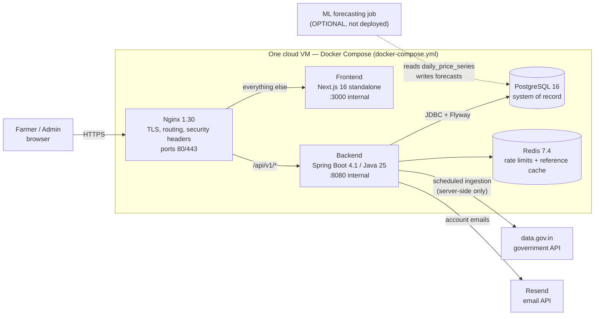
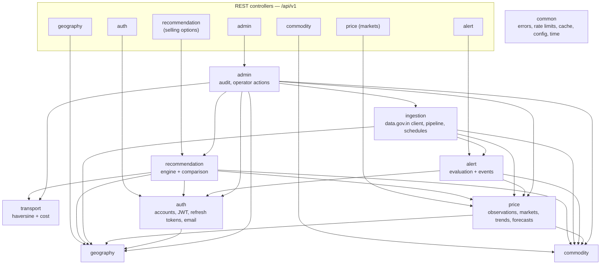
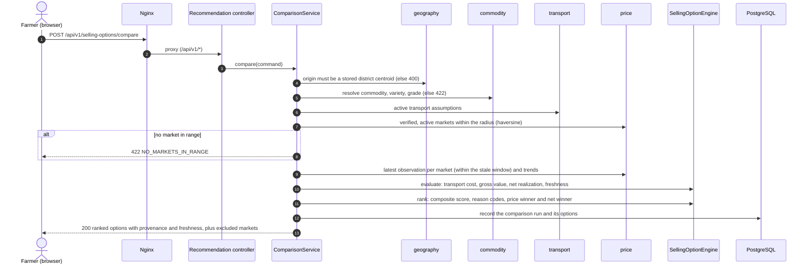
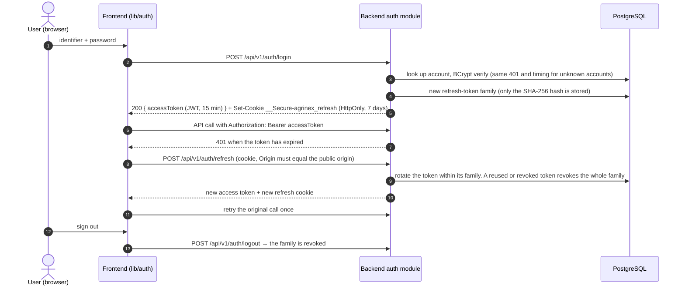
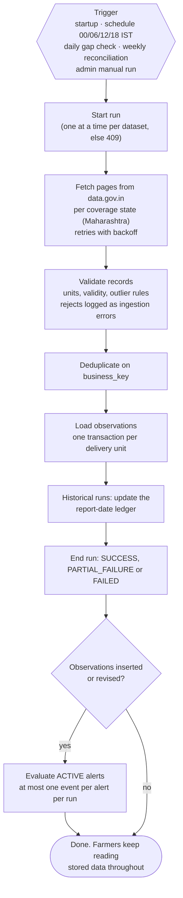

# AgriNex — Farmer Selling Intelligence & Market Linkage Platform

AgriNex (SIH26132) is a farmer-centric decision-support web platform. It turns government mandi price data from data.gov.in / Agmarknet into transport-aware, explainable answers to one question: **"Where should I consider selling?"**

A farmer picks a crop, a quantity and their district. AgriNex compares the verified markets within range and estimates transport cost and net realization for each one. It ranks them with a deterministic, explainable score and shows where every price came from and how fresh it is.

> **Status (Phase 1).** Phase 1 runs locally against real Maharashtra data and has passed its local readiness review "with explicit limitations" (`docs/decision-review/PHASE1_LOCAL_READINESS_REPORT.md`). The public deployment is **PLANNED**: the runbook is ready, and the owner actions it lists are pending (`docs/operations/DEPLOYMENT_GUIDE.md` §12). Phase 2 (buyer linkage) is **PLANNED** and has not started. ML forecasting is **OPTIONAL** and switched off.

This README explains how to run the code. The product requirements live in the master specification, [`docs/01_AGRINEX_MASTER_PRODUCT_PHASES.md`](docs/01_AGRINEX_MASTER_PRODUCT_PHASES.md). Contributors and AI agents follow [`CLAUDE.md`](CLAUDE.md), and start from [`docs/00_SSOT_INDEX.md`](docs/00_SSOT_INDEX.md).

---

## Contents

- [Features](#features)
- [Architecture](#architecture)
- [Tech stack](#tech-stack)
- [Repository layout](#repository-layout)
- [Prerequisites](#prerequisites)
- [Local setup](#local-setup)
- [Environment variables](#environment-variables)
- [Backend configuration and profiles](#backend-configuration-and-profiles)
- [Database](#database)
- [API documentation](#api-documentation)
- [Key flows](#key-flows)
- [Testing](#testing)
- [Build and run](#build-and-run)
- [Deployment](#deployment)
- [Further documentation](#further-documentation)

---

## Features

All prices are real government observations. AgriNex never fabricates, interpolates or synthesizes a price. Every computed amount is an **ESTIMATED** INR value.

**Farmer app** (Marathi, Hindi, English; mobile-first)

| Feature | What it does | Route |
|---|---|---|
| Compare selling options | Ranks the verified, active markets within a radius (default 150 km) of the farmer's district. For each it shows the modal price, the estimated transport cost and the estimated net realization | `/compare` |
| Why this ranking | Explains the ranking with its reason codes, and shows the best-price market next to the best-net market | `/compare/why` |
| What-If simulator | Recalculates the comparison with a different quantity, transport rate per km or search radius | `/compare/what-if` |
| Market detail and trend | Shows a market's latest prices with their freshness and attribution, and the price trend | `/markets/[marketId]`, `/markets/[marketId]/trend` |
| Price alerts | Alerts when a price goes above or below a value, or rises or falls by a percentage (`PRICE_ABOVE`, `PRICE_BELOW`, `PERCENTAGE_RISE`, `PERCENTAGE_FALL`), with in-app alert events. Requires an account | `/alerts`, `/alerts/new` |
| Accounts | Farmer registration, sign-in, email verification and password reset | `/sign-in`, `/account`, `/forgot-password`, `/reset-password`, `/verify-email` |

**Admin console** (English, ADMIN role only)

| Feature | Route |
|---|---|
| System status, data health and historical coverage | `/admin` |
| Ingestion runs and their errors; manual trigger; pause and resume per dataset | `/admin/runs` |
| Transport assumptions and recommendation weights, versioned | `/admin/config` |
| Market curation: verify, merge, deactivate, reactivate, set coordinates | `/admin/markets` |
| Commodities: price units and names | `/admin/commodities` |
| District aliases | `/admin/district-aliases` |
| Admin audit log | `/admin/audit` |

**Backend jobs** (inside the backend process, Asia/Kolkata time)

- Price ingestion from two data.gov.in resources, `CURRENT_PRICE` and `HISTORICAL_PRICE`. It runs at start when no run has succeeded in the last 6 hours, and again at 00:00, 06:00, 12:00 and 18:00.
- Historical maintenance: a daily gap check at 03:00 and a weekly re-fetch of recent report dates on Sundays at 04:00.
- Alert evaluation after every ingestion run that inserted or revised observations.
- Daily retention purges at 03:30.

---

## Architecture

AgriNex is a **modular monolith** (spec §12). One Spring Boot backend sits behind one Next.js frontend, with PostgreSQL as the system of record and Redis for rate limits and the reference-data cache. In production, one Nginx edge publishes ports 80 and 443 and is the only service reachable from outside.

### System architecture (production topology)



- Nginx answers 404 for `/actuator/**`. Health checks run only inside the Docker network.
- Government API calls happen only on the server, in the ingestion module (spec §31 RULE 1). The browser never calls data.gov.in.
- A Redis outage degrades the service but never stops it. Readiness depends on the database only.
- The backend never calls the ML job. Core flows never depend on it (spec §35).

### Backend modules

Each module owns its tables and repositories. Other modules reach it only through its public `*Api` / `*Port` types, and `ModuleBoundaryTest` enforces this (spec §27).



Each edge is a real compile-time dependency between module packages. `common` is used by every module and is left out to keep the diagram readable. `commodity`, `geography` and `transport` depend on no other module. The full component view is in [`docs/architecture/COMPONENT_ARCHITECTURE.md`](docs/architecture/COMPONENT_ARCHITECTURE.md).

---

## Tech stack

Versions are pinned to the approved technology baseline ([`docs/architecture/CURRENT_TECHNOLOGY_BASELINE.md`](docs/architecture/CURRENT_TECHNOLOGY_BASELINE.md), ADR-0002).

| Layer | Technology |
|---|---|
| Backend | Java 25, Spring Boot 4.1.1 (Web MVC, Security with OAuth2 resource server for JWT, Data JPA, Data Redis, Cache, Validation, Actuator, RestClient), Flyway, Maven Wrapper |
| Database | PostgreSQL 16.15 |
| Cache / rate limits | Redis 7.4.11 |
| Frontend | Next.js 16.3 (App Router, Turbopack), React 19.3, TypeScript 6, Tailwind CSS 4, Recharts, MSW 2 (mock mode) |
| Frontend tests | Vitest 5 + Testing Library + jsdom, Ajv contract validation, Playwright (browser journeys) |
| Backend tests | JUnit 5, Spring Boot test slices, MockMvc, Testcontainers (PostgreSQL + Redis) |
| ML (OPTIONAL) | Python 3.14, psycopg 3, jsonschema, pytest |
| Edge / ops | Nginx 1.30.5, certbot (on the host), Docker Compose |
| API contract | OpenAPI 3.1 (`contracts/openapi.yaml`) and JSON Schema |

---

## Repository layout

| Path | Contents |
|---|---|
| `backend/` | Spring Boot application (`com.agrinex.*` modules), Flyway migrations in `src/main/resources/db/migration`, tests, `Dockerfile` |
| `frontend/` | Next.js app: `app/` routes, `components/`, `lib/` (API client, auth, i18n, compare logic), `__mocks__/api/` contract mocks, `e2e/` Playwright tests, `Dockerfile` |
| `contracts/` | `openapi.yaml` (the REST contract) and the shared JSON Schemas |
| `ml/forecasting/` | OPTIONAL forecasting batch job, with its synthetic sandbox and tests |
| `infra/` | Development Compose files, Nginx templates, and deployment scripts (`infra/deploy/`) |
| `docker-compose.yml` | Production-shaped stack: Nginx, frontend, backend, PostgreSQL, Redis |
| `scripts/` | Database backup, health check, and evaluation / data-readiness SQL |
| `docs/` | Specification, decisions, architecture, API, database, QA, security and operations documents |

---

## Prerequisites

| Tool | Version | Used for |
|---|---|---|
| JDK | 25 | Backend build and run |
| Node.js / npm | 24 (`>=24.0.0 <25`) / 11 | Frontend |
| Docker Desktop / Engine with Compose v2 | current | PostgreSQL and Redis for development, Testcontainers in backend tests, and the full-stack images |
| Python | 3.14 (only for the OPTIONAL ML job) | `ml/forecasting` |
| A data.gov.in API key | — | Real price ingestion |
| A Resend API key and a verified sender | — | Account emails (optional locally: `AGRINEX_EMAIL_PROVIDER=none`) |

Maven is not needed: use the wrapper (`./mvnw`, or `.\mvnw` on Windows).

---

## Local setup

The full, tested walkthrough for Windows / PowerShell is [`docs/LOCAL_DEVELOPMENT_GUIDE.md`](docs/LOCAL_DEVELOPMENT_GUIDE.md). It also covers the demo script, ingestion, QA and troubleshooting. The steps below are a summary of it, in POSIX shell syntax.

**1. Create the environment file once.** Never copy the template over an existing `infra/.env`.

```bash
[ -f infra/.env ] || cp infra/.env.example infra/.env
# Fill in every blank value: passwords, a JWT secret, your data.gov.in key, the admin account, email settings.
```

Generate a JWT secret (32 random bytes, base64) with, for example, `openssl rand -base64 32`.

**2. Start PostgreSQL and Redis** (development Compose project `agrinex-dev`, published on 127.0.0.1 only):

```bash
docker compose --env-file infra/.env -f infra/docker-compose.yml up -d
docker compose --env-file infra/.env -f infra/docker-compose.yml ps   # both must be (healthy)
```

**3. Start the backend** with the variables of `infra/.env` in the environment:

```bash
# Export every NAME=value line of infra/.env into this shell only (values are not evaluated by the shell).
while IFS= read -r line; do case "$line" in [A-Za-z_]*=*) export "${line%%=*}=${line#*=}";; esac; done < infra/.env
cd backend
./mvnw -DskipTests package
java -jar target/agrinex-backend-0.0.1-SNAPSHOT.jar
```

The backend listens on port 8080 (set `SERVER_PORT` to change it). Flyway applies the migrations automatically at start. The backend is ready when the log shows `Started AgrinexBackendApplication`. On Windows, use the `Get-Content` block of the local guide, §5, instead of this loop.

**4. Start the frontend** and point its development proxy at the backend:

```bash
cd frontend
npm ci
AGRINEX_DEV_API_ORIGIN=http://localhost:8080 npm run dev
```

Open http://localhost:3000. The admin console is at http://localhost:3000/admin. Sign in there with `AGRINEX_BOOTSTRAP_ADMIN_EMAIL` / `AGRINEX_BOOTSTRAP_ADMIN_PASSWORD`.

**Frontend without a backend (mock mode).** `NEXT_PUBLIC_USE_MOCK_API=true npm run dev` serves the synthetic, contract-validated responses in `frontend/__mocks__/api/` through MSW. Every screen then shows a "SYNTHETIC DATA · PROTOTYPE" banner. See [`frontend/README.md`](frontend/README.md).

### Health checks

| What | Address |
|---|---|
| Backend readiness (database included) | `http://localhost:8080/actuator/health/readiness` |
| Backend liveness | `http://localhost:8080/actuator/health/liveness` |
| Backend overall health (includes Redis) | `http://localhost:8080/actuator/health` |
| Frontend health | `http://localhost:3000/api/health` → `{"status":"ok"}` |

---

## Environment variables

Secrets come only from the process environment. They never belong in the repository, in frontend code, or in `NEXT_PUBLIC_*` variables. `.env`, `infra/.env` and every other `*.env` file is git-ignored. The templates are [`infra/.env.example`](infra/.env.example) for development and [`infra/deploy/production.env.example`](infra/deploy/production.env.example) for the server.

### Backend and infrastructure (`infra/.env`)

| Variable | Required | Purpose |
|---|---|---|
| `SPRING_PROFILES_ACTIVE` | Yes | `local` for development (`dev` is its former name and still works). Production pins `prod` in `docker-compose.yml` |
| `POSTGRES_DB`, `POSTGRES_USER`, `POSTGRES_PASSWORD` | Yes | Database name, user and password (`agrinex` / `agrinex` / secret) |
| `POSTGRES_HOST`, `POSTGRES_PORT` | Local: defaults `localhost`, `5432` | Database address. Also the host port that `infra/docker-compose.yml` publishes |
| `REDIS_HOST`, `REDIS_PORT`, `REDIS_PASSWORD` | Local: defaults `localhost`, `6379`; password required | Redis address and password |
| `REDIS_MAXMEMORY` | No (`128mb`) | Redis memory limit, with LRU eviction |
| `JWT_SECRET` | Yes | Base64 HMAC key for access tokens. At least 256 bits |
| `AGRINEX_PUBLIC_ORIGIN` | Local: default `http://localhost:3000` | The one public origin. Used for CORS, the Origin check, and the base of emailed links |
| `AGRINEX_DOMAIN` | Production only | Public host name. Production derives the origin as `https://` + this host |
| `AGRINEX_BOOTSTRAP_ADMIN_EMAIL`, `AGRINEX_BOOTSTRAP_ADMIN_PASSWORD` | Optional | Creates the first ADMIN account (password of 15–64 characters) |
| `DATA_GOV_API_KEY` | For ingestion (required in production) | data.gov.in API key |
| `AGRINEX_EMAIL_PROVIDER` | No (`none`) | `resend` sends real emails, `none` sends none. Production requires `resend` |
| `RESEND_API_KEY`, `AGRINEX_EMAIL_FROM` | When the provider is `resend` | Resend key and sender (`Name <address>`) |
| `ML_DB_USER`, `ML_DB_PASSWORD` | No | OPTIONAL ML role. It stays without login until the ML track is authorized |
| `SERVER_PORT` | No (`8080`) | Backend HTTP port |

Any other backend setting can be overridden through Spring Boot's relaxed binding, for example `AGRINEX_RATELIMITS_REFRESHPERMINUTE=1000` for E2E runs.

### Frontend

| Variable | Where | Purpose |
|---|---|---|
| `AGRINEX_DEV_API_ORIGIN` | `next dev` only | Forwards `/api/v1/*` to a local backend, for example `http://localhost:8080` |
| `NEXT_PUBLIC_USE_MOCK_API` | Build time, public | `true` turns on mock mode. The production image refuses to build with it set to `true` |
| `E2E_ADMIN_IDENTIFIER`, `E2E_ADMIN_PASSWORD` | Playwright runs only | Admin credentials for the admin browser journeys |

---

## Backend configuration and profiles

The backend has a **single configuration file**, [`backend/src/main/resources/application.yml`](backend/src/main/resources/application.yml). It is a multi-document YAML file:

| Document | Activated by | Contents |
|---|---|---|
| Shared (first) | Always | Datasource pool, JPA, Flyway, Redis cache, Actuator, logging, security TTLs, rate limits, email, ingestion schedules and retention |
| `local` | `spring.config.activate.on-profile: local` (also through `dev`, a profile group alias) | Localhost defaults for the database and Redis. The public origin defaults to `http://localhost:3000`, and CORS also allows that dev-server origin |
| `prod` | `spring.config.activate.on-profile: prod` | No defaults: every value must come from the environment. CORS allows only the public origin |

The `test` profile is used only by the automated tests, which supply their own properties and containers.

`StartupProfileValidator` runs before the application context is created. It refuses to start unless exactly one of `local`/`dev`, `prod` or `test` is active. Under `prod` it also checks the following, and names the missing variables but never their values:

- an HTTPS public origin equal to `https://` + `AGRINEX_DOMAIN`;
- non-local database and Redis hosts, with their passwords;
- a JWT secret of at least 256 bits;
- the data.gov.in key, sent over HTTPS;
- Resend, with a sender address;
- no extra CORS origins.

---

## Database

PostgreSQL 16. The schema changes **only** through Flyway migrations in `backend/src/main/resources/db/migration`, which the backend applies at start. Hibernate only validates the schema (`ddl-auto: validate`). Never edit a migration that may already have been applied: add a new one instead.

| Migration | Contents |
|---|---|
| `V1` | Geography and commodity reference tables |
| `V2` | Source datasets and markets |
| `V3` | Ingestion audit (runs, errors) |
| `V4` | Price observations, with the database-level unique `business_key` (spec §31 RULE 6) |
| `V5` | Accounts: users, farmer profiles, refresh tokens, and admin audit events |
| `V6` | Transport assumptions, recommendation weights, selling searches, recommendation runs, selling options, price alerts and alert events |
| `V7` | Source datasets and initial configuration |
| `V8` | Commodities with official unit evidence |
| `V9` | OPTIONAL ML boundary: the `daily_price_series` view, the `forecasts` table, and the role `agrinex_ml` (no login) |
| `V10` | Maharashtra geography (LGD districts, Survey of India centroids) |
| `V11` | Commodity master and report units |
| `V12` | Commodity source aliases |
| `V13` | Ingestion report-date ledger |

Each backend module owns its tables. See [`docs/database/TABLE_OWNERSHIP.md`](docs/database/TABLE_OWNERSHIP.md), the [ERD](docs/database/ERD.md), the [data dictionary](docs/database/DATA_DICTIONARY.md), and the seed sources in [`docs/database/SEED_AND_REFERENCE_DATA.md`](docs/database/SEED_AND_REFERENCE_DATA.md).

Connection settings come from `POSTGRES_HOST`, `POSTGRES_PORT`, `POSTGRES_DB`, `POSTGRES_USER` and `POSTGRES_PASSWORD`. The pool is HikariCP with 10 connections and a 3-second connection timeout, so a database outage fails fast with 503.

---

## API documentation

The REST contract is the hand-authored **[`contracts/openapi.yaml`](contracts/openapi.yaml)** (OpenAPI 3.1, `info.version` 1.1.0). The code conforms to it. `ContractCoverageIntegrationTest` (backend) and `lib/api/contract.test.ts` (frontend mocks) check that it stays in sync. The explanations are in [`docs/api/`](docs/api/), starting at [`docs/api/API_INDEX.md`](docs/api/API_INDEX.md). To browse it, open the YAML in any OpenAPI viewer, for example the Swagger Editor. The backend does not serve a Swagger UI.

**Conventions.**
- Every path starts with `/api/v1`.
- Bodies are JSON. Errors are RFC 9457 `application/problem+json` (`ApiErrorResponse`) and never carry stack traces.
- IDs are UUIDs. Dates are `yyyy-MM-dd` in the Asia/Kolkata calendar.
- Prices keep their verified unit (for example `Rs./Quintal`) and are never converted.

| Group | Operations | Access |
|---|---|---|
| Auth | `POST /auth/register`, `/auth/login`, `/auth/refresh`, `/auth/logout`, `/auth/password-reset/request`, `/auth/password-reset/confirm`, `/auth/email-verification/confirm`, `/auth/email-verification/resend` | Public. `refresh` and `logout` use the refresh cookie. `resend` needs a token |
| Geography | `GET /geography/states`, `/geography/states/{stateId}/districts`, `/geography/districts/{districtId}/localities` | Public |
| Commodities | `GET /commodities`, `/commodities/{commodityId}/varieties`, `/commodities/{commodityId}/grades` | Public |
| Markets | `GET /markets/{marketId}`, `/markets/{marketId}/trends`, `/markets/{marketId}/forecast` (`available: false` while ML is off) | Public |
| Selling options | `POST /selling-options/compare`, `/selling-options/simulate` | Public. An optional token links the search to the farmer's profile |
| Alerts | `GET/POST /alerts`, `PATCH/DELETE /alerts/{alertId}`, `GET /alerts/events`, `POST /alerts/events/{eventId}/read` | Bearer token |
| Admin | `/admin/system/status`, `/admin/ingestion/**`, `/admin/config/**`, `/admin/markets/**`, `/admin/commodities/**`, `/admin/district-aliases`, `/admin/audit-events` | Bearer token with the ADMIN role |

The security schemes are `bearerAuth`, an HS256 JWT access token valid for 15 minutes, and `refreshCookie`, the HttpOnly `__Secure-agrinex_refresh` cookie valid for 7 days and rotated on every refresh. The frontend's TypeScript types are generated from the contract with `npm run generate:api-types`.

---

## Key flows

### Request flow: comparing selling options

`POST /api/v1/selling-options/compare` reads only stored data. The government API is never called during a request.



The engine is pure and deterministic: no clock, randomness, data access or ML. Its formulas, with `round2` meaning half-up rounding to 2 decimal places, are:

- transport = `round2(max(minimumTripCharge, distanceKm × ratePerKm) × trips)`;
- gross = `round2(modalPrice × quantity in quintals)`;
- net = gross − transport;
- score = `wNet·normNet + wPrice·normPrice + wTrend·trendScore + wFreshness·freshnessScore − wTransport·normTransport`. Each normalized value is a min-max over the eligible markets. The weights are versioned and editable by an admin.

See [`docs/architecture/RECOMMENDATION_ENGINE.md`](docs/architecture/RECOMMENDATION_ENGINE.md). `/selling-options/simulate` (What-If) runs the same calculation with overridden inputs.

### Authentication

Login returns a short-lived access token in the response body and sets a rotating refresh token as an HttpOnly cookie. The frontend keeps the access token **in memory only**.



- The security chain is stateless: no session, CSRF tokens, form login or basic auth.
- Role checks use `@PreAuthorize`. `/api/v1/admin/**` is also restricted to ADMIN in the filter chain, before the request body is read.
- CORS allows only the public origin, plus `http://localhost:3000` under the `local` profile.
- Login, registration, refresh, password-reset and verification requests are rate-limited through Redis.

See [`docs/architecture/SECURITY_ARCHITECTURE.md`](docs/architecture/SECURITY_ARCHITECTURE.md).

### Price ingestion and alerts



See [`docs/architecture/INGESTION_ARCHITECTURE.md`](docs/architecture/INGESTION_ARCHITECTURE.md) and [`docs/architecture/DATA_FLOW.md`](docs/architecture/DATA_FLOW.md).

### OPTIONAL: ML forecasting boundary

`ml/forecasting` is a batch job, not a service, and it is not deployed. When the ML track is authorized (spec §35, ADR-0030), it reads the `daily_price_series` view and writes the `forecasts` table as the role `agrinex_ml`. It validates every output against `contracts/forecast-output.schema.json`. Until then, `GET /markets/{id}/forecast` answers `available: false`, and nothing else is affected. See [`ml/forecasting/README.md`](ml/forecasting/README.md).

---

## Testing

| Suite | Command | Needs | Result on 2026-10-28 |
|---|---|---|---|
| Backend: unit, integration (MockMvc + Testcontainers), migrations, contract coverage, module boundaries, profile configuration | `cd backend && ./mvnw verify` | JDK 25. **Docker running** (Testcontainers starts PostgreSQL and Redis and never touches your database) | 160 passed, 0 failed |
| Frontend: unit, component, hook, and contract tests for every mock | `cd frontend && npm test` | Node 24 | 199 passed |
| Frontend: types and lint | `npm run typecheck`, `npm run lint` | Node 24 | pass |
| Frontend: production build | `npm run build` | Node 24 | pass |
| ML unit tests (synthetic series) | `cd ml/forecasting && python -m pytest` | Python 3.14 venv with `.[test]` | 15 passed |
| Browser journeys (E2E, real stack, nothing mocked) | `cd frontend && npm run e2e` | Backend and frontend running, with `AGRINEX_RATELIMITS_REFRESHPERMINUTE=1000` and `E2E_ADMIN_*` set | Not run on 2026-10-28. Last recorded: 10 passed on 2026-10-18 |

The core calculations (transport, net realization, scoring) have deterministic unit tests with hand-computed fixtures: `TransportCalculatorTest` and `SellingOptionEngineTest`. Read-only evaluation and data-readiness queries are in `scripts/run_evaluation.sql` and `scripts/data_readiness.sql`. The QA strategy is in [`docs/architecture/TESTING_ARCHITECTURE.md`](docs/architecture/TESTING_ARCHITECTURE.md).

---

## Build and run

| Task | Command |
|---|---|
| Backend jar | `cd backend && ./mvnw -DskipTests package` → `target/agrinex-backend-0.0.1-SNAPSHOT.jar` |
| Backend (run) | `java -jar backend/target/agrinex-backend-0.0.1-SNAPSHOT.jar` (environment from `infra/.env`), or `./mvnw spring-boot:run` |
| Frontend (production) | `cd frontend && npm ci && npm run build && npm start` |
| Regenerate API types | `cd frontend && npm run generate:api-types` (after any contract change) |
| Regenerate mock catalog | `cd frontend && npm run generate:mocks` |
| ML sandbox (synthetic data, Windows) | `powershell -ExecutionPolicy Bypass -File ml\forecasting\sandbox\run_sandbox.ps1` |

**Whole stack in Docker, over plain HTTP.** This uses the same images as production, in their own Compose project and with an empty database:

```bash
AGRINEX_DOMAIN=localhost docker compose --env-file infra/.env \
  -f docker-compose.yml -f infra/docker-compose.dev.yml up -d --build
```

Then open http://localhost:8088. The backend is also on 8090 and the frontend on 3010, both on 127.0.0.1 only. To stop the stack, run the same command with `stop`. Never use `down -v`, which deletes the database volume.

---

## Deployment

The decided target is one cloud VM running the root `docker-compose.yml`: Nginx with TLS from certbot on the host, the frontend, the backend under the `prod` profile, PostgreSQL with a named volume, and Redis (ADR-0021, ADR-0055). The deployment is **PLANNED**. The full runbook is [`docs/operations/DEPLOYMENT_GUIDE.md`](docs/operations/DEPLOYMENT_GUIDE.md). In outline:

1. Prepare the host once: `bash infra/deploy/setup_host.sh` installs Docker Engine with Compose and certbot, opens ports 80 and 443 in the host firewall, and creates the mounted directories.
2. Build the source bundle on the development machine: `python infra/deploy/build_source_bundle.py <output folder>`. The bundle is an allow-list of files and refuses to include any secret. Copy it to the VM, extract it into `/opt/agrinex`, and verify `MANIFEST.sha256`.
3. Create the server environment file: `bash infra/deploy/create_server_env.sh /tmp/prod.env`. It writes `/opt/agrinex/.env` (mode 600) from `infra/deploy/production.env.example`. It generates the database, Redis and JWT secrets on the server, and takes the owner's keys from the uploaded file.
4. Get the certificate with certbot, using the HTTP-01 webroot `/var/www/certbot`. Install `infra/deploy/certbot-deploy-hook.sh` so that Nginx reloads after each renewal.
5. Optionally restore the curated database copy (guide §4.5).
6. Start the stack: `docker compose up -d --build` from `/opt/agrinex`.
7. Verify with `scripts/health_check.sh https://<domain>`. Schedule `scripts/backup_db.sh` by cron (daily, 7-day retention), and copy backups off the VM.

The backend refuses to start under `prod` if any required setting is missing or unsafe. See [Backend configuration and profiles](#backend-configuration-and-profiles).

---

## Further documentation

| Topic | Document |
|---|---|
| Governance and working rules | [`CLAUDE.md`](CLAUDE.md), [`docs/README.md`](docs/README.md) |
| Single source of truth index | [`docs/00_SSOT_INDEX.md`](docs/00_SSOT_INDEX.md) |
| Master specification | [`docs/01_AGRINEX_MASTER_PRODUCT_PHASES.md`](docs/01_AGRINEX_MASTER_PRODUCT_PHASES.md) |
| UI/UX specification | [`docs/02_AgriNex_UIUX_Phase1_Specification.md`](docs/02_AgriNex_UIUX_Phase1_Specification.md) |
| Decisions (ADRs) and open items | [`docs/architecture/DECISION_LOG.md`](docs/architecture/DECISION_LOG.md), [`docs/REQUIRES_DECISION.md`](docs/REQUIRES_DECISION.md) |
| Architecture | [`docs/architecture/ARCHITECTURE_INDEX.md`](docs/architecture/ARCHITECTURE_INDEX.md) |
| Database | [`docs/database/DATABASE_INDEX.md`](docs/database/DATABASE_INDEX.md) |
| API | [`docs/api/API_INDEX.md`](docs/api/API_INDEX.md) |
| Government data reference | [`docs/data/AGRINEX_VERIFIED_GOVERNMENT_API_DATA_REFERENCE.md`](docs/data/AGRINEX_VERIFIED_GOVERNMENT_API_DATA_REFERENCE.md) |
| Local development and demo | [`docs/LOCAL_DEVELOPMENT_GUIDE.md`](docs/LOCAL_DEVELOPMENT_GUIDE.md) |
| Deployment and operations | [`docs/operations/DEPLOYMENT_GUIDE.md`](docs/operations/DEPLOYMENT_GUIDE.md) |

Price data: Agmarknet / Directorate of Marketing & Inspection, served through data.gov.in. AgriNex shows the source attribution with every price.
