# AgriNex — Master Product & Phase Specification
## Single Source of Truth — All Team Members Read This First

**Project Name:** AgriNex
**Full Name:** AgriNex — Farmer Selling Intelligence & Market Linkage Platform
**Tagline:** Compare smarter. Sell better.
**SIH Problem:** SIH26132 — Strengthening Market Linkages and Price Discovery for Farmers
**Issuing Body:** Government of Maharashtra / Maharashtra State Innovation Society (MSInS)
**Theme:** Agriculture, FoodTech & Rural Development
**Category:** Software
**Team Size:** 6 members
**Stack:** Java 17 · Spring Boot 3.3.x · Next.js 14 · TypeScript · PostgreSQL 16 · Redis 7 · Python 3.11 (ML, optional) · Docker
**Document Version:** 2.0 — September 2026
**Document Owner:** Team Lead / Product Manager
**Naming Note:** Previously prototyped as "MandiWise" and "KrishiSetu." Both are retired. Only correct name is **AgriNex**.

> **SSOT Rule:** If this document conflicts with any role-specific file (02–04), this document wins. Correct the role file, not this one.

---

## Table of Contents

1. Project Identity
2. Problem Statement & Farmer Pain Points
3. SIH26132 Alignment
4. Existing Ecosystem & Honest Differentiation
5. Product Thesis & Principles
6. Target Users & Personas
7. Phase 1 — "Where Should I Consider Selling?"
8. Phase 2 — "Can AgriNex Help Me Act on That Decision?"
9. Phase 1 vs Phase 2 Comparison Table
10. Phase Gate Strategy & Freeze Checklist
11. System Context Diagram (C4 Level 1)
12. Container Architecture Diagram (C4 Level 2)
13. Component / Module Diagram (C4 Level 3)
14. End-to-End Data Flow Diagram
15. Ingestion Pipeline Flow
16. Recommendation Engine Flow
17. What-If Simulator Flow
18. Phase 2 Transaction State Machine
19. Phase 2 Buyer Verification State Machine
20. ER Diagram — Domain Overview
21. Sequence Diagram — Hero Flow (Farmer Comparison)
22. Sequence Diagram — Ingestion Pipeline
23. Sequence Diagram — Phase 2 Listing to Transaction
24. Use-Case Diagram
25. Activity Diagram — Farmer Decision Journey
26. Functional Requirements
27. Non-Functional Requirements
28. Security Overview
29. Resilience & Failure Handling
30. API Module Interaction Overview
31. Data Source Policy & Rules
32. Transport Cost & Net Realization Model
33. Historical Trends Engine
34. Alert Engine
35. ML Strategy (Optional)
36. Evaluation & Research Methodology
37. Risks & Limitations
38. Scalability & Future Scope
39. Out of Scope (Enforced)
40. Team Roles & RACI Matrix
41. Integration Contract Matrix
42. Development Order (Enforced)
43. Repository Structure & Shared Contracts
44. Mock & Parallel Development Strategy
45. Deployment Overview
46. Demo Narrative (Step-by-Step)
47. Viva Questions & Defensible Answers
48. Acceptance Criteria & Definition of Done
49. Claims Discipline & Disclaimers

---

## 1. Project Identity

| Field | Value |
|-------|-------|
| Project Name | **AgriNex** |
| Full Name | AgriNex — Farmer Selling Intelligence & Market Linkage Platform |
| Tagline | Compare smarter. Sell better. |
| SIH Problem | SIH26132 — Strengthening Market Linkages and Price Discovery for Farmers |
| Core Deliverable | A deployable, farmer-centric decision-support web platform converting government mandi data into transport-aware, explainable market recommendations, extensible to buyer-linkage in Phase 2 |
| Capstone Phase | **Phase 1** — must stand alone as a complete, deployed, academically defensible product |
| Team Size | 6 (UI/UX · Frontend · Backend · Data Engineering · DevOps/Security · QA; ML is optional shared track) |

**Verified Government Data Sources (from actual API calls):**

| Dataset | Resource ID | Use |
|---------|-------------|-----|
| Current Daily Mandi Prices | `9ef84268-d588-465a-a308-a864a43d0070` | Latest prices, comparison, alerts, daily sync |
| Historical Variety-wise Prices | `35985678-0d79-46b4-9ed6-6f13308a1d24` | Trends, ML training data, historical bootstrap |

Both datasets: Ministry of Agriculture & Farmers Welfare, Directorate of Marketing and Inspection (DMI), published on data.gov.in under NDSAP.

**Verified API Behavior (from real test calls):**
- Multiple Maharashtra onion market records confirmed returned from both APIs
- Historical data returned records dated 01/08/2026 through 13/09/2026
- Single historical query returned 100+ records → **pagination is mandatory on every ingestion call**
- Price fields need unit verification before any monetary calculation

---

## 2. Problem Statement & Farmer Pain Points

### What Already Exists

Mandi prices are publicly available. Agmarknet 2.0 links 4,367 mandis (PIB, November 2025). e-NAM connects 1,522 mandis and supports online bidding. Both provide price information. The problem AgriNex solves is **not** that farmers lack price data.

### The Actual Problem

> A farmer who sees prices at three different mandis still faces a silent, unanswered question: "After I load my truck, pay the driver, spend 2-3 hours on the road, and arrive at that mandi — is the higher sticker price actually worth it?"

No freely accessible, self-service tool answers this question as of September 2026.

### Specific Farmer Pain Points

| # | Pain Point | Consequence |
|---|-----------|-------------|
| P1 | **Price without cost context** — Dashboards show ₹/quintal but not what it costs to physically reach that market | Farmer may travel to a market with higher price but end up with less money after transport |
| P2 | **No net comparison** — Manual estimation of distance, fuel, truck hire under time pressure is error-prone | Wrong market choice on day of harvest when produce is perishable |
| P3 | **No trend awareness** — Single day's price doesn't reveal whether that market is rising, falling, or volatile | Farmer may sell into a market whose price peaked 3 days ago |
| P4 | **No explanation** — Existing dashboards show numbers, not reasons. Farmer cannot answer "why this market?" | No learning, no defensible justification to farming community |
| P5 | **No path to action** — Even a perfect recommendation is informational only unless the farmer can connect to a buyer | Decision remains isolated from execution |
| P6 | **Data trust gap** — Farmers distrust apps with unsourced, suspiciously smooth "real-time" numbers | Government-attributed, dated, freshness-labelled data builds trust scraped numbers cannot |

### The Core Question AgriNex Answers

> "Given my crop, quantity, and location, which nearby market appears to give me the best **net** economic outcome — not just the best sticker price — and **why**?"

---

## 3. SIH26132 Alignment

SIH26132 asks to "Strengthen Market Linkages and Price Discovery for Farmers." AgriNex maps directly:

| SIH26132 Requirement | AgriNex Response | Phase |
|----------------------|-----------------|-------|
| Price discovery | Ingestion + normalization of government mandi prices; multi-market comparison | Phase 1 |
| Transport-aware decision | Distance + transport estimation; net realization calculation | Phase 1 |
| Historical context | 30-day trend charts from historical dataset | Phase 1 |
| Farmer-centric outcome | Decision engine ranked by estimated net realization, not just price | Phase 1 |
| Authoritative data | 100% price data from data.gov.in / DMI; source attributed in UI | Phase 1 |
| Market linkage | Listing → Bid → Transaction flow connecting farmer to verified buyer | Phase 2 |

AgriNex must be positioned as: **a decision-support layer on top of the existing price-discovery ecosystem, not a replacement for it**, that then extends into linkage in Phase 2.

---

## 4. Existing Ecosystem & Honest Differentiation

**CRITICAL:** AgriNex must NOT claim to be the first or only platform handling mandi prices or agricultural commerce. These are verified facts, not our opinions.

### 4.1 Agmarknet / Agmarknet 2.0

| Attribute | Verified Fact |
|-----------|---------------|
| Owner | Ministry of Agriculture & Farmers Welfare, GoI |
| Mandis linked | 4,367 (PIB press release, November 2025) |
| What it provides | Daily arrival and price data per market/commodity |
| What it does NOT provide | Transport cost, net realization, market ranking, trend interpretation, buyer linkage |
| AgriNex overlap | Uses same underlying DMI data family via data.gov.in |
| AgriNex differentiation | Adds farmer context, transport model, net realization, ranking, explanation |
| AgriNex must NOT claim | "Nobody shows mandi prices" — false |

### 4.2 e-NAM (National Agriculture Market)

| Attribute | Verified Fact |
|-----------|---------------|
| Owner | Ministry of Agriculture, managed by SFAC |
| Mandis integrated | 1,522 (as of June 2025) |
| Registered farmers | 1.79 crore (mid-2025) |
| What it provides | Online auction/bidding, price discovery within integrated mandis, online payment |
| Key limitation | Requires mandi-side infrastructure; farmer must bring produce to integrated mandi |
| AgriNex overlap | Both support price discovery and buyer linkage |
| AgriNex differentiation | AgriNex helps farmer decide BEFORE travel; does not require mandi infrastructure; Phase 2 connects directly to buyers regardless of mandi integration status |
| IMPORTANT | AgriNex does NOT replace e-NAM. They serve sequential workflow stages. |

### 4.3 DeHaat

| Attribute | Verified Fact |
|-----------|---------------|
| Scope | Full-stack: inputs, advisory, credit, market linkage |
| Farmers served | 1.8 million across 12 states (December 2025) |
| AgriNex differentiation | DeHaat requires enrolled centre; AgriNex is self-service web; AgriNex is NOT a full-stack input/advisory platform |

### 4.4 Ninjacart

| Attribute | Verified Fact |
|-----------|---------------|
| What it provides | B2B fresh produce supply chain; farm-to-retail; logistics |
| Who it serves | Institutional buyers (retailers, restaurants) — not individual smallholder farmers directly |
| AgriNex differentiation | AgriNex serves individual farmers choosing between mandis; Ninjacart is a B2B logistics player |

### 4.5 The Honest Differentiation

AgriNex's differentiation is NOT any single unprecedented feature. It is the **coherent decision-support workflow**:

> "AgriNex takes a farmer from 'What are today's mandi prices?' to 'Which selling option appears economically better for my situation, why, and what can I do next?' — in one mobile-first interface, powered by live government data, without requiring mandi integration, institutional enrollment, or complex technical literacy."

**What AgriNex must NOT claim:**
- "Nobody shows mandi prices" — false
- "No platform supports agricultural trading" — e-NAM does
- "We're the first to connect farmers to buyers" — DeHaat does
- "Our transport cost is real" — it is an estimate
- "Our data is real-time" — government mandi data is latest-reported-price, not real-time

---

## 5. Product Thesis & Principles

### Product Thesis

```
Government mandi price data
    ↓ (Ingestion + cleaning + normalization)
Canonical market intelligence stored in PostgreSQL
    ↓ (Farmer provides: crop, quantity, location)
Candidate market discovery within radius
    ↓ (Haversine distance calculation)
Transport cost estimation (configurable formula)
    ↓ (price × quantity)
Estimated gross sale value
    ↓ (gross − transport)
Estimated net realization per market
    ↓ (weighted composite scoring)
Market ranking with net realization as primary driver
    ↓ (fixed vocabulary reason codes)
Explainable recommendation ("Why this market?")
    ↓ (farmer adjusts quantity/transport assumptions)
What-if scenario exploration
    ↓ (Phase 2 extension)
Produce listing → Verified buyer discovery → Bid → Transaction
```

### Product Principles

| # | Principle | Practical Implication |
|---|-----------|----------------------|
| P1 | **Net realization over sticker price** | Default framing is "what you actually end up with" |
| P2 | **Explainability over opacity** | No unexplained scores. Every ranking ships with fixed-vocabulary reason codes |
| P3 | **Honesty over impressiveness** | Every estimate labelled as estimate. No claim of guaranteed outcomes |
| P4 | **Small defensible core over feature sprawl** | Phase 1 is intentionally scoped to be completable and demonstrable |
| P5 | **Contract-first parallel work** | Every interface defined in writing before implementation |
| P6 | **Resilience by default** | Product works when government API is slow, rate-limited, or down |
| P7 | **Farmer-first UI** | Every screen designed for mobile, possibly non-English, non-tech-savvy user |
| P8 | **Phase 1 must stand alone** | If Phase 2 is never built, Phase 1 is still a complete capstone |
| P9 | **ML is optional** | Decision engine works completely without ML. ML is an enhancement only |
| P10 | **Government data, not fabricated data** | Never invent or synthesize price data |

---

## 6. Target Users & Personas

### Persona 1 — Ramesh, Smallholder Vegetable Farmer (Primary)

| Attribute | Detail |
|-----------|--------|
| Age | 38 |
| Location | Dindori, Nashik district, Maharashtra |
| Land | 2.5 acres — onion (primary), tomato (secondary) |
| Quantity per cycle | 200–800 kg |
| Device | Android mid-range, 5.5" screen |
| Connectivity | 4G (drops to 3G occasionally) |
| Language | Marathi (preferred), Hindi (acceptable), English (numbers only) |
| Digital literacy | WhatsApp, basic apps — comfortable tapping, NOT comfortable reading dense text |
| Primary pain | Knows nearby mandis have different prices but cannot determine which is economically better |
| What he needs | Simple input → clear comparison → obvious winner with reason → option to act |

### Persona 2 — Sunita Devi, Secondary Farmer

| Attribute | Detail |
|-----------|--------|
| Age | 45 |
| Location | Wardha district, Maharashtra |
| Crop | Cotton, soybean |
| Device | Older Android 4.7" — intermittent 3G |
| Language | Hindi |
| Digital literacy | Basic; sometimes uses voice input |
| Primary need | Price alert when commodity crosses threshold; basic comparison before harvest |

### Persona 3 — Platform Admin (Internal)

- Internal team member / operator
- Needs: ingestion health dashboard, sync status, error visibility, config management
- Device: Laptop (desktop-first admin UI acceptable)
- Language: English

### Persona 4 — Verified Buyer Suresh (Phase 2 Only)

| Attribute | Detail |
|-----------|--------|
| Age | 52 |
| Role | Wholesale trader / processor, Pune |
| Device | Desktop or tablet |
| Language | Hindi / English |
| Need | Browse produce listings, submit bids, track transactions, build farmer relationships |

### Persona 5 — Faculty Evaluator (Documentation Persona)

- Must see a coherent problem → data → engine → outcome → evaluation story within 8 minutes
- Must leave confident that the team built a real engineering product, not a demo shell

---

## 7. Phase 1 — "Where Should I Consider Selling?"

### Core Question
> **"WHERE should I consider selling?"**

### Why Phase 1 Must Stand Alone

If the team completes only Phase 1, the product must still be:
- Deployed to a cloud VM and publicly accessible
- Demonstrable in under 10 minutes
- Academically defensible as a complete capstone
- Aligned with SIH26132 on both Price Discovery and the beginning of Market Linkage (decision)
- Solving a real, specific, measurable problem

### Phase 1 Feature List (Final)

| # | Feature | Priority | Blocks Demo |
|---|---------|----------|-------------|
| F1.1 | Farmer quick-start (no mandatory registration for comparison) | Must | Yes |
| F1.2 | Language selection (Marathi / Hindi / English) | Must | Yes |
| F1.3 | Location selection (State → District → Locality, no exact address) | Must | Yes |
| F1.4 | Commodity + variety/grade selection | Must | Yes |
| F1.5 | Quantity input (kg / quintal) | Must | Yes |
| F1.6 | Market discovery within configurable radius (default 150 km) | Must | Yes |
| F1.7 | Latest reported mandi prices (current dataset) | Must | Yes |
| F1.8 | Multi-market comparison table | Must | Yes |
| F1.9 | Transport cost estimation (configurable formula) | Must | Yes |
| F1.10 | Estimated gross sale value | Must | Yes |
| F1.11 | Estimated net realization | Must | Yes |
| F1.12 | Market ranking with explainable reason codes | Must | Yes |
| F1.13 | Price-only winner vs net-realization winner distinction | Must | Yes |
| F1.14 | "Why recommended?" explanation card | Must | Yes |
| F1.15 | Historical price trend charts (7-day, 30-day) | Must | Yes |
| F1.16 | Data freshness indicators (FRESH / RECENT / STALE / UNAVAILABLE) | Must | Yes |
| F1.17 | Source attribution (DMI / data.gov.in, report date) | Must | Yes |
| F1.18 | What-if selling simulator | Should | Yes |
| F1.19 | Price alerts (threshold, percentage movement) | Should | No |
| F1.20 | Admin data-health dashboard | Must | Yes |
| F1.21 | Mobile-first responsive interface | Must | Yes |
| F1.22 | Accessibility baseline (WCAG 2.1 AA core flows) | Must | No |
| F1.23 | Error and stale-data handling | Must | Yes |
| F1.24 | Evaluation instrumentation (price-only vs net-realization experiment) | Must | No |
| F1.25 | Docker-based reproducible deployment | Must | Yes |

---

## 8. Phase 2 — "Can AgriNex Help Me Act on That Decision?"

### Core Question
> **"Can AgriNex HELP ME ACT on that decision?"**

### Phase 2 is a Logical Extension, Not a Separate Product

```
Phase 1: Farmer identifies Market A as economically preferred
    ↓
Phase 2: Farmer creates produce listing anchored to that market's reference price
    ↓
Verified buyer discovers listing
    ↓
Buyer submits bid
    ↓
Farmer compares bids against AgriNex recommendation
    ↓
Farmer accepts best bid
    ↓
Transaction tracked through completion
    ↓
Both parties rate experience
```

### Phase 2 Feature List (Final)

| # | Feature | Priority |
|---|---------|----------|
| F2.1 | Buyer registration with phone verification | Must |
| F2.2 | Buyer identity verification state machine (REGISTERED → VERIFIED) | Must |
| F2.3 | Farmer produce listing (linked to Phase 1 recommendation) | Must |
| F2.4 | Buyer listing discovery with search/filter | Must |
| F2.5 | Bid submission (verified buyers only — server-enforced) | Must |
| F2.6 | Farmer bid comparison view (bid vs mandi reference price) | Must |
| F2.7 | Bid acceptance with database-level concurrency protection | Must |
| F2.8 | Transaction state machine (12 states, server-enforced transitions) | Must |
| F2.9 | Transaction history for both parties | Must |
| F2.10 | Post-completion ratings (both directions) | Should |
| F2.11 | Full audit trail (every state transition) | Must |
| F2.12 | Admin buyer verification review | Must |

---

## 9. Phase 1 vs Phase 2 Comparison Table

| Capability | Phase 1 | Phase 2 |
|------------|---------|---------|
| Current government mandi price data | ✅ | ✅ |
| Historical price data & trends | ✅ | ✅ |
| Multi-market comparison | ✅ | ✅ |
| Transport cost estimation | ✅ | ✅ |
| Estimated net realization | ✅ | ✅ |
| Market ranking with explanation | ✅ | ✅ |
| Historical trend charts | ✅ | ✅ |
| What-if selling simulator | ✅ | ✅ |
| Price alerts | ✅ | ✅ |
| Admin data-health dashboard | ✅ | ✅ |
| Data freshness display | ✅ | ✅ |
| Source attribution & disclaimer | ✅ | ✅ |
| Buyer registration | ❌ | ✅ |
| Buyer verification | ❌ | ✅ |
| Farmer produce listing | ❌ | ✅ |
| Buyer listing discovery | ❌ | ✅ |
| Bidding system | ❌ | ✅ |
| Transaction state machine | ❌ | ✅ |
| Transaction history | ❌ | ✅ |
| Post-completion ratings | ❌ | ✅ |
| ML price forecasting | ⚙️ Optional | ⚙️ Optional/Integrated |
| Payment gateway | ❌ Never | ❌ Out of scope |
| Logistics marketplace | ❌ Never | ❌ Out of scope |
| Native mobile app | ❌ Never | ❌ Out of scope |

---

## 10. Phase Gate Strategy & Freeze Checklist

```
Phase 1 Development
    ↓
Phase 1 Internal Testing (QA runs complete test matrix)
    ↓
Phase 1 Staging Deployment (reproducible Docker)
    ↓
Phase 1 Evaluation Experiment (price-only vs net-realization)
    ↓
━━━━━━━━━━━ PHASE 1 FREEZE ━━━━━━━━━━━
    ↓
Phase 2 Development starts
    ↓
Phase 2 Testing
    ↓
Phase 2 Deployment
    ↓
Final Evaluation & Documentation
```

**HARD RULE 1:** Phase 2 development does NOT begin before Phase 1 is deployed, tested, and formally frozen.

**HARD RULE 2:** ML integration does NOT begin before the deterministic decision engine works end-to-end.

### Phase 1 Freeze Checklist

**DATA:**
- [ ] Current government API integrated and paginated correctly
- [ ] Historical government API integrated and bootstrapped with ≥60 days of data
- [ ] Data normalized (trim, canonical market names, commodity names, units verified)
- [ ] Duplicate prevention working (business key + DB unique constraint)
- [ ] Freshness metadata on every observation
- [ ] Ingestion audit records written on every sync run
- [ ] Ingestion scheduler running on 6-hour cadence

**BACKEND:**
- [ ] JWT auth working (register, login, refresh, logout)
- [ ] Geography and commodity endpoints returning correct data
- [ ] Market price endpoints returning freshest available data
- [ ] Comparison endpoint returning correctly ranked results
- [ ] Net realization calculation verified correct (unit tests pass with hand-computed fixtures)
- [ ] Recommendation reason codes correctly attached
- [ ] What-if simulator API responding correctly
- [ ] Price alerts evaluated on every ingestion completion
- [ ] Admin health API returning accurate metrics
- [ ] Error responses always use `ApiErrorResponse` format — no stack traces exposed
- [ ] OpenAPI spec generated and exported to `contracts/openapi.yaml`

**FRONTEND:**
- [ ] Farmer can select crop + quantity + location and submit
- [ ] Comparison results table renders with all required fields
- [ ] WinnerCalloutBanner shows when price-only winner ≠ net winner
- [ ] "Why recommended?" explanation card renders all reason codes
- [ ] Historical trend chart renders for 7-day and 30-day
- [ ] What-if simulator recalculates client-side without full API re-call
- [ ] Freshness badges visible on all price-related screens
- [ ] Source attribution on all price-related screens
- [ ] Admin dashboard shows accurate sync status
- [ ] Language switch works (Marathi / Hindi / English) on all screens
- [ ] Responsive at 375px viewport

**RESILIENCE:**
- [ ] Government API failure handled gracefully (verified by disabling API key in test)
- [ ] Stale data warning displayed correctly
- [ ] No-data empty state handled with meaningful message

**DEPLOYMENT:**
- [ ] `docker compose up -d` starts all services from `.env.example`
- [ ] Database migrations run automatically on startup
- [ ] Health check endpoints respond at `/actuator/health`
- [ ] Demo fixture data loads on first boot

**EVALUATION:**
- [ ] Price-only vs net-realization experiment executable from DB
- [ ] Results documented in evaluation report with correct metrics

---

## 11. System Context Diagram (C4 Level 1)

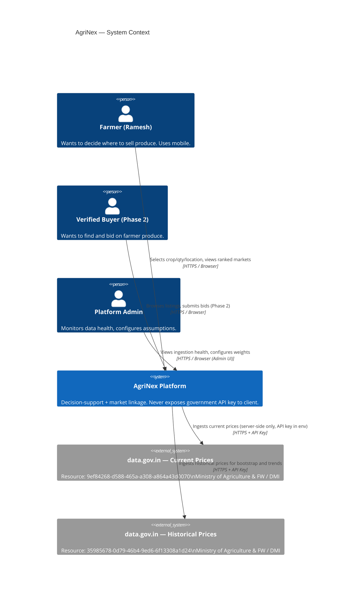

---

## 12. Container Architecture Diagram (C4 Level 2)

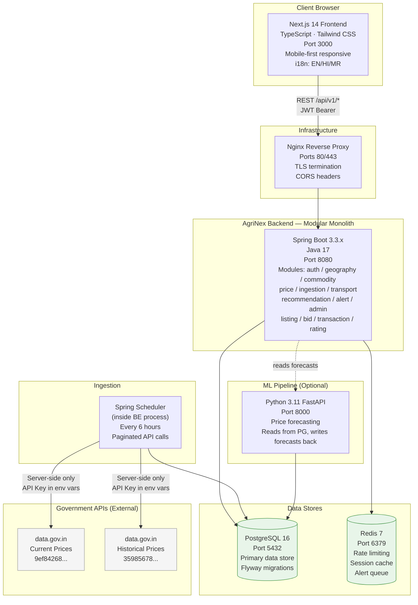

---

## 13. Component / Module Diagram (C4 Level 3)

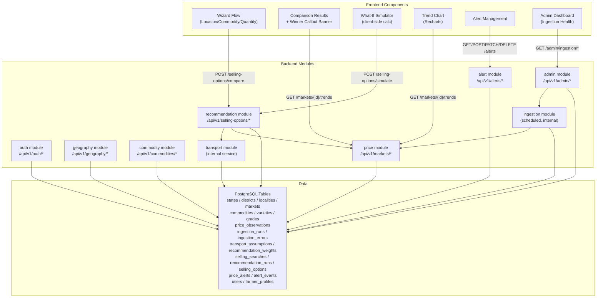

---

## 14. End-to-End Data Flow Diagram

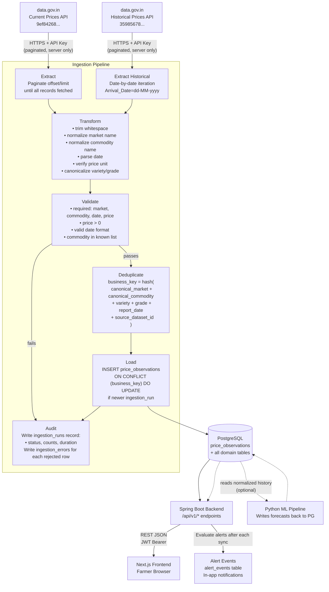

---

## 15. Ingestion Pipeline Flow

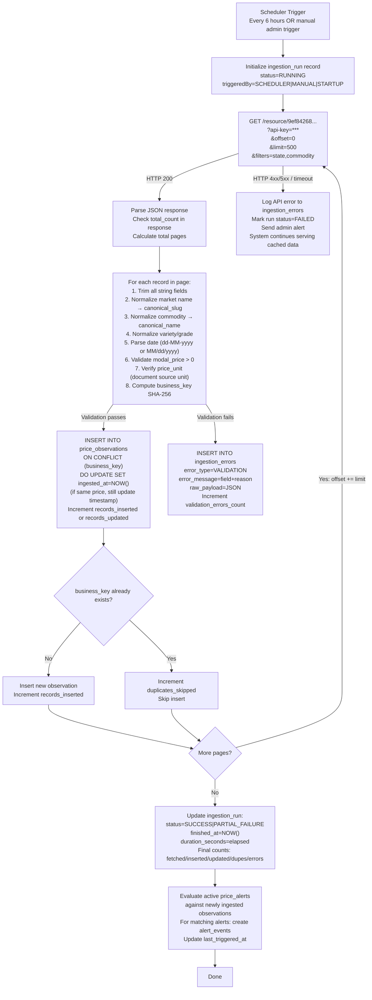

---

## 16. Recommendation Engine Flow

```mermaid
flowchart TD
    INPUT["Input:\ncommodityId, varietyId?, gradeId?\nquantity, quantityUnit\noriginLat, originLon\nmaxDistanceKm (default 150)"] --> LOAD_WEIGHTS["Load active recommendation_weights\nLoad active transport_assumptions"]

    LOAD_WEIGHTS --> FIND_MKTS["Find candidate markets:\nSELECT markets WHERE\nhaversionDistance(originLat, originLon, market.lat, market.lon) <= maxDistanceKm\nAND market.is_active = true"]

    FIND_MKTS -->|"0 markets found"| ERR422["Return 422 INSUFFICIENT_DATA\nNO_MARKETS_IN_RANGE"]
    FIND_MKTS -->|"N markets"| FOREACH["For each candidate market"]

    FOREACH --> FRESHDDATA["Find freshest price_observation:\nSELECT * FROM price_observations\nWHERE market_id = ? AND commodity_id = ?\nAND report_date >= NOW() - freshness_stale_days\nORDER BY report_date DESC LIMIT 1"]

    FRESHDDATA -->|"No observation"| EXCLUDED["Exclude market\nReason: NO_RECENT_PRICE_DATA"]
    FRESHDDATA -->|"Has observation"| NORMALIZE["Normalize quantity to quintal:\nIF unit=KG: qty_quintal = quantity / 100\nIF unit=QUINTAL: qty_quintal = quantity"]

    NORMALIZE --> DISTANCE["Calculate distance:\ndistanceKm = haversine(originLat, originLon,\n  market.lat, market.lon)\nis_approximate = market.lat derived from district centroid"]

    DISTANCE --> TRANSPORT["Estimate transport cost:\ntrips = ceil(quantityKg / vehicleCapacityKg)\nperTripCost = max(\n  minimumTripCharge,\n  distanceKm × ratePerKm\n)\ntransportCost = perTripCost × trips"]

    TRANSPORT --> GROSS["Estimate gross value:\ngrossValue = observation.modalPrice × qty_quintal"]

    GROSS --> NET["Estimate net realization:\nnetRealization = grossValue − transportCost"]

    NET --> TREND["Compute trend:\nFetch last 30 days of observations\nCompute 7-day % change vs 7-day average\nClassify: RISING (>3%), FALLING (<-3%), STABLE"]

    TREND --> FRESHNESS["Classify freshness:\nFRESH: report_date >= today - fresh_days (default 1)\nRECENT: report_date >= today - recent_days (default 4)\nSTALE: report_date >= today - stale_days (default 10)\nUNAVAILABLE: older than stale_days"]

    FRESHNESS --> SCORE["Compute composite score:\nnormalized_net = (net - min_net) / (max_net - min_net)\nnormalized_price = (price - min_price) / (max_price - min_price)\ntrendScore = RISING→1.0, STABLE→0.5, FALLING→0.0\nfreshnessScore = FRESH→1.0, RECENT→0.7, STALE→0.3, UNAVAILABLE→0.0\n\nscore = w_net × normalized_net\n      + w_price × normalized_price\n      + w_trend × trendScore\n      + w_freshness × freshnessScore\n      − w_transport_penalty × normalized_transport"]

    SCORE --> REASONS["Attach reason codes:\nPRICE_ADVANTAGE if price in top 25%\nLOWER_TRANSPORT if transport in bottom 25%\nPOSITIVE_TREND if trend=RISING\nSTABLE_TREND if trend=STABLE\nRECENT_DATA if freshness=FRESH\nSUITABLE_DISTANCE if distanceKm < 50\nNEGATIVE_TREND if trend=FALLING\nSTALE_DATA if freshness=STALE"]

    REASONS --> COLLECT["Collect all eligible candidates"]
    EXCLUDED --> COLLECT
    COLLECT --> RANK["Sort candidates by score DESC\nAssign rank 1..N\nIdentify price_only_winner (highest modal price)\nIdentify net_winner (rank 1 by composite score)\nSet rankingsDisagree = (priceWinner ≠ netWinner)"]

    RANK --> PERSIST["Persist:\nINSERT selling_search\nINSERT recommendation_run (with weights, transport refs)\nINSERT selling_options (one per candidate)"]

    PERSIST --> RESPOND["Return MarketComparisonResponse:\nrecommendationId, commodityName, quantity\npriceOnlyWinnerId, netRealizationWinnerId\nrankingsDisagree\noptions: SellingOptionResponse[]"]
```

---

## 17. What-If Simulator Flow

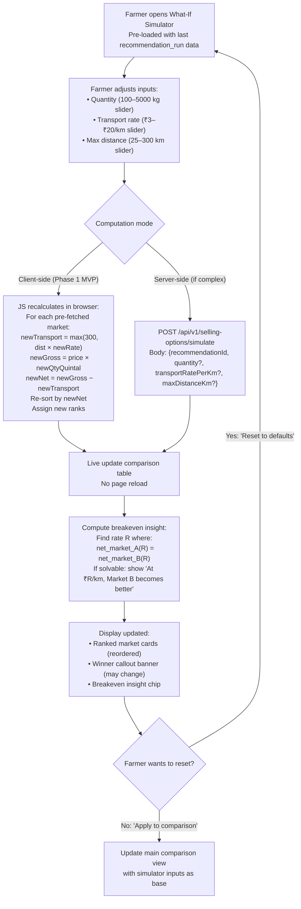

---

## 18. Phase 2 Transaction State Machine

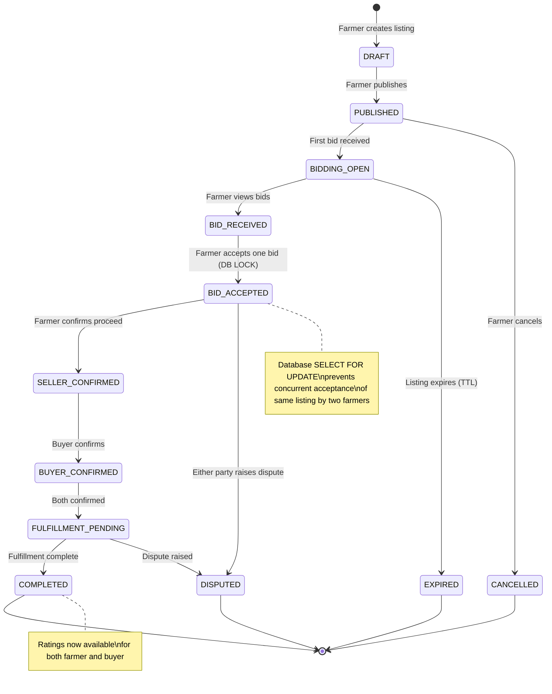

**State Transition Rules (enforced server-side in `TransactionService`):**

| From State | Allowed Next States | Actor |
|-----------|---------------------|-------|
| DRAFT | PUBLISHED, CANCELLED | Farmer |
| PUBLISHED | BIDDING_OPEN, CANCELLED, EXPIRED | System |
| BIDDING_OPEN | BID_RECEIVED, EXPIRED | System |
| BID_RECEIVED | BID_ACCEPTED, EXPIRED | Farmer |
| BID_ACCEPTED | SELLER_CONFIRMED, DISPUTED | Farmer |
| SELLER_CONFIRMED | BUYER_CONFIRMED | Buyer |
| BUYER_CONFIRMED | FULFILLMENT_PENDING | System |
| FULFILLMENT_PENDING | COMPLETED, DISPUTED | Farmer/Buyer |
| COMPLETED | (terminal) | — |
| CANCELLED | (terminal) | — |
| EXPIRED | (terminal) | — |
| REJECTED | (terminal) | — |
| DISPUTED | (terminal — admin resolves externally) | — |

---

## 19. Phase 2 Buyer Verification State Machine

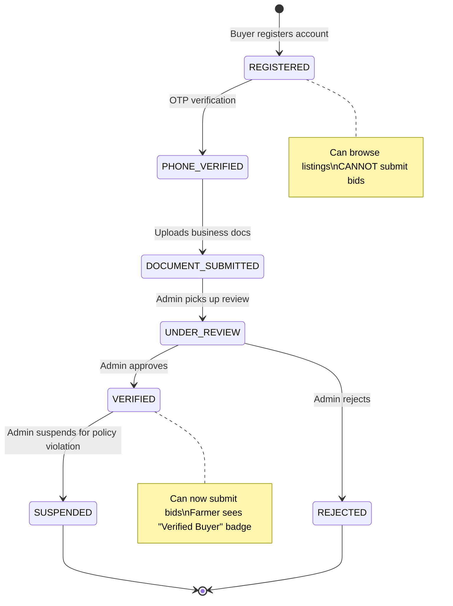

---

## 20. ER Diagram — Domain Overview

```mermaid
erDiagram
    STATES {
        uuid id PK
        varchar name
        varchar name_hi
        varchar name_mr
        varchar code UK
    }
    DISTRICTS {
        uuid id PK
        uuid state_id FK
        varchar name
        decimal centroid_lat
        decimal centroid_lon
    }
    LOCALITIES {
        uuid id PK
        uuid district_id FK
        varchar name
        decimal lat
        decimal lon
    }
    MARKETS {
        uuid id PK
        varchar canonical_name
        varchar canonical_slug UK
        uuid district_id FK
        decimal lat
        decimal lon
        boolean is_active
    }
    COMMODITIES {
        uuid id PK
        varchar canonical_name UK
        varchar name_hi
        varchar name_mr
        varchar category
    }
    VARIETIES {
        uuid id PK
        uuid commodity_id FK
        varchar canonical_name
    }
    GRADES {
        uuid id PK
        uuid commodity_id FK
        varchar canonical_name
    }
    PRICE_OBSERVATIONS {
        uuid id PK
        uuid market_id FK
        uuid commodity_id FK
        uuid variety_id FK
        uuid grade_id FK
        date report_date
        decimal modal_price
        decimal min_price
        decimal max_price
        varchar price_unit
        varchar business_key UK
        uuid source_dataset_id FK
        uuid ingestion_run_id FK
        timestamptz ingested_at
    }
    SOURCE_DATASETS {
        uuid id PK
        varchar resource_id UK
        varchar title
        varchar dataset_type
    }
    INGESTION_RUNS {
        uuid id PK
        uuid source_dataset_id FK
        timestamptz started_at
        timestamptz finished_at
        varchar status
        int records_fetched
        int records_inserted
        int records_updated
        int duplicates_skipped
        int validation_errors_count
    }
    INGESTION_ERRORS {
        uuid id PK
        uuid ingestion_run_id FK
        varchar error_type
        text error_message
        jsonb raw_payload
    }
    USERS {
        uuid id PK
        varchar phone_number UK
        varchar email UK
        varchar password_hash
        varchar role
        boolean is_active
    }
    FARMER_PROFILES {
        uuid id PK
        uuid user_id FK UK
        varchar display_name
        uuid default_district_id FK
        varchar preferred_locale
    }
    TRANSPORT_ASSUMPTIONS {
        uuid id PK
        decimal cost_per_km
        decimal minimum_trip_charge
        decimal vehicle_capacity_kg
        boolean is_active
    }
    RECOMMENDATION_WEIGHTS {
        uuid id PK
        decimal w_net_realization
        decimal w_price
        decimal w_trend
        decimal w_freshness
        decimal w_transport_penalty
        int freshness_fresh_days
        int freshness_recent_days
        int freshness_stale_days
        boolean is_active
    }
    SELLING_SEARCHES {
        uuid id PK
        uuid farmer_profile_id FK
        uuid commodity_id FK
        decimal quantity
        varchar quantity_unit
        decimal origin_lat
        decimal origin_lon
        int max_distance_km
    }
    RECOMMENDATION_RUNS {
        uuid id PK
        uuid selling_search_id FK
        uuid weights_id FK
        uuid transport_id FK
        uuid price_only_winner_market_id FK
        uuid net_winner_market_id FK
        boolean rankings_disagree
    }
    SELLING_OPTIONS {
        uuid id PK
        uuid recommendation_run_id FK
        uuid market_id FK
        uuid price_observation_id FK
        decimal distance_km
        decimal estimated_transport_cost
        decimal estimated_gross_value
        decimal estimated_net_realization
        varchar trend_direction
        varchar freshness_status
        int rank
        decimal score
        text[] reason_codes
    }
    PRICE_ALERTS {
        uuid id PK
        uuid farmer_profile_id FK
        varchar alert_type
        uuid commodity_id FK
        uuid market_id FK
        decimal threshold_value
        varchar status
        timestamptz last_triggered_at
    }
    ALERT_EVENTS {
        uuid id PK
        uuid price_alert_id FK
        timestamptz triggered_at
        decimal trigger_value
    }

    STATES ||--o{ DISTRICTS : "has"
    DISTRICTS ||--o{ LOCALITIES : "has"
    DISTRICTS ||--o{ MARKETS : "hosts"
    COMMODITIES ||--o{ VARIETIES : "has"
    COMMODITIES ||--o{ GRADES : "has"
    MARKETS ||--o{ PRICE_OBSERVATIONS : "reports"
    COMMODITIES ||--o{ PRICE_OBSERVATIONS : "priced as"
    VARIETIES ||--o{ PRICE_OBSERVATIONS : "specified in"
    GRADES ||--o{ PRICE_OBSERVATIONS : "graded in"
    SOURCE_DATASETS ||--o{ PRICE_OBSERVATIONS : "sources"
    INGESTION_RUNS ||--o{ PRICE_OBSERVATIONS : "produced"
    SOURCE_DATASETS ||--o{ INGESTION_RUNS : "for"
    INGESTION_RUNS ||--o{ INGESTION_ERRORS : "logs"
    USERS ||--o| FARMER_PROFILES : "has"
    FARMER_PROFILES ||--o{ SELLING_SEARCHES : "performs"
    SELLING_SEARCHES ||--o{ RECOMMENDATION_RUNS : "generates"
    RECOMMENDATION_RUNS ||--o{ SELLING_OPTIONS : "contains"
    MARKETS ||--o{ SELLING_OPTIONS : "evaluated as"
    PRICE_OBSERVATIONS ||--o{ SELLING_OPTIONS : "based on"
    RECOMMENDATION_WEIGHTS ||--o{ RECOMMENDATION_RUNS : "configures"
    TRANSPORT_ASSUMPTIONS ||--o{ RECOMMENDATION_RUNS : "configures"
    FARMER_PROFILES ||--o{ PRICE_ALERTS : "configures"
    PRICE_ALERTS ||--o{ ALERT_EVENTS : "triggers"
    COMMODITIES ||--o{ PRICE_ALERTS : "monitors"
```

---

## 21. Sequence Diagram — Hero Flow (Farmer Comparison)

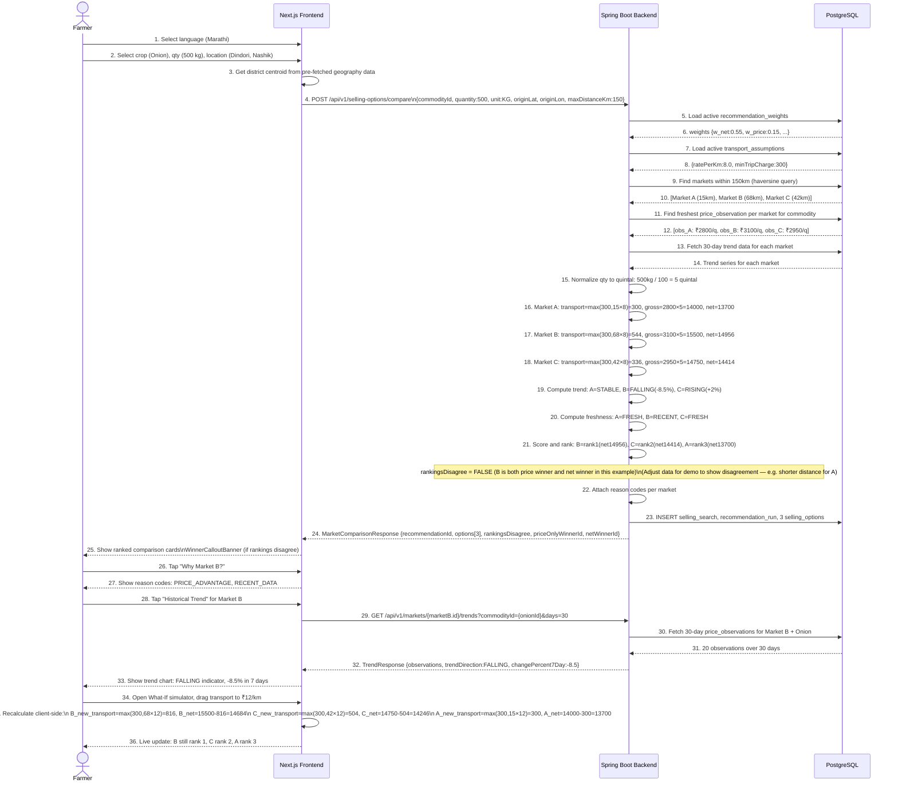

---

## 22. Sequence Diagram — Ingestion Pipeline

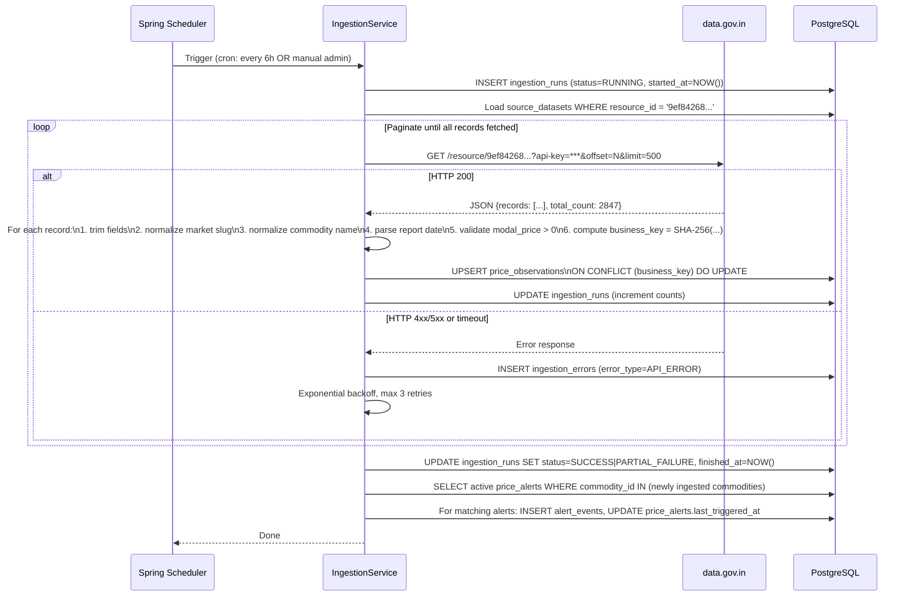

---

## 23. Sequence Diagram — Phase 2 Listing to Transaction

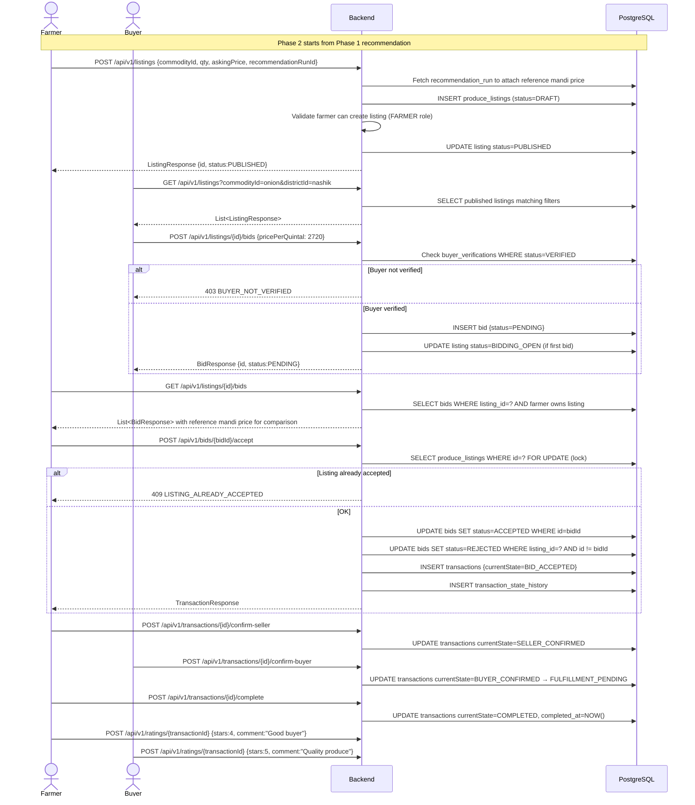

---

## 24. Use-Case Diagram

```mermaid
graph TD
    Farmer((Farmer))
    Buyer((Verified Buyer\nPhase 2))
    Admin((Admin))

    Farmer --> UC1["Compare market prices\nwith net realization"]
    Farmer --> UC2["View explainable\nrecommendation reasons"]
    Farmer --> UC3["Run What-If\nselling simulator"]
    Farmer --> UC4["View historical\nprice trends"]
    Farmer --> UC5["Configure price alerts\n(threshold / % movement)"]
    Farmer --> UC6["Register & login\n(for alerts/history)"]
    Farmer --> UC7["Create produce listing\n(Phase 2)"]
    Farmer --> UC8["Compare bids vs mandi reference\n(Phase 2)"]
    Farmer --> UC9["Accept bid / Track transaction\n(Phase 2)"]
    Farmer --> UC10["Rate completed transaction\n(Phase 2)"]

    Buyer --> UC11["Register & get verified\n(Phase 2)"]
    Buyer --> UC12["Browse farmer listings\n(Phase 2)"]
    Buyer --> UC13["Submit bids\n(verified only, Phase 2)"]
    Buyer --> UC14["Track transaction status\n(Phase 2)"]
    Buyer --> UC15["Rate farmer\n(Phase 2)"]

    Admin --> UC16["Monitor ingestion\nhealth dashboard"]
    Admin --> UC17["View ingestion run\nhistory & errors"]
    Admin --> UC18["Trigger manual\ndata sync"]
    Admin --> UC19["Configure transport\nassumptions"]
    Admin --> UC20["Configure recommendation\nweights"]
    Admin --> UC21["Review buyer\nverifications (Phase 2)"]

    UC1 -.->|"extends"| UC3
    UC1 -.->|"extends"| UC4
    UC7 -.->|"extends from"| UC1
```

---

## 25. Activity Diagram — Farmer Decision Journey

```mermaid
flowchart TD
    A([Start: Farmer opens AgriNex]) --> B{First launch?}
    B -->|Yes| C[Language selection screen\nMR / HI / EN]
    B -->|No| D[Landing screen with saved language]
    C --> D
    D --> E[Tap 'Compare Markets']
    E --> F[Select State → District → Locality\n(no exact address required)]
    F --> G[Select commodity\nSearchable dropdown, most common pinned]
    G --> H[Enter quantity + unit\nKG or QUINTAL]
    H --> I[Optional: adjust max distance\nDefault 150 km]
    I --> J[Tap 'Find Markets']
    J --> K{API response}
    K -->|"No markets found"| L[Show empty state:\n'No data in range.\nTry increasing distance.'\n+ Adjust distance button]
    K -->|"Results"| M[Show Comparison Results screen]
    L --> I
    M --> N{Rankings disagree?}
    N -->|Yes| O[Show WinnerCalloutBanner:\n'Highest Price: Market B\nHighest Net: Market A']
    N -->|No| P[Show regular ranked cards]
    O --> Q[Farmer taps market card]
    P --> Q
    Q --> R[Show reason codes:\n'Why recommended?']
    R --> S{Farmer action?}
    S -->|"View Trend"| T[Navigate to trend chart\n7-day / 30-day toggle]
    S -->|"Open Simulator"| U[What-If simulator panel\nAdjust qty/transport/distance]
    S -->|"Set Alert"| V{Logged in?}
    S -->|"Satisfied"| Z([End: Farmer has decision])
    T --> S
    U --> S
    V -->|No| W[Quick phone registration\n(lightweight)]
    V -->|Yes| X[Create alert: threshold/% type\nmarketId optional]
    W --> X
    X --> Y[Alert saved\nEvaluated on next ingestion]
    Y --> Z
```

---

## 26. Functional Requirements

| ID | Requirement | Phase | Priority |
|----|-------------|-------|----------|
| FR-01 | System shall ingest current mandi prices from resource `9ef84268-d588-465a-a308-a864a43d0070` with paginated API calls | P1 | Must |
| FR-02 | System shall ingest historical prices from resource `35985678-0d79-46b4-9ed6-6f13308a1d24` with date-based iteration | P1 | Must |
| FR-03 | Ingestion shall normalize market names (trim, canonical slug), commodity names, variety, grade | P1 | Must |
| FR-04 | Ingestion shall prevent duplicate observations via deterministic business_key unique constraint | P1 | Must |
| FR-05 | System shall verify and document price unit from source (e.g., per quintal) before any calculation | P1 | Must |
| FR-06 | System shall compute haversine distance between farmer's district centroid and each candidate market | P1 | Must |
| FR-07 | System shall compute estimated transport cost using configurable formula: max(minTripCharge, distanceKm × ratePerKm) × trips | P1 | Must |
| FR-08 | System shall compute estimated gross sale value: normalizedPrice × quantityInQuintal | P1 | Must |
| FR-09 | System shall compute estimated net realization: grossValue − transportCost | P1 | Must |
| FR-10 | System shall rank candidate markets by composite score with net realization as dominant factor | P1 | Must |
| FR-11 | System shall identify and flag when price-only winner differs from net-realization winner | P1 | Must |
| FR-12 | System shall attach fixed-vocabulary reason codes to each ranked market | P1 | Must |
| FR-13 | System shall classify data freshness (FRESH/RECENT/STALE/UNAVAILABLE) per observation | P1 | Must |
| FR-14 | System shall compute 7-day and 30-day trend direction (RISING/STABLE/FALLING) per market/commodity | P1 | Must |
| FR-15 | System shall allow farmer to recalculate rankings with adjusted quantity/transport/distance assumptions (What-If) | P1 | Must |
| FR-16 | System shall continue serving stored data when government API is unavailable | P1 | Must |
| FR-17 | System shall record every ingestion run with full audit metrics | P1 | Must |
| FR-18 | System shall expose admin endpoint showing ingestion health, run history, and validation errors | P1 | Must |
| FR-19 | System shall evaluate price alerts after every ingestion run and create alert_events | P1 | Should |
| FR-20 | System shall enforce farmer/buyer/admin role-based access on all endpoints server-side | P1 | Must |
| FR-21 | System shall reject illegal buyer verification state transitions server-side | P2 | Must |
| FR-22 | System shall enforce transaction state machine server-side with DB-level locking on bid acceptance | P2 | Must |
| FR-23 | System shall reject bids from unverified buyers at the API level | P2 | Must |
| FR-24 | System shall record every transaction state transition with actor, timestamp, reason | P2 | Must |
| FR-25 | System shall allow ratings only after transaction reaches COMPLETED state | P2 | Must |

---

## 27. Non-Functional Requirements

| Category | Requirement | Target |
|----------|-------------|--------|
| **Performance** | Comparison endpoint response time | < 1 second under normal demo conditions |
| **Performance** | Simple GET endpoints (geography, commodities) | < 300ms (with caching) |
| **Performance** | Frontend LCP on mobile (3G) | < 3 seconds |
| **Reliability** | Ingestion failure handling | Farmer endpoints must not be affected by ingestion failures |
| **Reliability** | System availability during government API downtime | Continue serving stored data |
| **Scalability** | Database design | Should support additional states/commodities without code changes |
| **Security** | API key protection | Government API key never in frontend or version control |
| **Security** | Authentication | JWT with 15-min access token + 7-day refresh token rotation |
| **Security** | Authorization | All sensitive endpoints enforce RBAC server-side |
| **Accessibility** | Core farmer flows | WCAG 2.1 AA target |
| **Localization** | Languages | Marathi, Hindi, English on all farmer-facing screens |
| **Portability** | Deployment | Fully reproducible via `docker compose up` with `.env` |
| **Observability** | Logs | Structured JSON logs with correlation ID per request |
| **Observability** | Health | `/actuator/health` with DB + Redis sub-checks |
| **Maintainability** | Module boundaries | No cross-module direct DB access; each module owns its repositories |
| **Testability** | Core calculations | Transport, net realization, scoring covered by deterministic unit tests |
| **Data Integrity** | Price observations | Business key unique constraint at DB level, not just application level |

---

## 28. Security Overview

| Control | Implementation | Where |
|---------|---------------|--------|
| Password hashing | BCrypt, cost factor ≥ 12 | Backend AuthService |
| Access token | JWT, HS256, signed with server secret, 15-min expiry | Backend JwtService |
| Refresh token | SHA-256 hashed, stored in DB, 7-day TTL | Backend refresh_tokens table |
| RBAC | Spring Security @PreAuthorize, roles: FARMER, BUYER, ADMIN | Backend SecurityConfig |
| Government API key | In `DATA_GOV_API_KEY` env var only, never in frontend | Backend ingestion module |
| Input validation | Bean Validation on all request DTOs | Backend @Valid annotations |
| SQL injection | JPA/Hibernate parameterized queries only — no string concatenation | Backend repositories |
| CORS | Restricted to known frontend origin | Backend WebConfig |
| Rate limiting | Redis-backed, per-IP on compare endpoint (60 req/min) | Backend Redis interceptor |
| Secure headers | X-Content-Type-Options, X-Frame-Options, CSP | Nginx config |
| PII minimization | No home address collected; district centroid only | Frontend + Backend |
| Error responses | Never expose stack traces in HTTP responses | GlobalExceptionHandler |
| TLS | HTTPS only in staging and production | Nginx + certbot |
| Phase 2 documents | Buyer verification docs stored with access control | Backend file service |

**Role capabilities:**

| Capability | FARMER | BUYER | ADMIN |
|-----------|--------|-------|-------|
| Compare markets (POST /compare) | ✅ (anonymous ok) | ✅ | ✅ |
| Create price alert | ✅ | ❌ | ✅ |
| Create listing | ✅ | ❌ | ✅ |
| Submit bid | ❌ | ✅ (verified only) | ✅ |
| Accept bid | ✅ (listing owner) | ❌ | ✅ |
| View own transactions | ✅ | ✅ | ✅ |
| Admin ingestion health | ❌ | ❌ | ✅ |
| Configure weights | ❌ | ❌ | ✅ |
| Review buyer verification | ❌ | ❌ | ✅ |

---

## 29. Resilience & Failure Handling

| Failure Scenario | Required Behavior | UI Message |
|-----------------|-------------------|------------|
| Government API unavailable | Serve last successfully synced data; mark ingestion_run as FAILED; continue comparison/trend/alert from DB | "Latest source synchronization is unavailable. Showing most recently stored government-reported data." |
| Partial ingestion (some pages fail) | Persist successfully fetched pages; log failed pages in ingestion_errors; do not rollback successful partial progress | Admin sees: X records inserted, Y pages failed |
| No recent data for commodity/market | Return empty options array with appropriate code | "No recent market observation available for this commodity in your area." |
| ML forecast unavailable | Return ForecastResponse {available: false}; comparison, alerts, recommendation continue unaffected | "Forecast unavailable." (shown only in optional forecast section) |
| Concurrent bid acceptance | DB SELECT FOR UPDATE prevents both from succeeding; second gets 409 CONFLICT | "This listing has already been accepted by another buyer." |
| Token expired | 401 UNAUTHORIZED → frontend refreshes using httpOnly cookie → retry | Transparent refresh; user sees no interruption |
| Database connection failure | Spring Boot fails fast with 503; health endpoint reflects DB DOWN | Standard 503 error page |

---

## 30. API Module Interaction Overview

This table defines which backend module handles each API group, enabling parallel development:

| API Path Group | Backend Module | Frontend Screen | Produces Contract |
|---------------|----------------|-----------------|------------------|
| `POST /api/v1/auth/*` | `auth` | Login, Register | `AuthResponse` |
| `GET /api/v1/geography/*` | `geography` | Location wizard | `StateResponse`, `DistrictResponse`, `LocalityResponse` |
| `GET /api/v1/commodities/*` | `commodity` | Commodity selector | `CommodityResponse`, `VarietyResponse` |
| `GET /api/v1/markets/{id}` | `price` | Market detail | `MarketDetailResponse` |
| `GET /api/v1/markets/{id}/trends` | `price` | Trend chart | `TrendResponse` |
| `POST /api/v1/selling-options/compare` | `recommendation` | Comparison results | `MarketComparisonResponse` |
| `POST /api/v1/selling-options/simulate` | `recommendation` | What-If simulator | `MarketComparisonResponse` |
| `GET/POST/PATCH/DELETE /api/v1/alerts` | `alert` | Alert management | `AlertResponse` |
| `GET /api/v1/admin/*` | `admin` | Admin dashboard | `IngestionHealthResponse`, `IngestionRunResponse` |
| `POST /api/v1/admin/ingestion/trigger` | `admin` → `ingestion` | Admin trigger button | `TriggerResponse` |
| `PUT /api/v1/admin/config/*` | `admin` | Admin config | `TransportAssumptionResponse`, `WeightsResponse` |
| `POST /api/v1/listings` | `listing` | Create listing (P2) | `ListingResponse` |
| `GET /api/v1/listings` | `listing` | Browse listings (P2) | `PaginatedResponse<ListingResponse>` |
| `POST /api/v1/listings/{id}/bids` | `bid` | Submit bid (P2) | `BidResponse` |
| `POST /api/v1/bids/{id}/accept` | `bid` → `transaction` | Accept bid (P2) | `TransactionResponse` |
| `GET /api/v1/transactions/{id}` | `transaction` | Transaction detail (P2) | `TransactionResponse` |
| `POST /api/v1/ratings/{txId}` | `rating` | Rate transaction (P2) | `RatingResponse` |

---

## 31. Data Source Policy & Rules

### RULE 1 — No Direct Frontend Access to Government APIs
The frontend NEVER calls data.gov.in. All government API calls happen server-side, in the ingestion module, using `DATA_GOV_API_KEY` from environment variables.

### RULE 2 — Pagination is Mandatory
Both government datasets may return 100+ records per query. The ingestion module MUST paginate using `offset` and `limit` parameters until all records are retrieved.

### RULE 3 — Unit Verification Before Calculation
The source price unit (e.g., per quintal) must be verified from actual API response field documentation and stored on every price_observation. No silent unit assumptions.

### RULE 4 — Naming "Latest Reported Price" Not "Real-Time"
Government mandi data is batch-reported, not real-time. All UI and documentation must use "latest reported price" or "government-reported price," never "live price" or "real-time price."

### RULE 5 — No Fabricated Data
If no recent observation exists for a market, show "No data available." Never interpolate or fabricate a price.

### RULE 6 — Deduplication at DB Level
Unique constraint on `business_key` in `price_observations` ensures deduplication even if application code has a bug. The DB is the last line of defense.

### RULE 7 — Source Attribution Always Visible
Every price-related screen must show: "Source: Ministry of Agriculture & FW / DMI / data.gov.in" and the report date.

---

## 32. Transport Cost & Net Realization Model

### Formula (Documented, Configurable, Never Silent)

```
quantityInKg = quantity × (1 if unit=KG else 100)
quantityInQuintal = quantityInKg / 100

trips = ceil(quantityInKg / vehicleCapacityKg)  [default: vehicleCapacityKg = 1000]

perTripCost = max(minimumTripCharge, distanceKm × ratePerKm)
estimatedTransportCost = perTripCost × trips

estimatedGrossValue = normalizedModalPrice × quantityInQuintal

estimatedNetRealization = estimatedGrossValue - estimatedTransportCost
```

### Configurable Parameters (Admin-Managed in `transport_assumptions` table)

| Parameter | Default | Description |
|-----------|---------|-------------|
| `ratePerKm` | ₹8.00 | Cost per km per trip |
| `minimumTripCharge` | ₹300 | Minimum charge per trip regardless of distance |
| `vehicleCapacityKg` | 1,000 kg | Assumed vehicle capacity for multi-trip calculation |

### Mandatory UI Labels
- Transport cost must always show: "**Estimated** — based on ₹8/km assumption. Actual costs will vary."
- Net realization must always show: "**Estimated net realization**"
- No financial guarantee implied anywhere

### What-If Override
Farmer can override `ratePerKm` and `maxDistanceKm` in the simulator. The override is session-only and does not change system defaults.

---

## 33. Historical Trends Engine

**Data source:** `35985678-0d79-46b4-9ed6-6f13308a1d24` (historical variety-wise prices)

**Trend computation algorithm:**
1. Fetch observations for market + commodity for last 30 days from `price_observations`
2. Compute 7-day average of `modal_price` for observations in last 7 days
3. Compute baseline average of `modal_price` for observations 8–14 days ago
4. `changePercent7Day = (avg7Day - baselineAvg) / baselineAvg × 100`
5. `trendDirection`:
   - `RISING` if changePercent7Day > +3.0%
   - `FALLING` if changePercent7Day < -3.0%
   - `STABLE` if between -3.0% and +3.0%
   - `INSUFFICIENT_DATA` if fewer than 4 observations in last 14 days

**What the frontend shows:**
- Line chart: modal_price vs date (7 or 30 day toggle)
- Trend badge: ↑ RISING (green) / → STABLE (grey) / ↓ FALLING (red)
- "7-day change: +5.2%" or "-8.5%"
- Empty state: "Insufficient historical data for this market/commodity"

---

## 34. Alert Engine

**Alert types in Phase 1:**

| Type | Trigger Condition |
|------|------------------|
| `PRICE_ABOVE` | `latestModalPrice >= thresholdValue` for commodity + (optional) market |
| `PRICE_BELOW` | `latestModalPrice <= thresholdValue` for commodity + (optional) market |
| `PERCENTAGE_RISE` | `changePercent7Day >= thresholdValue` (e.g., thresholdValue = 5.0 means 5% rise) |
| `PERCENTAGE_FALL` | `changePercent7Day <= -thresholdValue` |

**Evaluation timing:** After every ingestion run completes, `AlertEvaluationService` queries all `ACTIVE` alerts and checks against newly ingested observations.

**Delivery in Phase 1:** In-app notifications only (alert_events table → polled or pushed to frontend). Email delivery is optional enhancement.

**Alert lifecycle:**
1. Farmer creates alert → `status=ACTIVE`
2. Alert triggered → `INSERT alert_events`, `UPDATE price_alerts SET last_triggered_at`
3. Farmer views/dismisses alert → alert remains ACTIVE (will trigger again next ingestion if still true)
4. Farmer deactivates → `status=PAUSED`
5. Farmer deletes → `DELETE price_alerts` (cascades to alert_events)

---

## 35. ML Strategy (Optional Module)

### Decision Criterion
ML should only be built if:
1. Historical series has ≥ 90 observations per market-commodity pair after bootstrap
2. The deterministic decision engine is complete and deployed
3. At least one team member has time available after Phase 1 freeze

### Optional ML Problem
Short-horizon mandi price forecasting: predict modal price for market+commodity 3 or 7 days ahead.

### Baseline Models (Always Built First)
1. Naive last-value (predict tomorrow = today)
2. 7-day rolling mean
3. First ML model: ARIMA or Prophet
4. Second model: LightGBM with lag features (only if justified)

**Models NOT recommended without evidence:** LSTM, transformer, deep learning — complexity must be earned.

### Validation Strategy
**Chronological only — no random splits:**
- Training: January to July
- Validation: August
- Test: September

Rolling-window or expanding-window evaluation.

**Metrics:** MAE, RMSE, Directional Accuracy (did we predict direction correctly?)

### ML Failure Behavior (Enforced)
If ML pipeline fails:
- `ForecastResponse { available: false }` returned
- Comparison, recommendation, transport, alerts continue unaffected
- Frontend shows "Forecast unavailable" only in the optional forecast section
- No 5xx error due to ML failure

### ML Contract (Input → Output Schema)

**Input (from backend/DB):**
```json
{
  "marketId": "uuid",
  "commodityId": "uuid",
  "varietyId": null,
  "observations": [
    { "date": "2026-09-01", "modalPrice": 4200.0, "minPrice": 3900.0, "maxPrice": 4500.0 }
  ]
}
```

**Output (written to `forecasts` table):**
```json
{
  "marketId": "uuid",
  "commodityId": "uuid",
  "forecastHorizonDays": 7,
  "forecast": [
    { "date": "2026-09-15", "predictedPrice": 4250.0, "lowerBound": 3950.0, "upperBound": 4600.0 }
  ],
  "modelName": "ARIMA",
  "modelVersion": "1.0",
  "mae": 210.4,
  "rmse": 300.2,
  "trainingDataThrough": "2026-09-13",
  "generatedAt": "2026-09-14T05:30:00Z"
}
```

---

## 36. Evaluation & Research Methodology

### This is an Academic Requirement — Not Optional

The project must have a measurable evaluation component beyond "the app works."

### Experiment 1 — Price-Only Ranking vs Net-Realization Ranking (REQUIRED)

**Research Question:** Does including transport cost change which market AgriNex recommends, and by how much?

**Method:**
1. From `recommendation_runs` and `selling_options` tables, collect all historical comparison scenarios where ≥2 markets were eligible
2. For each scenario: identify `price_only_winner_market_id` and `net_winner_market_id`
3. Compute: `rankingDisagreementRate = scenarios_where_winner_differs / total_scenarios × 100`
4. For each disagreement case, compute: `netDifference = net_realization_of_net_winner - net_realization_of_price_winner`
5. Report: `averageEstimatedNetDifference`, `medianEstimatedNetDifference`, `percentile90EstimatedNetDifference`

**Expected finding:** A meaningful % of scenarios where the highest-priced market is NOT the highest net-realization market — which is the product thesis.

**Honest framing:** "These are estimated outcomes based on our configured transport assumptions, not actual transaction data."

### Experiment 2 — Data Pipeline Reliability (REQUIRED)

Run ingestion for 14 consecutive days. Measure:
- Sync success rate (%)
- Average ingestion duration (seconds)
- Duplicate rate per run
- Validation error rate
- Stale market percentage at peak (end of day)

### Experiment 3 — ML Model Comparison (if ML built)

| Metric | Naive Last-Value | 7-Day Rolling Mean | ARIMA | LightGBM |
|--------|-----------------|-------------------|-------|----------|
| MAE (₹/quintal) | ? | ? | ? | ? |
| RMSE | ? | ? | ? | ? |
| Directional Accuracy | ? | ? | ? | ? |

If ML performs worse than naive: **report it honestly**. A finding that "simple baselines outperform ARIMA for sparse mandi data" is a valid academic finding.

### Experiment 4 — Optional Usability Evaluation

If real users are available:
- Scenario 1: Give farmer a raw price table for 3 mandis → measure: time to decision, confidence score
- Scenario 2: Give same farmer AgriNex recommendation view → measure: same metrics
- Survey instrument: System Usability Scale (SUS) or adapted 5-question confidence/ease scale

---

## 37. Risks & Limitations

| Risk | Probability | Impact | Mitigation | Fallback |
|------|-------------|--------|------------|---------|
| Government API outage | Medium | High | Cache all data in PostgreSQL | Show stored data with STALE banner |
| Government API schema change | Low | High | Adapter layer isolates raw field parsing; raw_payload stored in ingestion_errors | Fail ingestion loudly; expose in admin |
| API rate limiting | Medium | Medium | Exponential backoff, max 3 retries, 6-hour cron schedule | Resume from last successful offset |
| Historical data sparsity for some markets | Medium | Medium | Document minimum observation threshold; ML only if ≥90 obs | Show "Insufficient history" gracefully |
| Data inconsistency (units, names) | High | Medium | Normalization pipeline with explicit documented rules | Reject record, log validation error |
| Duplicate records in source | High | Low | Business key + DB unique constraint | ON CONFLICT DO UPDATE |
| Transport estimate inaccuracy | High (inherent) | Low | Clear "ESTIMATED" labelling; simulator lets farmer override | Farmer adjusts assumptions |
| Poor ML forecast | Medium | Low | ML is optional; baselines always shown first | Display "Forecast unavailable" |
| Phase 2 cold start (no buyers) | High | Low | Demo with fixture/seed buyers; Phase 1 still complete standalone | Ship Phase 1 only |
| Scope creep | Medium | High | Enforced out-of-scope list; Master doc arbitrates | PM role enforces feature freeze |
| Deployment failure during demo | Low | High | Rehearsed Docker deployment; fixture data pre-loaded | Local localhost fallback |
| Team member blocked by another | Medium | Medium | Contract-first development; mocks for every endpoint | Each role has independent spec |

---

## 38. Scalability & Future Scope

**Explicitly NOT in this capstone** but defensible future directions:

| Future Direction | How Current Architecture Supports It |
|-----------------|-------------------------------------|
| Additional states/commodities | Ingestion is parameterized; adding coverage = data config, not code change |
| Routing-based distance (vs haversine) | Transport module is isolated; swap haversine for Google Maps Distance Matrix API |
| Real logistics-partner integration | Transport module interface allows plugging in external quote API |
| Deeper ML forecasting | ML pipeline is already decoupled; upgrade model independently |
| Payments/escrow (Phase 2) | Transaction state machine has FULFILLMENT_PENDING state — payment can be inserted there |
| Mobile app | Backend REST API is already mobile-ready; wrap in React Native or Flutter |
| Multi-tenancy / White-label | Geography module is state-agnostic; no hardcoded Maharashtra assumption |

---

## 39. Out of Scope (Enforced)

The following are PERMANENTLY out of scope for AgriNex capstone (unless all Phase 1+2 features are complete and 2+ weeks remain):

- Blockchain / cryptocurrency
- Microservices architecture / Kubernetes
- Native iOS or Android app
- IoT / drones / computer vision
- Fertilizer, disease, or pest recommendation
- Credit scoring or insurance products
- Full payment gateway / escrow
- Live transporter marketplace / GPS logistics tracking
- Social media layer / farmer community chat
- LLM chatbot (adding an LLM for novelty without grounded data is explicitly rejected)
- Unrelated weather prediction platform
- Any feature requiring an unverified external API dependency

**Enforcement:** Any team member proposing an out-of-scope feature must justify it against Product Principle P4: "Smallest system, strongest answer." The Master doc is the arbiter.

---

## 40. Team Roles & RACI Matrix

| Responsibility | UI/UX | Frontend | Backend | Data | ML | DevOps | QA |
|----------------|-------|----------|---------|------|----|--------|----|
| Design system & tokens | R | C | I | I | I | I | I |
| Screen design — all states | R | C | I | I | I | I | C |
| Farmer comparison flow (FE) | C | R | C | I | I | I | C |
| REST API design | I | C | R | C | I | I | C |
| PostgreSQL schema | I | I | R | C | C | I | I |
| Flyway migrations | I | I | R | I | I | C | I |
| Data ingestion pipeline | I | I | C | R | C | I | C |
| Data normalization rules | I | I | C | R | I | I | C |
| Transport cost engine | I | I | R | I | I | I | C |
| Recommendation engine | I | C | R | C | C | I | C |
| Trend computation | I | C | R | R | C | I | C |
| Alert evaluation | I | C | R | I | I | I | C |
| ML pipeline (optional) | I | I | C | C | R | I | C |
| Docker Compose & infra | I | I | C | I | I | R | C |
| CI/CD pipeline | I | I | C | I | I | R | C |
| Security implementation | I | C | R | I | I | C | C |
| Unit tests (backend) | I | I | R | I | I | I | C |
| E2E tests | I | C | C | I | I | I | R |
| API contract tests | I | C | C | I | I | I | R |
| Research evaluation | I | I | C | C | C | I | R |
| Admin dashboard (FE+BE) | C | R | R | C | I | I | C |
| Phase 2 listing/bid/tx | C | R | R | I | I | I | C |
| Documentation | C | C | C | C | C | C | R |

R = Responsible, C = Consulted, I = Informed

---

## 41. Integration Contract Matrix

| Contract File | Produced By | Consumed By | Change Process |
|--------------|-------------|-------------|----------------|
| `contracts/openapi.yaml` | Backend | Frontend, QA | PR reviewed by Frontend before merge |
| `contracts/price-observation.schema.json` | Data Engineering | Backend, ML, QA | PR reviewed by Backend before merge |
| `contracts/recommendation.schema.json` | Backend | Frontend, QA | PR reviewed by Frontend before merge |
| `contracts/forecast-output.schema.json` | ML | Backend | PR reviewed by Backend before merge |
| `contracts/error-response.schema.json` | Backend | Frontend, QA | PR reviewed by Frontend before merge |
| `frontend/__mocks__/api/*.json` | Backend (initial) | Frontend (dev mode) | Must match OpenAPI schema exactly |
| `fixtures/seed_data.sql` | Data Engineering | Backend, ML, QA | PR reviewed by Backend before merge |
| `infra/.env.example` | DevOps | All roles | PR reviewed by Team Lead before merge |

**Shared Contract Change Rule:**
1. Create PR with change description and reason
2. Tag all consuming roles for review
3. Increment version in contract file
4. Update corresponding mock data to match
5. Merge only with ≥2 approvals from consuming roles

---

## 42. Development Order (Enforced)

```
Week 1-2:  Setup
  1. Repository structure + branch strategy (main, develop, feature/*)
  2. contracts/ — OpenAPI skeleton, JSON schemas, mock JSONs
  3. infra/ — Docker Compose, PostgreSQL init, .env.example
  4. Database migrations V1–V6 (Phase 1 schema)

Week 2-3:  Data Foundation
  5. Data ingestion — current price API (paginated, normalized, deduplicated)
  6. Data ingestion — historical API + bootstrap
  7. Reference data seed (states, districts, commodities, known markets)

Week 3-4:  Backend Core
  8. Backend auth module (JWT register/login/refresh)
  9. Backend geography + commodity endpoints
  10. Backend market price endpoints + trend computation
  11. Backend transport engine (distance + cost formula)

Week 4-5:  Recommendation Engine
  12. Backend net realization calculation
  13. Backend composite scoring + ranking
  14. Backend reason code attachment
  15. Backend comparison endpoint (POST /selling-options/compare)
  16. Backend simulator endpoint (POST /selling-options/simulate)

Week 5-6:  Frontend Core
  17. Frontend shell — routing, layout, language selector
  18. Frontend farmer wizard (location → commodity → quantity)
  19. Frontend comparison results screen
  20. Frontend winner callout banner
  21. Frontend recommendation reason card
  22. Frontend trend chart

Week 6-7:  Feature Completion
  23. Frontend what-if simulator (client-side calculation)
  24. Backend + Frontend alert management
  25. Backend admin ingestion health API
  26. Frontend admin dashboard

Week 7-8:  Quality & Deploy
  27. Phase 1 integration testing (QA)
  28. Phase 1 deployment on cloud VM
  29. Phase 1 evaluation experiment
  ━━━━━━━━━━━ PHASE 1 FREEZE ━━━━━━━━━━━

Week 9-10: Phase 2
  30. Buyer auth + verification flow
  31. Produce listings (create, browse)
  32. Bidding with concurrency control
  33. Transaction state machine
  34. Ratings

Week 11-12: Final
  35. ML integration (if data permits)
  36. Phase 2 testing
  37. Phase 2 deployment
  38. Final evaluation documentation
```

---

## 43. Repository Structure & Shared Contracts

```
agrinex/
├── frontend/                          # Next.js 14 application
│   ├── app/                           # App Router pages
│   ├── components/                    # UI components
│   ├── lib/                           # API client, hooks, stores, utils
│   ├── public/locales/               # i18n JSON (mr/, hi/, en/)
│   └── __mocks__/api/                # Mock response JSON files
│
├── backend/                           # Spring Boot 3.3.x application
│   ├── src/main/java/com/agrinex/    # Java source
│   └── src/main/resources/db/migration/ # Flyway migrations
│
├── ml/                                # Python ML pipeline (optional)
│   ├── forecasting/                   # Models, training, evaluation
│   └── api/                           # FastAPI server (if serving forecasts)
│
├── data-pipeline/                     # Standalone ingestion scripts (if not in Spring Batch)
│
├── contracts/                         # 🔒 SHARED — all roles must review changes
│   ├── openapi.yaml                   # Backend produces; Frontend + QA consume
│   ├── price-observation.schema.json  # Data produces; Backend + ML consume
│   ├── recommendation.schema.json     # Backend produces; Frontend + QA consume
│   ├── forecast-output.schema.json    # ML produces; Backend consumes
│   └── error-response.schema.json     # Backend produces; Frontend + QA consume
│
├── docs/
│   ├── 01_AgriNex_Master_Product_Phases.md      ← This file
│   ├── 02_AgriNex_UIUX_Phase1_Specification.md
│   ├── 03_AgriNex_Frontend_Phase1_Implementation.md
│   └── 04_AgriNex_Backend_Phase1_API_Database.md
│
├── infra/
│   ├── docker-compose.yml
│   ├── docker-compose.dev.yml
│   ├── nginx.conf
│   └── .env.example
│
├── fixtures/
│   ├── seed_data.sql                  # Reference data (states, commodities, markets)
│   ├── demo_price_observations.sql    # Demo-ready price snapshot
│   ├── test_accounts.sql             # One account per role for testing
│   └── ml_observations.csv           # Historical data sample for ML
│
├── scripts/
│   ├── bootstrap_historical.sh        # Run historical data backfill
│   ├── run_evaluation.sql            # Price-only vs net-realization experiment query
│   └── health_check.sh               # Quick deployment validation
│
├── docker-compose.yml                 # Production compose file
├── .env.example                       # All required env vars documented
└── README.md
```

---

## 44. Mock & Parallel Development Strategy

All 6 team members can work in parallel from Day 1 using this strategy:

| Role | What They Need | Where It Lives | Owner |
|------|---------------|----------------|-------|
| Frontend | Backend API responses | `frontend/__mocks__/api/*.json` | Backend (initial scaffold) |
| Backend | Normalized price data | `fixtures/seed_data.sql` | Data Engineering |
| ML | Historical observations | `fixtures/ml_observations.csv` | Data Engineering |
| QA | Test accounts, expected API responses | `fixtures/test_accounts.sql` + `contracts/openapi.yaml` | Backend |
| DevOps | All service configs | `infra/.env.example` | DevOps |
| UI/UX | Component specs | `02_AgriNex_UIUX_Phase1_Specification.md` | UI/UX |

**Golden Rule:** All mocks MUST match production contracts exactly. A mock with wrong field names is a bug, not a placeholder.

**Feature Flag:** `NEXT_PUBLIC_USE_MOCK_API=true` in `.env.local` enables all mock handlers via MSW. Frontend should work completely offline with this flag set.

---

## 45. Deployment Overview

### Services (docker-compose.yml)

| Service | Image | Port | Purpose |
|---------|-------|------|---------|
| `agrinex-frontend` | Custom Next.js | 3000 | Farmer UI, Admin UI |
| `agrinex-backend` | Custom Spring Boot | 8080 | All REST API endpoints |
| `agrinex-db` | postgres:16 | 5432 | Primary data store |
| `agrinex-redis` | redis:7-alpine | 6379 | Rate limiting, cache |
| `agrinex-nginx` | nginx:1.25 | 80/443 | Reverse proxy, TLS |
| `agrinex-ml` | Custom Python | 8000 | ML forecasts (optional) |

### One-Command Local Start

```bash
git clone https://github.com/<team>/agrinex
cd agrinex
cp infra/.env.example .env
# Edit .env: fill DATA_GOV_API_KEY, JWT_SECRET, POSTGRES_PASSWORD
docker compose up -d
# Wait ~30 seconds for migrations and startup
# Seed demo data:
docker compose exec agrinex-db psql -U agrinex -f /fixtures/seed_data.sql
# Visit http://localhost:3000
```

### Health Verification

```bash
# Backend health
curl http://localhost:8080/actuator/health
# Expected: {"status":"UP","components":{"db":{"status":"UP"},"redis":{"status":"UP"}}}

# Frontend
curl http://localhost:3000/api/health
# Expected: {"status":"ok"}

# Trigger first sync
curl -X POST http://localhost:8080/api/v1/admin/ingestion/trigger \
  -H "Authorization: Bearer <admin-token>" \
  -H "Content-Type: application/json" \
  -d '{"datasetType":"CURRENT_PRICE"}'
```

---

## 46. Demo Narrative (Step-by-Step)

### Target Audience: Faculty Evaluator + SIH Jury
### Duration: 6–8 minutes
### Key Takeaway: "They built a real decision-support product on actual government data, not a demo shell."

**[0:00–0:45] — The Problem Statement**

*[Show a simple slide or speak]*
"Ramesh grows onions in Nashik district. He checks three mandi prices on WhatsApp: Lasalgaon ₹3,100/q, Pimpalgaon ₹2,950/q, APMC Nashik ₹2,800/q. The obvious choice seems to be Lasalgaon. But Lasalgaon is 68km away. Nashik is 15km away. After hiring a vehicle, is Lasalgaon actually worth it? AgriNex answers that."

**[0:45–1:45] — Farmer Input Flow**

*[Live demo on mobile browser]*
- Open AgriNex at demo URL
- Show language selector: tap Marathi
- Tap "Compare Markets"
- Select: Onion / 500 kg / Maharashtra → Nashik → Dindori
- Tap Find Markets

**[1:45–3:00] — Comparison Results — Hero Moment**

*[Results screen loads in <1 second from cached DB]*
- Show 3 market cards with full data
- If `rankingsDisagree=true`: highlight the WinnerCalloutBanner:
  - "Highest Price: APMC Lasalgaon"
  - "Highest Net Realization: APMC Nashik ← Recommended"
- *Explain:* "Lasalgaon has ₹300/q higher price, but ₹544 transport vs ₹240 for Nashik. For 5 quintals, Nashik gives ₹13,760 vs ₹14,956 — wait, in this case Lasalgaon still wins on net! But with even slightly higher transport or lower quantity, the math flips."
- *Adjust the demo data to ensure rankings disagree for impact*

**[3:00–3:45] — Explainability**

- Tap "Why Recommended?" on winning market
- Show reason codes in Marathi: "कमी वाहतूक खर्च" / "अलीकडील माहिती" / "स्थिर भाव"
- *Say:* "Not just a number. A reason."

**[3:45–4:30] — Historical Trend**

- Tap "Historical Trend" on market
- Toggle 7-day → 30-day
- Show FALLING indicator with -8.5% badge
- *Say:* "Price was ₹3,400 last week. If trend continues, selling today at ₹3,100 is better than waiting."

**[4:30–5:15] — What-If Simulator**

- Open simulator panel
- Drag transport rate from ₹8/km to ₹12/km
- Watch ranking update live
- Show breakeven insight: "At ₹10.5/km, Market A becomes better than Market B"
- *Say:* "If Ramesh can negotiate cheaper transport, the decision might change. This simulator lets him explore without guessing."

**[5:15–5:45] — Data Transparency**

- Point to freshness badge: "FRESH — reported today"
- Point to attribution footer: "Source: Ministry of Agriculture / DMI / data.gov.in — 14 Sep 2026"
- Point to disclaimer: "Estimated transport cost — actual costs will vary"
- *Say:* "We tell farmers exactly where the data comes from and how old it is. No fake live prices."

**[5:45–6:30] — Admin Ingestion Health**

- Switch to admin view (admin@agrinex.com / admin123)
- Show ingestion health dashboard
- Highlight: "847 records synced, last sync 2h ago, 0 API errors, 3 markets STALE"
- Show last 5 ingestion runs table
- *Say:* "We know exactly what data we have and how fresh it is."

**[6:30–7:30] — Phase 2 (if built)**

- Farmer creates listing: "500 kg onion, asking ₹2,750/q, reference APMC Nashik ₹2,800"
- Buyer views listing: "Farmer asking ₹2,750 vs mandi ₹2,800"
- Buyer submits bid: ₹2,720/q
- Farmer accepts — transaction created
- Show transaction timeline: BID_ACCEPTED → SELLER_CONFIRMED → ...
- *Say:* "Phase 1 helped Ramesh decide WHERE to sell. Phase 2 helps him find a buyer at his decision point."

**[7:30–8:00] — Closing Statement**

"AgriNex doesn't just show prices. It transforms government price data into a transport-aware, explainable, farmer-centric decision. Then, in Phase 2, it helps the farmer act on that decision. Compare smarter. Sell better."

---

## 47. Viva Questions & Defensible Answers

**Q1: Mandi prices already exist. What did you actually add?**
A: Agmarknet and e-NAM show prices. AgriNex answers a fundamentally different question: after accounting for distance, transport cost, trend, and data freshness — which market results in the highest net income for this specific farmer with this specific quantity? That calculation, in farmer-appropriate language with an explicit "why," does not exist as a self-service tool. We didn't reinvent price discovery; we made it decision-usable.

**Q2: How are you different from e-NAM?**
A: e-NAM is an electronic trading platform requiring mandi-side infrastructure. Farmers must bring produce to an integrated mandi to trade. AgriNex helps the farmer decide BEFORE they travel — which mandi to go to. We serve different sequential stages: AgriNex informs the pre-travel decision; e-NAM executes the in-mandi transaction. We complement e-NAM, not compete with it.

**Q3: How are you different from Agmarknet?**
A: Agmarknet publishes prices. AgriNex takes those same source prices and adds: farmer location context, transport cost estimation, net realization comparison across multiple markets, freshness classification, trend signal, and a "why" explanation. These are not in Agmarknet.

**Q4: How do you normalize market names from the government data?**
A: Our ingestion pipeline trims whitespace from every string field, then applies a canonical slug derivation (lowercase, spaces-to-hyphens). For known market-name variants (e.g., "APMC Pune " vs "APMC Pune"), we maintain a canonical mapping table. Genuinely distinct commodities (e.g., "Onion" vs "Onion Green") remain separate entities — we do not collapse them. Normalization rules are documented, unit-tested, and logged for every ingestion run.

**Q5: Is your transport cost real?**
A: No — it is explicitly an estimate, labelled as such on every screen. It uses a configurable per-km rate and minimum charge, stored in our database and adjustable by admin. We never claim to provide a real transporter quotation. The What-If simulator exists precisely so farmers can override our default assumption with their own knowledge.

**Q6: Where does distance come from?**
A: We use the Haversine formula between the district centroid of the farmer's selected location and the market's coordinates. We deliberately do not collect exact home addresses. The UI labels all distances as "approximate." This minimizes personal data while enabling meaningful transport estimation.

**Q7: What happens when the government API is unavailable?**
A: The system continues operating using the most recently ingested data from PostgreSQL. The frontend shows: "Latest source synchronization is unavailable. Showing most recently stored government-reported data." Freshness badges show data age. We never fabricate numbers. The admin dashboard shows the failed sync run.

**Q8: How do you handle duplicate records in the government data?**
A: We compute a deterministic `business_key` (SHA-256 hash of canonical market + commodity + variety + grade + report_date + source_dataset_id) and enforce a UNIQUE constraint on this column in PostgreSQL. Even if the application code has a bug, the database will reject duplicates. This is idempotent by design — the same ingestion run can run twice and produce identical results.

**Q9: Why don't you call the government API directly from the frontend?**
A: Three reasons: (1) API key protection — the government API key must never appear in browser code, `NEXT_PUBLIC_*` env vars, or client payloads. (2) Normalization — raw government data needs cleaning before presentation. (3) Resilience — storing data in PostgreSQL means the frontend is never directly dependent on external API availability.

**Q10: Why PostgreSQL instead of MongoDB or a time-series DB?**
A: Price observations have strong relational structure (market → district → state; commodity → variety → grade). Foreign key constraints enforce data integrity at the DB level. PostgreSQL's UNIQUE constraints are our last line of defense against duplicate ingestion. For the volume we handle (thousands of records per day), PostgreSQL is perfectly adequate and avoids introducing a second database type.

**Q11: Why a modular monolith instead of microservices?**
A: Microservices introduce network latency between services, distributed transaction complexity, separate deployment pipelines, service discovery, and distributed tracing overhead. A 6-person student team with a one-semester timeline cannot maintain that infrastructure. Our modular monolith has clean domain boundaries (each module owns its repositories and services) that could be extracted into services later — but starting as microservices would consume most of the semester on infrastructure.

**Q12: Why is ML optional?**
A: The core product — transport-aware net realization comparison with explainable ranking — is fully deterministic. It works without any ML. ML price forecasting is an optional enhancement that adds value only if (a) historical data is dense enough and (b) the forecast is meaningfully better than a simple baseline. We built the deterministic engine first, as the Master doc requires.

**Q13: Why not LSTM or a transformer for price forecasting?**
A: Model complexity should be justified by evidence. For sparse, seasonal mandi price data, LSTMs frequently underperform ARIMA or even rolling averages without substantial feature engineering. We first compare naive, rolling mean, and ARIMA. We escalate to more complex models only if they demonstrate measurable improvement on our chronological validation set.

**Q14: How do you prevent time-series leakage in ML validation?**
A: We use strictly chronological splits — training data ends before validation data begins, validation ends before test begins. We never use random train/test splitting on time series. Features are computed only from data strictly available before each forecast date in every rolling validation fold.

**Q15: What if ML performs worse than the naive baseline?**
A: We report it honestly in the evaluation section. A finding that "simple rolling average outperforms ARIMA for sparse mandi price series" is a valid academic result. We include the comparison table showing all models. We never suppress poor results.

**Q16: How do you know your recommendation is useful?**
A: We run Experiment 1 from the evaluation methodology: comparing price-only rankings vs. net-realization rankings across historical scenarios. If the rankings frequently disagree and the net-realization winner has meaningfully higher estimated net income, that validates our decision layer adds value beyond raw price display.

**Q17: Does AgriNex guarantee profit?**
A: Never. The platform explicitly disclaims: "Market prices, transport estimates, and forecasts may be incomplete, delayed, or different from actual transaction conditions. AgriNex provides decision-support information and does not guarantee a sale price, transport quote, profit, or future market movement." This disclaimer appears in every price-related screen and in the about page.

**Q18: What is genuinely technically difficult in this project?**
A: (1) Idempotent multi-page government API ingestion with deduplication at the DB level, normalization of inconsistent text fields, and full audit trail. (2) A deterministic, explainable ranking engine with documented, configurable weights and a "why" layer that produces fixed-vocabulary reason codes in multiple languages. (3) The what-if simulator breakeven calculation — finding the transport rate crossover point between two markets algebraically. (4) Leakage-safe time-series validation for ML if built.

**Q19: How do you prevent two buyers from both accepting the same listing?**
A: The bid acceptance endpoint uses `SELECT ... FOR UPDATE` on the listing row, combined with an `ISOLATION LEVEL SERIALIZABLE` or `REPEATABLE READ` transaction. When the first buyer accepts, the listing state transitions to `BID_ACCEPTED`. When the second buyer attempts acceptance, the transaction sees the new state and returns 409 CONFLICT. This is enforced at the database level — frontend state checks are display-only.

**Q20: How do you scale this to other states beyond Maharashtra?**
A: The government API covers all states. The ingestion pipeline is parameterized — adding a new state requires only adding it to the `states` reference table and adjusting ingestion filter parameters. No code changes needed. District centroid coordinates follow the same geography schema. The recommendation engine has no hardcoded geographic assumptions.

**Q21: How do you secure the government API key?**
A: The key is stored only in `DATA_GOV_API_KEY` environment variable in backend runtime. It is never in frontend code, never in `NEXT_PUBLIC_*` variables (which are bundled into browser-accessible JavaScript), never in version control (`.gitignore` excludes `.env` files), never in API responses, and never in error messages or logs.

**Q22: What are your main limitations?**
A: (1) Transport cost is estimated, not actual — accurate only when our configured rate approximates real local transport costs. (2) Distance is based on district centroid, not actual road distance — may under/overestimate for markets near district borders. (3) Dependent on government data completeness — some markets/commodities may have sparse or stale data. (4) No real transaction execution in Phase 1 — the decision layer doesn't close the sale. (5) Phase 2 has no marketplace liquidity guarantee — buyer availability depends on actual adoption.

**Q23: How is Phase 2 connected to Phase 1?**
A: When a farmer creates a Phase 2 listing, they can optionally link it to their last Phase 1 recommendation_run. The listing then shows the reference mandi price (from the recommendation) alongside the farmer's asking price. Buyers see this context. A farmer listing at ₹2,750/q when the reference mandi is ₹2,800/q is a transparent, informed decision — not a guess.

**Q24: What academic/technical novelty does this project have?**
A: The novelty is not any single algorithm but the **decision-support workflow**: we quantify, via Experiment 1, how frequently including transport cost changes the recommended market, and by how much. This is a measurable academic finding — not a theoretical claim. Additionally, if ML is built, we contribute a rigorous chronological validation comparison on actual Indian government mandi price data, which is underrepresented in agricultural ML literature.

**Q25: Why 6 hours for the ingestion schedule? Why not more frequent?**
A: Government mandi data is batch-reported daily, not intraday. Fetching every hour would produce many "duplicate" ingestion runs with no new data, wasting API quota and generating noise in the audit log. Six hours balances freshness with responsible API usage. The admin can trigger manual syncs at any time for immediate updates.

---

## 48. Acceptance Criteria & Definition of Done

### Phase 1 — Acceptance Criteria

| Criterion | Test Method | Acceptable Threshold |
|-----------|-------------|---------------------|
| Comparison API response time | k6 load test | < 1 second at p95 under 10 concurrent users |
| Ingestion completeness | Count records fetched vs count in price_observations | ≥ 95% of API records ingested per run |
| Duplicate prevention | Run ingestion twice; count new rows on 2nd run | 0 new duplicate rows on repeated ingestion |
| Freshness accuracy | Compare freshness badge to report_date | 100% badge accuracy vs report_date |
| Transport calculation accuracy | Hand-compute expected values for fixture data | 100% match with test fixtures |
| Net realization accuracy | Hand-compute for 5 manual scenarios | 100% match |
| rankingsDisagree flag accuracy | Manually verify 10 scenarios | 100% match |
| Recommendation reason codes | Unit test all reason code triggers | All 8 codes trigger in at least one test scenario |
| Admin health API | Compare DB counts to API response | Exact match on all fields |
| Government API failure handling | Disable API key in test environment | System continues serving data; banner shows |
| Language switch | Test all 3 languages on all farmer screens | 0 untranslated hardcoded strings on farmer screens |
| Mobile responsiveness | Chrome DevTools at 375px viewport | No horizontal scroll; all elements visible |

### Phase 2 — Acceptance Criteria (Additional)

| Criterion | Test Method | Threshold |
|-----------|-------------|-----------|
| Unverified buyer cannot submit bid | Try POST /bids as PHONE_VERIFIED buyer | 403 response |
| Concurrent bid acceptance | 2 simultaneous POST /bids/{id}/accept requests | Exactly 1 succeeds; 1 gets 409 |
| Illegal state transition rejected | POST /transactions/{id}/complete from BID_ACCEPTED | 409 ILLEGAL_STATE_TRANSITION |
| Rating before COMPLETED rejected | POST /ratings/{txId} on SELLER_CONFIRMED transaction | 422 or 403 response |

---

## 49. Claims Discipline & Disclaimers

Throughout ALL documentation, code comments, UI copy, and presentations:

| Claim Type | Label | Example |
|------------|-------|---------|
| Verified by API test | **VERIFIED** | "Historical API returns 100+ records per page — VERIFIED" |
| Feature we will build | **PLANNED** | "Email alerts — PLANNED (Phase 1)" |
| Calculated from assumptions | **ESTIMATED** | "Transport cost: ESTIMATED based on ₹8/km assumption" |
| Enhancement that may not ship | **OPTIONAL** | "ML forecasting — OPTIONAL, Phase 1" |

**Standard Disclaimer (must appear on all price-related screens and in documentation):**

> "Market prices, transport estimates, and forecasts may be incomplete, delayed, revised, or different from actual transaction conditions. AgriNex provides decision-support information and does not guarantee a sale price, transport quote, profit, or future market movement."

**Price labelling rules:**
- ✅ "Latest reported price" or "Government-reported mandi price"
- ✅ "Reported on [date]"
- ✅ "Estimated transport cost based on ₹8/km assumption"
- ✅ "Estimated net realization"
- ❌ "Real-time price"
- ❌ "Live price"
- ❌ "Guaranteed best market"
- ❌ "Actual transport cost"
- ❌ "You will earn ₹X"

---

*End of File 01 — AgriNex Master Product & Phase Specification v2.0*
*This document is the Single Source of Truth. All role-specific files (02–04) must remain consistent with this file. If conflict exists, this file wins.*