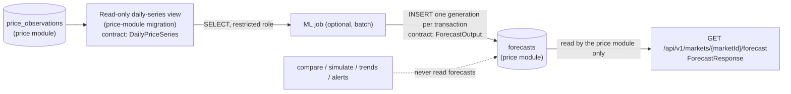

# AgriNex — ML Contract Boundary and Deterministic Fallback

**Status:** AUTHORITATIVE, part of the API contract area (SSOT index area 4). Created by Task 8 on 2026-10-04.

- The contract files govern where they differ: `contracts/forecast-output.schema.json`, `contracts/price-observation.schema.json` (`$defs/DailyPriceSeries`), and the forecast operation in `contracts/openapi.yaml`.
- Architecture: [ML_ARCHITECTURE.md](../architecture/ML_ARCHITECTURE.md) and ADR-0030.
- Labels as in [API_CONVENTIONS.md](API_CONVENTIONS.md).

## 1. Principles

| Principle | Source |
|---|---|
| AgriNex works completely without ML. The deterministic engine is the guaranteed baseline | [SSOT REQUIREMENT] P9, §35, §47 Q12 |
| ML starts only after the deterministic engine works end to end | [SSOT REQUIREMENT] HARD RULE 2 |
| ML is never an input to comparison, scoring, ranking, transport or alerts | [SSOT REQUIREMENT] §16, §35; [ARCHITECTURAL DECISION] ADR-0030; ML_ARCHITECTURE §4.10 |
| No runtime dependency: the backend never calls the ML service | [ARCHITECTURAL DECISION] ADR-0030 item 3 |
| An ML failure never produces a 5xx and never affects core features | [SSOT REQUIREMENT] §29, §35 |
| No prediction, confidence, metric, model identity or training data is fabricated | [SSOT REQUIREMENT] P10; Task 8 instruction |

## 2. The boundary is the database

There is **no request/response API between the backend and ML** [ARCHITECTURAL DECISION, ADR-0030]. The `ml/api` FastAPI service is not used for serving.

- The ML job's database role may SELECT the daily-series view, and INSERT and DELETE rows in `forecasts`. Nothing else (ADR-0030 item 1).
- ML_ARCHITECTURE §4.8 and §4.9 were corrected on 2026-10-04 (Task 8.5) to match ADR-0030 item 3: the backend never calls or checks an ML service, and `agrinex-ml` is a batch job with no serving port. Availability is still a boolean.
- Its credentials live in the deployment environment like every other secret (ADR-0020).

## 3. Input contract: `DailyPriceSeries`

[SSOT REQUIREMENT, spec §35 "Input (from backend/DB)"; ARCHITECTURAL DECISION, ADR-0010 rule 7, ADR-0030 item 5.]

| Field | Meaning |
|---|---|
| `marketId`, `commodityId` | The series key |
| `varietyId`, `gradeId` | Series filters. Always `null` today, because forecasts are built on the representative series (ADR-0030 item 5) |
| `priceUnit` | Unit of every price in the series. A series never mixes units |
| `observations[]` | One point per date, ascending: `date`, `modalPrice`, `minPrice`, `maxPrice` (spec §35), plus `observationId`, `varietyId`, `gradeId` and `sourceDataset` for lineage [CONTRACT DESIGN: provenance additions] |

Selection rules:

- each point is the observation ADR-0010 selects for that date: current-dataset precedence, otherwise the lower-median representative;
- it is never an average, and never interpolated;
- dates without data are absent.

ML trains only on series with at least 90 observations (spec §35; ADR-0030 item 5), with chronological validation and no leakage (spec §35, §47 Q14).

The view's column names are fixed by its migration when the ML track starts. The view must map one-to-one onto this logical record.

## 4. Output contract: `ForecastOutput`

[SSOT REQUIREMENT, spec §35 "Output (written to forecasts table)"; database: `forecasts` in `docs/database/DATA_DICTIONARY.md`.]

| `ForecastOutput` field | `forecasts` column | Rule |
|---|---|---|
| `marketId` | `market_id` | Same for every row of the generation |
| `commodityId` | `commodity_id` | No variety (representative series) |
| `forecastHorizonDays` | `forecast_horizon_days` | 3 or 7 |
| `forecast[].date` | `forecast_date` | Unique within a generation; after `trainingDataThrough` |
| `forecast[].predictedPrice` | `predicted_price` | numeric(14,2), in the input unit |
| `forecast[].lowerBound`, `upperBound` | `lower_bound`, `upper_bound` | As produced, or null. When present, lower ≤ predicted ≤ upper |
| `modelName`, `modelVersion` | `model_name`, `model_version` | Chosen by the ML track. They identify the producing model exactly |
| `mae`, `rmse` | `mae`, `rmse` | Validation metrics of that model version as computed by the ML job, or null. Never filled in by the backend |
| `trainingDataThrough` | `training_data_through` | Last observation date used |
| `generatedAt` | `generated_at` | Shared by every row of the generation |

Write protocol [CONTRACT DESIGN, within ADR-0030]:

1. The job inserts all rows of one generation in one transaction, so a partial generation is never visible.
2. Rows are never updated. A new forecast is a new generation (a new `generatedAt`).
3. Rows are deleted only by the 90-day retention purge (ADR-0029), or by the ML job removing its own faulty generation.
4. The database CHECK constraints (horizon, dates after training, bounds order, non-negative metrics) reject invalid rows. The job validates against `forecast-output.schema.json` before writing.

**Open at ML track start.** Neither spec §35 nor the `forecasts` checks require `predictedPrice` or the bounds to be positive. Whether a non-positive prediction is rejected, stored or hidden is decided when the ML track starts; until then the contract adds no rule.

**Confidence semantics.** The `forecasts` table records bounds without a coverage level. Therefore:

- no confidence percentage exists anywhere in the contract;
- clients may show the bounds only as "model's range", never as "95 % confidence";
- a calibrated level can be added later as an optional field, which is additive.

## 5. Public exposure: `ForecastResponse`

`GET /api/v1/markets/{marketId}/forecast?commodityId=…` is owned by the price module and marked `x-agrinex-phase: OPTIONAL_ML` [ARCHITECTURAL DECISION, ADR-0030 item 4].

| Situation | Response |
|---|---|
| ML track not started | The operation is not implemented, and the frontend shows no forecast section (FRONTEND_ARCHITECTURE §11). Contract tests for it run only with the ML track |
| No forecast dated today or later (the ML job never ran, failed, stopped, or was removed) | 200, `available: false`, `forecasts: []`. No prediction (§29, §35; ML_ARCHITECTURE §4.8: availability is a boolean) |
| Forecast available | 200, `available: true`, `kind: ML_FORECAST`, `inputBasis: REPRESENTATIVE_DAILY_SERIES`, `priceUnit`, and one `forecasts[]` entry (`ForecastSeries`) per horizon with the spec §35 names: `forecastHorizonDays`, `modelName`, `modelVersion`, `generatedAt`, `trainingDataThrough`, `mae`, `rmse`, and `forecast[]`, the latest generation's points dated today or later |
| Unknown or unverified market | 404 (as every public market operation) |
| Database unavailable | 503: a core failure, not an ML failure (§29) |

The public point, `ForecastPointResponse`, is defined in `openapi.yaml` rather than referenced from `forecast-output.schema.json`. A change of the ML output therefore never changes the public response without Frontend review (spec §41).

**Timeouts:** none on the request path, because the backend never calls ML. A slow or hanging ML job only delays new rows. Until they exist, the latest valid generation is served, or `available: false` once its dates have passed.

## 6. Deterministic fallback in the recommendation contract

[SSOT REQUIREMENT, §16, P9; ARCHITECTURAL DECISION, ADR-0023, ADR-0024, ADR-0026, ADR-0030.]

- `MarketComparisonResponse` is complete and valid with no ML anywhere in the system:
  - ranked options, winners and reason codes;
  - estimates, provenance and source status;
  - `decisionBasis.rankingMethod` (`DETERMINISTIC_COMPOSITE_SCORE` for comparisons, `NET_REALIZATION` for simulations).
- `decisionBasis.mlContributed` is `const: false` in contract version 1. A client can always tell that no ML output influenced the result.
- Comparison never reads forecasts (`docs/database/TABLE_OWNERSHIP.md`), so a forecast failure cannot reach it. There is nothing to fall back from: the deterministic result is the only result.
- **Enabling ML later** keeps every existing operation and field unchanged. The ML enhancement is the separate forecast operation, which a client calls per market and commodity when its optional forecast section is enabled.
- **ML influencing a recommendation** (shown inside an option, or used in ranking) would change a business rule. It needs an authorized specification change or an approved decision first (ML_ARCHITECTURE §4.10). The contract path would then be additive:
  - an optional `forecast` property on `SellingOptionResponse`, reusing `ForecastSeries` and its provenance;
  - `mlContributed` relaxed to a boolean;
  - a new extensible `RankingMethod` value.
- **Disabling ML later** leaves the API intact: the forecast operation answers `available: false`.

## 7. Compatibility of the ML contracts

- `forecast-output.schema.json` and the `DailyPriceSeries` definition are versioned like every contract file (`x-agrinex-contract-version`).
- Under spec §41, `forecast-output.schema.json` is produced by ML and reviewed by Backend before merge.
- A change of model, algorithm or training data does not change the contract. It changes only `modelName`, `modelVersion` and the metrics written.
- Adding an optional output field (for example a calibrated interval level) is a minor version and needs a matching migration. Removing or renaming a field is a major version.

## 8. What the ML track must not do

- Write to any table other than `forecasts`, or read anything other than the daily-series view.
- Present a forecast as a reported price, or call the government API.
- Fill in metrics, bounds or confidence values the model did not produce.
- Train on `docs/data/raw/Agriculture_price_dataset.csv` (ADR-0005 item 3).
- Run before the HARD RULE 2 gate and the spec §35 criteria are met.
