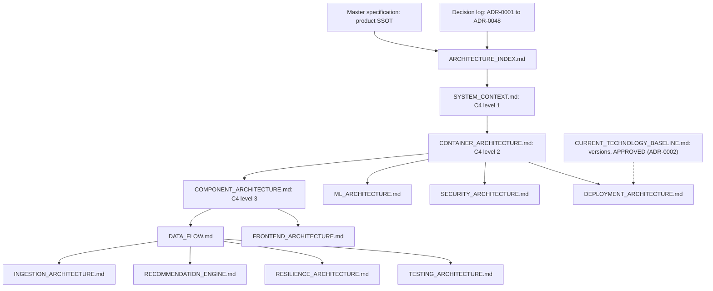

# AgriNex — Architecture Index

**Status:** AUTHORITATIVE. Architecture formalization from Task 6 (2026-10-03), approved in the decision lock of the same day under the delegation recorded in ADR-0001 ([DECISION_LOG.md](DECISION_LOG.md)).

- These documents formalize architecture already defined in the master specification (`docs/01_AGRINEX_MASTER_PRODUCT_PHASES.md`, "spec").
- Statements traced to the spec carry the spec's authority.
- The documents' own organization and interpretations were approved in the decision lock (§14). The decisions that close the spec's gaps are entries ADR-0001 to ADR-0034 in the decision log, plus ADR-0035 to ADR-0042, approved by the Human Project Owner on 2026-10-04, and ADR-0043 to ADR-0048 from the Task 9 final decision lock of the same day.
- Where a document here and a binding decision-log entry differ, the entry governs (decision log, rule 7).

**Versions:** the approved technology baseline ([CURRENT_TECHNOLOGY_BASELINE.md](CURRENT_TECHNOLOGY_BASELINE.md), ADR-0002). Diagrams show technology families only (A-04).

> **Every architecture area is approved.** Implementation of an area may begin once that area's remaining human prerequisites (§13) are met. Each implementation task still verifies current library documentation (CLAUDE.md rules 5–6) and names its tests (CLAUDE.md §L).

**Classification labels used in this document set:**

| Label | Meaning |
|---|---|
| REQUIREMENT FROM SSOT | Stated by the master specification. Cited as (§n) |
| VERIFIED TECHNICAL FACT | Established by current official technical documentation, with its source and date |
| DECISION (ADR-NNNN) | A binding entry in [DECISION_LOG.md](DECISION_LOG.md): APPROVED by a human (ADR-0001, ADR-0002), or DECIDED under the delegation recorded in ADR-0001 |
| ASSUMPTION | A temporary, reversible interpretation (A-n, §10) |
| REQUIRES_DECISION | An item still open in `docs/REQUIRES_DECISION.md` (RD-n, §11). Four remain: RD-002, RD-012, RD-025, RD-037 |
| CONFLICT | Incompatible statements (C-n, §12). All are resolved by decision-log entries |

## 1. Architecture hierarchy

| Level | Source | Authority |
|---|---|---|
| 1 | Master specification (product SSOT). Its architecture sections are §11–§17, §27–§30, §35, §39, and §41–§45 | AUTHORITATIVE. Approved "by virtue of that document" ([DECISION_LOG.md](DECISION_LOG.md), Current state) |
| 2 | Binding decision-log entries | ADR-0001 to ADR-0034 (2026-10-03): 2 APPROVED, 30 DECIDED and 2 DEFERRED. ADR-0035 to ADR-0042 (2026-10-04): 8 APPROVED. ADR-0043 to ADR-0048 (2026-10-04, Task 9 final): 4 APPROVED and 2 DECIDED under the delegation recorded in ADR-0043 |
| 3 | These architecture documents | AUTHORITATIVE for their areas. Subordinate to levels 1 and 2 (CLAUDE.md §B item 3) |
| Downstream | Task 8 (`contracts/`), Task 9 (designs; role file 02), Task 10 (scaffolding), role file 04 | Must conform to the approved architecture. Task 7 (database architecture) is complete: `docs/database/` |

## 2. C4 hierarchy

| Level | Element | Parent | Document |
|---|---|---|---|
| L1 | AgriNex Platform (system) | — | [SYSTEM_CONTEXT.md](SYSTEM_CONTEXT.md) |
| L1 | Farmer; Platform Admin; Verified Buyer (Phase 2) (people) | — | [SYSTEM_CONTEXT.md](SYSTEM_CONTEXT.md) |
| L1 | data.gov.in Current Daily Mandi Prices; data.gov.in Historical Variety-wise Prices (external) | — | [SYSTEM_CONTEXT.md](SYSTEM_CONTEXT.md) |
| L2 | Frontend web application; Backend API (modular monolith); PostgreSQL; Redis; Reverse proxy (Nginx); ML service (optional) | AgriNex Platform | [CONTAINER_ARCHITECTURE.md](CONTAINER_ARCHITECTURE.md) |
| L3 | Phase 1 modules: auth, geography, commodity, price, transport, recommendation, alert, admin, ingestion (with the in-process scheduler) | Backend API | [COMPONENT_ARCHITECTURE.md](COMPONENT_ARCHITECTURE.md) |
| L3 | Phase 2 modules: listing, bid, transaction, rating. Buyer verification belongs to auth (ADR-0031) | Backend API | [COMPONENT_ARCHITECTURE.md](COMPONENT_ARCHITECTURE.md) |
| L3 | Cross-cutting elements: `SecurityConfig`, `WebConfig`, Redis interceptor, `GlobalExceptionHandler`, Bean Validation, repositories, structured logging, health | Backend API | [COMPONENT_ARCHITECTURE.md](COMPONENT_ARCHITECTURE.md) |
| L3 | Frontend components and screens (§13, §25, §30) | Frontend web application | [COMPONENT_ARCHITECTURE.md](COMPONENT_ARCHITECTURE.md), [FRONTEND_ARCHITECTURE.md](FRONTEND_ARCHITECTURE.md) |
| L3 | `ml/forecasting`, `ml/api` | ML service | [ML_ARCHITECTURE.md](ML_ARCHITECTURE.md) |

- Each level-3 element belongs to exactly one level-2 container.
- The spec does not decompose PostgreSQL, Redis, or the reverse proxy further.

## 3. Document map

| Document | Purpose | Primary spec sections | Status |
|---|---|---|---|
| [ARCHITECTURE_INDEX.md](ARCHITECTURE_INDEX.md) | Hub: hierarchy, decisions, conflicts, prerequisites, approval, reconciliation, audit | All architecture sections | AUTHORITATIVE |
| [SYSTEM_CONTEXT.md](SYSTEM_CONTEXT.md) | C4 L1: people, system, external systems | §1, §6, §11, §24, §31, §39 | AUTHORITATIVE |
| [CONTAINER_ARCHITECTURE.md](CONTAINER_ARCHITECTURE.md) | C4 L2: containers and relationships | §12, §45 | AUTHORITATIVE |
| [COMPONENT_ARCHITECTURE.md](COMPONENT_ARCHITECTURE.md) | C4 L3: modules, cross-cutting elements, frontend and ML parts | §12, §13, §27, §28, §30, §43 | AUTHORITATIVE |
| [DATA_FLOW.md](DATA_FLOW.md) | The 17 critical flows, with failure and fallback behavior | §14–§17, §21–§25, §33–§36 | AUTHORITATIVE |
| [INGESTION_ARCHITECTURE.md](INGESTION_ARCHITECTURE.md) | Government-data ingestion | §1, §14, §15, §22, §31, §37 | AUTHORITATIVE |
| [RECOMMENDATION_ENGINE.md](RECOMMENDATION_ENGINE.md) | Deterministic engine and What-If | §5, §16, §17, §21, §32, §33 | AUTHORITATIVE |
| [SECURITY_ARCHITECTURE.md](SECURITY_ARCHITECTURE.md) | Trust boundaries, authentication, RBAC, secrets, edge | §27, §28, §29 | AUTHORITATIVE |
| [RESILIENCE_ARCHITECTURE.md](RESILIENCE_ARCHITECTURE.md) | Failure boundaries and degraded behavior | §27, §29, §35, §37 | AUTHORITATIVE |
| [DEPLOYMENT_ARCHITECTURE.md](DEPLOYMENT_ARCHITECTURE.md) | Services, environments, configuration, TLS, health | §7, §10, §28, §43, §45 | AUTHORITATIVE |
| [FRONTEND_ARCHITECTURE.md](FRONTEND_ARCHITECTURE.md) | Frontend boundary, interaction, required states | §12, §13, §25, §27, §30, §43, §44, §48 | AUTHORITATIVE |
| [ML_ARCHITECTURE.md](ML_ARCHITECTURE.md) | Optional forecasting boundary | §12, §14, §35, §36, §41, §43, §45 | AUTHORITATIVE |
| [TESTING_ARCHITECTURE.md](TESTING_ARCHITECTURE.md) | Test levels, acceptance mapping, test data and environments | §10, §27, §36, §40, §48 | AUTHORITATIVE |
| [DECISION_LOG.md](DECISION_LOG.md) | Binding decisions and departures | — | AUTHORITATIVE; ADR-0001 to ADR-0048 |
| [CURRENT_TECHNOLOGY_BASELINE.md](CURRENT_TECHNOLOGY_BASELINE.md) | Approved versions | — | AUTHORITATIVE (ADR-0002) |

## 4. Component ownership

Team ownership follows the spec's RACI (§40). R = responsible, C = consulted.

| Component or area | R | C |
|---|---|---|
| Frontend farmer comparison flow | Frontend | UI/UX, Backend, QA |
| Design system and tokens; screen design for all states | UI/UX | Frontend (+ QA for screen design) |
| REST API design (all backend API groups) | Backend | Frontend, Data, QA |
| PostgreSQL schema; Flyway migrations | Backend | Data, ML (schema); DevOps (migrations) |
| Ingestion module; normalization rules | Data Engineering | Backend, ML, QA (pipeline); Backend, QA (rules) |
| Transport module | Backend | QA |
| Recommendation module | Backend | Frontend, Data, ML, QA |
| Trend computation (price module) | Backend and Data Engineering | Frontend, ML, QA |
| Alert evaluation (alert module) | Backend | Frontend, QA |
| Admin dashboard (admin module and UI) | Frontend and Backend | UI/UX, Data, QA |
| ML service (optional) | ML | Backend, Data, QA |
| Docker Compose and infrastructure; CI/CD | DevOps | Backend, QA |
| Security implementation | Backend | Frontend, DevOps, QA |
| Phase 2 listing, bid, and transaction | Frontend and Backend | UI/UX, QA |
| Unit tests (backend) | Backend | QA |
| E2E tests; API contract tests; research evaluation | QA | Frontend, Backend (and Data, ML for evaluation) |
| Documentation, including these architecture documents | QA | All roles |

**Contract producers (§41):**

| Contract | Producer |
|---|---|
| `contracts/openapi.yaml` | Backend (hand-authored, ADR-0022) |
| `contracts/price-observation.schema.json` | Data Engineering |
| `contracts/recommendation.schema.json` | Backend |
| `contracts/forecast-output.schema.json` | ML |
| `contracts/error-response.schema.json` | Backend (RFC 9457 Problem Details, ADR-0022) |
| `frontend/__mocks__/api/*.json` | Backend (initial) |
| `fixtures/seed_data.sql` (reference seed, loaded by Flyway, ADR-0021) | Data Engineering |
| `infra/.env.example` | DevOps |

The project owner approved the architecture through the delegation recorded in ADR-0001 (§14). The master specification's Document Owner is the Team Lead / Product Manager (spec header).

## 5. Document dependencies

| Document | Depends on | Feeds |
|---|---|---|
| SYSTEM_CONTEXT | Spec | CONTAINER, SECURITY, DATA_FLOW |
| CONTAINER_ARCHITECTURE | SYSTEM_CONTEXT | COMPONENT, SECURITY, RESILIENCE, DEPLOYMENT, ML |
| COMPONENT_ARCHITECTURE | CONTAINER | DATA_FLOW, INGESTION, RECOMMENDATION, FRONTEND, SECURITY |
| DATA_FLOW | COMPONENT, CONTAINER | INGESTION, RECOMMENDATION, RESILIENCE, TESTING |
| INGESTION_ARCHITECTURE | SYSTEM_CONTEXT, COMPONENT | RECOMMENDATION, RESILIENCE, TESTING |
| RECOMMENDATION_ENGINE | INGESTION, COMPONENT | FRONTEND, TESTING |
| SECURITY_ARCHITECTURE | CONTAINER, COMPONENT | DEPLOYMENT, FRONTEND |
| RESILIENCE_ARCHITECTURE | CONTAINER, INGESTION, RECOMMENDATION, ML | TESTING, FRONTEND |
| DEPLOYMENT_ARCHITECTURE | CONTAINER, SECURITY, technology baseline | TESTING |
| FRONTEND_ARCHITECTURE | COMPONENT, SECURITY, RECOMMENDATION | TESTING |
| ML_ARCHITECTURE | INGESTION, CONTAINER | RESILIENCE, TESTING |
| TESTING_ARCHITECTURE | All of the above | — |

**What the downstream tasks consume:**

| Task | Documents consumed | Prerequisites |
|---|---|---|
| Task 7 (database) | Done: `docs/database/` (AUTHORITATIVE) | — |
| Task 8 (API) | COMPONENT (API groups), SECURITY (auth per endpoint), RECOMMENDATION, FRONTEND, DATA_FLOW; decision log (especially ADR-0022 and ADR-0023); `docs/database/` | None open (§13) |
| Task 9 (UI) | FRONTEND, RESILIENCE (user-visible states), SECURITY (auth interaction) | Role file 02 and recorded design approvals (ADR-0027) |
| Task 10 (scaffolding) | CONTAINER, DEPLOYMENT, TESTING, and the approved technology baseline | Tooling decisions per ADR-0034 at scaffolding time |

## 6. Critical data flows

These flows are detailed in [DATA_FLOW.md](DATA_FLOW.md).

| ID | Flow | Phase |
|---|---|---|
| F-01 | Farmer decision journey | 1 |
| F-02 | Government current-price ingestion | 1 |
| F-03 | Historical ingestion and bootstrap | 1 |
| F-04 | Normalization and persistence | 1 |
| F-05 | Market comparison | 1 |
| F-06 | Transport-cost calculation | 1 |
| F-07 | Net-realization calculation | 1 |
| F-08 | Deterministic recommendation | 1 |
| F-09 | Trends | 1 |
| F-10 | ML forecasting | Optional |
| F-11 | Alerts | 1 (Should) |
| F-12 | What-If simulation | 1 (Should) |
| F-13 | Admin monitoring and configuration | 1 |
| F-14 | Authentication | 1 |
| F-15 | Evaluation | 1 |
| F-16 | Reference-data seeding | 1 |
| F-17 | Listing → bid → transaction → rating; buyer verification | 2 |

## 7. Phase 1 architecture

**"Where should I consider selling?" Phase 1 must stand alone (P8).**

| Aspect | Phase 1 elements |
|---|---|
| People | Farmer (anonymous or registered), Platform Admin |
| Containers | Frontend, Backend, PostgreSQL, Redis, Reverse proxy. **ML is optional, not Phase 1 core** |
| Backend modules | auth, geography, commodity, price, transport, recommendation, alert, admin, ingestion |
| Flows | F-01 to F-09, F-11 to F-16 |
| Security | JWT access tokens and rotated refresh tokens; RBAC (roles FARMER, BUYER, ADMIN all defined in Phase 1, FR-20); API key protection; validation; rate limiting; TLS; secure headers; PII minimization (ADR-0016, ADR-0017, ADR-0020) |
| Gate | §10 freeze checklist (DATA, BACKEND, FRONTEND, RESILIENCE, DEPLOYMENT, EVALUATION) and §48 Phase 1 acceptance criteria |

## 8. Phase 2 architecture

**"Can AgriNex help me act on that decision?"** Phase 2 starts only after the Phase 1 Freeze (HARD RULE 1).

| Aspect | Phase 2 elements |
|---|---|
| People | Verified Buyer. Farmer and Admin gain Phase 2 use cases |
| Containers | No new containers (§12, §45). Verification documents are stored in PostgreSQL (ADR-0031) |
| Backend modules | listing, bid, transaction, rating. Buyer verification and its documents belong to auth (ADR-0031) |
| Flows | F-17 (§19, §23) |
| Security | Verified-buyer bid gate (403); listing-owner checks; `SELECT … FOR UPDATE` acceptance (409); document access control |
| Gate | §48 Phase 2 acceptance criteria |
| Deferred | RD-012 (state model), RD-025 (OTP provider, listing TTL value): ADR-0032 |

**Direction of dependency.** Phase 2 depends on Phase 1:

- listings reference a Phase 1 `recommendation_run` (§23, §47 Q23);
- Phase 2 uses Phase 1 authentication and roles.

No Phase 1 component depends on a Phase 2 component, so Phase 2 is not a hidden dependency of Phase 1.

**Shared foundations:** the auth module and RBAC model, the `users` table, and recommendation runs.

**Intentionally deferred:**

- all Phase 2 implementation;
- the optional ML track (HARD RULE 2, §35);
- email alerts (an optional enhancement, §34);
- everything in §38 future scope;
- everything in §39 out of scope.

## 9. Architectural decisions

- **Architecture established by the spec** is REQUIREMENT FROM SSOT, approved by virtue of the spec:

  | Architecture decision | Spec |
  |---|---|
  | Modular monolith backend; no microservices or Kubernetes | §12, §39, §47 Q11 |
  | PostgreSQL as the single primary database type, with Flyway migrations | §12, §47 Q10 |
  | Redis, at least for rate limiting | §12, §28 |
  | Nginx reverse proxy with TLS termination | §12, §28, §45 |
  | Server-side ingestion inside the backend, scheduled every 6 h, plus manual and startup triggers | §12, §15, §22, §31 RULE 1 |
  | Deterministic decision engine; ML optional and outside the ranking | P9, §10 HARD RULE 2, §16, §35 |
  | REST `/api/v1/*` with JWT Bearer; one API group per module | §12, §30 |
  | RBAC with FARMER, BUYER, ADMIN | §28, FR-20 |
  | Contract-first, with `contracts/` and the Shared Contract Change Rule | P5, §41 |
  | Docker Compose deployment on a cloud VM; reproducible from `.env.example` | F1.25, §7, §10, §45 |
  | Module boundary rule: no cross-module direct DB access | §27 |
  | Phase gate | §10 HARD RULE 1 |

- **Decision-log entries** complete the spec where it leaves gaps or contradicts itself:

  | Area | Entries |
  |---|---|
  | Governance and technology | ADR-0001 (delegation and lock), ADR-0002 (baseline), ADR-0003 (Maven), ADR-0004 (browser floor), ADR-0034 (deferred tooling) |
  | Government data and ingestion | ADR-0005 (source, evidence, outages), ADR-0006 (coverage, vocabularies), ADR-0007 (dates, IST), ADR-0008 (unit, validation), ADR-0009 (identity, conflicts, revisions), ADR-0011 (orchestration), ADR-0012 (completeness) |
  | Domain rules | ADR-0010 (observation selection), ADR-0014 (geography, markets), ADR-0015 (localized names), ADR-0024 (scoring), ADR-0025 (trends), ADR-0026 (What-If) |
  | Module structure and data | ADR-0013 (ownership and dependencies), ADR-0029 (retention), ADR-0030 (ML integration) |
  | Security and edge | ADR-0016 (accounts and tokens), ADR-0017 (routing, CORS, browser tokens, rate limits), ADR-0018 (Redis), ADR-0020 (admin boundary, secrets, audit), ADR-0028 (demo credentials and data), ADR-0033 (MCP credentials) |
  | Task 8 follow-up (2026-10-04) | ADR-0035 (read-only ports), ADR-0036 (Earth radius), ADR-0037 (erasure procedure), ADR-0038 (transport label), ADR-0039 (origin check, recommendation → geography), ADR-0040 (estimate precision), ADR-0041 (deactivation procedures), ADR-0042 (security sign-off) |
  | Task 9 final decision lock (2026-10-04) | ADR-0043 (approved UI/UX direction and screens), ADR-0044 (design decisions PDD-01 to PDD-14), ADR-0045 (recommendation wording), ADR-0046 (Marathi and Hindi copy ownership), ADR-0047 (account email, login identifiers, password recovery), ADR-0048 (verification and recovery mechanism, email delivery) |
  | Interaction and delivery | ADR-0019 (alerts), ADR-0021 (deployment topology), ADR-0022 (API contract conventions), ADR-0023 (comparison contract), ADR-0027 (design source of record) |
  | Phase 2 | ADR-0031 (placements), ADR-0032 (deferred) |

  Departures from the spec's text are listed in the decision log's departures table (D-01 to D-16).

## 10. Assumptions

| ID | Assumption | Why it was unavoidable | Reversible? |
|---|---|---|---|
| A-01 | §43's conditional `data-pipeline/` ("Standalone ingestion scripts (if not in Spring Batch)") and Spring Batch are **not activated**. Ingestion is the backend ingestion module, triggered by the in-process Spring Scheduler | §43 is conditional, while §12, §13, §15, and §22 all place ingestion in the backend. The container model needs one definite structure. ADR-0011 builds on it | Yes. A later decision could activate it |
| A-02 | **A single backend instance** runs, so the in-process scheduler fires once per schedule, and the in-process rate-limit fallback (ADR-0018) needs no coordination | §45 lists one `agrinex-backend` service, and ADR-0021 deploys one VM. More instances would need a new decision | Yes |
| A-03 | UC6's "(for alerts/history)" (§24) adds **no Phase 1 history screen or endpoint** | The final Phase 1 feature list (F1.1–F1.25) has no history feature, and §30 lists no history endpoint | Yes. A spec update would add it |
| A-04 | Architecture diagrams show **technology families without version numbers**. Versions live in the approved baseline (ADR-0002) | Version labels in diagrams would duplicate the baseline and go stale | Yes |
| A-05 | These documents became **AUTHORITATIVE** in the decision lock. Statements traced to the spec carry its authority, and decision-log entries govern where they differ | Task 6 assigned approval to the project owner, who delegated it (ADR-0001). CLAUDE.md §B item 3 governs subordinate documents | Yes |

## 11. REQUIRES_DECISION items

The full text of each item is in `docs/REQUIRES_DECISION.md`. **Resolved by the decision lock (2026-10-03):**

| ID | Decision | Resolution |
|---|---|---|
| RD-001 | Technology version baseline | ADR-0002 |
| RD-003 | Ingestion coverage and the commodity "known list" | ADR-0006 |
| RD-004 | Government date formats | ADR-0007 |
| RD-005 | Upsert behavior on a `business_key` conflict | ADR-0009 |
| RD-006 | Compare field names and no-data semantics | ADR-0023 |
| RD-007 | Composite scoring gaps | ADR-0024 |
| RD-008 | Meaning of FR-14's "30-day trend direction" | ADR-0025 |
| RD-009 | What-If rules | ADR-0026 |
| RD-010 | Design source of record | ADR-0027 |
| RD-011 | Demo admin credentials on a public deployment | ADR-0028 |
| RD-013 | Build tool | ADR-0003 |
| RD-014 | Browser floor | ADR-0004 |
| RD-015 | Price-observation selection for comparison, trends, and alerts | ADR-0010 |
| RD-016 | Ingestion run orchestration | ADR-0011 |
| RD-017 | Module data ownership and cross-module access | ADR-0013 |
| RD-018 | Geographic reference data source; unknown markets | ADR-0014 |
| RD-019 | Redis responsibilities and failure behavior | ADR-0018 |
| RD-020 | Alert and notification delivery | ADR-0019 |
| RD-021 | Public routing, origin layout, browser token handling | ADR-0017 |
| RD-022 | Deployment topology | ADR-0021 |
| RD-023 | OpenAPI contract source of truth | ADR-0022 |
| RD-024 | Backend–ML integration and forecast exposure | ADR-0030 |
| RD-026 | Demo price data vs the no-fabrication rule | ADR-0028 |
| RD-027 to RD-036 | Database decisions from Task 7 | ADR-0006 to ADR-0009, ADR-0012, ADR-0014 to ADR-0016, ADR-0029 ([DATABASE_INDEX.md §8](../database/DATABASE_INDEX.md#8-decisions-applied-and-remaining-open-items)) |

**Still open:**

| ID | Item | Status | Blocks |
|---|---|---|---|
| RD-002 | Inline credentials in `.mcp.json` | Decided by ADR-0033; awaiting user action | Commits that include `.mcp.json`; pushes |
| RD-012 | Phase 2 state model | DEFERRED (ADR-0032) | Phase 2 only |
| RD-025 | Phase 2 OTP provider and listing TTL value | DEFERRED (ADR-0032); the rest is decided by ADR-0031 | Phase 2 only |
| RD-037 | Hosting procurement (cloud VM, region, size, domain) | Needs human input | The public deployment only |

## 12. Conflicts

### 12.1 Conflicts between sources

There are **no conflicts between separate authoritative sources**.

- Where a decision-log entry departs from the spec's text, the departure is quoted and listed in the decision log (D-01 to D-13). It is a recorded decision, not an open conflict.
- The baseline's VERIFIED TECHNICAL FACTS (Spring Boot 3.3.x, Next.js 14 and `nginx:1.25` are out of support) are handled by ADR-0002.

### 12.2 Conflicts within the master specification, found in Task 6

| ID | Source A | Source B | Exact conflict | Architectural impact | Affected documents | Resolution |
|---|---|---|---|---|---|---|
| C-01 | §1 dataset "Use" (current: comparison and alerts; historical: trends and bootstrap); F1.7; §33 "Data source: historical" | §16 and §33 step 1 queries, which have no dataset, variety, or grade filter; §14 business key includes `source_dataset_id` | The dataset roles are stated, but the selection queries mix both datasets and all varieties. Same-day rows from both datasets coexist | Comparisons and trends could double-count or pick an arbitrary observation | DATA_FLOW, RECOMMENDATION, INGESTION, ML | ADR-0010 (current-dataset precedence, exact filters, lower-median representative; D-08) |
| C-02 | §27 ("No cross-module direct DB access"); §13 (ingestion → price); §34 (`AlertEvaluationService`) | §15 and §22 (`IngestionService` upserts `price_observations`, reads `price_alerts`, inserts `alert_events` directly) | The ingestion sequence touches tables that the module rule and the dependency diagram place behind other modules | Table ownership and invocation paths | COMPONENT, INGESTION, DATA_FLOW | ADR-0013 |
| C-03 | §12 (backend → ML, "reads forecasts"); §43 (`ml/api` "if serving forecasts") | §14 and §35 (forecasts written to a PostgreSQL table that the backend reads) | Two different forecast read paths | Runtime dependency, failure containment, network exposure of `agrinex-ml` | ML, CONTAINER, RESILIENCE, DEPLOYMENT | ADR-0030 (database-only integration) |
| C-04 | §12 Redis: "Rate limiting, Session cache, Alert queue" | §45: "Rate limiting, cache"; §28 (stateless JWT, refresh tokens in the DB); §34 (alert events in PostgreSQL) | Redis's responsibilities are described inconsistently | What Redis holds and what happens when it fails | CONTAINER, SECURITY, RESILIENCE | ADR-0018, ADR-0019 (D-09) |
| C-05 | §43 (`infra/docker-compose.yml`, `infra/docker-compose.dev.yml`, root `docker-compose.yml` "Production compose file"; `infra/.env.example` and root `.env.example`); §10 ("Demo fixture data loads on first boot") | §41 (`infra/.env.example` is the contract); §45 (copy `infra/.env.example` to `.env`, run at the root, seed manually with `psql`) | Overlapping compose and env files; automatic vs manual seeding | Environment definitions and the initialization procedure | DEPLOYMENT, TESTING | ADR-0021 (D-12) |
| C-06 | P5 ("Every interface defined in writing before implementation"); §42 item 2 (OpenAPI skeleton first); §41 (change rule, version increments) | §10 ("OpenAPI spec generated and exported to `contracts/openapi.yaml`") | Hand-authored contract vs a contract generated from code | Which artifact is authoritative; drift control | COMPONENT, FRONTEND, TESTING | ADR-0022 (D-11) |
| C-07 | P10 ("Never invent or synthesize price data"); §31 RULE 5 | §21 note ("Adjust data for demo to show disagreement"); §46 ("Adjust the demo data to ensure rankings disagree") | Demo-data adjustment vs the no-fabrication rule | Integrity of the demo fixtures | TESTING, DEPLOYMENT | ADR-0028 |

### 12.3 Conflicts within the spec registered earlier

| RD | Conflict | Resolution |
|---|---|---|
| RD-004 | Date formats | ADR-0007 (D-06) |
| RD-005 | Upsert semantics | ADR-0009 (D-07) |
| RD-006 | Compare field names | ADR-0023 |
| RD-008 | FR-14 vs §33 | ADR-0025 |
| RD-009 | What-If formula vs §32 | ADR-0026 (D-13) |
| RD-012 | Phase 2 state model | DEFERRED (ADR-0032) |

## 13. Implementation prerequisites

Every architecture area is approved and every Phase 1 decision is taken. The prerequisites below are human actions or later-task decisions, not open architecture decisions.

| Area | Prerequisite |
|---|---|
| Any commit or push | RD-002 user actions (ADR-0033) |
| Backend scaffolding | None. Maven 3.10.x (ADR-0003), approved baseline (ADR-0002). Workstation upgrade to Java 25 (baseline §6) |
| Frontend scaffolding | Node 24 on the workstation; tooling choices under ADR-0034 |
| Infrastructure scaffolding (compose, Dockerfiles, `nginx.conf`) | None (ADR-0017, ADR-0018, ADR-0021). CI system choice under ADR-0034 |
| API contracts (Task 8) | None (ADR-0022, ADR-0023 and the decisions they cite) |
| UI and design (Task 9) | Role file 02 and design approvals recorded by the Document Owner (ADR-0027) |
| Reference-data seed | Survey of India boundaries, LGD lists, unit-evidence exports, curated translations ([SEED_AND_REFERENCE_DATA.md §11](../database/SEED_AND_REFERENCE_DATA.md#11-prerequisites)) |
| Ingestion, recommendation, alerts, security implementation | None beyond the decisions. Security-sensitive changes need human review before merge (CLAUDE.md rule 16) |
| Public deployment | RD-037 (hosting procurement); first-admin bootstrap (ADR-0028); RD-002 resolved |
| ML (optional) | The §35 criteria and HARD RULE 2 (ADR-0030) |
| Phase 2 | Phase 1 Freeze (HARD RULE 1), RD-012 and RD-025 (ADR-0032) |

## 14. Architecture approval checklist

Approved on 2026-10-03 in the decision lock, under the delegation recorded in ADR-0001 ([DECISION_LOG.md](DECISION_LOG.md)).

- [x] System Context approved
- [x] Container Architecture approved
- [x] Component Architecture approved
- [x] Data Flow approved
- [x] Ingestion Architecture approved
- [x] Recommendation Architecture approved
- [x] Security Architecture approved
- [x] Resilience Architecture approved
- [x] Deployment Architecture approved
- [x] Frontend Architecture approved
- [x] ML Architecture approved
- [x] Testing Architecture approved
- [x] Phase 1 / Phase 2 boundary approved
- [x] All required architecture decisions resolved (Phase 2 items deferred by ADR-0032)
- [x] All conflicts resolved

---

## Appendix A — Reconciliation

This appendix compares the spec's architecture with `CURRENT_TECHNOLOGY_BASELINE.md`, `docs/REQUIRES_DECISION.md`, `DECISION_LOG.md`, and the repository, as of the decision lock (2026-10-03).

| # | Item | Sources compared | Classification |
|---|---|---|---|
| 1 | Technology families: Java, Spring Boot, Next.js, TypeScript, PostgreSQL, Redis, Python (optional), Docker | Spec header, §12 | REQUIREMENT FROM SSOT |
| 2 | Technology versions | Spec header, §12, §45 vs the baseline | DECISION (ADR-0002), departures D-01 to D-05. VERIFIED TECHNICAL FACT: Spring Boot 3.3.x, Next.js 14 and `nginx:1.25` are out of support |
| 3 | Architecture decisions in the log | `DECISION_LOG.md` | ADR-0001 to ADR-0048 |
| 4 | Repository structure | §43 vs the repository, which holds only docs and tooling | REQUIREMENT FROM SSOT (planned). Not created yet; no conflict |
| 5 | Master spec file path | §43 (mixed case) vs the actual uppercase path | Resolved by explicit user instruction in Task 4 (SSOT index note) |
| 6 | Scheduler placement | §12 draws it in its own box but labels it "inside BE process" | REQUIREMENT FROM SSOT. Modeled as a backend component |
| 7 | Frontend placement | §12 "Client Browser" vs §45 `agrinex-frontend` service | REQUIREMENT FROM SSOT. One container with both server-side and browser execution; no server-side backend calls in Phase 1 (ADR-0017) |
| 8 | `data-pipeline/`, Spring Batch | §43 (conditional) | ASSUMPTION A-01 |
| 9 | Backend instance count | §45 | ASSUMPTION A-02 |
| 10 | UC6 "history" | §24 vs §7, §30 | ASSUMPTION A-03 |
| 11 | Version-free diagrams | Spec labels vs the baseline | ASSUMPTION A-04 |
| 12 | Status of these documents | Task 6, CLAUDE.md §B, ADR-0001 | ASSUMPTION A-05 |
| 13 | Dataset roles vs selection queries | §1, F1.7, §33 vs §16, §33, §14 | CONFLICT C-01, resolved by ADR-0010 |
| 14 | Module rule vs ingestion and alert sequence | §27, §13, §34 vs §15, §22 | CONFLICT C-02, resolved by ADR-0013 |
| 15 | ML forecast path | §12, §43 vs §14, §35 | CONFLICT C-03, resolved by ADR-0030 |
| 16 | Redis responsibilities | §12 vs §45, §28, §34 | CONFLICT C-04, resolved by ADR-0018 and ADR-0019 |
| 17 | Compose, env files, seeding | §43, §10 vs §41, §45 | CONFLICT C-05, resolved by ADR-0021 |
| 18 | OpenAPI authorship | P5, §42, §41 vs §10 | CONFLICT C-06, resolved by ADR-0022 |
| 19 | Demo data adjustment | P10, §31 vs §21, §46 | CONFLICT C-07, resolved by ADR-0028 |
| 20 | Alert delivery ("polled or pushed"); admin alert channel; alert-event retrieval | §34, §15, §30 | DECISION (ADR-0019) |
| 21 | Nginx routing, origin layout, CORS in two places, token storage, client IP, actuator exposure | §12, §28, §29, §45 | DECISION (ADR-0017) |
| 22 | Geographic data source; markets not in the reference data | FR-06, §16, §20, §42 | DECISION (ADR-0014) |
| 23 | Historical cadence, bootstrap trigger, overlapping runs, resume, status rule | §10, §15, §22, §29, §37, §43 | DECISION (ADR-0011) |
| 24 | OTP provider, document storage, verification ownership, expiry mechanism | §11, §12, §18, §19, §28, §39 | DECISION (ADR-0031) for storage, ownership and mechanism; DEFERRED (ADR-0032) for the OTP provider and TTL value |
| 25 | Email alert delivery | §34 ("optional enhancement") | REQUIREMENT FROM SSOT (optional). Not in Phase 1 (ADR-0019) |
| 26 | Faculty Evaluator persona | §6 ("Documentation Persona") | REQUIREMENT FROM SSOT. Not a system actor |
| 27 | Out-of-scope items | §39 | REQUIREMENT FROM SSOT. All excluded |
| 28 | Origin coordinates | FR-06, §28, §47 Q6 | REQUIREMENT FROM SSOT. District centroid; no exact address (ADR-0014) |
| 29 | Test tools not named by the spec | §48 names only k6 and Chrome DevTools | DEFERRED to scaffolding (ADR-0034) |

## Appendix B — Architecture audit against the master specification

| # | Check | Result | Evidence |
|---|---|---|---|
| 1 | System Context matches the spec | Consistent | Every §11 person, system, external system, and relationship is present, and nothing was added. The Faculty Evaluator is excluded per §6 |
| 2 | Containers match the spec | Consistent | Six containers from §12 and §45. The scheduler is modeled as a backend component, as "inside BE process" requires |
| 3 | Components and modules match the spec | Consistent | All 13 §12 modules, the §13 dependencies plus those approved in ADR-0013, and the §30 API groups, with no extra modules. Verification belongs to auth (ADR-0031) |
| 4 | Data flows match the spec | Consistent | F-01 to F-17 trace to §14–§36, completed by ADR-0009 to ADR-0013 and ADR-0019 |
| 5 | Ingestion matches the spec | Consistent | Pipeline from §14, §15 and §22, completed by ADR-0005 to ADR-0009, ADR-0011, ADR-0012 and ADR-0014 |
| 6 | Recommendation logic matches the spec | Consistent | §16, §32 and §33 rules quoted, completed by ADR-0010 and ADR-0023 to ADR-0026 |
| 7 | Deterministic decisioning precedes optional ML | Consistent | HARD RULE 2. §16 has no forecast term. ML reaches only the separate forecast section (ADR-0030) |
| 8 | ML remains optional | Consistent | P9, §35, §45. ML is drawn dashed and kept off every core path |
| 9 | Security boundaries match the spec | Consistent | §27, §28 and §29 controls, completed by ADR-0016 to ADR-0018, ADR-0020 and ADR-0028 |
| 10 | Resilience behavior matches the spec | Consistent | §29, §35 and §37 reproduced. Source outages are covered by ADR-0005 and Redis failure by ADR-0018 |
| 11 | Deployment matches the spec | Consistent | §45 services and the §7 cloud VM, completed by ADR-0021 |
| 12 | Frontend and backend responsibilities match | Consistent | §12, §28, §30, §31 RULE 1, §47 Q19 |
| 13 | Phase 1 / Phase 2 boundaries preserved | Consistent | HARD RULE 1. No Phase 1 → Phase 2 dependency (§8) |
| 14 | Out-of-scope items remain excluded | Consistent | No microservices or Kubernetes, payment, logistics marketplace, native apps, LLM chatbot, or unverified external APIs. No geocoding service (ADR-0014) |
| 15 | Technology versions are approved | Consistent | ADR-0002; departures listed (D-01 to D-05) |
| 16 | No undocumented architecture introduced | Consistent | Every diagram node traces to a spec section or a decision-log entry |
