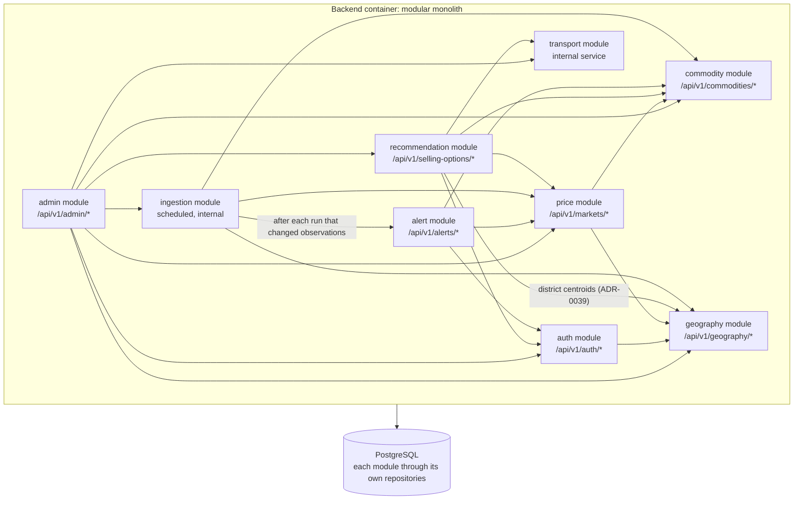
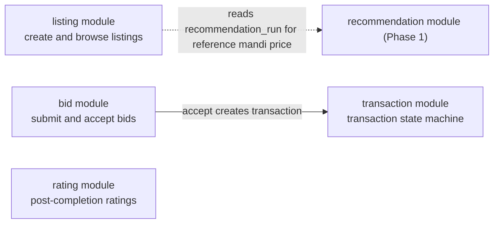
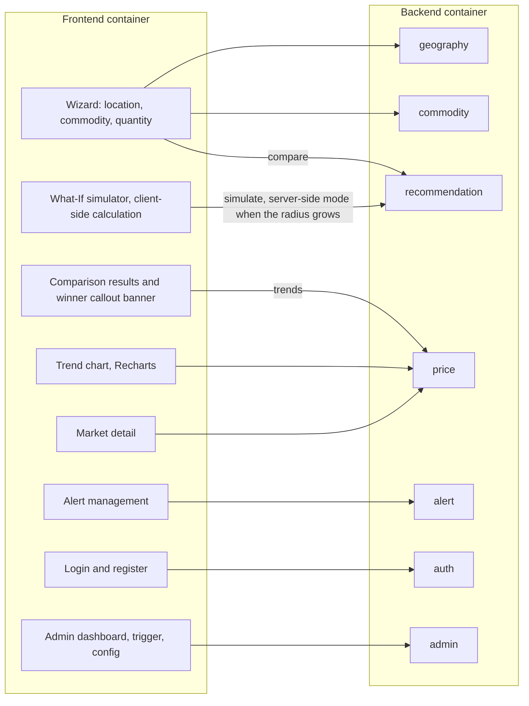

# AgriNex — Component Architecture (C4 Level 3)

**Status:** AUTHORITATIVE. Architecture formalization from Task 6 (2026-10-03), approved in the decision lock of the same day (ADR-0001; [ARCHITECTURE_INDEX.md §14](ARCHITECTURE_INDEX.md#14-architecture-approval-checklist)).

- This document formalizes architecture already defined in the master specification (`docs/01_AGRINEX_MASTER_PRODUCT_PHASES.md`, "spec").
- Statements traced to the spec carry the spec's authority.
- Where the spec leaves a gap or contradicts itself, the decision log ([DECISION_LOG.md](DECISION_LOG.md)) records the decision, and this document cites the entries it applies. Where this document and a binding entry differ, the entry governs.

**Versions:** technology families only. Versions are in the approved baseline (ADR-0002; `CURRENT_TECHNOLOGY_BASELINE.md`).

## 1. Purpose

This document decomposes each container from [CONTAINER_ARCHITECTURE.md](CONTAINER_ARCHITECTURE.md) into the components the spec defines. Every component below belongs to exactly one container and has a documented responsibility.

## 2. Scope

**In scope:**

- backend modules (Phase 1 and Phase 2);
- cross-cutting backend elements named by the spec;
- frontend components and screens;
- the optional ML service's parts.

**Covered elsewhere:**

- detailed ingestion internals: [INGESTION_ARCHITECTURE.md](INGESTION_ARCHITECTURE.md);
- detailed recommendation internals: [RECOMMENDATION_ENGINE.md](RECOMMENDATION_ENGINE.md);
- the frontend in depth: [FRONTEND_ARCHITECTURE.md](FRONTEND_ARCHITECTURE.md).

## 3. SSOT traceability

| Element | Spec sources |
|---|---|
| Backend module list | §12 ("Modules: auth / geography / commodity / price / ingestion / transport / recommendation / alert / admin / listing / bid / transaction / rating") |
| Phase 1 module diagram and dependencies | §13 |
| API groups per module | §30 |
| Module boundary rule | §27 ("No cross-module direct DB access; each module owns its repositories"), §47 Q11 |
| Cross-cutting backend elements | §27, §28 |
| Frontend components | §13, §25, §30, §42 items 17–26, §43 |
| ML parts | §43 (`ml/forecasting`, `ml/api`) |

## 4. Architecture

### 4.1 Backend modules: Phase 1

Every arrow between modules is an approved dependency:

- §13 gives recommendation → transport, recommendation → price, ingestion → price, and admin → ingestion. §30 gives "admin → ingestion" for the manual trigger.
- ADR-0013 approves the others, and the paths that §15, §22 and §34 describe. Each one, with its purpose, is listed in [TABLE_OWNERSHIP.md §4](../database/TABLE_OWNERSHIP.md#4-module-dependencies-required-by-this-ownership).
- After a run commits, ingestion invokes alert evaluation, in its own transaction (ADR-0019).
- ADR-0039 adds recommendation → geography, used only to read district centroids for the origin check of a comparison.
- The graph is acyclic: geography, commodity and transport are leaves, and no module depends on admin.

**Read-only ports** (ADR-0035). They are permitted runtime paths over the edges above. In each, a consuming module declares an interface and the owning module implements it, so no table is read across a boundary:

| Data | Port declared by | Implemented by | Edge used |
|---|---|---|---|
| Latest current-dataset sync status | price (`SourceSyncStatusPort`) | ingestion | ingestion → price |
| Active freshness thresholds (market detail, trends, alerts, commodity filter) | price (`FreshnessPolicyPort`) | recommendation | recommendation → price |
| Commodities with recent observations in coverage | commodity (`CommodityAvailabilityPort`) | price | price → commodity |

Recommendation and alert obtain the sync status through the price module's interface. A comparison or simulation passes the thresholds of its own weights version into price's selection call.

No other module-to-module dependency exists. Adding one needs a new decision.

### 4.2 Backend module catalogue

The spec does not assign table ownership; ADR-0013 does. The "Tables owned" column lists each module's tables. The full detail, with access patterns and prohibited access, is in [TABLE_OWNERSHIP.md](../database/TABLE_OWNERSHIP.md).

| Module | Phase | Responsibilities (spec, completed by decisions) | API group → response types (§30) | Depends on | Tables owned (ADR-0013) | Responsible role (§40) |
|---|---|---|---|---|---|---|
| auth | 1 | Register, login, refresh, logout (§10). BCrypt password hashing, cost ≥12 (`AuthService`). HS256 JWT access tokens, 15 min (`JwtService`). Refresh tokens: SHA-256-hashed, stored in the DB, 7-day TTL, rotated (§27, §28). Email verification and password recovery with single-use emailed links, and the outbound email adapter (Resend through `RestClient`) that sends them after commit (ADR-0047, ADR-0048) | `POST /api/v1/auth/*` → `AuthResponse` (verification and recovery operations answer 202 or 204 without a body) | geography (ADR-0013) | `users`, `farmer_profiles` (§20); `refresh_tokens` (§28; rotation with token families, ADR-0016) | Backend ("Security implementation") |
| geography | 1 | Serves the State → District → Locality hierarchy (F1.3), including district centroid coordinates, from which the frontend derives the farmer's origin (§21 step 3, FR-06). Must respond in < 300 ms with caching (§27) | `GET /api/v1/geography/*` → `StateResponse`, `DistrictResponse`, `LocalityResponse` | — | `states`, `districts`, `localities`, `district_source_aliases` (district resolution for ingestion, ADR-0014) | Backend |
| commodity | 1 | Serves commodities, varieties, and grades (F1.4), with localized names (`name_hi`, `name_mr`, §20). Must respond in < 300 ms with caching (§27) | `GET /api/v1/commodities/*` → `CommodityResponse`, `VarietyResponse` | — | `commodities` (with verified units, ADR-0008), `varieties`, `grades` | Backend |
| price | 1 | Market detail. Returns the freshest available market prices (§10) through the selection rules of ADR-0010. Computes trends (§33; ADR-0025). Serves price data to the recommendation and alert modules. Stores observations and their revisions (ADR-0009). Registers and curates markets (ADR-0014) | `GET /api/v1/markets/{id}` → `MarketDetailResponse`; `GET /api/v1/markets/{id}/trends` → `TrendResponse`; optional forecast endpoint (ADR-0030) | geography, commodity (ADR-0013) | `source_datasets`, `markets`, `market_source_aliases`, `price_observations`, `price_observation_revisions`; `forecasts` (optional) | Backend; trend computation is shared with Data (§40) |
| transport | 1 | Haversine distance and the configurable transport-cost formula (§16, §32; §42 item 11). Kept isolated so routing-based distance could replace it later (§38) | None (internal service, §13) | — | `transport_assumptions` (§32) | Backend |
| recommendation | 1 | Comparison: candidate discovery, gross and net realization, composite scoring, reason codes, ranking, price-only and net winners, persistence (§16; ADR-0023, ADR-0024). What-If server-side mode (§17; ADR-0026). Rate-limited (§28; ADR-0017) | `POST /api/v1/selling-options/compare`, `POST /api/v1/selling-options/simulate` → `MarketComparisonResponse` | transport, price (§13); commodity, auth (ADR-0013) | `recommendation_weights`, `selling_searches`, `recommendation_runs`, `selling_options`. Reads transport assumptions through transport (§16) | Backend |
| alert | 1 (Should) | Farmer alert management. Four alert types: `PRICE_ABOVE`, `PRICE_BELOW`, `PERCENTAGE_RISE`, `PERCENTAGE_FALL`. Lifecycle ACTIVE / PAUSED / delete (§34). `AlertEvaluationService` evaluates ACTIVE alerts after every ingestion run that changed observations; in-app delivery by polling (§34, FR-19; ADR-0019) | `GET/POST/PATCH/DELETE /api/v1/alerts` → `AlertResponse`; alert events within the same group (ADR-0019) | price, commodity, auth (ADR-0013) | `price_alerts`, `alert_events` | Backend ("Alert evaluation") |
| admin | 1 | Ingestion health, run history, and validation errors (FR-18). Manual sync trigger (UC18), and pause/resume per dataset. Configuration of transport assumptions and recommendation weights (UC19–UC20). Curation of markets, commodities and district aliases. Audit of every admin action (ADR-0020). ADMIN role only (§28) | `GET /api/v1/admin/*` → `IngestionHealthResponse`, `IngestionRunResponse`; `POST /api/v1/admin/ingestion/trigger` → `TriggerResponse`; `PUT /api/v1/admin/config/*` → `TransportAssumptionResponse`, `WeightsResponse`; curation endpoints within the admin group (ADR-0020) | ingestion (§13, §30); transport, recommendation, price, commodity, geography, auth (ADR-0013) | `admin_audit_events`. Changes other modules' data only through their interfaces | Frontend + Backend ("Admin dashboard") |
| ingestion | 1 | Scheduled (every 6 h), manual, and startup-triggered ingestion of both government datasets (§15; ADR-0011). Pagination, normalization, validation, deduplication, load, and audit (§14, §15; ADR-0008, ADR-0009). An adapter layer isolates raw field parsing (§37). Triggers alert evaluation after each run (§15; ADR-0019) | None (internal, scheduled) | price (§13); commodity, geography, alert (ADR-0013) | `ingestion_runs`, `ingestion_errors`, `ingestion_source_settings`. Writes observations through price | Data Engineering ("Data ingestion pipeline", "Data normalization rules") |

### 4.3 Backend modules: Phase 2

| Module | Responsibilities (spec) | API group (§30, §23) | Notes |
|---|---|---|---|
| listing | Farmer produce listings, optionally linked to a Phase 1 recommendation run (F2.3, §47 Q23). Buyer discovery with search and filters (F2.4) | `POST /api/v1/listings` → `ListingResponse`; `GET /api/v1/listings` → `PaginatedResponse<ListingResponse>` | Reads `recommendation_run` to attach the reference price (§23) |
| bid | Bid submission, for verified buyers only (F2.5, FR-23). Bid acceptance with database-level concurrency protection: `SELECT … FOR UPDATE` (F2.7, §23) | `POST /api/v1/listings/{id}/bids` → `BidResponse`; `POST /api/v1/bids/{id}/accept` → `TransactionResponse` (bid → transaction) | Bid statuses PENDING / ACCEPTED / REJECTED (§23) |
| transaction | Server-enforced transaction state machine in `TransactionService` (§18, F2.8, FR-22). Audit trail of every transition (F2.11, FR-24). History for both parties (F2.9) | `GET /api/v1/transactions/{id}` → `TransactionResponse`. §23 also shows confirm-seller, confirm-buyer, and complete endpoints | The state model is deferred (RD-012, ADR-0032) |
| rating | Ratings in both directions, only after COMPLETED (F2.10, FR-25) | `POST /api/v1/ratings/{txId}` → `RatingResponse` | — |

**Phase 2 elements the spec names without assigning to a module**, placed by ADR-0031:

- buyer verification (the state machine of §19, `buyer_verifications` of §23, and admin review, F2.12) belongs to the auth module;
- the "Backend file service" for verification documents (§28) is part of the auth module and stores the documents in PostgreSQL;
- system-initiated transitions, such as listing expiry, run as a scheduled job in the listing module.

The OTP provider and the listing TTL value are deferred (RD-025, ADR-0032).

### 4.4 Cross-cutting backend elements

These are named by the spec. They are not modules.

| Element | Responsibility | Spec |
|---|---|---|
| `SecurityConfig` (Spring Security) | RBAC with `@PreAuthorize`. Roles FARMER, BUYER, ADMIN | §28 |
| `WebConfig` | CORS restricted to the known frontend origin, as defense in depth. Nginx emits no CORS headers, because the frontend and API share one origin (ADR-0017) | §28, §12 |
| Redis interceptor | Per-IP rate limiting: 60 requests/min shared by compare and simulate (§28); 10 requests/min on login, register and refresh; failed logins limited per identifier. An in-process fallback applies when Redis is down (ADR-0017, ADR-0018) | §28 |
| `GlobalExceptionHandler` | Never exposes stack traces. All errors use `ApiErrorResponse` (`contracts/error-response.schema.json`), shaped as RFC 9457 Problem Details with `code` and `correlationId` (ADR-0022) | §10, §28, §41 |
| Bean Validation | `@Valid` on every request DTO | §28 |
| JPA/Hibernate repositories | Parameterized queries only. Each module owns its repositories | §27, §28 |
| Structured logging | JSON logs with a correlation ID per request. Request and response bodies are never logged, and personal data (phone numbers, coordinates) never appears in logs (ADR-0042) | §27 |
| Health endpoint | `/actuator/health` with DB and Redis sub-checks. The readiness group includes the database only, and actuator is never public (ADR-0017, ADR-0018) | §10, §27, §45 |
| Operator procedures | One-off commands of the backend application, run by an operator with server access, with no HTTP endpoint: account erasure (ADR-0037), and account deactivation and reactivation (ADR-0041). The admin module performs them through the auth module's interface and audits them with a named ADMIN as actor | ADR-0029 |

### 4.5 Frontend components

Each edge comes from §13 (component diagram) or from §30's "Frontend Screen" column. Every call passes through the reverse proxy as REST over `/api/v1/*` (§12).

| Component or screen | Responsibility | Phase | Spec |
|---|---|---|---|
| Language selection, landing screen | Choose MR/HI/EN on first launch; later launches use the saved language | 1 | §25, F1.2 |
| Wizard (location → commodity → quantity, optional max distance) | Collect the comparison inputs. The origin is the district centroid taken from pre-fetched geography data | 1 | §13, §21 step 3, §25, F1.3–F1.6 |
| Comparison results and `WinnerCalloutBanner` | Ranked market cards and table. The banner appears when the price-only winner differs from the net winner | 1 | §10, §13, §25, F1.8, F1.13 |
| "Why recommended?" explanation card | Reason codes for a market | 1 | F1.14, §42 item 21 |
| Market detail | Detail for one market | 1 | §30 |
| Trend chart | 7-day / 30-day line chart (Recharts), trend badge, 7-day change | 1 | §13, §33, F1.15 |
| What-If simulator panel | Client-side recalculation, re-ranking, breakeven insight, reset or apply | 1 (Should) | §10, §13, §17, F1.18 |
| Alert management | Create, list, update, and delete alerts (logged-in farmers) | 1 (Should) | §13, §25, §34, F1.19 |
| Login, register (quick phone registration) | Authentication for alerts and admin | 1 | §25, §30 |
| Admin dashboard, trigger button, config | Ingestion health, run history, errors; manual sync; transport and weight configuration | 1 | §13, §30, F1.20 |
| Freshness badges, source attribution, disclaimer, estimate labels | Shown on every price-related screen | 1 | F1.16, F1.17, §31 RULES 4/7, §32, §49 |
| Phase 2 screens | Create listing, browse listings, submit bid, accept bid, transaction detail, rate transaction | 2 | §30 |
| Frontend library code | API client, hooks, stores, utils (`lib/`); locales `mr/`, `hi/`, `en/`; mock JSON (`__mocks__/api/`) for MSW mock mode | 1 | §43, §44 |

### 4.6 ML service parts (optional)

| Part | Responsibility | Spec |
|---|---|---|
| `ml/forecasting` | Models, training, evaluation | §43 |
| `ml/api` | FastAPI server, only "if serving forecasts" | §43. Not used: forecasts are served from PostgreSQL by the price module (ADR-0030) |

## 5. Responsibilities

See the catalogues in §4. Team responsibility follows the spec's RACI (§40) and is summarized in [ARCHITECTURE_INDEX.md §4](ARCHITECTURE_INDEX.md#4-component-ownership).

## 6. Boundaries

- **Module boundary rule** (§27): no module accesses another module's database tables directly; each module owns its repositories. ADR-0013 assigns every table to one owner.
- **Module dependencies** are limited to those in §4.1 and §4.3. A new inter-module dependency is an architecture decision (CLAUDE.md §G).
- **Phase boundary:**
  - Phase 1 modules do not depend on Phase 2 modules.
  - Phase 2's listing module depends on Phase 1 recommendation data (§23), not the other way round.
- **Frontend boundary:** frontend components reach backend modules only through their REST API groups (§30). Each API group belongs to exactly one module (§30).

## 7. Flows

See [DATA_FLOW.md](DATA_FLOW.md).

## 8. Decisions

- The module list, the §13 dependencies, the API-group-to-module mapping, and the cross-cutting elements are **REQUIREMENT FROM SSOT** (§12, §13, §27, §28, §30).
- Decision-log entries complete them:
  - ADR-0013: ownership and the additional dependencies;
  - ADR-0017 and ADR-0018: edge, CORS, rate limiting and Redis;
  - ADR-0019: alerts;
  - ADR-0020: admin capabilities and audit;
  - ADR-0022: contracts and errors;
  - ADR-0030: ML;
  - ADR-0031: Phase 2 placements;
  - ADR-0035: read-only ports;
  - ADR-0037 and ADR-0041: operator procedures;
  - ADR-0039: the recommendation → geography dependency.

## 9. Assumptions

- **A-02:** a single backend instance runs.
- **A-03:** the "history" in UC6 is not a Phase 1 screen.

Both are defined in [ARCHITECTURE_INDEX.md §10](ARCHITECTURE_INDEX.md#10-assumptions).

## 10. Decisions applied

| Item | Decision |
|---|---|
| RD-009: simulator mode and formula | ADR-0026 |
| RD-012: Phase 2 state model behind the transaction module | Deferred (ADR-0032) |
| RD-017: table ownership and cross-module paths | ADR-0013 |
| RD-020: how alert events reach the frontend | ADR-0019: polling |
| RD-023: hand-authored or generated `contracts/openapi.yaml` | ADR-0022: hand-authored, authoritative |
| RD-024: how the backend obtains forecasts | ADR-0030: from PostgreSQL, through the price module |
| RD-025: owner of buyer verification and the file service | ADR-0031: auth |
| RD-038: module paths for cross-module data | ADR-0035: read-only ports |
| RD-040, RD-044: erasure, deactivation and reactivation | ADR-0037, ADR-0041: operator procedures without HTTP |
| RD-042: origin check | ADR-0039: recommendation → geography |

## 11. Phase applicability

| Group | Phase |
|---|---|
| auth, geography, commodity, price, transport, recommendation, alert, admin, ingestion; the frontend components marked 1 | Phase 1 |
| listing, bid, transaction, rating; buyer verification; file service; the Phase 2 screens | Phase 2 (HARD RULE 1: only after the Phase 1 Freeze) |
| ML parts | Optional (HARD RULE 2) |

## 12. Dependencies

- **Upstream:** [CONTAINER_ARCHITECTURE.md](CONTAINER_ARCHITECTURE.md).
- **Downstream:**
  - [DATA_FLOW.md](DATA_FLOW.md);
  - [INGESTION_ARCHITECTURE.md](INGESTION_ARCHITECTURE.md);
  - [RECOMMENDATION_ENGINE.md](RECOMMENDATION_ENGINE.md);
  - [FRONTEND_ARCHITECTURE.md](FRONTEND_ARCHITECTURE.md);
  - [SECURITY_ARCHITECTURE.md](SECURITY_ARCHITECTURE.md);
  - Task 7 (database architecture) and Task 8 (API contracts).
