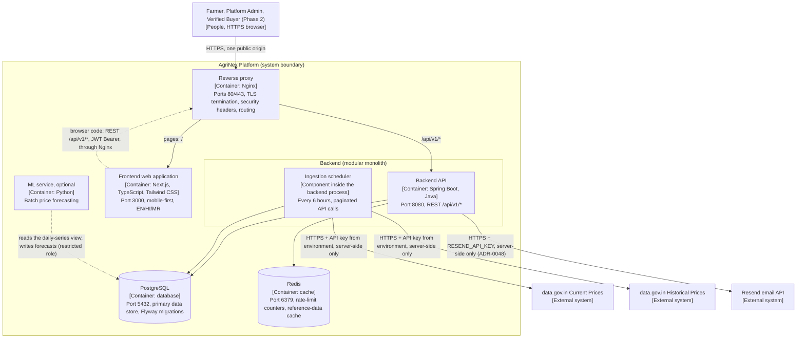

# AgriNex — Container Architecture (C4 Level 2)

**Status:** AUTHORITATIVE. Architecture formalization from Task 6 (2026-10-03), approved in the decision lock of the same day (ADR-0001; [ARCHITECTURE_INDEX.md §14](ARCHITECTURE_INDEX.md#14-architecture-approval-checklist)).

- This document formalizes architecture already defined in the master specification (`docs/01_AGRINEX_MASTER_PRODUCT_PHASES.md`, "spec").
- Statements traced to the spec carry the spec's authority.
- Where the spec leaves a gap or contradicts itself, the decision log ([DECISION_LOG.md](DECISION_LOG.md)) records the decision, and this document cites the entries it applies. Where this document and a binding entry differ, the entry governs.

**Versions:** technology families only. Versions are in the approved baseline (ADR-0002; `CURRENT_TECHNOLOGY_BASELINE.md`).

## 1. Purpose

This document decomposes the AgriNex system ([SYSTEM_CONTEXT.md](SYSTEM_CONTEXT.md)) into its deployable and runnable containers. For each container it records the responsibilities and relationships the spec defines.

## 2. Scope

**In scope:**

- the six containers inside the AgriNex boundary;
- their responsibilities and relationships;
- the container-level boundaries.

**Covered elsewhere:**

- modules inside the containers: [COMPONENT_ARCHITECTURE.md](COMPONENT_ARCHITECTURE.md);
- hosts, environments, and configuration: [DEPLOYMENT_ARCHITECTURE.md](DEPLOYMENT_ARCHITECTURE.md).

## 3. SSOT traceability

| Container | Spec sources |
|---|---|
| Frontend web application | §12 (container diagram), §13, §43 (`frontend/`), §44 (mock mode), §45 (`agrinex-frontend`) |
| Backend API (modular monolith) | §12, §13, §27, §28, §30, §43 (`backend/`), §45 (`agrinex-backend`), §47 Q11 |
| PostgreSQL | §5, §12, §20, §27, §45 (`agrinex-db`), §47 Q10 |
| Redis | §12, §27, §28, §45 (`agrinex-redis`) |
| Reverse proxy (Nginx) | §12, §28, §45 (`agrinex-nginx`) |
| ML service (optional) | §12, §14, §35, §43 (`ml/`), §45 (`agrinex-ml`) |

The diagram in §4.1 preserves the meaning of the spec's §12 diagram, with two clarifications:

- The spec draws the Spring Scheduler in its own "Ingestion" box but labels it "(inside BE process)". This document therefore shows it as a component *inside* the backend container (§4.4).
- The spec places the Next.js frontend inside a "Client Browser" box. §45 also deploys it as the `agrinex-frontend` service on port 3000. Both statements hold: this one container is served by a Node.js server and its code runs in the browser.

## 4. Architecture

### 4.1 Container diagram

**How to read the diagram:**

- The dashed line from `fe` is browser-side code calling the API. The other dashed line belongs to the optional ML track.
- All public traffic, both pages and API calls, enters through Nginx on one origin (ADR-0017).
- Redis holds only rate-limit counters and a reference-data cache (ADR-0018).
- The backend never calls the ML service; it reads forecasts from PostgreSQL (ADR-0030).

### 4.2 Container catalogue

| Container | Technology family | Runtime and port | Compose service (§45) | Responsibilities (spec) | Phase |
|---|---|---|---|---|---|
| Frontend web application | Next.js App Router, TypeScript, Tailwind CSS. Recharts for trend charts. i18n EN/HI/MR | Node.js server on port 3000. Code also runs in the browser | `agrinex-frontend`: "Farmer UI, Admin UI" | Farmer and admin user interfaces. Calls the backend REST API. Recalculates the What-If simulation client-side. Offers a mock-API mode through MSW (§44). Health endpoint `/api/health` (§45) | Phase 1 (Phase 2 screens later) |
| Backend API | Spring Boot, Java. Modular monolith | Port 8080 | `agrinex-backend`: "All REST API endpoints" | All `/api/v1/*` endpoints. Business logic for comparison, trends, alerts, and admin. Ingestion through the in-process scheduler. RBAC and input validation. Health endpoint `/actuator/health` with DB and Redis sub-checks (§27); the readiness group includes the database only (ADR-0018) | Phase 1 (Phase 2 modules later) |
| PostgreSQL | PostgreSQL | Port 5432 | `agrinex-db` | Primary data store for all domain data (§12, §20). Schema managed by Flyway migrations, which run automatically on startup (§10) | Phase 1 |
| Redis | Redis | Port 6379 | `agrinex-redis`: "Rate limiting, cache" | Rate-limit counters (§28) and a reference-data cache, with no persistence (ADR-0018). No session cache or alert queue (departure D-09) | Phase 1 |
| Reverse proxy | Nginx | Ports 80/443 | `agrinex-nginx`: "Reverse proxy, TLS" | TLS termination, with certbot on the host (§28, ADR-0021). Secure headers (§28). Routes `/api/v1/` to the backend and every other path to the frontend, and blocks `/actuator/` (ADR-0017). No CORS headers, because there is one origin (departure D-10) | Phase 1 |
| ML service | Python (FastAPI only if `ml/api` is ever needed) | Batch job; no port is required (ADR-0030) | `agrinex-ml`: "ML forecasts (optional)" | Short-horizon price forecasting. Reads a daily-series view and writes forecasts through a restricted database role (§12, §35, ADR-0030) | **Optional** (P9, HARD RULE 2) |

### 4.3 Container relationships

| From | To | Purpose | Protocol / mechanism | Spec |
|---|---|---|---|---|
| People | Reverse proxy → Frontend | Use the farmer and admin UIs (and the buyer UI in Phase 2) | HTTPS, one public origin | §11, §45; ADR-0017 |
| Frontend (browser code) | Reverse proxy → Backend | All application API calls | REST/JSON, `/api/v1/*`, JWT Bearer | §12, §14; ADR-0017 |
| Backend | PostgreSQL | Persistence through each module's repositories | JPA/Hibernate with parameterized queries (§28); Flyway schema | §12, §27, §28 |
| Backend | Redis | Rate-limit counters; reference-data cache (ADR-0018) | Redis client (Lettuce) | §12, §28 |
| Ingestion scheduler (inside backend) | data.gov.in (both datasets) | Paginated ingestion | HTTPS + `DATA_GOV_API_KEY` from the environment | §12, §31 |
| Ingestion scheduler | PostgreSQL | Load observations, write audit records | Inside the backend's persistence | §12, §14 |
| Backend (auth module) | Resend email API | Email-verification, password-reset and password-changed emails, sent after the request's transaction commits | HTTPS `POST /emails` with `RESEND_API_KEY` from the environment, through `RestClient` | ADR-0047, ADR-0048 |
| ML service | PostgreSQL | Read the daily-series view; write forecasts | Restricted database role (ADR-0030) | §12, §14, §35 |
| Backend | ML service | None at runtime: the backend reads forecasts from PostgreSQL | — (ADR-0030 resolves the §12 dashed edge) | §12 |

### 4.4 Inside the backend container

- **The ingestion scheduler runs inside the backend process** (§12 "inside BE process"; §22 "Spring Scheduler → IngestionService"). No separate ingestion process or container exists: §45 lists none.
- **The spec's conditional ingestion alternatives are not used.** §43 mentions `data-pipeline/` ("Standalone ingestion scripts (if not in Spring Batch)"). This architecture does not activate that option (ASSUMPTION A-01).
- **Phase 2 adds modules to the same backend container** (listing, bid, transaction, rating; §12, §30). It does not add containers.

## 5. Responsibilities

- **Frontend:**
  - Presentation, localization, and client-side What-If recalculation.
  - It holds no secrets, never calls data.gov.in (§31 RULE 1), and reaches data only through the backend API.
- **Backend:**
  - The only container that calls the government APIs.
  - The only container that enforces authentication, RBAC, validation, and business rules (§28).
  - The writer of all domain data in PostgreSQL. The one exception is optional ML forecasts, written by the ML job through its restricted role (ADR-0030).
- **PostgreSQL:**
  - The system of record. "Cache all data in PostgreSQL" (§37) is what lets AgriNex keep working during a government API outage.
- **Redis:**
  - Supports the backend. It is not the system of record for any domain entity named in §20.
- **Reverse proxy:**
  - The single public entry for all traffic, both pages and API, with TLS and security headers (ADR-0017).
- **ML service:**
  - An optional add-on. Comparison, recommendation, transport, and alerts never depend on it (§35).

## 6. Boundaries

| Boundary | Rule | Spec |
|---|---|---|
| Frontend boundary | Talks to the backend only through the REST API. Never calls data.gov.in. Holds no secrets. `NEXT_PUBLIC_*` variables carry no secrets | §12, §31 RULE 1, §47 Q9, Q21 |
| Backend boundary | A single deployable modular monolith. Microservices are out of scope | §12, §39, §47 Q11 |
| Persistence boundary | PostgreSQL is reached by the backend and, optionally, the ML job through its restricted role (ADR-0030). Redis is reached by the backend. The frontend never reaches a data store | §12 |
| Edge boundary | Nginx is the only public entry, on ports 80/443, with TLS in staging and production. It routes `/api/v1/` to the backend and everything else to the frontend, and keeps `/actuator/` internal (ADR-0017) | §12, §28, §45 |
| Optional ML boundary | A separate container. Its failure must not cause a 5xx response or affect core flows | §35 |

**Things that are not containers:**

- the Spring Scheduler, which is a backend component;
- MSW, which is a development-time mock mode in the frontend (§44);
- `fixtures/` and `scripts/`, which are build-time and deployment-time artifacts (§43).

**Not part of the architecture:** message brokers, search engines, additional database types, orchestrators, and service meshes.

- §39 excludes microservices and Kubernetes.
- §47 Q10 keeps one database type.

Adding any of these would need an approved decision.

## 7. Flows

See [DATA_FLOW.md](DATA_FLOW.md), [INGESTION_ARCHITECTURE.md](INGESTION_ARCHITECTURE.md), and [RECOMMENDATION_ENGINE.md](RECOMMENDATION_ENGINE.md).

## 8. Decisions

These are all **REQUIREMENT FROM SSOT**. Decision-log entries refine them: ADR-0017 (routing), ADR-0018 (Redis), ADR-0021 (topology) and ADR-0030 (ML).

| Decision | Spec |
|---|---|
| Backend is a modular monolith, not microservices | §12, §39, §47 Q11 |
| PostgreSQL is the single primary database type | §12, §47 Q10 |
| Redis is used, for rate limiting at least | §12, §28 |
| Nginx is the reverse proxy and terminates TLS | §12, §28, §45 |
| Ingestion runs inside the backend, server-side only | §12, §22, §31 RULE 1 |
| ML runs as an optional, separate container | §12, §35, §45 |
| Deployment is reproducible with Docker Compose | F1.25, §27, §45 |

## 9. Assumptions

- **A-01:** the §43 conditional `data-pipeline/` and Spring Batch alternatives are not activated.
- **A-02:** a single backend instance runs, so the in-process scheduler runs exactly once.
- **A-04:** diagrams show technology families only.

All three are defined in [ARCHITECTURE_INDEX.md §10](ARCHITECTURE_INDEX.md#10-assumptions).

## 10. Decisions applied

| Item | Decision |
|---|---|
| RD-001: versions of every container's technology | ADR-0002 |
| RD-019: Redis contents and failure behavior | ADR-0018 |
| RD-020: the Redis "alert queue" | ADR-0019: there is none; alerts are PostgreSQL rows, delivered by polling |
| RD-021: UI traffic and CORS placement | ADR-0017 |
| RD-022: compose files, environments and persistent storage | ADR-0021 |
| RD-024: how the backend obtains forecasts | ADR-0030 |

## 11. Phase applicability

- **Phase 1:** every container except the ML service.
- **Optional:** the ML service (§9 "Optional", §35).
- **Phase 2:** adds modules inside the backend and screens inside the frontend, not new containers (§12, §30, §45). Phase 2's "Backend file service" (§28) stores documents in PostgreSQL (ADR-0031).

## 12. Dependencies

- **Upstream:** [SYSTEM_CONTEXT.md](SYSTEM_CONTEXT.md).
- **Downstream:**
  - [COMPONENT_ARCHITECTURE.md](COMPONENT_ARCHITECTURE.md);
  - [SECURITY_ARCHITECTURE.md](SECURITY_ARCHITECTURE.md);
  - [RESILIENCE_ARCHITECTURE.md](RESILIENCE_ARCHITECTURE.md);
  - [DEPLOYMENT_ARCHITECTURE.md](DEPLOYMENT_ARCHITECTURE.md);
  - [ML_ARCHITECTURE.md](ML_ARCHITECTURE.md).
