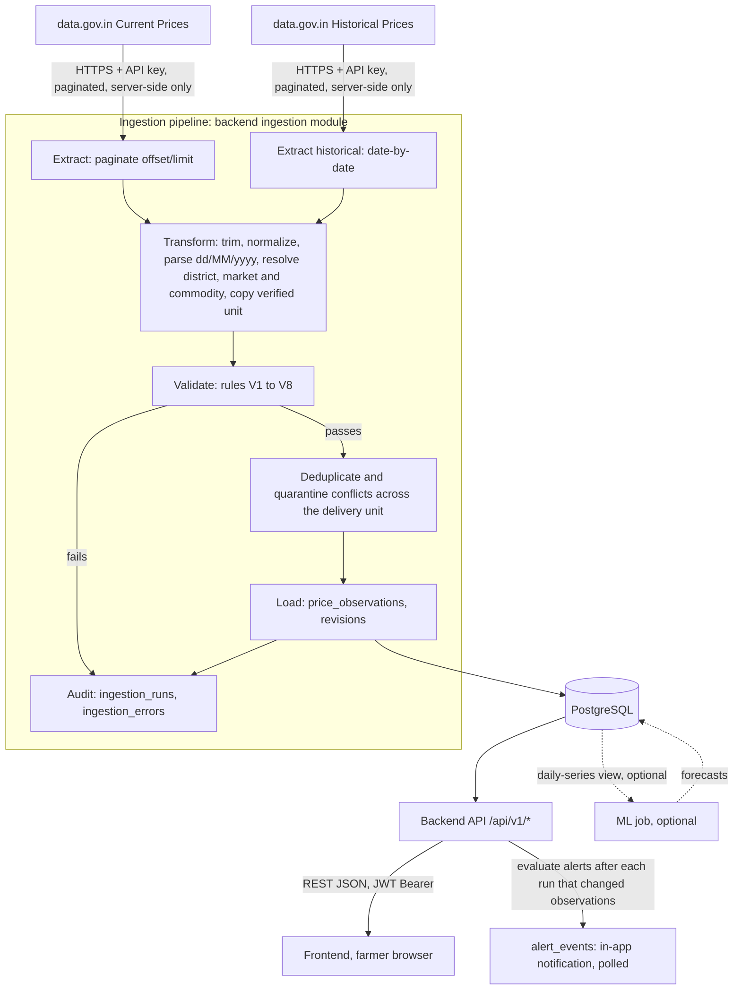
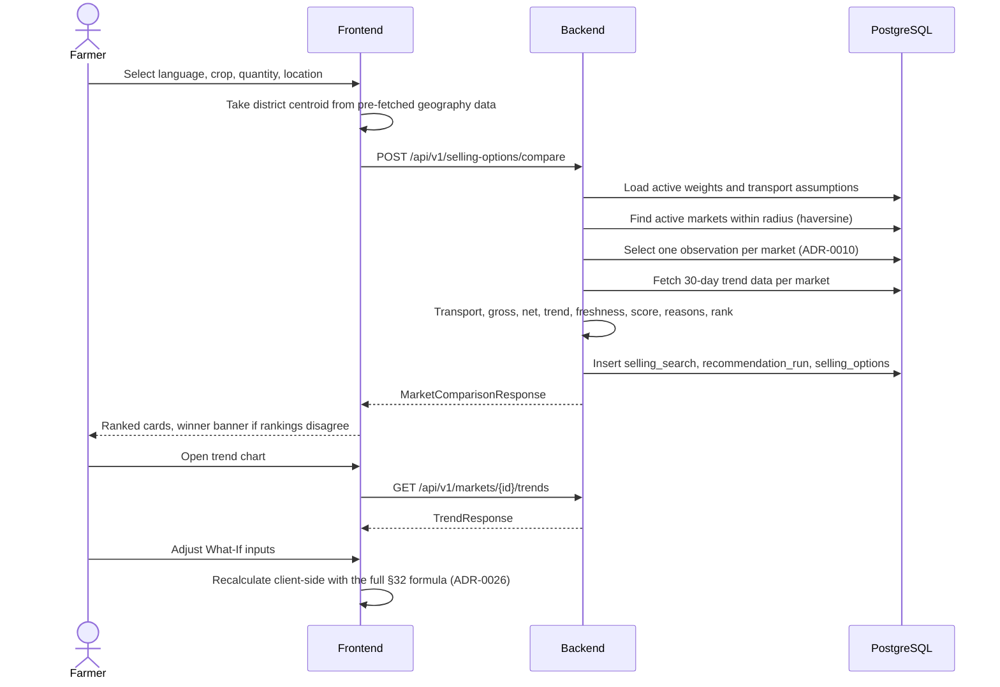
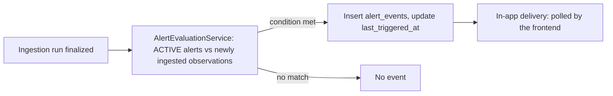

# AgriNex — Data Flow

**Status:** AUTHORITATIVE. Architecture formalization from Task 6 (2026-10-03), approved in the decision lock of the same day (ADR-0001; [ARCHITECTURE_INDEX.md §14](ARCHITECTURE_INDEX.md#14-architecture-approval-checklist)).

- This document formalizes architecture already defined in the master specification (`docs/01_AGRINEX_MASTER_PRODUCT_PHASES.md`, "spec").
- Statements traced to the spec carry the spec's authority.
- Where the spec leaves a gap or contradicts itself, the decision log ([DECISION_LOG.md](DECISION_LOG.md)) records the decision, and this document cites the entries it applies. Where this document and a binding entry differ, the entry governs.

**Versions:** technology families only. Versions are in the approved baseline (ADR-0002; `CURRENT_TECHNOLOGY_BASELINE.md`).

## 1. Purpose

This document lists the critical data flows the spec establishes. For each flow it gives:

- what starts the flow and which components process it;
- which data stores it touches;
- whether it is synchronous;
- what it produces;
- how it fails, and what the fallback is.

No flow here goes beyond what the spec describes, completed by the decision-log entries cited in each flow.

## 2. Scope

**In scope:**

- Phase 1 flows;
- the optional ML flow;
- a summary of the Phase 2 flows.

**Covered in more depth elsewhere:**

- ingestion: [INGESTION_ARCHITECTURE.md](INGESTION_ARCHITECTURE.md);
- recommendation: [RECOMMENDATION_ENGINE.md](RECOMMENDATION_ENGINE.md);
- ML: [ML_ARCHITECTURE.md](ML_ARCHITECTURE.md).

## 3. SSOT traceability

| Flow | Spec sources |
|---|---|
| End-to-end data flow | §5 (product thesis chain), §14 |
| Farmer decision journey | §21, §25 |
| Government ingestion (current and historical), normalization, persistence | §14, §15, §22, §31, FR-01–FR-05, FR-17 |
| Comparison, transport, net realization, deterministic recommendation | §16, §21, §32, FR-06–FR-13 |
| Trends | §21 steps 13–14 and 28–33, §33, FR-14 |
| What-If simulation | §17, §21 steps 34–36, §32, FR-15 |
| Alerts | §14, §15, §22, §25, §34, FR-19 |
| Admin monitoring | §24 UC16–UC20, §30, §45, FR-18 |
| Authentication | §10, §28, §29 |
| Optional ML forecasting | §12, §14, §35 |
| Evaluation | §36, §43 (`scripts/run_evaluation.sql`) |
| Reference-data seeding | §42 item 7, §43, §44, §45 |
| Phase 2 flows | §19, §23 |

## 4. Architecture

### 4.1 End-to-end data flow

This diagram is derived from spec §14.

### 4.2 Hero flow: farmer comparison

This diagram is condensed from spec §21. The spec's numbered example values are omitted.

### 4.3 Alert evaluation

This diagram is derived from spec §15, §22, and §34.

## 5. Responsibilities

Each flow below is described with the same fields. "Mode" says whether the flow is synchronous (request/response) or runs in the background.

### F-01 — Farmer decision journey

| Field | Value |
|---|---|
| Initiator | Farmer, anonymous or logged in (F1.1) |
| Source → destination | Browser inputs → ranked comparison, reasons, trends, and What-If results on screen |
| Processing components | Frontend: language, wizard, comparison, explanation card, trend chart, simulator. Backend: geography, commodity, recommendation, price |
| Data stores | PostgreSQL: reads reference data and observations; writes the search and recommendation records |
| Mode | Synchronous request/response for each step. The What-If simulator runs client-side (§10, §17) |
| Output | Ranked markets, winner banner, reason codes, trend chart, simulator results (§25) |
| Failure behavior | No markets in range: HTTP 422 `NO_MARKETS_IN_RANGE` (§16). No recent observation: 200 with empty `options` and `noDataReason: NO_RECENT_PRICE_DATA`; the UI shows "No recent market observation available…" (§29; ADR-0023) |
| Fallback | Empty state "No data in range. Try increasing distance." with an Adjust distance button (§25). Comparisons always use stored data, with freshness badges and a stale banner (§29) |
| Phase | 1 |

### F-02 — Government current-price ingestion

| Field | Value |
|---|---|
| Initiator | Scheduler every 6 hours, manual admin trigger, or startup (`triggeredBy` = SCHEDULER, MANUAL, or STARTUP, §15) |
| Source → destination | data.gov.in resource `9ef84268-…` → `price_observations` and audit tables |
| Processing component | Backend ingestion module (`IngestionService`), with its source adapter layer (§37) |
| Data stores | PostgreSQL: `source_datasets`, `ingestion_runs`, `ingestion_errors`, `price_observations` |
| Mode | Background, inside the backend process. Never on a farmer request path (§27: "Farmer endpoints must not be affected by ingestion failures") |
| Output | Normalized, deduplicated observations and an audited run (FR-17) |
| Failure behavior | Each page is retried with exponential backoff, at most 3 times (§22, §37). A non-JSON or malformed response is a page failure, never "zero records" (ADR-0005). The failure is logged to `ingestion_errors` (`API_ERROR` or `SCHEMA_ERROR`, with an `error_code`). The run ends FAILED when nothing was fetched, and PARTIAL_FAILURE when some pages were loaded (§15, §29; ADR-0011). The admin alert is a dashboard banner plus an ERROR log event (ADR-0019) |
| Fallback | Keep serving the last stored data with true freshness labels, and show the §29 banner while the latest current run is FAILED (FR-16, §29; ADR-0005). A retry resumes at the failed offset; the next run re-fetches from offset 0, which is idempotent (§37; ADR-0011) |
| Phase | 1 |

### F-03 — Historical ingestion and bootstrap

| Field | Value |
|---|---|
| Initiator | The scheduler, every 6 hours, over the trailing window of report dates today − 3 to today. The bootstrap and backfills use the manual admin trigger with a date range of at most 366 days; `scripts/bootstrap_historical.sh` (§43) wraps that trigger (ADR-0011) |
| Source → destination | data.gov.in resource `35985678-…`, iterated date by date (`Arrival_Date`, §14) → `price_observations` |
| Processing component | Backend ingestion module, using the same transform/validate/dedupe/load/audit chain (§14) |
| Data stores | PostgreSQL |
| Mode | Background |
| Output | At least 60 days of history (§10 freeze checklist) for trends and the ML criteria |
| Failure behavior / fallback | As F-02 |
| Phase | 1 |

### F-04 — Normalization and persistence

Part of F-02 and F-03.

| Field | Value |
|---|---|
| Steps | **Transform:** trim; resolve district (alias) and market (alias, or a new PROVISIONAL market); match the commodity exactly; register new varieties and grades; parse the `dd/MM/yyyy` date; copy the commodity's verified price unit (§31 RULE 3; ADR-0006, ADR-0007, ADR-0008, ADR-0014). **Validate:** rules V1–V8 (ADR-0008). **Deduplicate:** `business_key` = SHA-256 of the resolved market + commodity + variety + grade + report_date + source_dataset_id (§14, §47 Q8). Same-key records with different prices in one delivery are quarantined (ADR-0009). **Load:** insert new observations; record a revision before updating changed prices; write nothing for identical re-deliveries (ADR-0009). **Audit:** counters satisfy the accounting invariant (ADR-0012) |
| Data stores | PostgreSQL. The unique constraint on `business_key` is the last line of defense (§31 RULE 6, §27) |
| Failure behavior | A record failing validation goes to `ingestion_errors` (`VALIDATION`, with `raw_payload`) and is rejected (§15, §37) |
| Fallback | Other records continue. Database uniqueness prevents duplicates even if the code is wrong |
| Phase | 1 |

### F-05 — Market comparison

| Field | Value |
|---|---|
| Initiator | Farmer, through the frontend wizard |
| Source → destination | Request with commodity (optional variety/grade), `quantity` and `quantityUnit`, origin coordinates (the district centroid), `maxDistanceKm` (default 150) → `MarketComparisonResponse` (ADR-0023) |
| Processing components | Recommendation module, using the transport and price modules (§13) |
| Data stores | PostgreSQL. Reads `markets`, `price_observations`, `recommendation_weights`, `transport_assumptions`. Writes `selling_searches`, `recommendation_runs`, `selling_options` (§16) |
| Mode | Synchronous. Under 1 s (§27); p95 under 1 s at 10 concurrent users (§48). Rate-limited at 60 requests/min per IP (§28) |
| Output | Ranked options, price-only winner, net winner, `rankingsDisagree`, reason codes |
| Failure behavior | As F-01. When Redis is unavailable, an in-process limiter applies the same limits, and the endpoint stays available (ADR-0018) |
| Fallback | Stored data only. The government API is never called on this path (§31 RULE 1, §47 Q9) |
| Phase | 1 |

### F-06 — Transport-cost calculation

Part of F-05.

| Field | Value |
|---|---|
| Processing component | Transport module |
| Inputs | Distance by haversine from the district centroid (FR-06). Active `transport_assumptions`: `ratePerKm`, `minimumTripCharge`, `vehicleCapacityKg` (§32) |
| Output | `estimatedTransportCost = max(minimumTripCharge, distanceKm × ratePerKm) × trips` (§32, FR-07). Labelled as an estimate (§32) |
| Mode | In-process, synchronous |
| Failure / fallback | Only VERIFIED markets with coordinates are candidates. Markets default to their district centroid, flagged approximate (ADR-0014) |

### F-07 — Net-realization calculation

Part of F-05.

| Field | Value |
|---|---|
| Processing component | Recommendation module |
| Output | `estimatedGrossValue = normalizedModalPrice × quantityInQuintal` and `estimatedNetRealization = estimatedGrossValue − estimatedTransportCost` (§32, FR-08, FR-09) |
| Mode | In-process, synchronous |

### F-08 — Deterministic recommendation

Part of F-05.

| Field | Value |
|---|---|
| Processing component | Recommendation module ([RECOMMENDATION_ENGINE.md](RECOMMENDATION_ENGINE.md)) |
| Steps | Trend and freshness classification → composite score (ADR-0024) → fixed-vocabulary reason codes → sort, rank, and winners → persistence (§16; ADR-0023) |
| Output | Persisted `recommendation_run` with references to the weights and transport assumptions used (§20). Experiment 1 depends on this (§36) |
| ML involvement | None. The score formula has no forecast input (§16; P9) |

### F-09 — Trends

| Field | Value |
|---|---|
| Initiator | Farmer opening a trend chart. Trends are also computed per market inside F-05 (§21 step 13) |
| Source → destination | `price_observations` for one market and commodity over the last 30 days → `TrendResponse` (§21) |
| Processing component | Price module (§33; §42 item 10) |
| Mode | Synchronous |
| Output | Daily series with provenance, `trendDirection` (including `INSUFFICIENT_DATA`) and `changePercent7Day` (§33; ADR-0025). One selected observation per date (ADR-0010) |
| Failure behavior | Fewer than 4 daily values in 14 days, or an empty window → `INSUFFICIENT_DATA` (ADR-0025) |
| Fallback | Empty state "Insufficient historical data for this market/commodity" (§33, §37) |
| Phase | 1 |

### F-10 — Optional ML forecasting

| Field | Value |
|---|---|
| Initiator | The ML job's own schedule. ML is optional and starts only after the §35 criteria are met (ADR-0030) |
| Source → destination | Daily-series view (input contract §35) → `forecasts` table (output contract §35, `contracts/forecast-output.schema.json`) |
| Processing component | ML service |
| Data stores | PostgreSQL |
| Mode | Offline/background. The backend reads `forecasts` through the price module and never calls ML (ADR-0030) |
| Output | Forecasts for an optional forecast section of the UI (§29) |
| Failure behavior | `ForecastResponse { available: false }`. No 5xx response. Comparison, recommendation, transport, and alerts are unaffected (§29, §35) |
| Fallback | The UI shows "Forecast unavailable." only in the optional forecast section |
| Phase | Optional (HARD RULE 2) |

### F-11 — Alerts

| Field | Value |
|---|---|
| Initiator | **Alert management:** a logged-in farmer (FARMER role; ADMIN also allowed, §28). **Evaluation:** completion of every ingestion run (§15, §34, FR-19) |
| Source → destination | **Management:** requests → `price_alerts`. **Evaluation:** ACTIVE `price_alerts` + newly ingested observations → `alert_events` and `last_triggered_at` |
| Processing component | Alert module (`AlertEvaluationService`, §34). Ingestion invokes it after the run commits, in its own transaction (ADR-0013, ADR-0019) |
| Data stores | PostgreSQL |
| Mode | Management: synchronous. Evaluation: background, after each run |
| Output | In-app notifications from `alert_events`, at most one per alert per run, delivered by polling (§34; ADR-0019) |
| Failure / fallback | An evaluation failure is logged (SYSTEM / `ALERT_EVALUATION_FAILED`). It does not change the run status; the next run evaluates again (ADR-0013, ADR-0019) |
| Phase | 1 (Should) |

### F-12 — What-If simulation

| Field | Value |
|---|---|
| Initiator | Farmer |
| Source → destination | Data from the last recommendation run, already loaded in the browser → updated ranking, winner banner, breakeven insight (§17) |
| Processing component | Frontend, client-side (Phase 1 MVP), with the full §32 formula. The recommendation module runs server-side only when the radius grows beyond the original comparison (§17; ADR-0026) |
| Data stores | None in client-side mode. PostgreSQL in server-side mode, which loads the run by `recommendationId` (§17) |
| Mode | Synchronous, no page reload |
| Output | Re-ranked cards. Overrides are "session-only and do not change system defaults" (§32) |
| Fallback | "Reset to defaults" (§17) |
| Phase | 1 (Should) |

### F-13 — Admin monitoring and configuration

| Field | Value |
|---|---|
| Initiator | Platform Admin (ADMIN role only, §28) |
| Source → destination | Ingestion audit data → `IngestionHealthResponse` and `IngestionRunResponse`. Manual trigger and pause/resume → ingestion. Config updates → transport assumptions and weights. Curation → markets, commodities and district aliases. Every change → `admin_audit_events` (§30; ADR-0020) |
| Processing component | Admin module, using the ingestion module (§13) |
| Data stores | PostgreSQL |
| Mode | Synchronous. A triggered ingestion runs in the background (§45 trigger example) |
| Output | Health, sync status, run history, errors. "Exact match" with database counts (§48) |
| Phase | 1 |

### F-14 — Authentication

| Field | Value |
|---|---|
| Initiator | Farmer (for alerts), Admin, Buyer (Phase 2) |
| Source → destination | Credentials → 15-minute HS256 access token and a 7-day rotated refresh token, stored hashed (§27, §28) |
| Processing component | Auth module |
| Data stores | PostgreSQL: `users`, `refresh_tokens`. Recovery and verification: F-18 |
| Mode | Synchronous |
| Failure behavior | Expired token: 401 → the frontend refreshes using the httpOnly cookie → retries (§29) |
| Fallback | Transparent refresh, so the user sees no interruption (§29). The access token is held in memory; the refresh cookie is HttpOnly, Secure, SameSite=Strict and scoped to `/api/v1/auth`; refresh tokens rotate with reuse detection (ADR-0016, ADR-0017) |
| Phase | 1 |

### F-15 — Evaluation

| Field | Value |
|---|---|
| Initiator | The team, QA (§40 "Research evaluation") |
| Source → destination | `recommendation_runs`, `selling_options`, `ingestion_runs` → experiment metrics (§36) |
| Processing component | `scripts/run_evaluation.sql` (§43) and analysis |
| Mode | Offline |
| Output | Experiment 1 (price-only vs net-realization) and Experiment 2 (14 consecutive days of ingestion reliability) are required. Experiment 3 runs only if ML is built |
| Phase | 1 |

### F-16 — Reference-data seeding

| Field | Value |
|---|---|
| Initiator | Data Engineering, DevOps (§41, §44) |
| Source → destination | Reference seed (§42 item 7, §43) → states, districts, district aliases, localities, commodities with units, source datasets and initial configuration ([SEED_AND_REFERENCE_DATA.md](../database/SEED_AND_REFERENCE_DATA.md)). Markets are registered by ingestion (ADR-0014) |
| Mode | Flyway, automatically at first boot (ADR-0021). Demo fixtures load only in demo-profile environments (ADR-0028) |
| Sources | LGD, Survey of India and the official Agmarknet masters (ADR-0006, ADR-0014) |
| Phase | 1 |

### F-17 — Phase 2 flows (summary)

| Field | Value |
|---|---|
| Flows | Listing → bid → acceptance → transaction → ratings (§23). Buyer verification (§19) |
| Processing components | listing, bid, transaction, and rating modules |
| Decided and deferred | Verification ownership and document storage are decided (ADR-0031). The state model, OTP provider and listing TTL are deferred (RD-012, RD-025; ADR-0032) |
| Phase | 2, only after the Phase 1 Freeze (HARD RULE 1) |

### F-18 — Email verification and password recovery

| Field | Value |
|---|---|
| Initiator | Farmer or admin (ADR-0047) |
| Source → destination | Registration or a resend → a verification link to the account's email → `confirmEmailVerification` sets `email_verified_at`. A forgotten password → `requestPasswordReset` (202 always) → a reset link to the verified email → `confirmPasswordReset` replaces the password hash and revokes every refresh-token family |
| Processing component | Auth module, with its outbound email adapter |
| Data stores | PostgreSQL: `users` (hashed one-time tokens and expiry times), `refresh_tokens` (revoked on reset) |
| External system | Resend email API, server-side only (ADR-0048) |
| Mode | Synchronous API calls. The email is sent after the transaction commits, off the request path, so response time never reveals whether an account exists |
| Failure behavior | Email provider unavailable: the operation's answer is unchanged, the failure is logged without personal data, nothing is queued; the user can ask again (RESILIENCE_ARCHITECTURE §4.2). Invalid, expired, spent or replaced token: 422 |
| Fallback | None by SMS or OTP (§39). An account without a verified email cannot be recovered by itself; the operator erasure procedure frees its identifiers (ADR-0037) |
| Phase | 1 |

## 6. Boundaries

- **No browser-to-government flow.** Every government-data flow is server-side and runs in the background (§31 RULE 1). Farmer flows read only stored data.
- **Data is never fabricated or interpolated** in any flow (P10, §31 RULE 5). Missing data produces explicit empty or unavailable states.
- **Personal data is kept to a minimum.** Origin coordinates are the district centroid, never a home address (§28, §47 Q6). They are stored with each search (`selling_searches.origin_lat/lon`, §20).
- **Optional flows** (F-10) never sit on the synchronous path of a Phase 1 flow (§35).

## 7. Flows

All flows are listed in §5.

## 8. Decisions

- Every flow above is a **REQUIREMENT FROM SSOT**, from the sources in §3.
- The decision-log entries cited in each flow complete them.

## 9. Assumptions

**A-02** applies: a single backend instance, so the in-process scheduler runs once. See [ARCHITECTURE_INDEX.md §10](ARCHITECTURE_INDEX.md#10-assumptions).

## 10. Decisions applied

| Flow | Decisions |
|---|---|
| F-01, F-05 | ADR-0023 (compare contract, no-data semantics), ADR-0010 (selection), ADR-0018 (rate limiting) |
| F-02 to F-04 | ADR-0005 (source, outages), ADR-0006 (coverage, known list), ADR-0007 (dates), ADR-0008 (unit, validation), ADR-0009 (identity, conflicts), ADR-0011 (orchestration), ADR-0012 (counters), ADR-0013 (paths), ADR-0014 (districts, markets) |
| F-06 | ADR-0014 (coordinates) |
| F-08 | ADR-0024 (scoring) |
| F-09 | ADR-0025 (trends), ADR-0010 (daily series) |
| F-10 | ADR-0030 (ML integration) |
| F-11 | ADR-0019 (alerts), ADR-0013 (invocation) |
| F-12 | ADR-0026 (What-If) |
| F-13 | ADR-0020 (admin boundary) |
| F-14 | ADR-0016, ADR-0017 (accounts, tokens, edge) |
| F-16 | ADR-0021 (seeding mechanism), ADR-0006, ADR-0014 (sources) |
| F-17 | ADR-0031; RD-012 and RD-025 deferred (ADR-0032) |

## 11. Phase applicability

| Flows | Phase |
|---|---|
| F-01 to F-09, F-11 to F-16 | Phase 1 |
| F-10 | Optional |
| F-17 | Phase 2 |

## 12. Dependencies

- **Upstream:**
  - [COMPONENT_ARCHITECTURE.md](COMPONENT_ARCHITECTURE.md);
  - [CONTAINER_ARCHITECTURE.md](CONTAINER_ARCHITECTURE.md).
- **Downstream:**
  - [INGESTION_ARCHITECTURE.md](INGESTION_ARCHITECTURE.md);
  - [RECOMMENDATION_ENGINE.md](RECOMMENDATION_ENGINE.md);
  - [RESILIENCE_ARCHITECTURE.md](RESILIENCE_ARCHITECTURE.md);
  - [TESTING_ARCHITECTURE.md](TESTING_ARCHITECTURE.md);
  - Task 7 (data model) and Task 8 (contracts).
