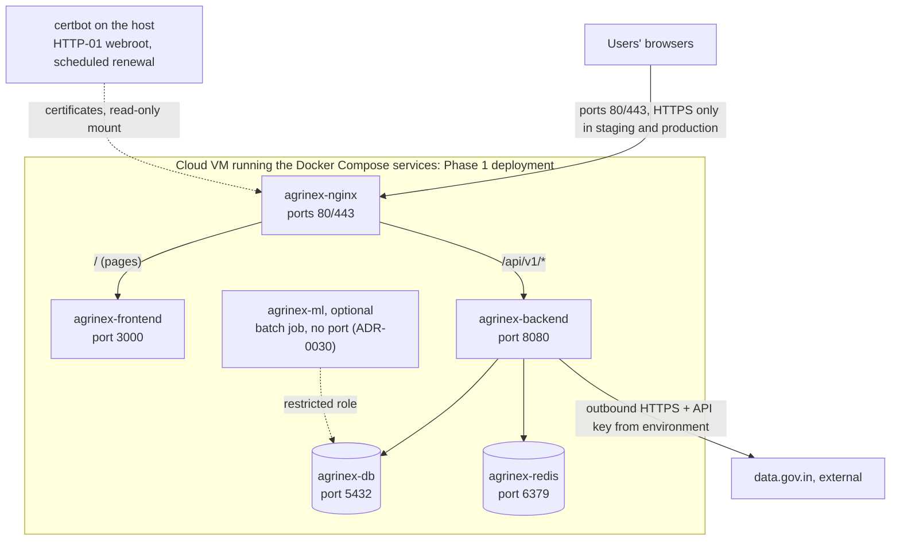

# AgriNex — Deployment Architecture

**Status:** AUTHORITATIVE. Architecture formalization from Task 6 (2026-10-03), approved in the decision lock of the same day (ADR-0001; [ARCHITECTURE_INDEX.md §14](ARCHITECTURE_INDEX.md#14-architecture-approval-checklist)).

- This document formalizes architecture already defined in the master specification (`docs/01_AGRINEX_MASTER_PRODUCT_PHASES.md`, "spec").
- Statements traced to the spec carry the spec's authority.
- Where the spec leaves a gap or contradicts itself, the decision log ([DECISION_LOG.md](DECISION_LOG.md)) records the decision, and this document cites the entries it applies. Where this document and a binding entry differ, the entry governs.

**Versions:** technology families only. Image tags and versions are in the approved baseline (ADR-0002; `CURRENT_TECHNOLOGY_BASELINE.md` §8): `postgres:16.15`, `redis:7.4.11-alpine` and `nginx:1.30.5`, the last replacing the spec's `nginx:1.25` (departure D-05).

## 1. Purpose

This document formalizes how AgriNex is deployed:

- the container services and their boundaries;
- network entry;
- environment configuration;
- startup and data initialization;
- TLS;
- health checks;
- the environments the spec names.

It introduces no infrastructure the spec does not support. The topology is decided in ADR-0021, the edge in ADR-0017, and Redis in ADR-0018.

## 2. Scope

**In scope:**

- the Docker Compose deployment of the six services;
- the Phase 1 cloud-VM deployment;
- local development as described by the spec.

**Not in scope:** Kubernetes, service meshes, message brokers, search engines, additional databases, and cloud-managed services. None of these are supported by the spec (§39, §45).

## 3. SSOT traceability

| Topic | Spec sources |
|---|---|
| Deployment target | §7 ("Deployed to a cloud VM and publicly accessible"), §42 item 28 ("Phase 1 deployment on cloud VM") |
| Reproducible Docker deployment | F1.25, §10 DEPLOYMENT, §27 (Portability), §45 |
| Services, images, ports | §12, §45 |
| Environment configuration | §41 (`infra/.env.example`), §43, §44 (`NEXT_PUBLIC_USE_MOCK_API`), §45 |
| TLS | §28 ("HTTPS only in staging and production", "Nginx + certbot") |
| Health and observability | §10, §27, §43 (`scripts/health_check.sh`), §45 |
| Startup and data | §10 (migrations on startup; demo fixtures on first boot), §43 (`fixtures/`, `scripts/`), §45 (seed command, first sync) |
| Phases of deployment | §10 (staging, freeze), §42 items 3, 28, 37 |
| Risks | §37 (demo deployment failure; localhost fallback) |

## 4. Architecture

### 4.1 Deployment view

### 4.2 Services (spec §45)

| Service | Image (family) | Port | Purpose | Phase |
|---|---|---|---|---|
| `agrinex-frontend` | Custom Next.js image | 3000 | Farmer UI, admin UI | Phase 1 |
| `agrinex-backend` | Custom Spring Boot image | 8080 | All REST API endpoints. Runs the in-process ingestion scheduler | Phase 1 |
| `agrinex-db` | PostgreSQL | 5432 | Primary data store | Phase 1 |
| `agrinex-redis` | Redis | 6379 | Rate-limit counters and reference-data cache; no persistence; password-protected (ADR-0018) | Phase 1 |
| `agrinex-nginx` | Nginx | 80/443 | Reverse proxy, TLS | Phase 1 |
| `agrinex-ml` | Custom Python image | none needed (batch job) | ML forecasts, written to PostgreSQL (ADR-0030) | Optional |

- **Public entry:** the spec gives Nginx ports 80/443 for the public entry.
- **Other services:** in the public deployment no other port is published. Nginx routes `/api/v1/` to the backend and every other path to the frontend, and blocks `/actuator/` (ADR-0017, ADR-0021).
- **Local access in §45:** the development override (`infra/docker-compose.dev.yml`) publishes `http://localhost:3000` and `http://localhost:8080` directly, as §45 describes, plus the database and Redis ports (ADR-0021).

### 4.3 Environment configuration

| Item | Specification | Spec |
|---|---|---|
| Environment file | `.env`, copied from `infra/.env.example` (`cp infra/.env.example .env`) | §45 |
| Environment contract | `infra/.env.example`, owned by DevOps and reviewed by the Team Lead, is the single contract. The root `.env.example` contains only comments pointing to it (ADR-0021) | §41, §43 |
| Required secrets (names only) | `DATA_GOV_API_KEY`, `JWT_SECRET`, `POSTGRES_PASSWORD`, `RESEND_API_KEY` (ADR-0048), plus a Redis password (ADR-0018) and the one-time bootstrap admin credentials (ADR-0028). Values are never documented or committed. On the server, `.env` is readable only by the deploying user (ADR-0020) | §45, §47 Q21 |
| Account email (ADR-0048) | Non-secret settings in `infra/.env.example` (names set there): the sender address on the verified sending domain, and the public origin used to build verification and reset links (never the request's `Host`). Prerequisites, all human actions: a Resend account and API key, and a sending domain verified with the DKIM and SPF records Resend issues, on the project domain (RD-037). Before the auth module relies on it, one live send must succeed (spec §39, §49; implementation gate AR-07). Without them, local development and tests use a non-delivering email adapter; Resend's `resend.dev` test sender delivers only to the Resend account's own address | ADR-0048 |
| Database user | `agrinex` (in the `psql -U agrinex` seed command) | §45 |
| Frontend mock mode | `NEXT_PUBLIC_USE_MOCK_API=true` in `.env.local` enables the MSW mock handlers, so the frontend works offline. A development-time flag. Not a secret | §44 |

### 4.4 Startup and data initialization

| Step | Specification | Spec |
|---|---|---|
| Start | `docker compose up -d` starts every service from `.env.example`-derived configuration | §10, §45 |
| Schema | Database migrations (Flyway) run automatically on startup | §10, §12 |
| Readiness wait | "Wait ~30 seconds for migrations and startup" | §45 |
| Seed and demo data | Reference data and the initial configuration load through Flyway at first boot, everywhere. Demo fixtures and test accounts load at first boot only in environments that enable the demo profile, never on the public deployment (departure D-12; ADR-0021, ADR-0028). The §45 manual `psql` command is not needed | §10, §45 |
| Fixtures | `seed_data.sql` (reference data), `demo_price_observations.sql` (an exact export of real observations), `test_accounts.sql` (one account per role; demo profile only, credentials generated per environment), `ml_observations.csv` | §43, §44; ADR-0028 |
| First admin | Created at backend start from bootstrap credentials in the environment, only when no ADMIN exists. The password is then removed from the environment (ADR-0028) | ADR-0028 |
| First sync | Admin-authenticated `POST /api/v1/admin/ingestion/trigger` with `{"datasetType":"CURRENT_PRICE"}` | §45 |
| Historical bootstrap | `scripts/bootstrap_historical.sh` ("Run historical data backfill") calls the admin trigger with `datasetType` `HISTORICAL_PRICE` and a date range of at least 60 days and at most 366. Credentials are supplied at run time (ADR-0011) | §43 |

### 4.5 Environments

| Environment | What the spec states | Decision (ADR-0021) |
|---|---|---|
| Local / development | One-command local start (§45). `infra/docker-compose.dev.yml` (§43). Frontend mock mode (§44) | `docker compose -f docker-compose.yml -f infra/docker-compose.dev.yml up` runs the full stack with the demo profile. `infra/docker-compose.yml` runs only PostgreSQL and Redis, for IDE-based development |
| Staging | "Phase 1 Staging Deployment (reproducible Docker)" (§10). HTTPS only (§28) | The public deployment before the Phase 1 freeze: same host, same root `docker-compose.yml` |
| Production / public | "Deployed to a cloud VM and publicly accessible" (§7, §42 item 28). HTTPS only (§28). Root `docker-compose.yml` is the "Production compose file" (§43) | One cloud VM. Experiment 2's 14 days of ingestion run here. Provider, region, size and domain are RD-037 (human procurement) |

### 4.6 TLS and the edge

- **HTTPS only in staging and production**, terminated at Nginx, with certificates managed by certbot (§28).
- **Security headers at Nginx:** X-Content-Type-Options, X-Frame-Options, CSP and Referrer-Policy, plus Strict-Transport-Security once TLS is verified (§28; ADR-0017).
- **certbot (ADR-0021):**
  - It runs on the host, not as a §45 service.
  - It uses HTTP-01 webroot validation through a challenge directory that Nginx serves.
  - Certificates are mounted read-only into the Nginx container.
  - The certbot package's scheduled renewal runs with a deploy hook that reloads Nginx.
- **Routing and CORS (ADR-0017):**
  - Nginx routes `/api/v1/` to the backend and every other path to the frontend, blocks `/actuator/`, and redirects HTTP to HTTPS except the ACME challenge path.
  - Nginx emits no CORS headers (departure D-10); the backend keeps its restricted CORS configuration (§28).

### 4.7 Health and observability

| Item | Specification | Spec |
|---|---|---|
| Backend health | `/actuator/health` with DB and Redis sub-checks, internal only. The container health check uses `/actuator/health/readiness`, which includes the database only (ADR-0017, ADR-0018) | §10, §27, §45 |
| Database and cache health | `pg_isready`; Redis `PING` (ADR-0021) | ADR-0021 |
| Frontend health | `/api/health` returns `{"status":"ok"}` | §45 |
| Deployment check | `scripts/health_check.sh` ("Quick deployment validation") | §43 |
| Logs | Structured JSON logs with a correlation ID per request | §27 |

Log aggregation, metrics backends, and alerting infrastructure are not specified and not added.

### 4.8 Operational requirements implied by the spec

- **Public accessibility.** Phase 1 must be publicly accessible and demonstrable in under 10 minutes (§7).
- **Continuous ingestion.** Experiment 2 needs **14 consecutive days of ingestion** (§36). A deployment must therefore run with the scheduler active long enough before the Phase 1 Freeze.
- **Demo fallback.** "Rehearsed Docker deployment; fixture data pre-loaded" with a "Local localhost fallback" if the demo deployment fails (§37).
- **Operator procedures.** Account erasure, deactivation and reactivation run on the deployment host as one-off commands of the backend application, with the same image and environment, by an operator with server access. No HTTP endpoint exists for them. The operations runbook (not created yet) gives the steps (ADR-0037, ADR-0041).
- **Persistence.** Data must survive container restarts, because the system serves stored data (FR-16) and builds history (§10). PostgreSQL uses a named volume, and a daily host `pg_dump` keeps 7 days of backups. Redis is ephemeral (ADR-0018, ADR-0021).

### 4.9 CI/CD and branches

- **CI/CD pipeline:** DevOps is responsible (§40). The CI system is chosen at infrastructure scaffolding (ADR-0034). The contract-drift tests of ADR-0022 run in the backend and frontend test suites, so they also run without CI.
- **Branch strategy:** `main`, `develop`, `feature/*` (§42).

## 5. Responsibilities

| Concern | Responsible (§40) | Consulted |
|---|---|---|
| Docker Compose and infrastructure | DevOps | Backend, QA |
| CI/CD pipeline | DevOps | Backend, QA |
| Flyway migrations | Backend | DevOps |
| `infra/.env.example` | Produced by DevOps; reviewed by the Team Lead (§41) | All roles consume it |

## 6. Boundaries

| Boundary | Rule | Spec |
|---|---|---|
| Deployment/infrastructure boundary | A single Docker Compose deployment on a cloud VM. No Kubernetes or microservices | §7, §39, §45 |
| Network entry | Nginx ports 80/443. The backend is the only service with outbound calls to data.gov.in | §12, §31 RULE 1 |
| Container boundaries | One container per §45 service. The ingestion scheduler is not a separate container | §12, §45 |
| Configuration boundary | Secrets only through the environment (`.env`). Never in images, version control, or frontend variables | §45, §47 Q21 |
| Optional ML | `agrinex-ml` is optional. Deploying without it must not break core flows | §35, §45 |

## 7. Flows

None specific. Data-initialization steps are listed in §4.4.

## 8. Decisions

- Everything in §4 with a spec reference is a **REQUIREMENT FROM SSOT**.
- The topology, edge, Redis, seeding, credentials and images follow ADR-0021, ADR-0017, ADR-0018, ADR-0028 and ADR-0002.

## 9. Assumptions

**A-02:** one backend instance runs, on one VM (ADR-0021). A second instance would duplicate the in-process scheduler (§12) and split the in-process rate-limit fallback (ADR-0018), so it needs a new decision. See [ARCHITECTURE_INDEX.md §10](ARCHITECTURE_INDEX.md#10-assumptions).

## 10. Decisions applied and remaining items

| Item | Decision |
|---|---|
| RD-001: image tags and runtime versions | ADR-0002 |
| RD-002: tooling credentials before any commit or push | ADR-0033. Open until the user completes the conversion |
| RD-011: demo or test credentials on a public deployment | ADR-0028 |
| RD-019: Redis outage, health and readiness | ADR-0018 |
| RD-021: routing, origin, CORS, actuator, service ports | ADR-0017 |
| RD-022: compose and env roles, hosts, certbot, seeding, persistence | ADR-0021 |
| RD-024: whether `agrinex-ml` must be reachable | ADR-0030: it need not be |
| RD-040, RD-044: where erasure, deactivation and reactivation run | ADR-0037, ADR-0041: operator procedures on the deployment host |
| RD-037: hosting provider, region, size and domain | Open; human procurement |

## 11. Phase applicability

- **Phase 1:** staging deployment, then cloud VM deployment before the Freeze (§10, §42 items 27–29).
- **Phase 2:** deployment uses the same topology (§42 item 37). No Phase 2 service is listed in §45. Phase 2 documents are stored in PostgreSQL (ADR-0031).
- **Optional:** `agrinex-ml`.

## 12. Dependencies

- **Upstream:**
  - [CONTAINER_ARCHITECTURE.md](CONTAINER_ARCHITECTURE.md);
  - [SECURITY_ARCHITECTURE.md](SECURITY_ARCHITECTURE.md).
- **Downstream:**
  - Task 10 (scaffolding: `infra/`, compose files, Dockerfiles);
  - [TESTING_ARCHITECTURE.md](TESTING_ARCHITECTURE.md) (staging and evaluation environments).
