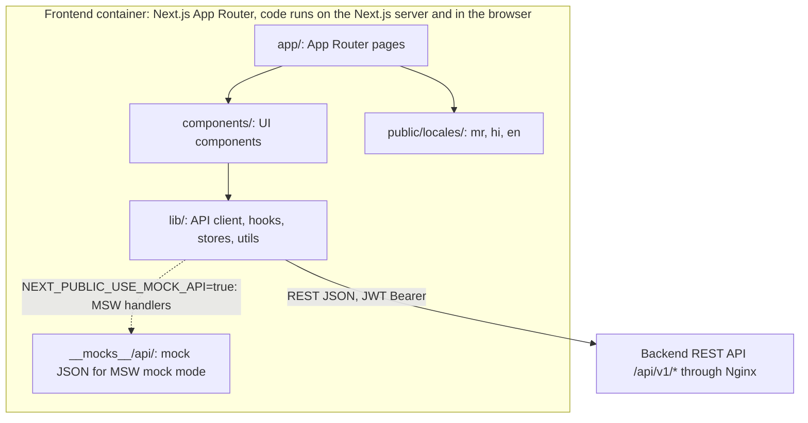

# AgriNex — Frontend Architecture

**Status:** AUTHORITATIVE. Architecture formalization from Task 6 (2026-10-03), approved in the decision lock of the same day (ADR-0001; [ARCHITECTURE_INDEX.md §14](ARCHITECTURE_INDEX.md#14-architecture-approval-checklist)).

- This document formalizes architecture already defined in the master specification (`docs/01_AGRINEX_MASTER_PRODUCT_PHASES.md`, "spec").
- Statements traced to the spec carry the spec's authority.
- Where the spec leaves a gap or contradicts itself, the decision log ([DECISION_LOG.md](DECISION_LOG.md)) records the decision, and this document cites the entries it applies. Where this document and a binding entry differ, the entry governs.

**Versions:** technology families only. Versions are in the approved baseline (ADR-0002; `CURRENT_TECHNOLOGY_BASELINE.md`).

> Detailed screen design belongs to Task 9 and the UI/UX role (§40 "Screen design — all states"). This document invents no screens. Production screens need an approved design source: role file 02, with approvals recorded by the Document Owner in SSOT index area 5 (CLAUDE.md §M; ADR-0027).

## 1. Purpose

This document records the frontend architecture the spec supports:

- the application boundary;
- its responsibilities;
- API and authentication interaction;
- state and interaction boundaries;
- role-specific UI;
- required states;
- responsive, accessibility, and localization requirements.

## 2. Scope

**In scope:** the single Next.js frontend container that serves the farmer UI, the admin UI, and (in Phase 2) the buyer UI.

**Out of scope:** visual design, component specifications, and copy. These belong to Task 9 and role file 02.

## 3. SSOT traceability

| Topic | Spec sources |
|---|---|
| Container, technologies, i18n | §12, §45 |
| Components and screens | §13, §25, §30, §42 items 17–26 |
| Repository structure | §43 (`frontend/app`, `components`, `lib`, `public/locales`, `__mocks__/api`) |
| Mock mode | §44 |
| Features | F1.1–F1.25 (§7), F2.x (§8) |
| Hero flow | §21 |
| Simulator | §10, §17, §32 |
| Auth interaction | §25, §28, §29 |
| Content rules | §31 RULES 4, 5, 7; §32; §33; §49 |
| Responsive, performance, accessibility, localization | §6, §27, §48, F1.2, F1.21, F1.22 |

## 4. Architecture

### 4.1 Application structure

### 4.2 Application boundary

- **One frontend application** (`agrinex-frontend`) serves both the "Farmer UI, Admin UI" (§45). Phase 2 screens are added to the same application (§30).
- **Technologies (families):** Next.js App Router, TypeScript, Tailwind CSS, Recharts for trend charts, and MSW for mock mode (§12, §13, §43, §44).
- **Data access:**
  - The frontend reaches data only through the backend REST API.
  - It never calls data.gov.in (§31 RULE 1).
  - It holds no secrets. `NEXT_PUBLIC_*` variables are bundled into browser code and must not contain secrets (§47 Q21).

### 4.3 Responsibilities

| Responsibility | Spec |
|---|---|
| Language selection on first launch, with the saved language reused afterwards | §25, F1.2 |
| Comparison wizard: State → District → Locality, commodity (searchable, most common pinned), variety/grade, quantity and unit, optional max distance | §25, F1.3–F1.6 |
| Derive origin coordinates from the district centroid in pre-fetched geography data. No exact address | §21 step 3, §28, FR-06 |
| Render ranked comparison results, the `WinnerCalloutBanner` when rankings disagree, and the "Why recommended?" reason card | §10, §25, F1.8–F1.14 |
| Trend chart: 7/30-day toggle, trend badge, 7-day change, insufficient-history empty state | §33, F1.15 |
| What-If simulator: client-side recalculation without a full API re-call, breakeven insight, reset or apply | §10, §17, F1.18 |
| Alert management for logged-in farmers | §25, §34, F1.19 |
| Admin dashboard: sync status, run history, errors, manual trigger, configuration | §13, §30, F1.20 |
| Freshness badges and source attribution on every price-related screen | §10, F1.16, F1.17, §31 RULE 7 |
| Error and stale-data handling | F1.23, §29 |

### 4.4 API interaction

- **Transport:** REST/JSON over `/api/v1/*` with a JWT Bearer token, through Nginx (§12).
- **One API group per screen:** each screen uses the API group of exactly one owning module (§30). See [COMPONENT_ARCHITECTURE.md §4.5](COMPONENT_ARCHITECTURE.md#45-frontend-components).
- **Contract-first:** the frontend uses only the approved contract (`contracts/openapi.yaml`) or mocks that match it exactly. "A mock with wrong field names is a bug" (§44, P5). The contract is hand-authored in OpenAPI 3.1, and frontend tests validate every mock against it (ADR-0022).
- **Mock mode:** `NEXT_PUBLIC_USE_MOCK_API=true` in `.env.local` enables every MSW handler, so the frontend "should work completely offline" (§44).
- **Call path (ADR-0017):**
  - All traffic enters through Nginx on one public origin. Pages go to the Next.js server, and `/api/v1/` goes to the backend.
  - Next.js server-side code does not call the backend in Phase 1. Every API call starts in the browser.
- **Provenance and freshness:** every price shown carries its report date, freshness, dataset, variety, grade, unit and source attribution from the API (ADR-0022). The §29 sync banner is driven by the latest-sync status in responses.

### 4.5 Authentication interaction

- **Comparison needs no login** ("Farmer quick-start", F1.1; anonymous OK, §28).
- **Alerts need a login.** Setting an alert prompts a "Quick phone registration (lightweight)" when the farmer is not logged in (§25). Registration asks for the mobile number, an email address and a password (ADR-0047, departure D-15).
- **Expired tokens:** a 401 triggers a refresh through the httpOnly cookie, then a retry. The user sees no interruption (§29).
- **The server enforces authorization.** Frontend role checks are display-only (§27, §28, §47 Q19).
- **Token handling (ADR-0016, ADR-0017):**
  - The access token lives in memory only, never in Web Storage.
  - The refresh cookie is `HttpOnly; Secure; SameSite=Strict; Path=/api/v1/auth`.
  - Refresh calls are serialized, so concurrent tabs do not trigger refresh-token reuse detection.
- **Login:** one `identifier` (mobile number or email) and a password. A farmer may use either identifier of the same account (ADR-0047). Farmer passwords are 8–64 characters (ADR-0016).
- **Email links (ADR-0048):** verification and reset links open frontend pages with the token in the URL fragment. The page removes it from the address bar at once, sends it in the request body, and never logs or stores it; the reset page sends `Referrer-Policy: no-referrer`. A successful reset does not sign the user in. Flows: `docs/api/FRONTEND_CONSUMPTION.md` §4.

### 4.6 State and interaction boundaries

| State | Where it lives | Spec |
|---|---|---|
| Geography reference data, including district centroids | Fetched in advance by the frontend for origin calculation | §21 step 3 |
| Last comparison result | Kept on the client so the simulator can recalculate without a full API re-call | §10, §17 |
| What-If overrides | Session-only. They never change system defaults | §32 |
| Saved language | Persisted for later launches. The persistence mechanism is an implementation detail the spec does not fix. For logged-in farmers the profile also has a `preferred_locale` | §20, §25 |
| Application stores | `lib/` "stores". No state library is named by the spec | §43 |

### 4.7 Role-specific UI

| Role | UI characteristics | Spec |
|---|---|---|
| Farmer (anonymous or logged in) | Mobile-first. Marathi, Hindi, or English. Low digital literacy, so content must be simple and tappable rather than dense text | §6, §25, P7 |
| Admin | Desktop-first is acceptable. English | §6 Persona 3 |
| Buyer (Phase 2) | Desktop or tablet. Hindi or English | §6 Persona 4 |

### 4.8 Required states and messages

| Situation | Required behavior or message | Spec |
|---|---|---|
| No markets in range | Empty state "No data in range. Try increasing distance." with an Adjust distance control | §16, §25 |
| No recent observation | "No recent market observation available for this commodity in your area." Shown when the response has empty `options` and `noDataReason: NO_RECENT_PRICE_DATA`. Excluded markets can be listed from `excludedMarkets` (ADR-0023) | §29 |
| Government sync unavailable | "Latest source synchronization is unavailable. Showing most recently stored government-reported data." Shown while the latest current-dataset run is FAILED (ADR-0005) | §29 |
| Stale data | Stale-data warning or STALE banner; freshness badges | §10, §37, F1.16 |
| Insufficient history | "Insufficient historical data for this market/commodity" | §33 |
| Forecast unavailable (optional ML section only) | "Forecast unavailable." | §29, §35 |
| Database failure | Standard 503 error page | §29 |
| Concurrent bid acceptance (Phase 2) | "This listing has already been accepted by another buyer." | §29 |
| Loading states | The spec does not specify them. Their design belongs to Task 9 ("Screen design — all states", §40) | — |

### 4.9 Content rules

- **Price naming:** "Latest reported price" or "Government-reported mandi price". Never "real-time" or "live" (§31 RULE 4, §49).
- **Attribution:** "Source: Ministry of Agriculture & FW / DMI / data.gov.in" plus the report date, on every price-related screen (§31 RULE 7).
- **Estimates:** "Estimated — based on ₹{appliedRatePerKm}/km assumption. Actual costs will vary.", showing the rate the estimate actually used, and "Estimated net realization" (§32; ADR-0038, departure D-14).
- **Disclaimer:** the standard disclaimer appears on every price-related screen (§49).
- **No fabrication:** never fabricate or interpolate a price (§31 RULE 5).

### 4.10 Responsive, performance, accessibility, and localization

| Requirement | Target | Spec |
|---|---|---|
| Mobile-first, responsive | No horizontal scroll at 375px; all elements visible | F1.21, §10, §48 |
| Performance | LCP under 3 s on mobile 3G | §27 |
| Accessibility | WCAG 2.1 AA for core farmer flows | F1.22, §27 |
| Localization | Marathi, Hindi, and English on every farmer-facing screen. No untranslated hardcoded strings on farmer screens. Reason codes are localized | F1.2, §27, §46, §48 |
| Browser support | Chrome/Edge 111+, Safari 16.4+, Firefox 128+. Android 7.0 or later receives a supporting Chrome; Android 6.0 and older are not supported (ADR-0004) | §6 Persona 2 |
| Localized data names | States and commodities in MR/HI where a reviewed translation exists, otherwise the English name. Districts, markets, varieties and grades are shown as officially published (ADR-0015) | F1.2 |
| Alerts | Alert events are fetched by polling, on page focus and while the page is open, at an interval set in role file 02. Viewing or dismissing marks an event read; the alert stays ACTIVE (ADR-0019) | §34 |

## 5. Responsibilities

| Concern | Responsible (§40) | Consulted |
|---|---|---|
| Design system and tokens; screen design for all states | UI/UX | Frontend; QA for screen design |
| Farmer comparison flow | Frontend | UI/UX, Backend, QA |
| Admin dashboard (frontend part) | Frontend | — |
| Phase 2 listing, bid, and transaction screens | Frontend | — |

## 6. Boundaries

- **Frontend boundary:** presentation, client-side simulation, and localization. No business authority and no secrets (§28, §47 Q21).
- **Backend boundary:** every business rule, authorization decision, and persistence operation is the backend's job. The frontend's What-If calculation is a presentation-level recalculation. It uses the full §32 formula with the transport assumptions from the comparison response and ranks by net realization. It calls the server only when the radius grows beyond the original comparison (ADR-0026).
- **Design boundary:** production screens require an approved design source (ADR-0027). Prototypes must be labelled as prototypes (CLAUDE.md §M).

## 7. Flows

These are F-01, F-12, and F-14 in [DATA_FLOW.md](DATA_FLOW.md).

## 8. Decisions

- Everything in §4 with a spec reference is a **REQUIREMENT FROM SSOT**.
- No screens beyond those named in §13, §25, and §30 are introduced, except the account screens that ADR-0047 and ADR-0048 require: forgotten password, new password from a reset link, and email verification from a link. They are specified in role file 02 (S14 to S16).

## 9. Assumptions

**A-03:** the "history" mentioned in UC6 (§24) is not a Phase 1 screen, because the final Phase 1 feature list (F1.1–F1.25) contains no history feature and §30 lists no history endpoint. See [ARCHITECTURE_INDEX.md §10](ARCHITECTURE_INDEX.md#10-assumptions).

## 10. Decisions applied

| Item | Decision |
|---|---|
| RD-006: comparison field names and empty states | ADR-0023 |
| RD-009: simulator formula, ranking, server trigger | ADR-0026 |
| RD-010: design source of record | ADR-0027 |
| RD-014: supported browsers | ADR-0004 |
| RD-020: alert delivery | ADR-0019: polling |
| RD-021: UI path, origin, token storage, cookie | ADR-0017 |
| RD-023: contract source for mocks | ADR-0022 |
| RD-024: optional forecast API | ADR-0030: a price-module endpoint, defined as optional in Task 8 |
| RD-033: localized names | ADR-0015 |

Tooling not yet chosen (the i18n library and the unit and end-to-end test tools) is chosen at frontend scaffolding (ADR-0034).

## 11. Phase applicability

| Scope | Phase |
|---|---|
| Every responsibility in §4.3 | Phase 1 |
| Listing, bid, transaction, and rating screens (§30) | Phase 2 |
| Forecast section | Optional, only if ML is built |

## 12. Dependencies

- **Upstream:**
  - [COMPONENT_ARCHITECTURE.md](COMPONENT_ARCHITECTURE.md);
  - [SECURITY_ARCHITECTURE.md](SECURITY_ARCHITECTURE.md);
  - [RECOMMENDATION_ENGINE.md](RECOMMENDATION_ENGINE.md).
- **Downstream:**
  - Task 8 (contracts);
  - Task 9 (UI/design prototypes, role file 02);
  - Task 10 (scaffolding);
  - [TESTING_ARCHITECTURE.md](TESTING_ARCHITECTURE.md).
