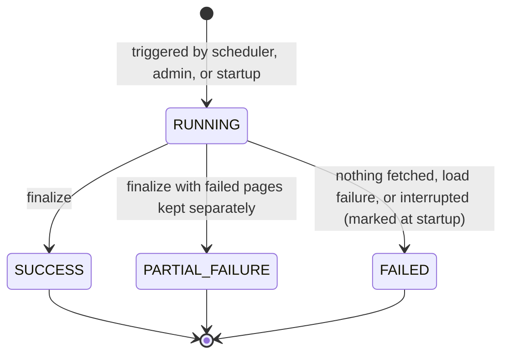

# AgriNex — Ingestion Architecture

**Status:** AUTHORITATIVE. Architecture formalization from Task 6 (2026-10-03), approved in the decision lock of the same day (ADR-0001; [ARCHITECTURE_INDEX.md §14](ARCHITECTURE_INDEX.md#14-architecture-approval-checklist)).

- This document formalizes architecture already defined in the master specification (`docs/01_AGRINEX_MASTER_PRODUCT_PHASES.md`, "spec").
- Statements traced to the spec carry the spec's authority.
- Where the spec leaves a gap or contradicts itself, the decision log ([DECISION_LOG.md](DECISION_LOG.md)) records the decision, and this document cites the entries it applies. Where this document and a binding entry differ, the entry governs.

**Versions:** technology families only. Versions are in the approved baseline (ADR-0002; `CURRENT_TECHNOLOGY_BASELINE.md`).

## 1. Purpose

This document preserves and formalizes the spec's design for ingesting government mandi price data into PostgreSQL. Where the spec left the design open, it applies these decision-log entries:

- ADR-0005: source and outages;
- ADR-0006: coverage and the commodity known list;
- ADR-0007: dates;
- ADR-0008: unit and validation;
- ADR-0009: identity, conflicts and revisions;
- ADR-0011: orchestration;
- ADR-0012: counters;
- ADR-0013: module paths;
- ADR-0014: districts and markets;
- ADR-0020: the pause switch.

## 2. Scope

**In scope:**

- the external APIs;
- server-side access and API-key protection;
- pagination and extraction;
- normalization, validation, and deduplication;
- persistence and the audit trail;
- scheduling and triggers;
- error handling, freshness tracking, and failure behavior.

**Covered elsewhere:** how stored observations are used. See [RECOMMENDATION_ENGINE.md](RECOMMENDATION_ENGINE.md) and [DATA_FLOW.md](DATA_FLOW.md).

## 3. SSOT traceability

| Topic | Spec sources |
|---|---|
| Datasets and verified API behavior | §1 |
| Server-side only, API key in env | §11, §12, §28, §31 RULE 1, §47 Q9, Q21 |
| Pipeline stages | §14 (end-to-end data flow), §15 (pipeline flow), §22 (sequence) |
| Requirements | FR-01–FR-05, FR-16, FR-17, FR-19 |
| Data source policy | §31 RULES 1–7 |
| Business key | §14, §47 Q8, §27 (data integrity), §31 RULE 6 |
| Schedule | §10, §12, §47 Q25 |
| Failure handling | §15, §22, §29, §37 |
| Audit schema (overview) | §20 (`SOURCE_DATASETS`, `INGESTION_RUNS`, `INGESTION_ERRORS`, `PRICE_OBSERVATIONS`) |
| Freeze-checklist items | §10 DATA |
| Acceptance criteria | §48 (ingestion completeness, duplicate prevention, admin health accuracy, API failure handling) |

## 4. Architecture

### 4.1 Pipeline

This diagram is derived from spec §14, §15, and §22.

```mermaid
flowchart TD
    trig["Trigger: every 6 hours at 00, 06, 12, 18 IST, manual admin trigger, or startup, paused datasets skipped"] --> init["Create ingestion_run: status RUNNING, triggeredBy recorded, one RUNNING run per dataset"]
    init --> call["Call data.gov.in page: offset, limit 500 by default, state filter Maharashtra"]
    call -->|"HTTP 200 JSON with the expected structure"| parse["Parse total and records, advance offset by records returned"]
    call -->|"4xx, 5xx, timeout, non-JSON or malformed"| apierr["Retry with exponential backoff, max 3 retries"]
    apierr -->|"still failing"| pagefail["Log API_ERROR or SCHEMA_ERROR with error_code, stop the delivery unit"]
    parse --> more{"More pages in the delivery unit?"}
    more -->|"yes"| call
    more -->|"no"| unit["Delivery unit fetched"]
    pagefail --> unit
    unit --> rec["Per record: trim, resolve district and market, match commodity, register variety and grade, parse dd/MM/yyyy, copy verified unit"]
    rec -->|"rules V1 to V8 fail"| valerr["Insert ingestion_errors: VALIDATION, error_code, raw_payload"]
    rec -->|"passes"| dedupe["Group by identity: identical copies are duplicates, differing prices are quarantined as CONFLICT"]
    dedupe --> load["One transaction per delivery unit: insert new rows, revision then update for changed prices, nothing for identical rows"]
    load --> fin["Finalize run as SUCCESS, PARTIAL_FAILURE or FAILED, counters satisfy the accounting invariant"]
    valerr --> fin
    fin --> alerts["After commit: alert evaluation for runs that changed observations"]
```

Two points about this diagram:

- **The historical dataset** goes through the same chain. Its extract step iterates date by date, using the `Arrival_Date` filter in `dd-MM-yyyy` (§14), and each report date is its own delivery unit.
  - **Scheduled runs** cover the trailing window today − 3 to today (IST).
  - **Bootstrap and backfills** use the manual trigger with a date range of at most 366 days (ADR-0011).
- **Delivery unit:** a whole CURRENT run, or one HISTORICAL report date. Conflicts and the V8 outlier rule are evaluated over a complete unit, and units already committed are never rolled back (§29).
- **Status rule (ADR-0011):**
  - SUCCESS: every page of every unit was fetched.
  - PARTIAL_FAILURE: at least one unit loaded, and at least one page or unit failed.
  - FAILED: nothing was fetched, a load failed, or the run was interrupted.

### 4.2 Ingestion-run lifecycle



The statuses are named in §15, §22, and §29. They are `RUNNING`, `SUCCESS`, `PARTIAL_FAILURE`, and `FAILED`.

### 4.3 Elements

| Element | Specification | Spec |
|---|---|---|
| External sources | Current Daily Mandi Prices `9ef84268-d588-465a-a308-a864a43d0070` and Historical Variety-wise Prices `35985678-0d79-46b4-9ed6-6f13308a1d24` (DMI, data.gov.in, NDSAP). Registered in `source_datasets` (`resource_id`, `dataset_type`) | §1, §20, §22 |
| Server-side access | Only the backend ingestion module calls the APIs, through Spring Framework's `RestClient`. The frontend never does | §31 RULE 1, §47 Q9; ADR-0011 |
| API-key protection | `DATA_GOV_API_KEY` lives only in the backend environment. It never appears in the frontend, in `NEXT_PUBLIC_*` variables, in version control, in API responses, or in errors and logs. Logged URLs have the key redacted, and admins see only whether it is configured. In diagrams the key is masked as `api-key=***` | §15, §22, §28, §47 Q21; ADR-0020 |
| Pagination | Mandatory on every call, using `offset` and `limit` (default `limit=500`, §15/§22). The offset advances by the number of records actually returned, until the reported total is reached or a page is empty | §1, §15, §31 RULE 2; ADR-0011 |
| Extraction: current | Paginated, filtered to the source state `Maharashtra`, all commodities. Records outside coverage are counted in `records_out_of_scope` | §14, §15; ADR-0006 |
| Extraction: historical | Date-by-date iteration (`Arrival_Date`, `dd-MM-yyyy`), paginated; scheduled trailing window, or a manual range | §14, FR-02; ADR-0007, ADR-0011 |
| Source adapter layer | "Adapter layer isolates raw field parsing" to contain government schema changes. A response that is not the expected JSON structure is a SCHEMA_ERROR page failure, never "zero records" | §37; ADR-0005 |
| Transform / normalize | Trim every string and collapse internal whitespace. The source district resolves through `district_source_aliases`; an unknown district rejects the record. The source market resolves through `market_source_aliases`; an unknown spelling registers a PROVISIONAL market. Commodity → exact match against the known list, then an exact match in `commodity_source_aliases` for the legacy DMI spellings (ADR-0051); the source spelling is kept on the row. Variety and grade → registered on first appearance. Distinct commodities (for example "Onion" vs "Onion Green") are never collapsed. Rules are documented, unit-tested, and logged per run | §14, §15, FR-03, §47 Q4; ADR-0006, ADR-0014 |
| Date parsing | Strict `dd/MM/yyyy` for record dates (departure D-06). Future dates (IST) are rejected | §14, §15; ADR-0007 |
| Unit verification | Each commodity carries a unit verified from official DMI/Agmarknet evidence (`Rs./Quintal`), and it is copied onto every observation (`price_unit`). A commodity without a verified unit is rejected (`UNIT_UNVERIFIED`). No conversion. Prices are exact decimals, rounded half-up to 2 dp | §31 RULE 3, FR-05, §10; ADR-0008 |
| Validation | Rules V1–V8: required fields; the date; a known commodity with a verified unit; a resolvable district; numeric and positive prices; min ≤ modal ≤ max; the `Rs./Quintal` floor; the 10× relative outlier rule. Failures go to `ingestion_errors` (`VALIDATION`, `error_code`, `error_message`, `raw_payload`) | §14, §15, §37; ADR-0008 |
| Deduplication | `business_key` = SHA-256 of the resolved market + commodity + variety + grade + report_date + source_dataset_id. A unique constraint at the database level is "the last line of defense". Within a delivery unit, identical copies count as duplicates, and same-key records with different prices are quarantined as CONFLICT | §14, §15, §27, §31 RULE 6, §47 Q8; ADR-0009 |
| Load | Through the price module's interface (ADR-0013), in one transaction per delivery unit. New identity → insert. Changed prices from a newer run → a `price_observation_revisions` row, then the update. Identical re-delivery → no write (departure D-07) | §14, §15, §22; ADR-0009 |
| Audit | One `ingestion_runs` record per run: status, `triggeredBy`, request scope, timestamps, page counts and record counts (`records_fetched`, `records_inserted`, `records_updated`, `duplicates_skipped`, `validation_errors_count`, `records_conflicted`, `records_out_of_scope`). The counts satisfy the accounting invariant, and completeness is computed from them (ADR-0012). One `ingestion_errors` record per rejected row, conflict variant or failure | §14, §15, §20, §22, FR-17; ADR-0012 |
| Scheduling | Every 6 hours (00:00, 06:00, 12:00, 18:00 IST) by the Spring Scheduler inside the backend process: a CURRENT run, then a HISTORICAL run over the trailing window. A STARTUP run happens when no current run succeeded in the last 6 hours. An admin can trigger a run, or pause and resume a dataset, at any time. One RUNNING run per dataset; an interrupted run is marked FAILED at startup. Historical maintenance (ADR-0054): a report-date ledger (`ingestion_report_dates`), a daily gap check at 03:00 IST that fetches up to 31 incomplete report dates of the last 366, and a weekly reconciliation on Sunday at 04:00 IST over the last 14 report dates; both are HISTORICAL runs on the same path and skip a paused dataset | §10, §12, §15, §22, §47 Q25; ADR-0011, ADR-0020, ADR-0054 |
| Error handling | **API errors:** each page is retried with exponential backoff, at most 3 times. A page that still fails is logged with its offset and error code.<br/>**Partial failure:** committed units persist, failed pages are logged, no rollback.<br/>**Schema change:** "fail ingestion loudly; expose in admin" (SCHEMA_ERROR).<br/>**Rate limiting:** a retry resumes from the failed offset, and the next run starts at offset 0. No resume state is persisted, because loading is idempotent.<br/>**Admin alert:** a dashboard banner plus a structured ERROR log event | §15, §22, §29, §37; ADR-0011, ADR-0019 |
| Freshness tracking | Each observation carries its `report_date` and `ingested_at`. Freshness (FRESH/RECENT/STALE/UNAVAILABLE) is classified from `report_date` against configurable day thresholds (defaults 1/4/10), with "today" in IST. "Freshness metadata on every observation" is a freeze-checklist item | §10, §16, §20, FR-13; ADR-0007 |
| Post-run alert evaluation | After a run that inserted or revised observations commits, ingestion invokes the alert module, in its own transaction. ACTIVE alerts are evaluated against those observations (FR-19). A failure is logged and does not change the run status | §15, §22, §34; ADR-0013, ADR-0019 |
| Observability | The admin health API and dashboard show sync status, run history, errors, and stale markets. They must exactly match database counts | FR-18, §46, §48 |

### 4.4 Data source policy mapping (§31)

| Rule | How the ingestion architecture satisfies it |
|---|---|
| RULE 1 — no direct frontend access | Ingestion exists only in the backend container |
| RULE 2 — pagination mandatory | The page loop runs until `total_count` is reached |
| RULE 3 — unit verification | `price_unit` is stored on every observation, copied from the commodity's evidence-verified unit (ADR-0008) |
| RULE 4 — "latest reported price" naming | Applies to the UI and documentation. Ingestion records `report_date` so the UI can label it |
| RULE 5 — no fabricated data | Ingestion never interpolates. Missing data stays missing |
| RULE 6 — deduplication at the DB level | `business_key` unique constraint |
| RULE 7 — source attribution | `source_dataset_id` and `report_date` are stored on every observation, so attribution can be shown |

## 5. Responsibilities

| Responsibility | Responsible (§40) | Consulted |
|---|---|---|
| Data ingestion pipeline | Data Engineering | Backend, ML, QA |
| Data normalization rules | Data Engineering | Backend, QA |
| Trend computation from ingested data | Backend and Data Engineering | Frontend, ML, QA |
| Alert evaluation | Backend | Frontend, QA |
| `contracts/price-observation.schema.json` (§41) | Produced by Data Engineering | Consumed by Backend, ML, QA |

## 6. Boundaries

- **Trust boundary:** outbound HTTPS from the backend to data.gov.in only. The API key never leaves the backend runtime environment (§28, §47 Q21).
- **Failure boundary:** "Farmer endpoints must not be affected by ingestion failures" (§27). Ingestion runs in the background and farmers always read stored data (§29).
- **Integrity boundary:** the database unique constraint on `business_key` backs up the application's deduplication (§31 RULE 6).
- **Module boundary:** ingestion depends on the price module (§13), and on the commodity, geography and alert modules (ADR-0013). It owns `ingestion_runs`, `ingestion_errors` and `ingestion_source_settings`. The admin module reaches ingestion health and control through the ingestion module (§13).

## 7. Flows

The flows are F-02, F-03, F-04, and F-11 in [DATA_FLOW.md](DATA_FLOW.md).

## 8. Decisions

- Everything in §4 marked with a spec reference is a **REQUIREMENT FROM SSOT**.
- No queues, circuit breakers or batch frameworks are added. Retries follow §22 and §37: exponential backoff with at most 3 retries, resuming at the failed offset, and an adapter layer.
- The decisions listed in §1 complete the pipeline.

## 9. Assumptions

- **A-01:** ingestion is implemented in the backend ingestion module. The §43 conditional `data-pipeline/` and Spring Batch alternatives are not activated.
- **A-02:** a single backend instance runs, so the in-process scheduler fires once per schedule.

See [ARCHITECTURE_INDEX.md §10](ARCHITECTURE_INDEX.md#10-assumptions).

## 10. Decisions applied

| Item | Decision |
|---|---|
| RD-003: coverage and the known commodity list | ADR-0006 |
| RD-004: date formats | ADR-0007 |
| RD-005, RD-028: upsert behavior; same-key conflicts | ADR-0009 |
| RD-015: which observations feed calculations | ADR-0010 |
| RD-016: orchestration | ADR-0011 |
| RD-017: write path and alert invocation | ADR-0013 |
| RD-018: market coordinates and unknown markets | ADR-0014 |
| RD-020: "Send admin alert" channel | ADR-0019 |
| RD-027: price unit | ADR-0008 |
| RD-029: completeness metric | ADR-0012 |

The canonical market-name mapping (§47 Q4) and the district alias table are defined in [DATA_DICTIONARY.md](../database/DATA_DICTIONARY.md) (`market_source_aliases`, `district_source_aliases`).

## 11. Phase applicability

**Phase 1.** Every item in the §10 freeze checklist under DATA is a Phase 1 gate. Experiment 2 requires 14 consecutive days of ingestion (§36).

## 12. Dependencies

- **Upstream:**
  - [SYSTEM_CONTEXT.md](SYSTEM_CONTEXT.md) (external systems);
  - [COMPONENT_ARCHITECTURE.md](COMPONENT_ARCHITECTURE.md) (ingestion module).
- **Downstream:**
  - [RECOMMENDATION_ENGINE.md](RECOMMENDATION_ENGINE.md) and [RESILIENCE_ARCHITECTURE.md](RESILIENCE_ARCHITECTURE.md);
  - [TESTING_ARCHITECTURE.md](TESTING_ARCHITECTURE.md);
  - Task 7: schemas for `source_datasets`, `ingestion_runs`, `ingestion_errors`, `price_observations`, and the canonical mapping.
