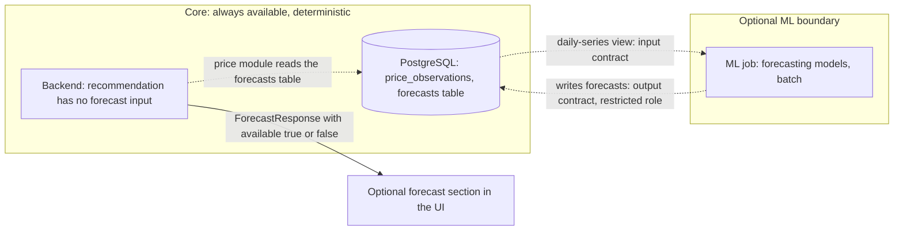

# AgriNex — ML Architecture (Optional Track)

**Status:** AUTHORITATIVE. Architecture formalization from Task 6 (2026-10-03), approved in the decision lock of the same day (ADR-0001; [ARCHITECTURE_INDEX.md §14](ARCHITECTURE_INDEX.md#14-architecture-approval-checklist)).

**Corrected 2026-10-04 (Task 8.5):** §4.8 and §4.9 aligned with ADR-0030 under the decision log's rule 7. They no longer imply a running ML service that the backend checks, or a serving port. ADR-0030 itself is unchanged.

- This document formalizes architecture already defined in the master specification (`docs/01_AGRINEX_MASTER_PRODUCT_PHASES.md`, "spec").
- Statements traced to the spec carry the spec's authority.
- Where the spec leaves a gap or contradicts itself, the decision log ([DECISION_LOG.md](DECISION_LOG.md)) records the decision, and this document cites the entries it applies. Where this document and a binding entry differ, the entry governs.

**Versions:** technology families only. Versions are in the approved baseline (ADR-0002; `CURRENT_TECHNOLOGY_BASELINE.md`).

> **ML is optional.** "Decision engine works completely without ML. ML is an enhancement only" (P9). "ML integration does NOT begin before the deterministic decision engine works end-to-end" (HARD RULE 2, §10).

## 1. Purpose

This document preserves the spec's optional ML boundary:

- the purpose of ML;
- when it may be built;
- its inputs, outputs, and model boundary;
- its interaction with the backend;
- forecast persistence and validation;
- failure behavior and availability semantics.

## 2. Scope

**In scope:** the optional forecasting service (`agrinex-ml`) and its contracts.

**Out of scope:**

- any use of forecasts in ranking (the spec has none, §16);
- ML infrastructure the spec does not name.

## 3. SSOT traceability

| Topic | Spec sources |
|---|---|
| Optional status | P9 (§5), §9 ("Optional" in Phase 1, "Optional/Integrated" in Phase 2), §10 HARD RULE 2, §47 Q12 |
| Container | §12 (Python FastAPI, port 8000, "Reads from PG, writes forecasts back"), §45 (`agrinex-ml`) |
| Strategy, models, validation, failure behavior, contracts | §35 |
| Data flow | §14 (dashed ML paths) |
| Contract file | §41 (`contracts/forecast-output.schema.json`: ML produces, Backend consumes) |
| Repository | §43 (`ml/forecasting`, `ml/api` "if serving forecasts") |
| Training data fixture | §44 (`fixtures/ml_observations.csv`) |
| Evaluation | §36 Experiment 3, §47 Q13–Q15 |
| Failure UI | §29 |
| Schedule | §42 item 35 ("ML integration (if data permits)", weeks 11–12) |

## 4. Architecture

### 4.1 ML boundary

ADR-0030 resolves CONFLICT C-03 in favor of the table path that §14 and §35 describe. The backend never calls the ML service at runtime, so the §12 dashed backend → ML edge is not implemented. `ml/api` (FastAPI) is not used for serving.

### 4.2 Purpose

The ML track does **short-horizon mandi price forecasting**: it predicts the modal price for a market and commodity 3 or 7 days ahead (§35).

### 4.3 When ML may be built

ML is built only if all three conditions in §35 hold:

1. The historical series has at least 90 observations per market–commodity pair after bootstrap.
2. The deterministic decision engine is complete and deployed.
3. At least one team member has time available after the Phase 1 Freeze.

### 4.4 Model boundary

- **Baselines are always built first** (§35):
  1. naive last-value;
  2. 7-day rolling mean;
  3. ARIMA or Prophet;
  4. LightGBM with lag features, "only if justified".
- **Not recommended without evidence:** LSTM, transformers, deep learning. "Complexity must be earned" (§35, §47 Q13).

### 4.5 Inputs and outputs

| Contract | Fields (spec §35) | Notes |
|---|---|---|
| Input ("from backend/DB") | `marketId`, `commodityId`, `varietyId`, `observations[]` (each with `date`, `modalPrice`, `minPrice`, `maxPrice`) | Read from a daily-series view: one selected observation per date, with current-dataset precedence and the lower-median representative when no variety is chosen (ADR-0010, ADR-0030). The view is defined by a price-module migration |
| Output ("written to `forecasts` table") | `marketId`, `commodityId`, `forecastHorizonDays`, `forecast[]` (each with `date`, `predictedPrice`, `lowerBound`, `upperBound`), `modelName`, `modelVersion`, `mae`, `rmse`, `trainingDataThrough`, `generatedAt` | Formalized in `contracts/forecast-output.schema.json` (§41) |
| Development data | `fixtures/ml_observations.csv` (Data Engineering) | §44 |

The `forecasts` table is not part of the §20 ER overview. Task 7 defines it ([DATA_DICTIONARY.md](../database/DATA_DICTIONARY.md)), and it belongs to the price module (ADR-0013, ADR-0030).

### 4.6 Backend–ML interaction

These statements in the spec do not agree with each other (CONFLICT C-03). ADR-0030 resolves them:

- §12 draws a dashed backend → ML edge labelled "reads forecasts".
- §14 and §35 place the forecasts in a PostgreSQL table that the backend reads.
- §43 provides `ml/api` "if serving forecasts".
- §35 describes the input as coming "from backend/DB".
- No forecast endpoint exists in §30, even though `ForecastResponse` is referenced (§29, §35).

**Decision (ADR-0030):**

- The ML job reads the daily-series view and writes `forecasts` through a dedicated database role, with SELECT on the view and INSERT/DELETE on `forecasts` only.
- The backend reads forecasts through the price module.
- A price-module endpoint, defined as optional in Task 8, returns `ForecastResponse`. It returns `available: false` when no forecast dated today or later exists.
- ML trains only on series with at least 90 observations (§37).
- Forecasts are deleted 90 days after their forecast date (ADR-0029).

### 4.7 Validation boundary

- **Splits:** chronological only, with no random splits. Training January–July, validation August, test September. Evaluation uses rolling or expanding windows (§35).
- **No leakage:** features use only data available before each forecast date (§47 Q14).
- **Metrics:** MAE, RMSE, and directional accuracy (§35).
- **Experiment 3:** compares naive, rolling mean, ARIMA, and LightGBM (§36).
- **Honest reporting:** results are reported even if ML performs worse than the naive baseline (§35, §36, §47 Q15).

### 4.8 Failure behavior and availability

These rules are enforced by §35 and §29, in the database-mediated integration of ADR-0030:

- **The backend never checks or calls an ML service** (ADR-0030 item 3). The price module reads the `forecasts` table, and that table is the only signal of ML availability.
- **When no forecast dated today or later exists** for the market and commodity, the forecast endpoint returns `ForecastResponse { available: false }` (ADR-0030 item 4). This covers every ML failure: the job never ran, failed, stopped or wrote no new generation, or the track was never built.
- **Core flows are unaffected:** comparison, recommendation, transport, and alerts carry on. None of them reads `forecasts`.
- **Only the forecast section changes.** The frontend shows "Forecast unavailable." only in the optional forecast section.
- **No 5xx response** is ever caused by an ML failure. A database failure while reading forecasts is a core failure (503, §29), not an ML failure.
- **Availability is a boolean.** Whether the ML job failed, has never been built, or produced no current forecast for the pair, consumers see `available: false`.

### 4.9 Deployment

- `agrinex-ml`, a custom Python image, optional (§45). It runs the ML job as a batch process that reads the daily-series view and writes `forecasts` through its restricted database role (ADR-0030). Nothing calls it, so it needs no published or internal port ([DEPLOYMENT_ARCHITECTURE.md §4.2](DEPLOYMENT_ARCHITECTURE.md); [CONTAINER_ARCHITECTURE.md](CONTAINER_ARCHITECTURE.md)). §12 (FastAPI) and §45 give the container port 8000; under ADR-0030 that port serves nothing.
- Source lives in `ml/forecasting` (models, training, evaluation) (§43). §43 also provides `ml/api` (FastAPI server) "if serving forecasts". ADR-0030 item 3 decides that it is not used to serve forecasts, so FastAPI is needed only if `ml/api` is ever needed for another purpose.

### 4.10 What ML is not

- **Not an input to ranking.** §16's composite score has no forecast term. Adding one would change a business rule, which needs an authorized spec update or an approved decision.
- **Not mandatory.** No Phase 1 freeze item depends on ML (§10).
- **No extra infrastructure.** No feature store, model registry, GPU infrastructure, or MLOps platform is part of the architecture, because the spec names none.

## 5. Responsibilities

| Concern | Responsible (§40) | Consulted |
|---|---|---|
| ML pipeline | ML | Backend, Data, QA |
| `contracts/forecast-output.schema.json` | Produced by ML | Reviewed by Backend before merge (§41) |
| `fixtures/ml_observations.csv` | Data Engineering | — |
| Research evaluation (Experiment 3) | QA | Backend, Data, ML |

## 6. Boundaries

- **Optional ML boundary:** a separate container. Disabling it or not deploying it must leave every Phase 1 flow intact (§35).
- **Data boundary:** ML reads normalized history and writes forecasts (§12, §14), through its own restricted database role. Its credentials are in the deployment environment, like every other secret (ADR-0020, ADR-0030).
- **Decision boundary:** the deterministic engine always runs first and stands alone (HARD RULE 2, P9).

## 7. Flows

This is F-10 in [DATA_FLOW.md](DATA_FLOW.md).

## 8. Decisions

Everything in §4 with a spec reference is a **REQUIREMENT FROM SSOT**. ADR-0030 decides the integration.

## 9. Assumptions

None.

## 10. Decisions applied

| Item | Decision |
|---|---|
| RD-024: read path, input supply, endpoint, database access, table ownership | ADR-0030 |
| RD-015: observations in the ML input series | ADR-0010 (daily series) |
| RD-001: Python, FastAPI and library versions | ADR-0002 (Python 3.14; libraries pinned only if the track starts) |

## 11. Phase applicability

**Optional.** ML starts only after the deterministic engine is complete and deployed, and after the Phase 1 Freeze (§35 criteria 2–3, HARD RULE 2). It is scheduled in weeks 11–12 "if data permits" (§42 item 35).

## 12. Dependencies

- **Upstream:**
  - [INGESTION_ARCHITECTURE.md](INGESTION_ARCHITECTURE.md) (history);
  - [CONTAINER_ARCHITECTURE.md](CONTAINER_ARCHITECTURE.md).
- **Downstream:**
  - [RESILIENCE_ARCHITECTURE.md](RESILIENCE_ARCHITECTURE.md) (ML failure row);
  - [TESTING_ARCHITECTURE.md](TESTING_ARCHITECTURE.md) (Experiment 3);
  - Task 7, but only if ML proceeds (`forecasts` schema).
