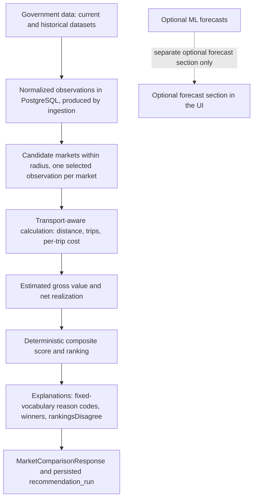
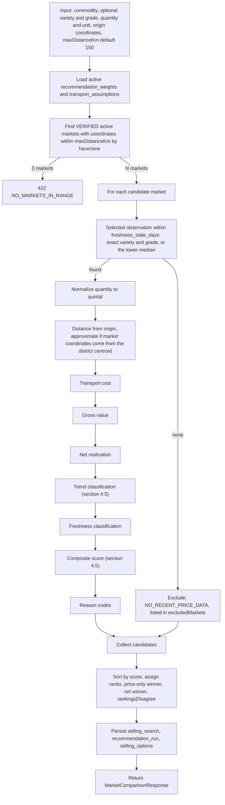

# AgriNex — Recommendation Engine Architecture

**Status:** AUTHORITATIVE. Architecture formalization from Task 6 (2026-10-03), approved in the decision lock of the same day (ADR-0001; [ARCHITECTURE_INDEX.md §14](ARCHITECTURE_INDEX.md#14-architecture-approval-checklist)).

- This document formalizes architecture already defined in the master specification (`docs/01_AGRINEX_MASTER_PRODUCT_PHASES.md`, "spec").
- Statements traced to the spec carry the spec's authority.
- Where the spec leaves a gap or contradicts itself, the decision log ([DECISION_LOG.md](DECISION_LOG.md)) records the decision, and this document cites the entries it applies. Where this document and a binding entry differ, the entry governs.

**Versions:** technology families only. Versions are in the approved baseline (ADR-0002; `CURRENT_TECHNOLOGY_BASELINE.md`).

## 1. Purpose

This document records the deterministic recommendation pipeline exactly as the spec defines it, completed where the spec is silent by the decision-log entries cited:

- ADR-0010: observation selection;
- ADR-0023: contract details;
- ADR-0024: scoring;
- ADR-0025: trends;
- ADR-0026: What-If.

The pipeline runs from normalized government price data to a ranked, explained comparison of markets. The deterministic engine is independently functional, and ML is not part of it.

## 2. Scope

**In scope:**

- the comparison engine (`POST /api/v1/selling-options/compare`), including its inputs, configuration, calculations, scoring, reasons, ranking, persistence, and outputs;
- the What-If simulation that re-runs part of the engine.

**Covered elsewhere:**

- how observations are produced: [INGESTION_ARCHITECTURE.md](INGESTION_ARCHITECTURE.md);
- forecasting: [ML_ARCHITECTURE.md](ML_ARCHITECTURE.md).

## 3. SSOT traceability

| Topic | Spec sources |
|---|---|
| Product thesis chain | §5 |
| Engine flow | §16 |
| Worked example | §21 |
| Transport and net-realization model | §32, FR-06–FR-09 |
| Ranking, winners, reasons, freshness | §16, FR-10–FR-13 |
| Trends | §33, FR-14 |
| What-If simulation | §17, §32 ("What-If Override"), FR-15 |
| Configuration tables | §20 (`TRANSPORT_ASSUMPTIONS`, `RECOMMENDATION_WEIGHTS`) |
| Persistence | §16 (PERSIST), §20 (`SELLING_SEARCHES`, `RECOMMENDATION_RUNS`, `SELLING_OPTIONS`) |
| Non-functional | §27 (< 1 s; deterministic unit tests), §28 (rate limit), §48 (acceptance) |
| ML separation | P9 (§5), §10 HARD RULE 2, §35, §47 Q12 |

## 4. Architecture

### 4.1 Pipeline layers



The ML path is deliberately disconnected from the ranking. §16's score has no forecast term. P9 states that the "decision engine works completely without ML. ML is an enhancement only". §35 adds that if ML fails, "comparison, recommendation, transport, alerts continue unaffected".

### 4.2 Engine flow

This diagram is condensed from spec §16.



### 4.3 Inputs and configuration

| Item | Definition | Spec |
|---|---|---|
| Request inputs | `commodityId`, optional `varietyId` and `gradeId`, `quantity` and `quantityUnit` (KG or QUINTAL), `originLat`, `originLon`, `maxDistanceKm` (default 150) | §16, §21, §25, F1.4–F1.6; ADR-0023 |
| Origin | The district centroid of the farmer's selected location, taken by the frontend from geography data. Never an exact address. The server accepts only a stored district centroid (6 decimal places, read through the geography module); any other origin answers 400 `VALIDATION_FAILED` and nothing is recorded | FR-06, §21 step 3, §28, §47 Q6; ADR-0039 |
| Transport assumptions | Active `transport_assumptions`: `ratePerKm` (default ₹8.00), `minimumTripCharge` (default ₹300), `vehicleCapacityKg` (default 1,000 kg). Admin-managed | §20, §32 |
| Recommendation weights | Active `recommendation_weights`: `w_net_realization` (0.55), `w_price` (0.15), `w_trend` (0.10), `w_freshness` (0.10), `w_transport_penalty` (0.10), plus the freshness thresholds `freshness_fresh_days`, `freshness_recent_days`, `freshness_stale_days` (defaults 1, 4, 10). Admins can change them | §16, §20, §21; ADR-0024 |

### 4.4 Calculations

These formulas are quoted from §16 and §32.

```text
quantityInKg      = quantity × (1 if unit=KG else 100)
quantityInQuintal = quantityInKg / 100
distanceKm        = haversine(originLat, originLon, market.lat, market.lon)
trips             = ceil(quantityInKg / vehicleCapacityKg)
perTripCost       = max(minimumTripCharge, distanceKm × ratePerKm)
estimatedTransportCost  = perTripCost × trips
estimatedGrossValue     = normalizedModalPrice × quantityInQuintal
estimatedNetRealization = estimatedGrossValue − estimatedTransportCost
```

- `normalizedModalPrice` is the selected observation's modal price in `Rs./Quintal`, never converted. A commodity with another unit is rejected with 422 `UNSUPPORTED_PRICE_UNIT` (ADR-0008, ADR-0023).
- Amounts are computed in exact decimal arithmetic and rounded half-up to 2 dp (ADR-0008).
- `haversine` uses the Earth radius 6 371.0088 km. The double result is converted through its shortest decimal form and rounded half-up to 2 dp before any further use (ADR-0036; `docs/api/API_CONVENTIONS.md` §4.1).
- If any estimate would exceed the stored precision (`numeric(14,2)`), the comparison answers 422 `ESTIMATE_OUT_OF_RANGE` and records nothing. There is no quantity limit (ADR-0023 item 1; ADR-0040).
- Distances are labelled "approximate" (§47 Q6), and flagged when the market's coordinates are its district centroid (ADR-0014).
- Transport cost is always labelled with the rate actually applied: "Estimated — based on ₹{appliedRatePerKm}/km assumption. Actual costs will vary." (§32; ADR-0038, departure D-14).
- Net realization is always labelled "Estimated net realization" (§32).
- No financial guarantee is implied anywhere (§32, §49).

### 4.5 Classification and scoring

| Step | Rule | Spec |
|---|---|---|
| Trend | Computed on the daily series (one selected observation per date). Recent window: today − 6 to today. Baseline window: today − 13 to today − 7 (IST). `changePercent7Day` = (recent average − baseline average) / baseline average × 100. RISING if > +3.0%, FALLING if < −3.0%, otherwise STABLE. INSUFFICIENT_DATA if there are fewer than 4 daily values in the last 14 days, or a window is empty. FR-14's "30-day trend direction" is this direction, shown with the 30-day chart | §16, §33; ADR-0025 |
| Freshness | FRESH if `report_date` ≥ today − `fresh_days`. RECENT if ≥ today − `recent_days`. STALE if ≥ today − `stale_days`. UNAVAILABLE if older. "Today" is the IST date | §16, FR-13; ADR-0007 |
| Normalization | `normalized_net` = (net − min_net) / (max_net − min_net). `normalized_price` = (price − min_price) / (max_price − min_price). `normalized_transport` = (transport − min_transport) / (max_transport − min_transport). When max = min, every candidate gets `normalized_net` = 1, `normalized_price` = 1 and `normalized_transport` = 0 | §16; ADR-0024 |
| Component scores | `trendScore`: RISING 1.0, STABLE 0.5, FALLING 0.0, INSUFFICIENT_DATA 0.5. `freshnessScore`: FRESH 1.0, RECENT 0.7, STALE 0.3, UNAVAILABLE 0.0 | §16; ADR-0024 |
| Composite score | `score = w_net × normalized_net + w_price × normalized_price + w_trend × trendScore + w_freshness × freshnessScore − w_transport_penalty × normalized_transport`. Net realization must be the dominant factor | §16, FR-10 |

### 4.6 Reason codes (fixed vocabulary)

| Code | Trigger (§16) |
|---|---|
| `PRICE_ADVANTAGE` | Price in the top 25%: modal ≥ the modal at position ⌈N/4⌉ in descending order (ADR-0024) |
| `LOWER_TRANSPORT` | Transport cost in the bottom 25%: cost ≤ the cost at position ⌈N/4⌉ in ascending order (ADR-0024) |
| `POSITIVE_TREND` | Trend RISING |
| `STABLE_TREND` | Trend STABLE |
| `NEGATIVE_TREND` | Trend FALLING |
| `RECENT_DATA` | Freshness FRESH |
| `STALE_DATA` | Freshness STALE |
| `SUITABLE_DISTANCE` | `distanceKm` < 50 |

Also:

- `NO_RECENT_PRICE_DATA` is the reason a market is excluded. Excluded markets are listed in `excludedMarkets`. When every market in range is excluded, the response is 200 with empty `options` and `noDataReason: NO_RECENT_PRICE_DATA` (§29; ADR-0023).
- `NO_MARKETS_IN_RANGE` is returned with HTTP 422 and the title "Insufficient data" (§16; ADR-0023).
- Each of the 8 codes must trigger in at least one unit-test scenario (§48).
- Reason codes are presented in farmer-appropriate language in MR/HI/EN (§46, §47 Q18).

### 4.7 Ranking, winners, and outputs

| Output | Definition | Spec |
|---|---|---|
| Rank | Candidates sorted by score, descending. Ties go to the higher net realization, then the shorter distance, then the alphabetically first market name. Ranks 1..N | §16; ADR-0024 |
| Price-only winner | Highest modal price. Ties go to the higher net realization, then the shorter distance, then the market name | §16, FR-11; ADR-0023 |
| Net winner | "rank 1 by composite score" | §16 |
| `rankingsDisagree` | priceWinner ≠ netWinner. Drives the `WinnerCalloutBanner` | §10, §16, §25 |
| Response | `MarketComparisonResponse`: `recommendationId`, commodity, quantity, `priceOnlyWinnerId`, `netRealizationWinnerId`, `rankingsDisagree`, `options: SellingOptionResponse[]`, `excludedMarkets`, `noDataReason`, the transport assumptions used, and per-option provenance (observation, variety, grade, report date, dataset, unit, freshness) | §16, §21, §30; ADR-0022, ADR-0023 |
| Persistence | `selling_search` (inputs), `recommendation_run` (weights and transport references, winners, `rankings_disagree`), and one `selling_options` row per eligible candidate (market, observation, distance, transport, gross, net, trend, freshness, rank, score, `reason_codes`). Runs with no eligible option are persisted with NULL winners, and excluded markets are not persisted. Anonymous comparisons store no profile ([DATA_DICTIONARY.md](../database/DATA_DICTIONARY.md)) | §16, §20, §28; ADR-0023 |

### 4.8 What-If simulation

| Aspect | Definition | Spec |
|---|---|---|
| Inputs | Quantity (100–5000 kg), transport rate (₹3–₹20/km), maximum distance (25–300 km), applied to the last recommendation run's data | §17 |
| Modes | Client-side recalculation is the Phase 1 MVP: no page reload and no full API re-call. It uses the full §32 formula with the transport assumptions from the comparison response (departure D-13). Server-side `POST /api/v1/selling-options/simulate` (`recommendationId`, optional `quantity`, `transportRatePerKm`, `maxDistanceKm`) is used only when the maximum distance exceeds the original radius. It recomputes with the original run's weight and transport versions, and nothing is persisted | §10, §17, §30; ADR-0026 |
| Breakeven insight | Find the rate R at which `net_market_A(R) = net_market_B(R)`. If solvable, show "At ₹R/km, Market B becomes better" | §17, §47 Q18 |
| Overrides | Session-only. They never change the system defaults | §32 |
| Ranking basis | The simulator ranks by estimated net realization (§17 "Re-sort by newNet"), with ties broken by shorter distance and then market name. The screen labels the basis | §17; ADR-0026 |

### 4.9 Determinism and reproducibility

- **Deterministic by design.** The engine uses no randomness and no ML. The same inputs, the same active configuration, and the same observations produce the same ranking. The spec calls it the "deterministic decision engine" (HARD RULE 2, §35, §47 Q12, Q18).
- **Reproducible from records.** Each `recommendation_run` stores references to the weights and transport assumptions it used (§20). Experiment 1 recomputes winners and disagreement rates from these persisted runs (§36).
- **Tested against hand-computed fixtures.** Transport, net realization, and scoring are covered by deterministic unit tests (§27, §48).

## 5. Responsibilities

| Concern | Module (§13) | Responsible role (§40) |
|---|---|---|
| Candidate discovery, scoring, reasons, ranking, persistence, simulate endpoint | recommendation | Backend; Data, ML, and Frontend consulted |
| Distance and transport cost | transport | Backend |
| Observations, trends | price | Backend and Data |
| Client-side What-If, winner banner, explanation card | frontend | Frontend |

## 6. Boundaries

- **ML boundary:**
  - No forecast enters the score (§16).
  - ML failure never affects comparison or recommendation (§35).
  - Using forecasts in ranking would change a business rule. That needs an authorized spec update or an approved decision (CLAUDE.md §B, §E).
- **Data boundary:**
  - The engine reads stored observations only.
  - It never calls the government API (§31 RULE 1).
  - It never interpolates a missing price (§31 RULE 5).
- **Performance and abuse boundary:**
  - Responses must take under 1 s (§27), with p95 under 1 s at 10 concurrent users (§48).
  - The endpoint is rate-limited at 60 requests/min per IP, a budget shared with simulate and backed by Redis (§28). When Redis is unavailable, an in-process limiter with the same limits takes over (ADR-0017, ADR-0018).
- **Module boundary:**
  - Recommendation depends on transport and price (§13), and on commodity and auth (ADR-0013).
  - It reads observations through the price module, and transport assumptions through the transport module (ADR-0013).

## 7. Flows

These are F-05 to F-08 and F-12 in [DATA_FLOW.md](DATA_FLOW.md).

## 8. Decisions

- Every rule in §4 traces to the spec. Where the spec was silent, the rule cites the decision-log entry that completes it: ADR-0010, ADR-0023, ADR-0024, ADR-0025 or ADR-0026.
- The engine adds no ranking factors beyond the spec's formula.

## 9. Assumptions

None specific to this document.

## 10. Decisions applied

| Item | Decision |
|---|---|
| RD-006: field names; excluded markets; no eligible option | ADR-0023 |
| RD-007: weights, normalization, INSUFFICIENT_DATA score, max = min | ADR-0024 |
| RD-008: "30-day trend direction" | ADR-0025 |
| RD-009: What-If formula, ranking, radius, server trigger | ADR-0026 |
| RD-015: observation selection | ADR-0010 |
| RD-017: cross-module access | ADR-0013 |
| RD-018: market coordinates | ADR-0014 |
| RD-019: rate limiting without Redis | ADR-0018 |
| RD-027: price unit | ADR-0008 |
| RD-039: Earth radius | ADR-0036 |
| RD-041: transport label | ADR-0038 |
| RD-042: origin check | ADR-0039 |
| RD-043: estimates beyond the stored precision | ADR-0040 |

## 11. Phase applicability

**Phase 1** (F1.6–F1.14, F1.18; FR-06–FR-15). Phase 2 listings reference a recommendation run's reference price (§23, §47 Q23). This does not change the engine.

## 12. Dependencies

- **Upstream:**
  - [INGESTION_ARCHITECTURE.md](INGESTION_ARCHITECTURE.md) (observations);
  - [COMPONENT_ARCHITECTURE.md](COMPONENT_ARCHITECTURE.md).
- **Downstream:**
  - [FRONTEND_ARCHITECTURE.md](FRONTEND_ARCHITECTURE.md) (comparison, explanation, simulator);
  - [TESTING_ARCHITECTURE.md](TESTING_ARCHITECTURE.md);
  - Task 8 (`contracts/recommendation.schema.json`, `openapi.yaml`).
