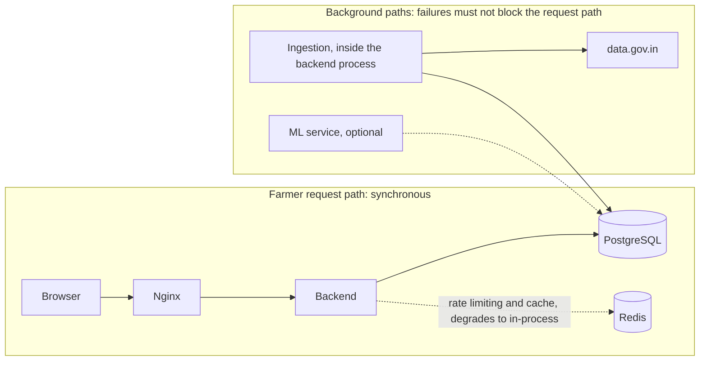

# AgriNex — Resilience Architecture

**Status:** AUTHORITATIVE. Architecture formalization from Task 6 (2026-10-03), approved in the decision lock of the same day (ADR-0001; [ARCHITECTURE_INDEX.md §14](ARCHITECTURE_INDEX.md#14-architecture-approval-checklist)).

- This document formalizes architecture already defined in the master specification (`docs/01_AGRINEX_MASTER_PRODUCT_PHASES.md`, "spec").
- Statements traced to the spec carry the spec's authority.
- Where the spec leaves a gap or contradicts itself, the decision log ([DECISION_LOG.md](DECISION_LOG.md)) records the decision, and this document cites the entries it applies. Where this document and a binding entry differ, the entry governs.

**Versions:** technology families only. Versions are in the approved baseline (ADR-0002; `CURRENT_TECHNOLOGY_BASELINE.md`).

## 1. Purpose

This document records the failure boundaries and degraded behavior that the spec defines for each major dependency, completed by these decision-log entries:

- ADR-0005: source outages;
- ADR-0009: conflicting records;
- ADR-0011: run status rules;
- ADR-0018: Redis failure;
- ADR-0019: the admin alert channel;
- ADR-0021: backups;
- ADR-0023: no-data responses;
- ADR-0030: ML containment.

It adds no circuit breakers, queues, replicas or failover.

## 2. Scope

**In scope:**

- government API failure;
- ingestion failure modes;
- stale and missing data;
- ML failure;
- database failure;
- cache failure;
- token expiry;
- Phase 2 concurrency;
- demo and deployment risks named by the spec.

**Covered elsewhere:** monitoring screens, which belong to the admin features in [DATA_FLOW.md](DATA_FLOW.md) F-13.

## 3. SSOT traceability

| Topic | Spec sources |
|---|---|
| Resilience principle | P6 (§5): "Product works when government API is slow, rate-limited, or down" |
| Failure table | §29 |
| Reliability NFRs | §27 (ingestion failures do not affect farmer endpoints; keep serving stored data during API downtime), FR-16 |
| Ingestion error handling | §15, §22, §37 |
| ML failure behavior | §35 ("Enforced") |
| Risks and fallbacks | §37 |
| Health checks | §10, §27, §45 |
| Resilience freeze checks | §10 RESILIENCE |
| Acceptance test | §48 (government API failure handling: disable the API key) |

## 4. Architecture

### 4.1 Isolation of the request path

The spec builds resilience on three principles:

- **Stored data is the source for every farmer-facing answer.** "Cache all data in PostgreSQL" (§37). Storing data "means the frontend is never directly dependent on external API availability" (§47 Q9).
- **Ingestion runs off the request path.** "Farmer endpoints must not be affected by ingestion failures" (§27).
- **ML runs off the core path.** "Comparison, recommendation, transport, alerts continue unaffected"; "No 5xx error due to ML failure" (§35).

### 4.2 Failure catalogue

| Failure condition | Affected component | Expected behavior | Fallback / degraded behavior | User-visible behavior | Recovery (as specified) | Spec |
|---|---|---|---|---|---|---|
| Government API unavailable (4xx/5xx/timeout, maintenance page, non-JSON) | Ingestion module | Exponential backoff, at most 3 retries per page. Then log `API_ERROR` or `SCHEMA_ERROR` with an `error_code`, and mark the run FAILED (nothing fetched) or PARTIAL_FAILURE. A failed response is never read as "zero records" and never changes stored data. Admin alert: dashboard banner plus an ERROR log event (ADR-0005, ADR-0011, ADR-0019) | Serve the last successfully synced data with true freshness labels. Comparison, trends and alerts continue from the database. No other source, no carried-forward prices | "Latest source synchronization is unavailable. Showing most recently stored government-reported data." shown while the latest current run is FAILED. Freshness badges show data age | Next scheduled run (6-hourly), a manual admin sync, or a historical backfill of missed dates | §15, §22, §29, §37, §47 Q7, Q25, FR-16 |
| Government API rate limiting | Ingestion module | Exponential backoff, at most 3 retries, within the 6-hour schedule | A retry resumes at the failed offset. The next run starts at offset 0, and idempotent loading makes that safe (ADR-0011) | None to farmers | Resumed or next run | §37 |
| Partial ingestion (some pages fail) | Ingestion module | Persist successfully fetched pages. Log failed pages in `ingestion_errors`. No rollback of successful progress. Run status PARTIAL_FAILURE | The rest of the data stays available | Admin sees "X records inserted, Y pages failed" | Next run. Status rule: ADR-0011 | §15, §29 |
| Government API schema change | Ingestion source adapter | The adapter layer isolates raw field parsing. `raw_payload` is stored in `ingestion_errors`. "Fail ingestion loudly" | Stored data stays available | Failure is exposed in the admin dashboard | Adapter fix (a code change) | §37 |
| Invalid or inconsistent records (units, names) | Ingestion validation | Reject the record and log a validation error (`VALIDATION`, `error_code`, `raw_payload`), under rules V1–V8, which include the unit floor and the 10× outlier rule (ADR-0008) | Other records continue | Admin error view | Unknown commodities and districts can be curated by an admin, and the dates backfilled | §15, §37 |
| Duplicate source records | Ingestion load, database | Business key plus a database unique constraint. Identical re-deliveries are counted and not written; changed prices are revised with an audit row (ADR-0009) | The database rejects duplicates even if the application has a bug | — | — | §31 RULE 6, §37, §47 Q8 |
| Same-key records with different prices in one delivery | Ingestion load | Quarantined: none stored, every variant logged as CONFLICT (ADR-0009) | The previously stored value, if any, stays | Admin error view | A later consistent delivery is stored normally | ADR-0009 |
| Stale data | Recommendation, price module, UI | Freshness classified per observation. STALE lowers the score and adds `STALE_DATA`. Markets with nothing within `freshness_stale_days` are excluded (`NO_RECENT_PRICE_DATA`) | Show stored data with freshness context | Stale-data warning and STALE banner. Freshness badges on every price screen | Next successful ingestion | §10, §16, §37, F1.16, F1.23 |
| Missing data: no recent observation in range | Recommendation module | Exclude affected markets and list them in `excludedMarkets`. If none remain, return 200 with empty `options` and `noDataReason: NO_RECENT_PRICE_DATA` (ADR-0023) | Never fabricate or interpolate (§31 RULE 5) | "No recent market observation available for this commodity in your area." | — | §16, §29 |
| No markets within the radius | Recommendation module | `422 NO_MARKETS_IN_RANGE` (ADR-0023) | Farmer can widen the distance | "No data in range. Try increasing distance." with an Adjust distance button | — | §16, §25 |
| Insufficient history for trends | Price module (trends) | `INSUFFICIENT_DATA` when fewer than 4 daily values exist in 14 days, or a window is empty (ADR-0025) | — | "Insufficient historical data for this market/commodity" ("Insufficient history") | — | §33, §37 |
| ML forecast unavailable or ML pipeline failure | ML job; forecast read through the price module | `ForecastResponse { available: false }` when no forecast for today or later exists. No 5xx, and no runtime call to ML (ADR-0030) | Comparison, recommendation, transport, and alerts unaffected | "Forecast unavailable." shown only in the optional forecast section | — | §29, §35, §37 |
| Database connection failure | Backend | Fail fast with 503. Health endpoint reports DB DOWN, and readiness fails | — | Standard 503 error page | Automatic when the database returns. A daily `pg_dump` (7 days kept) covers data loss (ADR-0021) | §27, §29 |
| Redis unavailable | Backend (rate limiter, reference-data cache) | Rate limiting switches to an in-process limiter with the same limits. Cache reads and writes bypass to PostgreSQL. Both log a warning. Health shows Redis DOWN; readiness stays UP (ADR-0018) | Degraded, not down | None | Automatic when Redis returns | ADR-0018 |
| Alert evaluation failure | Alert module, after a run | Logged as `ingestion_errors` type SYSTEM, code `ALERT_EVALUATION_FAILED`. The run status is unchanged (ADR-0013, ADR-0019) | Ingestion and farmer endpoints are unaffected | Possible missed alert for that run | The next run that changes observations evaluates again | ADR-0019 |
| Access token expired | Frontend, auth module | 401 → refresh using the httpOnly cookie → retry | — | Transparent: "user sees no interruption" | Automatic | §29 |
| Email provider unavailable or rejects a message | Auth module (email adapter) | The email is sent after the transaction commits, with a bounded timeout. A failure is logged as an ERROR event with the correlation id and no email address, token or link. No queue and no retry loop. The operation's answer is unchanged (registration 201, reset request 202), so the outage reveals nothing about accounts (ADR-0048) | Registration, login, comparison and alerts are unaffected | The user may not receive the link; the screens say a link may take a few minutes and offer "send again" | The user requests a new link; a new link replaces the old one | ADR-0048 |
| Concurrent bid acceptance (Phase 2) | Bid and transaction modules | `SELECT … FOR UPDATE`. The second request gets 409 (`LISTING_ALREADY_ACCEPTED`) | Exactly one acceptance succeeds | "This listing has already been accepted by another buyer." | — | §23, §29, §48 |
| Deployment failure during the demo | Deployment | Rehearsed Docker deployment. Fixture data loaded in advance | Fall back to localhost | — | — | §37 |
| Phase 2 cold start (no buyers) | Phase 2 | Demo with fixture or seed buyers | Ship Phase 1 only | — | — | §37 |

### 4.3 Health signals

| Signal | Behavior | Spec |
|---|---|---|
| Backend `/actuator/health` | Includes DB and Redis sub-checks. Expected `{"status":"UP","components":{"db":…,"redis":…}}`. Readiness group (`/actuator/health/readiness`, used by the container health check) includes the database only. Not exposed publicly (ADR-0017, ADR-0018) | §10, §27, §45 |
| Frontend `/api/health` | Returns `{"status":"ok"}` | §45 |
| `scripts/health_check.sh` | Quick deployment validation | §43 |
| Admin ingestion health | Sync status per dataset, consecutive failures, run history with counters and completeness, errors, stale markets, pause state (ADR-0012, ADR-0019, ADR-0020) | FR-18, §46 |

A Redis outage shows in the overall health status but never fails readiness (ADR-0018). `/actuator/health` is reachable only inside the Docker network (ADR-0017).

## 5. Responsibilities

| Concern | Responsible role (§40) |
|---|---|
| Ingestion failure handling | Data Engineering |
| Backend failure handling and error format | Backend |
| Deployment rehearsal and health checks | DevOps |
| Resilience verification (§10 RESILIENCE, §48) | QA |

## 6. Boundaries

- **Failure boundary 1: government data.**
  - Failures stop at the ingestion module and the audit records.
  - Farmer flows read PostgreSQL only.
- **Failure boundary 2: optional ML.**
  - Failures stop at the forecast read path and the optional forecast section.
- **Failure boundary 3: persistence.**
  - A database failure is not masked. The system fails fast with 503 (§29).
- **No invented mechanisms.** Retries follow §22 and §37, and the decision-log entries add only:
  - the in-process rate-limit fallback (ADR-0018);
  - the daily database dump (ADR-0021).

  No circuit breakers, queues, replicas or failover are part of this architecture. Adding one is a decision.

## 7. Flows

The failure behavior of each flow appears in the per-flow tables of [DATA_FLOW.md](DATA_FLOW.md).

## 8. Decisions

Every row in §4.2 with a spec reference is a **REQUIREMENT FROM SSOT**. Rows citing an ADR apply that decision-log entry.

## 9. Assumptions

None.

## 10. Decisions applied

| Item | Decision |
|---|---|
| RD-005, RD-028: upsert semantics and conflicts | ADR-0009 |
| RD-006: response when no eligible option remains | ADR-0023 |
| RD-016: resume state, status rule, overlapping runs | ADR-0011 |
| RD-019: Redis unavailable | ADR-0018 |
| RD-020: admin alert channel | ADR-0019 |
| RD-021: exposure of `/actuator/health` | ADR-0017 |
| RD-024: forecast read path | ADR-0030 |
| Source outages and maintenance | ADR-0005 |

## 11. Phase applicability

| Scenario | Phase |
|---|---|
| Government API, ingestion, stale or missing data, database, Redis, token expiry, demo deployment | Phase 1 (§10 RESILIENCE checks) |
| Concurrent bid acceptance, cold start | Phase 2 |
| ML failure | Optional |

## 12. Dependencies

- **Upstream:**
  - [CONTAINER_ARCHITECTURE.md](CONTAINER_ARCHITECTURE.md);
  - [INGESTION_ARCHITECTURE.md](INGESTION_ARCHITECTURE.md);
  - [RECOMMENDATION_ENGINE.md](RECOMMENDATION_ENGINE.md);
  - [ML_ARCHITECTURE.md](ML_ARCHITECTURE.md).
- **Downstream:**
  - [TESTING_ARCHITECTURE.md](TESTING_ARCHITECTURE.md) (resilience tests);
  - [FRONTEND_ARCHITECTURE.md](FRONTEND_ARCHITECTURE.md) (user-visible states).
