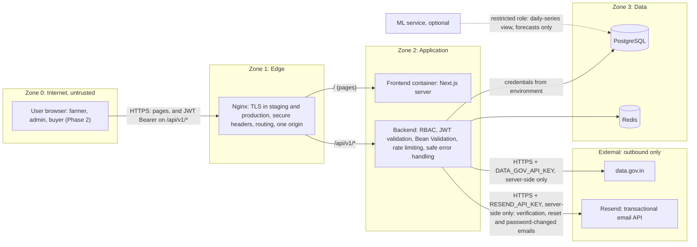
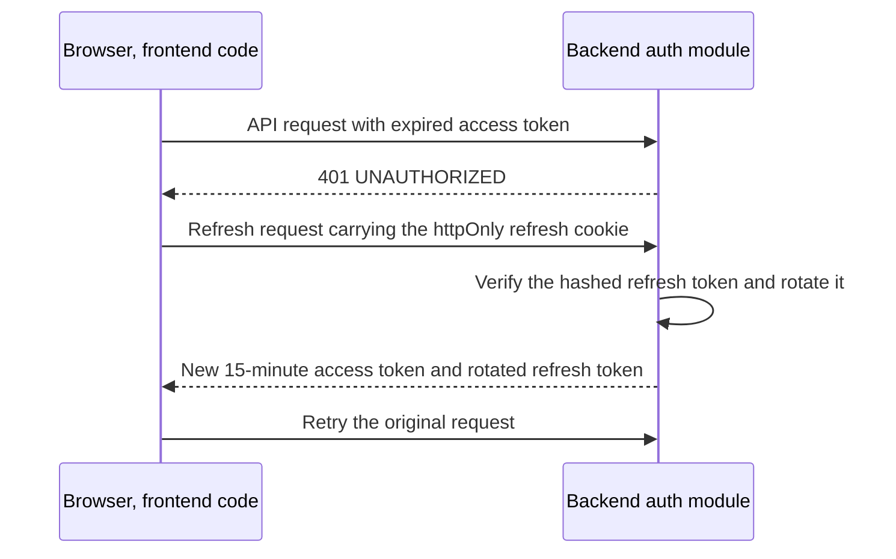

# AgriNex — Security Architecture

**Status:** AUTHORITATIVE. Architecture formalization from Task 6 (2026-10-03), approved in the decision lock of the same day (ADR-0001; [ARCHITECTURE_INDEX.md §14](ARCHITECTURE_INDEX.md#14-architecture-approval-checklist)).

- This document formalizes architecture already defined in the master specification (`docs/01_AGRINEX_MASTER_PRODUCT_PHASES.md`, "spec").
- Statements traced to the spec carry the spec's authority.
- Where the spec leaves a gap or contradicts itself, the decision log ([DECISION_LOG.md](DECISION_LOG.md)) records the decision, and this document cites the entries it applies. Where this document and a binding entry differ, the entry governs.

**Versions:** technology families only. Versions are in the approved baseline (ADR-0002; `CURRENT_TECHNOLOGY_BASELINE.md`).

> Security-sensitive changes need explicit human review (CLAUDE.md rule 16, §K). This document names secrets but never contains secret values.

## 1. Purpose

This document records the security architecture the spec establishes:

- trust boundaries;
- authentication and authorization;
- token handling;
- secrets;
- edge controls;
- data protection.

It also applies the security decisions of the decision lock: ADR-0016 (accounts and tokens), ADR-0017 (edge, CORS, browser tokens, rate limits), ADR-0018 (Redis), ADR-0020 (admin boundary, secrets, audit), ADR-0028 (demo credentials) and ADR-0033 (MCP credentials), and those of the Task 9 final decision lock: ADR-0047 (account email, login identifiers, Phase 1 password recovery) and ADR-0048 (email verification, reset mechanism, email delivery). The analysis behind ADR-0048 is in `docs/security/TASK_9_FINAL_ACCOUNT_RECOVERY_SECURITY_REVIEW.md`. Every security-sensitive change still needs explicit human review before merge (CLAUDE.md rule 16).

## 2. Scope

**In scope:**

- the Phase 1 security architecture;
- the Phase 2 security elements;
- the optional ML access boundary.

**Out of scope:** security products or controls the spec does not require. None are added here.

## 3. SSOT traceability

| Topic | Spec sources |
|---|---|
| Security controls table | §28 |
| Role capabilities | §28, FR-20 |
| Security NFRs | §27 (API key protection, JWT lifetimes and rotation, server-side RBAC) |
| Token-expiry handling | §29 |
| API key handling | §11, §12, §31 RULE 1, §47 Q9, Q21 |
| Error responses | §10 (`ApiErrorResponse`, no stack traces), §28, §41 |
| PII minimization | §28, §47 Q6 |
| Phase 2 security | F2.5, F2.7, FR-21–FR-23, §19, §23, §28, §29, §48 |

## 4. Architecture

### 4.1 Trust boundaries

The zones are a documentation device for describing trust boundaries. They are not additional infrastructure. Every node is a container from [CONTAINER_ARCHITECTURE.md](CONTAINER_ARCHITECTURE.md) or an external system from [SYSTEM_CONTEXT.md](SYSTEM_CONTEXT.md).

### 4.2 Controls (spec §28)

| Control | Implementation | Location |
|---|---|---|
| Password hashing | BCrypt, cost factor ≥ 12 | Backend `AuthService` |
| Access token | JWT, HS256, signed with a server secret (at least 256 random bits), 15-minute expiry. Claims `sub`, `role`, `iat`, `exp`, `iss`. Spring Security's resource-server JWT support (Nimbus, Boot-managed); no extra JWT library (ADR-0016) | Backend `JwtService` |
| Refresh token | Opaque 256-bit value, SHA-256-hashed, stored in the database, 7-day TTL, rotated on every refresh. Presenting a revoked token revokes its whole family (RFC 9700 §4.14.2; ADR-0016) | Backend `refresh_tokens` table |
| RBAC | Spring Security `@PreAuthorize`. Roles FARMER, BUYER, ADMIN. Enforced server-side on every endpoint (FR-20, §27) | Backend `SecurityConfig` |
| Government API key | Only in the `DATA_GOV_API_KEY` environment variable. Never in the frontend | Backend ingestion module |
| Input validation | Bean Validation on every request DTO | Backend (`@Valid`) |
| SQL injection | JPA/Hibernate parameterized queries only. No string concatenation | Backend repositories |
| CORS | Restricted to the known frontend origin, as defense in depth. Nginx adds no CORS headers, because the frontend and API share one origin (departure D-10; ADR-0017) | Backend `WebConfig` |
| Rate limiting | Redis-backed, per client IP. Compare and simulate share 60 requests/min (§28). Login, register and refresh are each 10 requests/min, and failed logins are limited per identifier. The password-reset and email-verification operations are each 10 requests/min, password-reset requests are limited to 3 per identifier per hour and verification resends to 3 per account per hour. An in-process fallback applies when Redis is down (ADR-0017, ADR-0018, ADR-0048) | Backend Redis interceptor |
| Secure headers | X-Content-Type-Options, X-Frame-Options, CSP, Referrer-Policy, and Strict-Transport-Security once TLS is verified (ADR-0017) | Nginx configuration |
| PII minimization | No home address is collected. District centroid only: the frontend sends the `listDistricts` centroid, and the backend accepts only a stored district centroid as a comparison origin (400 otherwise; ADR-0039) | Frontend and backend (recommendation, through geography) |
| Error responses | Stack traces never appear in HTTP responses. Every error uses `ApiErrorResponse` (§10), shaped as RFC 9457 Problem Details (ADR-0022) | `GlobalExceptionHandler` |
| TLS | HTTPS only in staging and production | Nginx + certbot |
| Phase 2 documents | Buyer verification documents are stored with access control | Auth module file service, storing documents in PostgreSQL (ADR-0031) |

### 4.3 Authentication and token handling

- **Endpoints:** `POST /api/v1/auth/*` handles register, login, refresh, and logout (§10, §30).
- **Accounts (ADR-0016):**
  - Registration is a "quick phone registration" for farmers who want alerts (§25), with a phone number, an email address and a password, and no OTP in Phase 1 (ADR-0047, departure D-15).
  - The user record holds a unique phone number (E.164, required for FARMER), a unique lower-case email (required for FARMER and ADMIN, ADR-0047), a password hash, a role, and an active flag (§20), plus the email-verification and password-reset state (ADR-0048).
  - Login takes one `identifier` and a password. A FARMER may use the phone number or the email of the same account, with the same password; an ADMIN uses the email (ADR-0047).
  - The phone number and the email of one account are counted as separate identifiers by every limit, so no response links them (ADR-0048).
  - Passwords are 8–64 characters for FARMER and 15–64 for ADMIN, never more than 72 UTF-8 bytes.
  - ADMIN accounts are provisioned, never self-registered (ADR-0028).
- **Tokens:**
  - The access token is a 15-minute HS256 JWT. It is sent as `Authorization: Bearer` on `/api/v1/*` (§12).
  - The refresh token lasts 7 days and is rotated. It is stored hashed in the database and used through an httpOnly cookie (§27, §28, §29).
- **Browser token handling (ADR-0017):**
  - The browser holds the access token in memory only, never in Web Storage.
  - The refresh cookie is `__Secure-agrinex_refresh`, with `HttpOnly; Secure; SameSite=Strict; Path=/api/v1/auth`. The server reads only the full prefixed name. `__Host-` is not possible with this path (ADR-0042). The refresh and logout endpoints also check that the `Origin` header equals the public origin.
  - The frontend serializes refresh calls, so parallel tabs do not trigger reuse detection. A 429 from refresh is not a sign-out: the client waits `Retry-After` and retries once (ADR-0042).
- **Account status (ADR-0042, ADR-0041):**
  - An inactive account cannot sign in (401 `INVALID_CREDENTIALS`) or refresh (401 `REFRESH_TOKEN_INVALID`, family revoked).
  - Every operation that evaluates an access token resolves the caller's account and answers 401 `UNAUTHORIZED` for an inactive or removed account. That covers alerts and admin, and compare and simulate when a token is sent.
  - The 15-minute stateless token is otherwise accepted for Phase 1.
- **Email verification and password recovery (ADR-0047, ADR-0048):**
  - After registration, a verification link is sent to the account's email. A provisioned ADMIN's email is recorded as verified at creation.
  - Links carry a single-use token of 256 random bits (base64url) from a cryptographically secure generator. Only its SHA-256 hash is stored, on `users`. A new link replaces the previous one. Verification links last 24 hours, reset links 30 minutes.
  - Links are built on the configured public origin, never on the request's `Host` header, with the token in the URL fragment, so it never reaches a server log or a `Referer` header. The reset page sends `Referrer-Policy: no-referrer`.
  - A password-reset request always answers 202, whatever the identifier, and the email is sent after the response, so neither the body nor the timing reveals an account. A reset link goes only to the verified email of an active account.
  - A successful reset replaces the BCrypt hash, spends the token, revokes every refresh-token family of the account, clears the refresh cookie, and sends a "password changed" notice. It does not sign the user in.
  - No SMS or OTP is used (§39). Emails are sent server-side through Resend's HTTPS API with Spring's `RestClient` (no additional library). Alert delivery stays in-app only (ADR-0019).
- **Operator procedures (ADR-0037, ADR-0041):**
  - Account erasure, deactivation and reactivation have no HTTP endpoint.
  - An operator with server access runs them as one-off commands of the backend. The admin module performs them through the auth module's interface.
  - Each writes an audit row (`ACCOUNT_ERASED`, `ACCOUNT_DEACTIVATED`, `ACCOUNT_REACTIVATED`) with a named, active ADMIN as actor, in the same transaction.
  - Deactivation revokes the account's refresh tokens, and the last active ADMIN cannot be deactivated.

Token refresh, derived from spec §29:

The user sees no interruption (§29). Every request passes through the reverse proxy, which the diagram omits.

### 4.4 Authorization: role capabilities (spec §28)

| Capability | FARMER | BUYER | ADMIN |
|---|---|---|---|
| Compare markets (`POST /compare`) | ✅ (anonymous ok) | ✅ | ✅ |
| Create price alert | ✅ | ❌ | ✅ |
| Create listing | ✅ | ❌ | ✅ |
| Submit bid | ❌ | ✅ (verified only) | ✅ |
| Accept bid | ✅ (listing owner) | ❌ | ✅ |
| View own transactions | ✅ | ✅ | ✅ |
| Admin ingestion health | ❌ | ❌ | ✅ |
| Configure weights | ❌ | ❌ | ✅ |
| Review buyer verification | ❌ | ❌ | ✅ |

Only these three roles exist. Agents must not invent roles or permissions (CLAUDE.md §C).

### 4.5 Secrets

| Secret (name only) | Purpose | Where it lives | Spec |
|---|---|---|---|
| `DATA_GOV_API_KEY` | Government API access | Backend runtime environment only | §28, §31, §45, §47 Q21 |
| `JWT_SECRET` | HS256 signing key for access tokens | Backend runtime environment | §28, §45 |
| `POSTGRES_PASSWORD` | Database credential | Runtime environment (`.env`) | §45 |
| Redis password | Redis access (ADR-0018). The variable name is set in `infra/.env.example` | Runtime environment (`.env`) | ADR-0018 |
| Bootstrap admin credentials | Create the first ADMIN when none exists; removed from the environment after first start (ADR-0028). Variable names are set in `infra/.env.example` | Runtime environment (`.env`), temporarily | ADR-0028 |
| `RESEND_API_KEY` | Sending verification, reset and password-changed emails through Resend (ADR-0048) | Backend runtime environment only | ADR-0048 |

These rules hold for every secret:

- Secrets are supplied through `.env`, created from `infra/.env.example` (§45). On the server, the file is readable only by the deploying user (ADR-0020).
- Secrets never appear in frontend code, in `NEXT_PUBLIC_*` variables, in version control, in API responses, or in error messages and logs. `.gitignore` excludes `.env` files (§47 Q21; CLAUDE.md §K).
- No API reads or writes a secret. Admins see only whether the government API key is configured (ADR-0020).
- Logs never contain `Authorization` headers, cookies or the `api-key` query parameter. The database rejects credential keys in `ingestion_runs.request_scope` and in admin audit details (ADR-0020).
- Request and response bodies are never logged, and personal data (phone numbers, email addresses, coordinates) never appears in logs (ADR-0042). Verification and reset tokens and the links that carry them are never logged, and email contents are not logged either (ADR-0048).

**Development-tooling credentials are outside the system boundary.** The repository's MCP configuration holds credentials for tooling. ADR-0033 decides that they become `${VAR}` references and are never committed inline. The conversion is a user action, and RD-002 stays open until it is done. They are not part of AgriNex's runtime architecture.

### 4.6 Sensitive data

| Data | Protection | Spec |
|---|---|---|
| Passwords | BCrypt hash only | §20, §28 |
| Refresh tokens | SHA-256 hash only | §28 |
| Email-verification and password-reset tokens | SHA-256 hash only, one active token per purpose, 24 hours or 30 minutes, single use (ADR-0048) | ADR-0048 |
| Phone number, email | Unique per user. Personal data is kept to a minimum. The email is never returned by the API (ADR-0047) | §20, §28; ADR-0047 |
| Farmer location | District centroid only, never a home address. The backend accepts only stored district centroids and stores them with searches as origin coordinates (ADR-0039) | §20, §28, §47 Q6 |
| Buyer verification documents (Phase 2) | Stored in PostgreSQL with access control: the owning BUYER and ADMIN only | §19, §28; ADR-0031 |
| Admin actions | Audited in `admin_audit_events`, with credential-free details. Operator procedures mask the phone number to its last two digits (erasure) or record no identifier beyond the user id (deactivation, reactivation) | ADR-0020, ADR-0037, ADR-0041 |
| Government API key | Server environment only | §28, §47 Q21 |

### 4.7 Accepted residual risks and gates (ADR-0042)

| Finding | Status | Note |
|---|---|---|
| SR-01 | Accepted | Registration 409 reveals that a number is registered, and a number can be claimed by someone else. OTP/SMS is outside Phase 1 (§39). Revisit when Phase 2 OTP exists; the erasure procedure frees a claimed number |
| SR-02 | Accepted | A `recommendationId` lets its holder read the run's origin and quantity; the origin is always a district centroid (ADR-0039) |
| SR-03 | Accepted | 15-minute stateless access tokens |
| SR-07 | Accepted | No absolute session lifetime in Phase 1 |
| SR-10 | Accepted | Password-only admin sign-in. No MFA, because the SSOT does not require it |
| SR-11 | Implementation gate | The final CSP is verified during frontend implementation, before release |
| SR-12 | Accepted | Targeted login lockout through the per-identifier failed-login limit |
| SR-13 | No change | No general per-IP limit. ADR-0017's limits stay; tuning is deployment and observability work based on real traffic |
| SR-15 | Accepted | The existing non-revealing authentication semantics |
| SR-01 (email) | Decided under ADR-0048 | Registration 409 also reveals a registered email, the same class of risk as SR-01, bounded by the register rate limit; an email claimed by someone else is freed by the erasure procedure. Recorded for the owner's awareness (security review AR-02) |
| AR-03 | Decided under ADR-0048 | Account recovery is as strong as the user's mailbox. Mitigations: verified email only, 30-minute single-use links, all sessions revoked, password-changed notice. Admins included: no separate password system |
| AR-07 | Implementation gate | The Resend send API must be verified by a live API test before the auth module relies on it (spec §39, §49), with a verified sending domain on the project domain (RD-037) |

## 5. Responsibilities

| Concern | Responsible (§40) | Consulted |
|---|---|---|
| Security implementation | Backend | DevOps, Frontend, QA |
| Edge configuration (Nginx, TLS), `infra/.env.example` | DevOps | Team Lead reviews `infra/.env.example` (§41) |

## 6. Boundaries

| Boundary | Rule | Spec |
|---|---|---|
| Frontend ↔ backend trust boundary | The frontend is untrusted. Every authorization check runs server-side. Frontend state checks are "display-only" | §27, §28, §47 Q19 |
| JWT boundary | The backend issues and validates tokens. The browser presents a Bearer token | §12, §28 |
| Administrative boundary | `/api/v1/admin/*` (health, trigger, pause, config, curation) is ADMIN only, and every change is audited. Secrets, schedules, coverage, rate limits, CORS and TLS are not changeable at runtime (ADR-0020). No fixed or published credentials exist on a public deployment (ADR-0028) | §28, §30 |
| Anonymous boundary | Comparison is explicitly anonymous-capable (§28), and so are simulate and the public read endpoints: geography, commodities, markets and trends. They are rate-limited where they compute (ADR-0017, ADR-0022) | §28 |
| Government-API boundary | Outbound only, server-side only, with the key from the environment | §31 RULE 1 |
| Database access boundary | The backend accesses data through JPA/Hibernate with parameterized queries, each module through its own repositories (ADR-0013). The optional ML job uses a separate restricted role (ADR-0030) | §27, §28 |
| Phase 2 boundary | Only VERIFIED buyers may bid (403 `BUYER_NOT_VERIFIED`). Listing-owner checks apply. Concurrent acceptance is serialized with `SELECT … FOR UPDATE` (409) | F2.5, F2.7, FR-23, §23, §29 |

## 7. Flows

These are F-14 (authentication) and F-05 (rate-limited comparison) in [DATA_FLOW.md](DATA_FLOW.md).

## 8. Decisions

- Everything in §4.2 and §4.4 is a **REQUIREMENT FROM SSOT** (§27, §28).
- This document adds no security products: no identity provider, no WAF, no secrets manager, no external authentication service. The spec does not require any of them, and adding one would need a new decision. The transactional email provider (Resend) is a delivery channel for links, not an authentication service; it was added by ADR-0048.
- The decision-log entries cited above complete the §28 controls.

## 9. Assumptions

None.

## 10. Decisions applied and remaining items

| Item | Decision |
|---|---|
| RD-002: MCP credentials | ADR-0033. Still open until the user converts `.mcp.json` and adds `.gitignore` |
| RD-011: demo admin credentials | ADR-0028 |
| RD-019: rate limiting without Redis | ADR-0018: in-process fallback, neither open nor closed |
| RD-021: origin, routing, CORS, token storage, cookie, client IP, actuator | ADR-0017 |
| RD-024: ML database access | ADR-0030 |
| RD-025: Phase 2 OTP and documents | Documents: ADR-0031. OTP provider deferred (ADR-0032) |
| RD-034: accounts and identifiers | ADR-0016 |
| Admin boundary and secrets | ADR-0020 |
| RD-040, RD-044: erasure, deactivation and reactivation | ADR-0037, ADR-0041: operator procedures without HTTP |
| RD-042: origin enforcement | ADR-0039 |
| Task 8.5 security review | ADR-0042 (sign-off; outcomes in §4.7) |
| RD-047: password recovery | ADR-0047 (product decision), ADR-0048 (mechanism; review in `docs/security/TASK_9_FINAL_ACCOUNT_RECOVERY_SECURITY_REVIEW.md`) |

## 11. Phase applicability

- **Phase 1:** authentication (including email verification and password recovery), RBAC, API key protection, validation, error handling, CORS, rate limiting, secure headers, TLS, and PII minimization.
- **Phase 2:** buyer verification gate, listing-owner and transaction authorization, document access control.
- **Optional:** ML access boundary.

## 12. Dependencies

- **Upstream:**
  - [CONTAINER_ARCHITECTURE.md](CONTAINER_ARCHITECTURE.md);
  - [COMPONENT_ARCHITECTURE.md](COMPONENT_ARCHITECTURE.md).
- **Downstream:**
  - [DEPLOYMENT_ARCHITECTURE.md](DEPLOYMENT_ARCHITECTURE.md) (edge, TLS, environment);
  - [FRONTEND_ARCHITECTURE.md](FRONTEND_ARCHITECTURE.md) (token interaction);
  - Task 8 (authentication requirements per endpoint).
