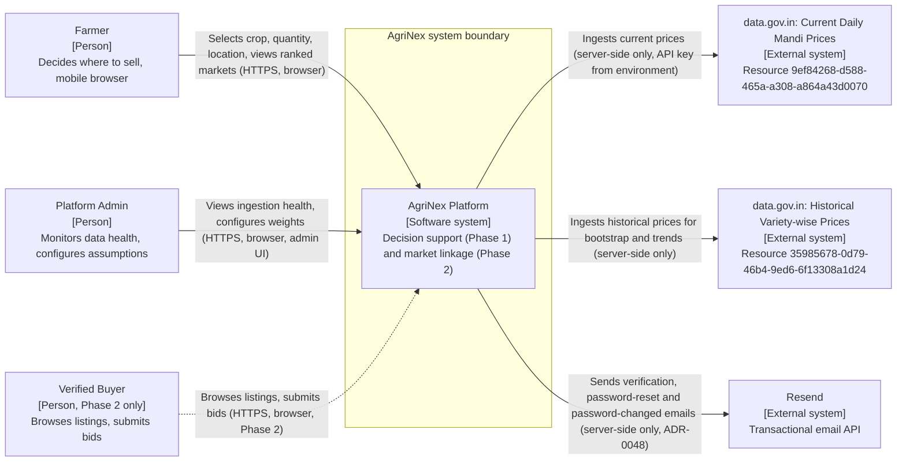

# AgriNex — System Context (C4 Level 1)

**Status:** AUTHORITATIVE. Architecture formalization from Task 6 (2026-10-03), approved in the decision lock of the same day (ADR-0001; [ARCHITECTURE_INDEX.md §14](ARCHITECTURE_INDEX.md#14-architecture-approval-checklist)).

- This document formalizes architecture already defined in the master specification (`docs/01_AGRINEX_MASTER_PRODUCT_PHASES.md`, "spec").
- Statements traced to the spec carry the spec's authority.
- Where the spec leaves a gap or contradicts itself, the decision log ([DECISION_LOG.md](DECISION_LOG.md)) records the decision, and this document cites the entries it applies. Where this document and a binding entry differ, the entry governs.

**Versions:** technology families only. Versions are in the approved baseline (ADR-0002; `CURRENT_TECHNOLOGY_BASELINE.md`).

## 1. Purpose

This document defines who and what interacts with AgriNex, and where the system boundary lies. It is the root of the C4 hierarchy: every container in [CONTAINER_ARCHITECTURE.md](CONTAINER_ARCHITECTURE.md) sits inside the boundary defined here.

## 2. Scope

**In scope:**

- the people who use AgriNex;
- the AgriNex system as a whole;
- the external systems it depends on;
- the relationships between them.

**Covered elsewhere:**

- internal structure: [CONTAINER_ARCHITECTURE.md](CONTAINER_ARCHITECTURE.md) and [COMPONENT_ARCHITECTURE.md](COMPONENT_ARCHITECTURE.md);
- deployment: [DEPLOYMENT_ARCHITECTURE.md](DEPLOYMENT_ARCHITECTURE.md).

## 3. SSOT traceability

| Element | Spec source |
|---|---|
| AgriNex Platform | §1 (core deliverable), §3, §11 |
| Farmer | §6 Personas 1–2, §11, §24 |
| Platform Admin | §6 Persona 3, §11, §24 |
| Verified Buyer (Phase 2) | §6 Persona 4, §8, §11, §24 |
| data.gov.in Current Daily Mandi Prices | §1, §11, FR-01 |
| data.gov.in Historical Variety-wise Prices | §1, §11, FR-02 |
| Server-side-only access to the government APIs | §11, §31 RULE 1, §47 Q9 |

The diagram below preserves the meaning of the spec's §11 diagram. It is a restatement; the spec's own diagram is unchanged.

## 4. Architecture

### 4.1 Context diagram

Dashed lines are Phase 2 only.

### 4.2 People

| Person | Who | How they use AgriNex | Phase | Spec source |
|---|---|---|---|---|
| Farmer | Smallholder farmer on a mobile device, often on a 3G/4G connection. Speaks Marathi, Hindi, or English | Compares markets without registering (F1.1; "anonymous ok", §28). Registers with a "quick phone registration" to create price alerts (§25). In Phase 2, also creates listings, compares bids, accepts bids, and rates transactions (§24 UC7–UC10) | Phase 1 (Phase 2 additions) | §6, §11, §24, §25, §28 |
| Platform Admin | Internal team member or operator on a laptop. Uses English. A desktop-first admin UI is acceptable | Monitors ingestion health, run history, and errors. Triggers manual syncs. Configures transport assumptions and recommendation weights (§24 UC16–UC20). Reviews buyer verifications in Phase 2 (UC21) | Phase 1 (Phase 2 addition) | §6, §11, §24 |
| Verified Buyer | Wholesale trader or processor on a desktop or tablet. Uses Hindi or English | Registers and gets verified, browses listings, bids (verified buyers only), tracks transactions, rates farmers | **Phase 2 only** | §6, §8, §11, §24 |

The spec defines exactly three roles: FARMER, BUYER, and ADMIN (§28). The Faculty Evaluator (Persona 5) is a "Documentation Persona" (§6). That persona is the audience for the demo (§46), not a user of the system, so it does not appear in the context.

### 4.3 The AgriNex system

- **What it is:** "A deployable, farmer-centric decision-support web platform converting government mandi data into transport-aware, explainable market recommendations, extensible to buyer-linkage in Phase 2" (§1).
- **Positioning:** a decision-support layer on top of the existing price-discovery ecosystem, not a replacement for it (§3). It does not replace e-NAM or Agmarknet (§4).
- **Key guarantee:** it "never exposes government API key to client" (§11).

### 4.4 External systems

| External system | Provider | Resource ID | Used for (spec §1) | Access | Spec source |
|---|---|---|---|---|---|
| Current Daily Mandi Prices | Ministry of Agriculture & Farmers Welfare, Directorate of Marketing and Inspection (DMI), published on data.gov.in under NDSAP | `9ef84268-d588-465a-a308-a864a43d0070` | "Latest prices, comparison, alerts, daily sync" | HTTPS with an API key. Paginated. Server-side only | §1, §11, §31 |
| Historical Variety-wise Prices | Same provider | `35985678-0d79-46b4-9ed6-6f13308a1d24` | "Trends, ML training data, historical bootstrap" | HTTPS with an API key. Paginated, iterating date by date | §1, §11, §14, FR-02 |
| Transactional email API | Resend | — | Account emails only: email verification, password reset and the password-changed notice (ADR-0047, ADR-0048). Not alert delivery, which stays in-app (ADR-0019) | HTTPS `POST /emails` with a Bearer API key (`RESEND_API_KEY`), from the backend only. Needs a verified sending domain. Verified by documentation (Resend API reference); a live API test is an implementation gate (spec §39, §49) | ADR-0048 |

**Verified API behavior recorded by the spec (§1):**

- Both APIs returned Maharashtra onion records.
- Historical records were dated 01/08/2026 through 13/09/2026. Every captured record uses the `dd/MM/yyyy` format (ADR-0007).
- A single historical query returned 100+ records, so pagination is mandatory on every call.
- Price units need verification before any calculation. Each commodity's unit is verified from official Agmarknet evidence (`Rs./Quintal`) (ADR-0008).

**Data obligations attached to these sources:**

- The data is batch-reported, so it is never labelled real-time (§31 RULE 4).
- It is never fabricated or interpolated (P10, §31 RULE 5).
- Every price screen shows source attribution (§31 RULE 7).

### 4.5 Not in the system context

| Item | Spec reference | Treatment |
|---|---|---|
| Faculty Evaluator, SIH jury | §6, §46 | Audience, not a user |
| Agmarknet, e-NAM, DeHaat, Ninjacart | §4 | Ecosystem context only. AgriNex has no runtime integration with them. DMI's Agmarknet 2.0 report exports and masters are offline official evidence for units, commodities and names (ADR-0005), never an ingestion source |
| Email delivery for alerts | §34: "Email delivery is optional enhancement" | Not used: alert delivery stays in-app only (ADR-0019). The email provider of ADR-0048 sends account emails only (§4.4) |
| OTP or SMS delivery for buyer phone verification | §19 ("OTP verification"), F2.1 | Phase 2 requires it, but §11 names no provider. Deferred to Phase 2 (RD-025, ADR-0032) |
| Source of geographic coordinates (district centroids, market coordinates) | FR-06, §16, §20 | Offline reference sources, not runtime systems: LGD for names and codes, and Survey of India district boundaries for centroids. Markets default to their district centroid. No geocoding service (ADR-0014) |
| Routing-distance APIs, logistics quote APIs | §38 | Future scope, not part of this capstone |
| Payment gateway, logistics marketplace, native mobile apps, LLM chatbot, and the rest of §39 | §9, §39 | Out of scope (enforced) |
| Certificate authority used by certbot | §28 ("Nginx + certbot") | Deployment-level dependency: the ACME authority certbot is configured for, with HTTP-01 webroot validation (ADR-0021; [DEPLOYMENT_ARCHITECTURE.md](DEPLOYMENT_ARCHITECTURE.md)) |

## 5. Responsibilities

At the system level, AgriNex is responsible for the following.

**Phase 1:**

- ingest and normalize government price data;
- discover candidate markets and estimate transport cost;
- estimate gross value and net realization;
- produce an explainable, deterministic ranking;
- compute historical trends;
- run the What-If simulation;
- evaluate price alerts;
- report data health to admins;
- show freshness and source attribution;
- capture evaluation instrumentation (§7 F1.1–F1.25).

**Phase 2:**

- buyer registration and verification;
- produce listings, bids, and the transaction lifecycle;
- ratings (§8 F2.1–F2.12).

**Optional:** short-horizon price forecasting (§35).

## 6. Boundaries

- **System boundary:**
  - Inside AgriNex: the frontend, the backend, the data stores, the reverse proxy, and the optional ML service ([CONTAINER_ARCHITECTURE.md](CONTAINER_ARCHITECTURE.md)).
  - Outside AgriNex: the two government datasets.
- **User/client boundary:** people interact only through HTTPS browsers (§11). Native apps are out of scope (§39).
- **External government-data boundary:**
  - Traffic flows outbound only, from AgriNex servers to data.gov.in.
  - The browser never calls data.gov.in (§31 RULE 1).
  - The API key stays in the server-side environment (§11, §28).

## 7. Flows

This document shows only the context-level relationships. For detailed flows, see [DATA_FLOW.md](DATA_FLOW.md).

## 8. Decisions

Every element and relationship above is a **REQUIREMENT FROM SSOT** (spec §11). No decision-log entry changes them.

## 9. Assumptions

None specific to this document. The diagram uses technology families only (A-04, [ARCHITECTURE_INDEX.md §10](ARCHITECTURE_INDEX.md#10-assumptions)).

## 10. Decisions applied

| Item | Decision |
|---|---|
| RD-003: which states and commodities are ingested | ADR-0006: Maharashtra statewide; commodity known list from the official Agmarknet master |
| RD-004: date formats of the government datasets | ADR-0007: strict `dd/MM/yyyy`; IST |
| RD-018: source of the geographic reference data | ADR-0014: LGD and Survey of India; district-centroid approximation for markets |
| Government source during outages | ADR-0005: data.gov.in stays the only ingestion source; no fallback source |
| RD-025: OTP delivery for Phase 2 buyer verification | Deferred to Phase 2 (ADR-0032) |

## 11. Phase applicability

| Element | Phase |
|---|---|
| Farmer, Platform Admin, both government datasets | Phase 1 |
| Farmer listing, bidding, and rating use cases; Admin buyer-verification review | Phase 2 |
| Verified Buyer | Phase 2 only |

## 12. Dependencies

- **Downstream documents:**
  - [CONTAINER_ARCHITECTURE.md](CONTAINER_ARCHITECTURE.md) decomposes the system boundary.
  - [SECURITY_ARCHITECTURE.md](SECURITY_ARCHITECTURE.md) builds its trust boundaries on it.
  - [DATA_FLOW.md](DATA_FLOW.md) details the relationships.
- **Upstream:** spec §1, §6, §11, §24, §31, §39.
