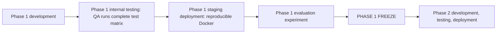

# AgriNex — Testing Architecture

**Status:** AUTHORITATIVE. Architecture formalization from Task 6 (2026-10-03), approved in the decision lock of the same day (ADR-0001; [ARCHITECTURE_INDEX.md §14](ARCHITECTURE_INDEX.md#14-architecture-approval-checklist)).

- This document formalizes architecture already defined in the master specification (`docs/01_AGRINEX_MASTER_PRODUCT_PHASES.md`, "spec").
- Statements traced to the spec carry the spec's authority.
- Where the spec leaves a gap or contradicts itself, the decision log ([DECISION_LOG.md](DECISION_LOG.md)) records the decision, and this document cites the entries it applies. Where this document and a binding entry differ, the entry governs.

**Versions:** technology families only. Versions are in the approved baseline (ADR-0002; `CURRENT_TECHNOLOGY_BASELINE.md`).

## 1. Purpose

This document defines the testing and verification architecture the spec requires. It covers:

- which test levels exist and what each one verifies;
- how the acceptance criteria map to tests;
- the test data and test environments;
- who is responsible.

It operationalizes the Definition of Done (§48) and CLAUDE.md §L.

## 2. Scope

**In scope:**

- Phase 1 and Phase 2 verification;
- the resilience and performance checks;
- the evaluation experiments (§36).

**Out of scope:** choosing test tools beyond those the spec names (see §4.6).

## 3. SSOT traceability

| Topic | Spec sources |
|---|---|
| Phase gate and freeze checklist | §10 |
| Testability NFR | §27 ("Transport, net realization, scoring covered by deterministic unit tests") |
| Acceptance criteria and DoD | §48 |
| Evaluation experiments | §36 |
| Test responsibilities | §40 RACI |
| Contracts and mocks | §41, §44 |
| Test fixtures and scripts | §43, §44 |
| Resilience behaviors under test | §29, §35, §37 |
| Normalization rules being unit-tested | §47 Q4 |

## 4. Architecture

### 4.1 Where testing sits in the phase gate

This diagram is derived from spec §10.

The spec does not define the contents of the "complete test matrix" in a separate document. The levels below assemble it from §10, §27, and §48.

### 4.2 Test levels

| Level | Verifies | Spec basis | Responsible (§40) |
|---|---|---|---|
| Unit: core calculations | Transport cost, net realization, composite scoring, reason-code triggers, all checked against hand-computed fixtures | §10, §27, §48 | Backend |
| Unit: normalization rules | Trim, canonical slug, commodity and variety normalization. "Normalization rules are documented, unit-tested, and logged" | §47 Q4 | Data Engineering (rules); Backend (backend unit tests) |
| Integration: ingestion and database | Pagination; duplicate prevention (running ingestion twice yields 0 new rows); database unique constraint on `business_key`; ingestion completeness ≥95%; audit records on every run | §10, §31 RULE 6, §48 | Data Engineering and Backend; QA consulted |
| Integration: admin health | The admin health API exactly matches database counts | §48 | Backend |
| API contract tests | Implementations and mocks match `contracts/openapi.yaml` and the JSON schemas. Errors always use `ApiErrorResponse`, without stack traces | §10, §40, §41, §44 | QA |
| End-to-end | The farmer flows and admin dashboard in the §10 FRONTEND checklist | §10, §40 | QA |
| Performance | Comparison API under 1 s at p95 with 10 concurrent users (k6). Frontend LCP under 3 s on mobile 3G (§27; method not specified) | §27, §48 | QA |
| Resilience | Government API failure, simulated by disabling the API key: the system keeps serving data and the banner shows. Stale-data warning. No-data empty state | §10, §48 | QA |
| Security: accounts and recovery | Login with the phone number and with the email of one account, same password; registration 409 for a registered phone or email; reset request answers the same 202 and takes comparable time for unknown, unverified, inactive and eligible accounts; tokens are single-use, expire (24 hours, 30 minutes) and are replaced by a newer link; only hashes are stored; a reset revokes every refresh-token family, clears the cookie and does not sign in; the per-identifier and per-account limits; no email, token or link in any log. A fake email adapter captures messages in tests | ADR-0047, ADR-0048 | Backend, QA |
| Recommendation wording | "Recommended" only on rank 1; "Highest estimated net realization" only on the options with the maximum estimate; the trade-off sentence never claims more money for rank 1 when its estimated net is not higher; What-If labels "Highest estimated net (what-if)" | ADR-0045 | Frontend, QA |
| Localization | All 3 languages on every farmer screen. 0 untranslated hardcoded strings | §48 | QA |
| Responsiveness | 375px viewport in Chrome DevTools. No horizontal scroll | §48 | QA |
| Accessibility | WCAG 2.1 AA for core farmer flows. The spec specifies no test method | F1.22, §27 | QA |
| Phase 2 acceptance | Unverified buyer → 403. Concurrent acceptance → exactly 1 succeeds, 1 gets 409. Illegal transition → 409 `ILLEGAL_STATE_TRANSITION`. Rating before COMPLETED → 422 or 403 | §48 | QA |
| Evaluation experiments | Experiment 1: price-only vs net-realization, run from the database. Experiment 2: 14 consecutive days of ingestion reliability. Experiment 3: ML comparison, only if ML is built. Experiment 4: optional usability study | §36 | QA ("Research evaluation") |

### 4.3 Acceptance criteria mapping: Phase 1 (§48)

| Criterion | Level | Threshold |
|---|---|---|
| Comparison API response time | Performance (k6) | p95 under 1 s at 10 concurrent users |
| Ingestion completeness | Integration | ≥95% of API records ingested per run |
| Duplicate prevention | Integration | 0 new duplicate rows on repeated ingestion |
| Freshness accuracy | Integration or E2E | Badge matches `report_date` 100% of the time |
| Transport calculation accuracy | Unit | 100% match with test fixtures |
| Net realization accuracy | Unit | 100% match across 5 manual scenarios |
| `rankingsDisagree` flag accuracy | Unit or integration | 100% match across 10 scenarios |
| Reason codes | Unit | All 8 codes trigger in at least one scenario |
| Admin health API | Integration | Exact match on all fields |
| Government API failure handling | Resilience | The system keeps serving data and the banner shows |
| Language switch | E2E | 0 untranslated strings on farmer screens |
| Mobile responsiveness | E2E | No horizontal scroll at 375px |

### 4.4 Test data

| Asset | Purpose | Spec |
|---|---|---|
| `fixtures/seed_data.sql` | Reference data (states, districts, district aliases, localities, commodities with units, source datasets, initial configuration), loaded by Flyway (ADR-0021; [SEED_AND_REFERENCE_DATA.md](../database/SEED_AND_REFERENCE_DATA.md)) | §43, §44 |
| `fixtures/demo_price_observations.sql` | "Demo-ready price snapshot": an exact export of real ingested observations, provenance included, loaded only with the demo profile (ADR-0028) | §43 |
| `fixtures/test_accounts.sql` | One account per role, only in demo-profile environments, with credentials generated per environment (ADR-0028) | §43, §44 |
| Evidence captures and CSV profiles | The seven API captures (evidence Appendix A) as integration-test inputs. The non-government `Agriculture_price_dataset.csv` and the official exports in `docs/data/raw/` are offline inputs for validation-rule tests (V1–V8). They are never loaded into a deployed database (ADR-0005, ADR-0008) | Evidence file; ADR-0005 |
| `fixtures/ml_observations.csv` | Historical sample for ML | §43, §44 |
| Hand-computed fixtures | Expected values for unit tests of transport, net realization, and scoring | §10, §48 |
| `frontend/__mocks__/api/*.json` | Mock responses. They must match the contracts exactly | §41, §44 |
| `scripts/run_evaluation.sql` | Experiment 1 query (created 2026-10-18; one read-only SELECT; percentiles by `percentile_cont`, an ASSUMPTION stated in its header; tested by `EvaluationScriptIntegrationTest`) | §43; ADR-0045 item 8 |

Unit-test fixtures are test inputs and are never presented as real data. Product and demo screens show government data only (P10, §31 RULE 5). Demo scenarios choose real data and never alter it (ADR-0028).

### 4.5 Test environments

| Environment | Specified use | Spec |
|---|---|---|
| Local / development | Frontend mock mode, which works offline. Local Docker Compose start | §44, §45 |
| "Test environment" | Disabling the government API key for the resilience test | §48 |
| QA internal testing | The "complete test matrix" before staging | §10 |
| Staging | Reproducible Docker deployment before evaluation and freeze | §10 |
| Long-running deployment | Experiment 2 needs 14 consecutive days of ingestion. It runs on the public cloud-VM deployment (ADR-0021) | §36 |

Hosts (ADR-0021):

- Local and QA environments run on developer machines, using the full-stack development override.
- Staging is the public deployment before the Phase 1 freeze.
- The "test environment" for the API-failure test is any environment whose government API key is withheld.

### 4.6 Tooling

- **Named by the spec:** k6 for load testing and Chrome DevTools for the 375px check (§48).
- **Backend unit tests:** the backend test stack follows the approved baseline: Spring Boot–managed JUnit Jupiter, Mockito and AssertJ (ADR-0002), built with Maven (ADR-0003).
- **Not named by the spec:** frontend unit runners, E2E tools, contract-testing tools and accessibility checkers.
  - These are dependency choices. They are made and justified at scaffolding (ADR-0034; CLAUDE.md rule 15).
  - The contract tests themselves are decided: backend integration tests validate real requests and responses against `contracts/openapi.yaml`, and frontend tests validate every mock against it (ADR-0022).

### 4.7 Definition of Done

A task is complete only when all of these hold (CLAUDE.md §L; §48):

- its acceptance criteria are addressed, including the relevant §48 rows and §10 checklist items;
- the relevant tests have been run;
- failures have been investigated;
- the required verification has been performed.

Tests are never weakened to make them pass.

## 5. Responsibilities

| Responsibility (§40) | Responsible | Consulted |
|---|---|---|
| Unit tests (backend) | Backend | QA |
| E2E tests | QA | Frontend, Backend |
| API contract tests | QA | Frontend, Backend |
| Research evaluation | QA | Backend, Data, ML |
| Documentation | QA | All roles |

## 6. Boundaries

- **Contract boundary:** contract tests and mocks bind to `contracts/`. A mock with wrong field names is a bug (§44).
- **Secret boundary:** tests never put real secrets into version control. No test account exists on a public deployment (ADR-0028).
- **Data boundary:** synthetic values belong only in tests. Demo and production views show government data (ADR-0028).

## 7. Flows

The tested flows are F-01 to F-17 in [DATA_FLOW.md](DATA_FLOW.md).

## 8. Decisions

Every level and criterion above is a **REQUIREMENT FROM SSOT** (§10, §27, §36, §40, §48). The decision-log entries in section 10 fix the expected values the tests assert.

## 9. Assumptions

None.

## 10. Decisions applied

These decisions fix what deterministic tests assert. No open item blocks writing them.

| Item | Decision | Effect on testing |
|---|---|---|
| RD-005, RD-028 | ADR-0009 | Duplicate, conflict, revision and unchanged-re-delivery paths |
| RD-029 | ADR-0012 | Accounting invariant, completeness of at least 95% per run, exact admin counts, Experiment 2 rates |
| RD-006 | ADR-0023 | Expected compare responses and the three no-data cases |
| RD-007 | ADR-0024 | Hand-computed scores, tie-breaks, max = min, all 8 reason codes |
| RD-008 | ADR-0025 | Trend windows, the 4-value threshold, empty windows |
| RD-009 | ADR-0026 | Client and server What-If parity with §32 |
| RD-011, RD-026 | ADR-0028 | Demo-profile-only fixtures; real data only |
| RD-015 | ADR-0010 | Precedence, lower median, exact filters |
| RD-016 | ADR-0011 | Status rules, retries, interrupted runs, overlap (409) |
| RD-022 | ADR-0021 | Environments |
| RD-023 | ADR-0022 | Contract tests against the hand-authored `contracts/openapi.yaml` |
| RD-027 | ADR-0008 | Validation rules V1–V8, rounding, no conversion |
| RD-036 | ADR-0007 | IST boundaries, `dd/MM/yyyy`, future dates |

## 11. Phase applicability

| Scope | Phase |
|---|---|
| Unit, integration, contract, E2E, performance, resilience, localization, responsiveness, and accessibility tests; Experiments 1–2 | Phase 1 gate (§10) |
| §48 Phase 2 criteria | Phase 2 |
| Experiment 3 | Optional |

## 12. Dependencies

- **Upstream:** every other architecture document, especially:
  - [DATA_FLOW.md](DATA_FLOW.md);
  - [RECOMMENDATION_ENGINE.md](RECOMMENDATION_ENGINE.md);
  - [RESILIENCE_ARCHITECTURE.md](RESILIENCE_ARCHITECTURE.md).
- **Downstream:**
  - Task 8 (contracts used by contract tests);
  - Task 10 (test scaffolding).
