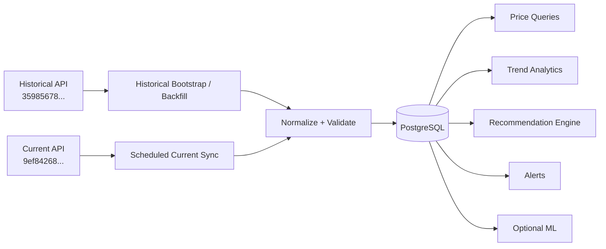
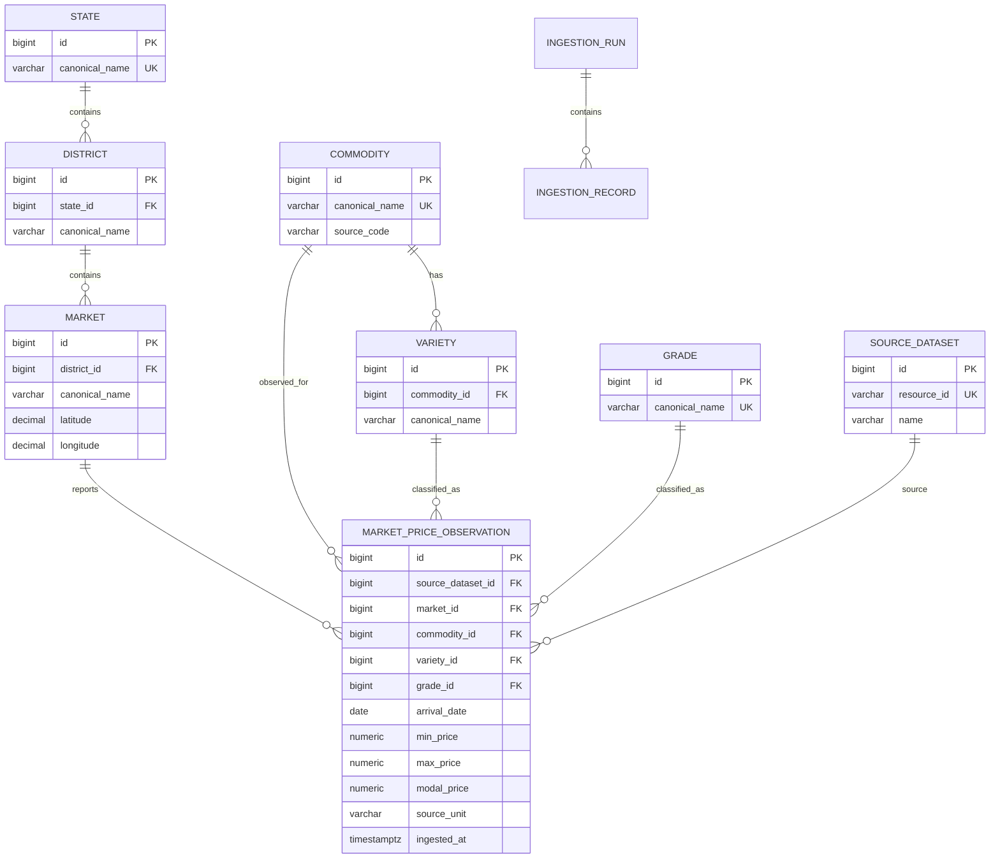

# AgriNex — Verified Government Market-Data API Reference (Expanded Evidence Edition)

> Implementation reference for AgriNex Phase 1 data ingestion, PostgreSQL design, backend contracts, analytics, recommendation logic, and testing.

> **Credential policy:** API keys are intentionally omitted from this document. Never copy the real API key into source code, frontend code, GitHub, screenshots, or documentation.

## 1. Canonical data strategy

AgriNex uses two official `data.gov.in` resources with separate responsibilities.

| Role | Dataset | Resource ID |
|---|---|---|
| Historical bootstrap / backfill / trends / ML | Variety-wise Daily Market Prices Data of Commodity | `35985678-0d79-46b4-9ed6-6f13308a1d24` |
| Current daily ingestion | Current Daily Price of Various Commodities from Various Markets (Mandi) | `9ef84268-d588-465a-a308-a864a43d0070` |

The historical resource is a Central Government resource from the Ministry of Agriculture and Farmers Welfare, Department of Agriculture and Farmers Welfare, Directorate of Marketing and Inspection (DMI).

The current resource is a `data.gov.in` resource titled **Current Daily Price of Various Commodities from Various Markets (Mandi)** and belongs to the Ministry of Agriculture and Farmers Welfare / Department of Agriculture and Farmers Welfare.

### Canonical architecture



## 2. API #1 — Historical / Variety-wise resource

### 2.1 Dataset identity

- **Title:** Variety-wise Daily Market Prices Data of Commodity
- **Resource ID:** `35985678-0d79-46b4-9ed6-6f13308a1d24`
- **Source:** `data.gov.in`
- **Target/index shown in metadata:** `agmarknet_new`
- **Status in captured metadata:** active
- **Response version observed:** `2.2.0`
- **Arrival date format:** `dd-MM-yyyy`

The resource exposes `Arrival_Date`, `Commodity`, `Commodity_Code`, `District`, `Grade`, `Market`, `Max_Price`, `Min_Price`, `Modal_Price`, `State`, and `Variety`. Its exposed filters include `State`, `District`, `Commodity`, and `Arrival_Date`; `State` and `District` are marked mandatory in the captured metadata.

### 2.2 What this API is for

Use this resource for:

1. Initial historical bootstrap into PostgreSQL.
2. Date-based historical backfill.
3. 7-day / 30-day price trend generation.
4. Historical market comparisons.
5. Research/evaluation datasets.
6. Optional price forecasting experiments.

It is the historical foundation of AgriNex. The frontend must not call this resource directly.

### 2.3 Credential-redacted request pattern

```http
GET https://api.data.gov.in/resource/35985678-0d79-46b4-9ed6-6f13308a1d24
    ?api-key=REDACTED
    &format=json
    &filters[State]=Maharashtra
    &filters[Commodity]=Onion
    &filters[Arrival_Date]=13/09/2026
    &limit=100
    &offset=0
```

Change `Arrival_Date` to retrieve another historical day, such as `07/09/2026` or `01/08/2026`. The exact URL encoding of brackets is transport-level detail; the semantic parameters are what the implementation must preserve.

### 2.4 Actual successful test — 13/09/2026

Captured response: `total=17`, `count=17`, `limit=100`, `offset=0`.

Representative actual records include Omchatinya Multi State Agro Purpose Co-Op Society (modal 4200), APMC Rahata (4350), Junnar(Otur) (4700), and Pune(Moshi) (3350).

#### Response sample

```json
[
  {
    "Arrival_Date": "13/09/2026",
    "Commodity": "Onion",
    "Commodity_Code": 23,
    "District": "Ahilyanagar",
    "Grade": "Local",
    "Market": "Omchatinya Multi State Agro Purpose Co-Op Society, Dist Ahilyanagar",
    "Max_Price": 5500,
    "Min_Price": 1000,
    "Modal_Price": 4200,
    "State": "Maharashtra",
    "Variety": "Other"
  },
  {
    "Arrival_Date": "13/09/2026",
    "Commodity": "Onion",
    "Commodity_Code": 23,
    "District": "Ahilyanagar",
    "Grade": "Local",
    "Market": "APMC Rahata ",
    "Max_Price": 5800,
    "Min_Price": 700,
    "Modal_Price": 4350,
    "State": "Maharashtra",
    "Variety": "Unhali"
  },
  {
    "Arrival_Date": "13/09/2026",
    "Commodity": "Onion",
    "Commodity_Code": 23,
    "District": "Pune",
    "Grade": "Local",
    "Market": "Junnar(Otur) ",
    "Max_Price": 5510,
    "Min_Price": 2000,
    "Modal_Price": 4700,
    "State": "Maharashtra",
    "Variety": "Unhali"
  },
  {
    "Arrival_Date": "13/09/2026",
    "Commodity": "Onion",
    "Commodity_Code": 23,
    "District": "Pune",
    "Grade": "Local",
    "Market": "Pune(Moshi) ",
    "Max_Price": 4200,
    "Min_Price": 2500,
    "Modal_Price": 3350,
    "State": "Maharashtra",
    "Variety": "Local"
  },
  {
    "Arrival_Date": "13/09/2026",
    "Commodity": "Onion",
    "Commodity_Code": 23,
    "District": "Pune",
    "Grade": "Local",
    "Market": "Junnar(Alephata) ",
    "Max_Price": 5000,
    "Min_Price": 3000,
    "Modal_Price": 4000,
    "State": "Maharashtra",
    "Variety": "Chinchwad"
  }
]
```

#### Complete captured record set

| # | State | District | Market | Commodity | Variety | Grade | Arrival_Date | Min_Price | Max_Price | Modal_Price |
|---:|---|---|---|---|---|---|---|---|---|---|
| 1 | Maharashtra | Ahilyanagar | Omchatinya Multi State Agro Purpose Co-Op Society, Dist Ahilyanagar | Onion | Other | Local | 13/09/2026 | 1000 | 5500 | 4200 |
| 2 | Maharashtra | Ahilyanagar | APMC Rahata  | Onion | Unhali | Local | 13/09/2026 | 700 | 5800 | 4350 |
| 3 | Maharashtra | Pune | Junnar(Otur)  | Onion | Unhali | Local | 13/09/2026 | 2000 | 5510 | 4700 |
| 4 | Maharashtra | Pune | Pune(Moshi)  | Onion | Local | Local | 13/09/2026 | 2500 | 4200 | 3350 |
| 5 | Maharashtra | Pune | Junnar(Alephata)  | Onion | Chinchwad | Local | 13/09/2026 | 3000 | 5000 | 4000 |
| 6 | Maharashtra | Pune | Pune(Khadiki)  | Onion | Local | Local | 13/09/2026 | 1000 | 1700 | 1350 |
| 7 | Maharashtra | Pune | Pune(Manjri)  | Onion | Local | Local | 13/09/2026 | 2000 | 4000 | 3000 |
| 8 | Maharashtra | Nagpur | APMC Ramtek  | Onion | Unhali | Local | 13/09/2026 | 3000 | 5000 | 4000 |
| 9 | Maharashtra | Ahilyanagar | APMC Newasa  | Onion | Unhali | Local | 13/09/2026 | 1500 | 4600 | 4000 |
| 10 | Maharashtra | Jalgaon | APMC Bhusaval  | Onion | Unhali | Local | 13/09/2026 | 4000 | 4000 | 4000 |
| 11 | Maharashtra | Pune | APMC Pune  | Onion | Local | Local | 13/09/2026 | 1000 | 5000 | 3000 |
| 12 | Maharashtra | Pune | Pune(Pimpri)  | Onion | Local | Local | 13/09/2026 | 2500 | 4700 | 3600 |
| 13 | Maharashtra | Pune | Junnar(Narayangaon)  | Onion | Chinchwad | Local | 13/09/2026 | 700 | 4800 | 2800 |
| 14 | Maharashtra | Satara | APMC Satara  | Onion | Other | Local | 13/09/2026 | 2000 | 4800 | 3400 |
| 15 | Maharashtra | Ahilyanagar | APMC Parner  | Onion | Unhali | Local | 13/09/2026 | 1000 | 5500 | 4000 |
| 16 | Maharashtra | Chattrapati Sambhajinagar | APMC Paithan  | Onion | Unhali | Local | 13/09/2026 | 1100 | 5300 | 3900 |
| 17 | Maharashtra | Satara | APMC Vaduj  | Onion | Local | Local | 13/09/2026 | 4000 | 5000 | 4500 |

## 3. Historical test — 07/09/2026

Captured response: `total=69`, `count=69`, `limit=100`, `offset=0`. The records include APMC Manmad, APMC Shevgaon, APMC Lasur Station, Prasanna Krushi Market, APMC Nagpur, APMC Solapur, APMC Sangamner, APMC Nasik and Lasalgaon(Vinchur).

### Complete captured record set

| # | State | District | Market | Commodity | Variety | Grade | Arrival_Date | Min_Price | Max_Price | Modal_Price |
|---:|---|---|---|---|---|---|---|---|---|---|
| 1 | Maharashtra | Nashik | APMC Manmad  | Onion | Unhali | Local | 07/09/2026 | 1000 | 4545 | 4200 |
| 2 | Maharashtra | Ahilyanagar | APMC Shevgaon  | Onion | 2nd Sort | Local | 07/09/2026 | 3200 | 4100 | 3800 |
| 3 | Maharashtra | Chattrapati Sambhajinagar | APMC Lasur Station  | Onion | Other | Local | 07/09/2026 | 1505 | 5000 | 3400 |
| 4 | Maharashtra | Ahilyanagar | Prasanna Krushi Market, Tal Parnet, Dist Ahilyanagar | Onion | Other | Local | 07/09/2026 | 600 | 5250 | 2925 |
| 5 | Maharashtra | Nagpur | APMC Nagpur  | Onion | Red | Local | 07/09/2026 | 4000 | 5000 | 4750 |
| 6 | Maharashtra | Solapur | APMC Solapur  | Onion | Red | Local | 07/09/2026 | 500 | 6300 | 3300 |
| 7 | Maharashtra | Ahilyanagar | APMC Sangamner  | Onion | Unhali | Local | 07/09/2026 | 1500 | 5500 | 3500 |
| 8 | Maharashtra | Nashik | APMC Nasik  | Onion | Unhali | Local | 07/09/2026 | 2100 | 4800 | 4250 |
| 9 | Maharashtra | Nashik | Lasalgaon(Vinchur)  | Onion | Unhali | Local | 07/09/2026 | 1200 | 5001 | 4450 |
| 10 | Maharashtra | Pune | Pune(Khadiki)  | Onion | Local | Local | 07/09/2026 | 1000 | 1700 | 1350 |
| 11 | Maharashtra | Satara | APMC Vaduj  | Onion | Local | Local | 07/09/2026 | 4000 | 5000 | 4500 |
| 12 | Maharashtra | Ahilyanagar | APMC Shevgaon  | Onion | 1st Sort | Local | 07/09/2026 | 4200 | 5500 | 4600 |
| 13 | Maharashtra | Mumbai | Mumbai-Onion & Potato Market  | Onion | Other | Local | 07/09/2026 | 3500 | 4700 | 4100 |
| 14 | Maharashtra | Ahilyanagar | APMC Shevgaon  | Onion | Other | Local | 07/09/2026 | 1500 | 3100 | 2600 |
| 15 | Maharashtra | Jalgaon | APMC Jalgaon  | Onion | Red | Local | 07/09/2026 | 1375 | 4750 | 3075 |
| 16 | Maharashtra | Nashik | APMC Yeola  | Onion | Unhali | Local | 07/09/2026 | 801 | 5000 | 4500 |
| 17 | Maharashtra | Nashik | APMC Devala  | Onion | Unhali | Local | 07/09/2026 | 1000 | 5000 | 4580 |
| 18 | Maharashtra | Nashik | APMC Satana  | Onion | Unhali | Local | 07/09/2026 | 1505 | 5480 | 4500 |
| 19 | Maharashtra | Ahilyanagar | Newasa(Ghodegaon)  | Onion | Unhali | Local | 07/09/2026 | 1500 | 5000 | 4000 |
| 20 | Maharashtra | Nashik | APMC Umrane | Onion | Unhali | Local | 07/09/2026 | 1500 | 5200 | 4500 |
| 21 | Maharashtra | Ahilyanagar | Rahuri(Vambori)  | Onion | Unhali | Local | 07/09/2026 | 500 | 5200 | 3900 |
| 22 | Maharashtra | Nagpur | APMC Nagpur  | Onion | White | Local | 07/09/2026 | 4500 | 5500 | 5250 |
| 23 | Maharashtra | Solapur | Laxmi-Sopan Agriculture Produce Marketing Co Ltd, Barshi, Dist Solapur | Onion | Other | Local | 07/09/2026 | 900 | 5000 | 4200 |
| 24 | Maharashtra | Nashik | Shivsiddha Govind Producer Company Ltd Sanchalit Khajgi Krushi Utpann Bajar Samati-Abhona-Kalwan | Onion | Other | Local | 07/09/2026 | 1300 | 6011 | 4650 |
| 25 | Maharashtra | Pune | Junnar(Narayangaon)  | Onion | Chinchwad | Local | 07/09/2026 | 1200 | 4800 | 3000 |
| 26 | Maharashtra | Pune | Pune(Moshi)  | Onion | Local | Local | 07/09/2026 | 2000 | 4800 | 3400 |
| 27 | Maharashtra | Pune | APMC Pune  | Onion | Local | Local | 07/09/2026 | 1000 | 5000 | 3000 |
| 28 | Maharashtra | Dhule | Pratap Nana Mahale Khajgi Krushi Uttpana Bazar, Samati-Dhule | Onion | Other | Local | 07/09/2026 | 1780 | 4640 | 3963.41 |
| 29 | Maharashtra | Nagpur | APMC Hingna | Onion | Red | Local | 07/09/2026 | 5000 | 5000 | 5000 |
| 30 | Maharashtra | Dhule | Pratap Nana Mahale Khajgi Krushi Uttpana Bazar, Samati-Dhule | Onion | Red | Local | 07/09/2026 | 3750 | 3750 | 3750 |
| 31 | Maharashtra | Ahilyanagar | APMC Kopargaon  | Onion | Unhali | Local | 07/09/2026 | 1500 | 4820 | 4350 |
| 32 | Maharashtra | Nashik | Pimpalgaon Baswant(Saykheda)  | Onion | Unhali | Local | 07/09/2026 | 2000 | 4611 | 4101 |
| 33 | Maharashtra | Chattrapati Sambhajinagar | APMC Gangapur  | Onion | Unhali | Local | 07/09/2026 | 905 | 5360 | 3814 |
| 34 | Maharashtra | Nashik | Dindori(Vani)  | Onion | Unhali | Local | 07/09/2026 | 4301 | 5401 | 4811 |
| 35 | Maharashtra | Ahilyanagar | APMC Ahilyanagar  | Onion | Unhali | Local | 07/09/2026 | 1000 | 5000 | 3000 |
| 36 | Maharashtra | Nashik | Pimpalgaon Baswant(Saykheda)  | Onion | Unhali | Local | 07/09/2026 | 200 | 4611 | 4150 |
| 37 | Maharashtra | Nashik | APMC Nampur | Onion | Unhali | Local | 07/09/2026 | 700 | 5205 | 4600 |
| 38 | Maharashtra | Thane | APMC Kalyan  | Onion | 1st Sort | Local | 07/09/2026 | 3700 | 5000 | 4350 |
| 39 | Maharashtra | Amarawati | Amrawati(Frui & Veg. Market)  | Onion | Local | Local | 07/09/2026 | 2500 | 5400 | 3950 |
| 40 | Maharashtra | Nagpur | APMC Kamthi  | Onion | Local | Local | 07/09/2026 | 4500 | 5000 | 4850 |
| 41 | Maharashtra | Solapur | APMC Mangal Wedha  | Onion | Local | Local | 07/09/2026 | 1400 | 5525 | 4350 |
| 42 | Maharashtra | Pune | Pune(Pimpri)  | Onion | Local | Local | 07/09/2026 | 2400 | 4600 | 3500 |
| 43 | Maharashtra | Pune | Pune(Manjri)  | Onion | Local | Local | 07/09/2026 | 3000 | 5000 | 4000 |
| 44 | Maharashtra | Satara | APMC Karad  | Onion | Halva | Local | 07/09/2026 | 3000 | 5200 | 5200 |
| 45 | Maharashtra | Kolhapur | APMC Kolhapur  | Onion | Other | Local | 07/09/2026 | 1200 | 5200 | 3000 |
| 46 | Maharashtra | Nashik | APMC Lasalgaon  | Onion | Unhali | Local | 07/09/2026 | 1500 | 4999 | 4550 |
| 47 | Maharashtra | Nashik | APMC Pimpalgaon Baswant  | Onion | Unhali | Local | 07/09/2026 | 1800 | 5959 | 4700 |
| 48 | Maharashtra | Nashik | APMC Nandgaon  | Onion | Unhali | Local | 07/09/2026 | 400 | 4771 | 4050 |
| 49 | Maharashtra | Nashik | APMC Dindori  | Onion | Unhali | Local | 07/09/2026 | 3900 | 5225 | 4450 |
| 50 | Maharashtra | Nashik | APMC Nampur | Onion | Unhali | Local | 07/09/2026 | 715 | 5250 | 4600 |
| 51 | Maharashtra | Nashik | Lasalgaon(Niphad)  | Onion | Unhali | Local | 07/09/2026 | 1200 | 4891 | 4550 |
| 52 | Maharashtra | Chandrapur | Chandrapur(Ganjwad)  | Onion | Other | Local | 07/09/2026 | 4500 | 5600 | 5000 |
| 53 | Maharashtra | Nashik | APMC Yeola  | Onion | Unhali | Local | 07/09/2026 | 801 | 4850 | 4350 |
| 54 | Maharashtra | Chattrapati Sambhajinagar | APMC Chattrapati Sambhajinagar  | Onion | Other | Local | 07/09/2026 | 2000 | 5100 | 3550 |
| 55 | Maharashtra | Sangli | APMC Vita  | Onion | Other | Local | 07/09/2026 | 4500 | 5500 | 4800 |
| 56 | Maharashtra | Satara | APMC Satara  | Onion | Other | Local | 07/09/2026 | 1500 | 4500 | 3000 |
| 57 | Maharashtra | Nashik | Shri Rameshwar Krushi Market, M.Nagar, Tal Deola, Dist Nashik | Onion | Other | Local | 07/09/2026 | 1111 | 5751 | 4144.07 |
| 58 | Maharashtra | Nashik | Malharshree Khajgi Krushi Utpann Bajar, Chandanpuri Tal Malegaon, Nashik | Onion | Other | Local | 07/09/2026 | 1954 | 4514 | 3810 |
| 59 | Maharashtra | Satara | APMC Lonand  | Onion | Unhali | Local | 07/09/2026 | 2000 | 5000 | 3700 |
| 60 | Maharashtra | Nashik | APMC Sinner  | Onion | Unhali | Local | 07/09/2026 | 1500 | 4698 | 4300 |
| 61 | Maharashtra | Nashik | APMC Kalvan  | Onion | Unhali | Local | 07/09/2026 | 2000 | 5535 | 4600 |
| 62 | Maharashtra | Nashik | APMC Chandwad  | Onion | Unhali | Local | 07/09/2026 | 1310 | 5260 | 4470 |
| 63 | Maharashtra | Nashik | APMC Manmad  | Onion | Unhali | Local | 07/09/2026 | 1330 | 4720 | 4400 |
| 64 | Maharashtra | Chattrapati Sambhajinagar | APMC Paithan  | Onion | Unhali | Local | 07/09/2026 | 2655 | 4685 | 4200 |
| 65 | Maharashtra | Dhule | APMC Sakri  | Onion | Unhali | Local | 07/09/2026 | 3700 | 5000 | 4400 |
| 66 | Maharashtra | Chattrapati Sambhajinagar | APMC Vaijpur  | Onion | Unhali | Local | 07/09/2026 | 1500 | 4805 | 4000 |
| 67 | Maharashtra | Pune | APMC Khed  | Onion | Fursungi | Local | 07/09/2026 | 2500 | 5000 | 3500 |
| 68 | Maharashtra | Ahilyanagar | Shree Sairaj Krushi Market, Dist Ahilyanagar | Onion | Local | Local | 07/09/2026 | 1000 | 5100 | 3100 |
| 69 | Maharashtra | Sangli | Sangli(Phale, Bhajipala Market)  | Onion | Local | Local | 07/09/2026 | 1800 | 5100 | 3450 |

## 4. Historical test — 01/08/2026 — pagination proof

Captured response: `total=103`, `count=100`, `limit=100`, `offset=0`.

This is proof that the historical API must be paginated.

```text
Page 1: offset=0   limit=100 → 100 records
Page 2: offset=100 limit=100 → 3 records expected
Total expected = 103
```

The three records from the second page were not supplied, so they are intentionally not invented here.

### First-page actual captured records

| # | State | District | Market | Commodity | Variety | Grade | Arrival_Date | Min_Price | Max_Price | Modal_Price |
|---:|---|---|---|---|---|---|---|---|---|---|
| 1 | Maharashtra | Dhule | Shirpur APMC | Onion | Red | Local | 01/08/2026 | 700 | 2425 | 2125 |
| 2 | Maharashtra | Nashik | Lasalgaon APMC | Onion | Unhali | Local | 01/08/2026 | 600 | 2399 | 2050 |
| 3 | Maharashtra | Nashik | Manmad APMC | Onion | Unhali | Local | 01/08/2026 | 550 | 2480 | 2200 |
| 4 | Maharashtra | Nashik | Pimpalgaon Baswant APMC | Onion | Unhali | Local | 01/08/2026 | 500 | 3271 | 2175 |
| 5 | Maharashtra | Sangli | Sangli(Phale, Bhajipala Market) APMC | Onion | Local | Local | 01/08/2026 | 800 | 2700 | 1750 |
| 6 | Maharashtra | Pune | Pune(Khadiki) APMC | Onion | Local | Local | 01/08/2026 | 800 | 1300 | 1050 |
| 7 | Maharashtra | Ahilyanagar | Jamkhed APMC | Onion | Local | Local | 01/08/2026 | 500 | 2350 | 1425 |
| 8 | Maharashtra | Ahilyanagar | Rahata APMC | Onion | Other | Local | 01/08/2026 | 1000 | 2000 | 1500 |
| 9 | Maharashtra | Kolhapur | APMC Kolhapur  | Onion | Other | Local | 01/08/2026 | 600 | 2800 | 1800 |
| 10 | Maharashtra | Chattrapati Sambhajinagar | APMC Chattrapati Sambhajinagar  | Onion | Other | Local | 01/08/2026 | 1300 | 2500 | 1900 |
| 11 | Maharashtra | Nashik | APMC Nasik  | Onion | Unhali | Local | 01/08/2026 | 700 | 2500 | 2050 |
| 12 | Maharashtra | Ahilyanagar | APMC Kopargaon  | Onion | Unhali | Local | 01/08/2026 | 500 | 2401 | 2100 |
| 13 | Maharashtra | Nashik | Pimpalgaon Baswant(Saykheda)  | Onion | Unhali | Local | 01/08/2026 | 950 | 2200 | 1900 |
| 14 | Maharashtra | Nashik | Dindori(Vani)  | Onion | Unhali | Local | 01/08/2026 | 2011 | 2801 | 2351 |
| 15 | Maharashtra | Nagpur | APMC Ramtek  | Onion | Unhali | Local | 01/08/2026 | 1500 | 2200 | 2000 |
| 16 | Maharashtra | Nagpur | APMC Nagpur  | Onion | White | Local | 01/08/2026 | 3000 | 3500 | 3375 |
| 17 | Maharashtra | Pune | Junnar(Narayangaon)  | Onion | Chinchwad | Local | 01/08/2026 | 500 | 2600 | 1500 |
| 18 | Maharashtra | Pune | Pune(Pimpri)  | Onion | Local | Local | 01/08/2026 | 2500 | 2600 | 2550 |
| 19 | Maharashtra | Pune | Pune(Khadiki)  | Onion | Local | Local | 01/08/2026 | 800 | 1300 | 1050 |
| 20 | Maharashtra | Ahilyanagar | APMC Jamkhed  | Onion | Local | Local | 01/08/2026 | 500 | 2350 | 1425 |
| 21 | Maharashtra | Ahilyanagar | APMC Shevgaon  | Onion | 2nd Sort | Local | 01/08/2026 | 1300 | 2000 | 2000 |
| 22 | Maharashtra | Dhule | APMC Dhule  | Onion | Red | Local | 01/08/2026 | 1530 | 2400 | 1950 |
| 23 | Maharashtra | Jalgaon | APMC Jalgaon  | Onion | Red | Local | 01/08/2026 | 662 | 2377 | 1527 |
| 24 | Maharashtra | Nagpur | APMC Nagpur  | Onion | Red | Local | 01/08/2026 | 1700 | 2800 | 2525 |
| 25 | Maharashtra | Satara | Karad APMC | Onion | Halva | Local | 01/08/2026 | 1500 | 2500 | 2500 |
| 26 | Maharashtra | Pune | Pune(Pimpri) APMC | Onion | Local | Local | 01/08/2026 | 2500 | 2600 | 2550 |
| 27 | Maharashtra | Nashik | Nasik APMC | Onion | Unhali | Local | 01/08/2026 | 700 | 2500 | 2050 |
| 28 | Maharashtra | Ahilyanagar | Newasa(Ghodegaon) APMC | Onion | Unhali | Local | 01/08/2026 | 500 | 2500 | 2000 |
| 29 | Maharashtra | Nashik | Yeola APMC | Onion | Unhali | Local | 01/08/2026 | 400 | 2500 | 2000 |
| 30 | Maharashtra | Chattrapati Sambhajinagar | Chattrapati Sambhajinagar APMC | Onion | Other | Local | 01/08/2026 | 1300 | 2500 | 1900 |
| 31 | Maharashtra | Chandrapur | Chandrapur(Ganjwad) APMC | Onion | Other | Local | 01/08/2026 | 2700 | 3800 | 3200 |
| 32 | Maharashtra | Ahilyanagar | Shevgaon APMC | Onion | Other | Local | 01/08/2026 | 500 | 1200 | 1200 |
| 33 | Maharashtra | Akola | Akola APMC | Onion | Other | Local | 01/08/2026 | 1000 | 2500 | 1600 |
| 34 | Maharashtra | Chattrapati Sambhajinagar | Lasur Station APMC | Onion | Other | Local | 01/08/2026 | 200 | 2425 | 1725 |
| 35 | Maharashtra | Sangli | Vita APMC | Onion | Other | Local | 01/08/2026 | 2000 | 3000 | 2600 |
| 36 | Maharashtra | Jalgaon | Jalgaon APMC | Onion | Red | Local | 01/08/2026 | 662 | 2377 | 1527 |
| 37 | Maharashtra | Nagpur | APMC Hingna | Onion | Red | Local | 01/08/2026 | 1800 | 3000 | 2400 |
| 38 | Maharashtra | Solapur | Laxmi-Sopan Agriculture Produce Marketing Co Ltd, Barshi, Dist Solapur | Onion | Other | Local | 01/08/2026 | 400 | 2000 | 1500 |
| 39 | Maharashtra | Chattrapati Sambhajinagar | APMC Lasur Station  | Onion | Other | Local | 01/08/2026 | 200 | 2425 | 1725 |
| 40 | Maharashtra | Satara | APMC Vai  | Onion | Local | Local | 01/08/2026 | 1200 | 2800 | 2000 |
| 41 | Maharashtra | Solapur | APMC Mangal Wedha  | Onion | Local | Local | 01/08/2026 | 1500 | 2550 | 2400 |
| 42 | Maharashtra | Pune | Pune(Manjri)  | Onion | Local | Local | 01/08/2026 | 1500 | 2600 | 2200 |
| 43 | Maharashtra | Pune | Pune(Moshi)  | Onion | Local | Local | 01/08/2026 | 1000 | 3000 | 2000 |
| 44 | Maharashtra | Solapur | APMC Solapur  | Onion | Red | Local | 01/08/2026 | 200 | 3500 | 1900 |
| 45 | Maharashtra | Nashik | APMC Manmad  | Onion | Unhali | Local | 01/08/2026 | 550 | 2480 | 2200 |
| 46 | Maharashtra | Nashik | APMC Dindori  | Onion | Unhali | Local | 01/08/2026 | 1800 | 2351 | 2150 |
| 47 | Maharashtra | Nashik | APMC Yeola  | Onion | Unhali | Local | 01/08/2026 | 400 | 2500 | 2000 |
| 48 | Maharashtra | Pune | Junnar(Narayangaon) APMC | Onion | Chinchwad | Local | 01/08/2026 | 500 | 2600 | 1500 |
| 49 | Maharashtra | Solapur | Mangal Wedha APMC | Onion | Local | Local | 01/08/2026 | 1500 | 2550 | 2400 |
| 50 | Maharashtra | Pune | Pune(Manjri) APMC | Onion | Local | Local | 01/08/2026 | 1500 | 2600 | 2200 |
| 51 | Maharashtra | Dhule | Dhule APMC | Onion | Red | Local | 01/08/2026 | 1530 | 2400 | 1950 |
| 52 | Maharashtra | Nagpur | Nagpur APMC | Onion | Red | Local | 01/08/2026 | 1700 | 2800 | 2525 |
| 53 | Maharashtra | Nagpur | HINGNA - APMC | Onion | Red | Local | 01/08/2026 | 1800 | 3000 | 2400 |
| 54 | Maharashtra | Ahilyanagar | Ahilyanagar APMC | Onion | Unhali | Local | 01/08/2026 | 400 | 2700 | 1550 |
| 55 | Maharashtra | Mumbai | Mumbai-Onion & Potato Market  | Onion | Other | Local | 01/08/2026 | 1300 | 2500 | 1900 |
| 56 | Maharashtra | Amarawati | Amrawati(Frui & Veg. Market)  | Onion | Local | Local | 01/08/2026 | 1000 | 3800 | 2400 |
| 57 | Maharashtra | Sangli | Sangli(Phale, Bhajipala Market)  | Onion | Local | Local | 01/08/2026 | 800 | 2700 | 1750 |
| 58 | Maharashtra | Ahilyanagar | Shree Sairaj Krushi Market, Dist Ahilyanagar | Onion | Local | Local | 01/08/2026 | 800 | 2700 | 1800 |
| 59 | Maharashtra | Dharashiv | APMC Dharashiv  | Onion | Red | Local | 01/08/2026 | 1700 | 2800 | 2250 |
| 60 | Maharashtra | Nashik | APMC Lasalgaon  | Onion | Unhali | Local | 01/08/2026 | 600 | 2399 | 2050 |
| 61 | Maharashtra | Ahilyanagar | APMC Ahilyanagar  | Onion | Unhali | Local | 01/08/2026 | 400 | 2700 | 1550 |
| 62 | Maharashtra | Dhule | APMC Shirpur  | Onion | Red | Local | 01/08/2026 | 700 | 2425 | 2125 |
| 63 | Maharashtra | Nashik | Shivsiddha Govind Producer Company Ltd Sanchalit Khajgi Krush Utpann Bajar, Samati-Nashik | Onion | Other | Local | 01/08/2026 | 500 | 3300 | 2210 |
| 64 | Maharashtra | Satara | Vai APMC | Onion | Local | Local | 01/08/2026 | 1200 | 2800 | 2000 |
| 65 | Maharashtra | Pune | Pune(Moshi) APMC | Onion | Local | Local | 01/08/2026 | 1000 | 3000 | 2000 |
| 66 | Maharashtra | Solapur | SHRI.SIDDHESHWAR  APMC | Onion | Red | Local | 01/08/2026 | 200 | 3500 | 1900 |
| 67 | Maharashtra | Nashik | Lasalgaon(Niphad) APMC | Onion | Unhali | Local | 01/08/2026 | 700 | 2370 | 2150 |
| 68 | Maharashtra | Ahilyanagar | Kopargaon APMC | Onion | Unhali | Local | 01/08/2026 | 500 | 2401 | 2100 |
| 69 | Maharashtra | Nashik | Pimpalgaon Baswant(Saykheda) APMC | Onion | Unhali | Local | 01/08/2026 | 950 | 2200 | 1900 |
| 70 | Maharashtra | Nagpur | Ramtek APMC | Onion | Unhali | Local | 01/08/2026 | 1500 | 2200 | 2000 |
| 71 | Maharashtra | Ahilyanagar | Rahuri(Vambori) APMC | Onion | Unhali | Local | 01/08/2026 | 200 | 2700 | 2000 |
| 72 | Maharashtra | Dhule | Sakri APMC | Onion | Unhali | Local | 01/08/2026 | 1800 | 2300 | 2100 |
| 73 | Maharashtra | Nashik | Kalvan APMC | Onion | Unhali | Local | 01/08/2026 | 700 | 3410 | 2200 |
| 74 | Maharashtra | Chandrapur | Chandrapur(Ganjwad)  | Onion | Other | Local | 01/08/2026 | 2700 | 3800 | 3200 |
| 75 | Maharashtra | Ahilyanagar | APMC Shevgaon  | Onion | Other | Local | 01/08/2026 | 500 | 1200 | 1200 |
| 76 | Maharashtra | Nashik | Shivsiddha Govind Producer Company Ltd Sanchalit Khajgi Krushi Utpann Bajar Samati-Abhona-Kalwan | Onion | Other | Local | 01/08/2026 | 500 | 3300 | 2210 |
| 77 | Maharashtra | Ahilyanagar | APMC Shevgaon  | Onion | 1st Sort | Local | 01/08/2026 | 2100 | 2800 | 2100 |
| 78 | Maharashtra | Nashik | Lasalgaon(Niphad)  | Onion | Unhali | Local | 01/08/2026 | 700 | 2370 | 2150 |
| 79 | Maharashtra | Dhule | APMC Sakri  | Onion | Unhali | Local | 01/08/2026 | 1800 | 2300 | 2100 |
| 80 | Maharashtra | Satara | APMC Satara  | Onion | Other | Local | 01/08/2026 | 1000 | 2500 | 1750 |
| 81 | Maharashtra | Ahilyanagar | APMC Rahata  | Onion | Other | Local | 01/08/2026 | 1000 | 2000 | 1500 |
| 82 | Maharashtra | Akola | APMC Akola  | Onion | Other | Local | 01/08/2026 | 1000 | 2500 | 1600 |
| 83 | Maharashtra | Ahilyanagar | Prasanna Krushi Market, Tal Parnet, Dist Ahilyanagar | Onion | Other | Local | 01/08/2026 | 800 | 2450 | 1625 |
| 84 | Maharashtra | Satara | APMC Karad  | Onion | Halva | Local | 01/08/2026 | 1500 | 2500 | 2500 |
| 85 | Maharashtra | Satara | APMC Vaduj  | Onion | Local | Local | 01/08/2026 | 2000 | 2800 | 2500 |
| 86 | Maharashtra | Mumbai | Mumbai-Onion & Potato Market APMC | Onion | Other | Local | 01/08/2026 | 1300 | 2500 | 1900 |
| 87 | Maharashtra | Kolhapur | Kolhapur APMC | Onion | Other | Local | 01/08/2026 | 600 | 2800 | 1800 |
| 88 | Maharashtra | Satara | Satara APMC | Onion | Other | Local | 01/08/2026 | 1000 | 2500 | 1750 |
| 89 | Maharashtra | Amarawati | Amrawati(Frui & Veg. Market) APMC | Onion | Local | Local | 01/08/2026 | 1000 | 3800 | 2400 |
| 90 | Maharashtra | Satara | Vaduj APMC | Onion | Local | Local | 01/08/2026 | 2000 | 2800 | 2500 |
| 91 | Maharashtra | Kolhapur | Vadgaonpeth APMC | Onion | Local | Local | 01/08/2026 | 1800 | 2900 | 2300 |
| 92 | Maharashtra | Dharashiv | Dharashiv APMC | Onion | Red | Local | 01/08/2026 | 1700 | 2800 | 2250 |
| 93 | Maharashtra | Nashik | Dindori APMC | Onion | Unhali | Local | 01/08/2026 | 1800 | 2351 | 2150 |
| 94 | Maharashtra | Nashik | Dindori(Vani) APMC | Onion | Unhali | Local | 01/08/2026 | 2011 | 2801 | 2351 |
| 95 | Maharashtra | Nagpur | Nagpur APMC | Onion | White | Local | 01/08/2026 | 3000 | 3500 | 3375 |
| 96 | Maharashtra | Ahilyanagar | Shevgaon APMC | Onion | 1st Sort | Local | 01/08/2026 | 2100 | 2800 | 2100 |
| 97 | Maharashtra | Ahilyanagar | Shevgaon APMC | Onion | 2nd Sort | Local | 01/08/2026 | 1300 | 2000 | 2000 |
| 98 | Maharashtra | Kolhapur | APMC Vadgaonpeth  | Onion | Local | Local | 01/08/2026 | 1800 | 2900 | 2300 |
| 99 | Maharashtra | Sangli | APMC Vita  | Onion | Other | Local | 01/08/2026 | 2000 | 3000 | 2600 |
| 100 | Maharashtra | Ahilyanagar | Newasa(Ghodegaon)  | Onion | Unhali | Local | 01/08/2026 | 500 | 2500 | 2000 |

## 5. API #2 — Current Daily resource

### 5.1 Dataset identity

- **Title:** Current Daily Price of Various Commodities from Various Markets (Mandi)
- **Resource ID:** `9ef84268-d588-465a-a308-a864a43d0070`
- **Source:** `data.gov.in`
- **Target/index shown in metadata:** `daily_mandi_price`
- **Status in captured metadata:** active
- **Response version observed:** `2.2.0`

The current resource contains `State`, `District`, `Market`, `Commodity`, `Variety`, `Grade`, `Arrival_Date`, `Min_Price`, `Max_Price`, and `Modal_Price`. The captured resource metadata represents the price fields as numeric/double.

### 5.2 What this API is for

Use it for:

1. Current daily synchronization.
2. Latest reported market prices.
3. Current market comparison.
4. Current alerts.
5. Current freshness indicators.
6. Updating the local database as new daily observations arrive.

The farmer request path must read PostgreSQL; it must not wait on the external government endpoint.

### 5.3 Credential-redacted request pattern

```http
GET https://api.data.gov.in/resource/9ef84268-d588-465a-a308-a864a43d0070
    ?api-key=REDACTED
    &format=json
    &filters[state]=Maharashtra
    &filters[commodity]=Onion
    &limit=100
    &offset=0
```

A broader Onion response supplied in the user payload reported `total=647`, `count=100`, `limit=100`, `offset=0`; because only 100 were returned, that response also requires pagination for complete retrieval.

### 5.4 Actual successful Maharashtra + Onion response

Captured response: `total=19`, `count=19`, `limit=100`, `offset=0`.

### Complete captured record set

| # | State | District | Market | Commodity | Variety | Grade | Arrival_Date | Min_Price | Max_Price | Modal_Price |
|---:|---|---|---|---|---|---|---|---|---|---|
| 1 |  |  |  |  |  |  |  |  |  |  |
| 2 |  |  |  |  |  |  |  |  |  |  |
| 3 |  |  |  |  |  |  |  |  |  |  |
| 4 |  |  |  |  |  |  |  |  |  |  |
| 5 |  |  |  |  |  |  |  |  |  |  |
| 6 |  |  |  |  |  |  |  |  |  |  |
| 7 |  |  |  |  |  |  |  |  |  |  |
| 8 |  |  |  |  |  |  |  |  |  |  |
| 9 |  |  |  |  |  |  |  |  |  |  |
| 10 |  |  |  |  |  |  |  |  |  |  |
| 11 |  |  |  |  |  |  |  |  |  |  |
| 12 |  |  |  |  |  |  |  |  |  |  |
| 13 |  |  |  |  |  |  |  |  |  |  |
| 14 |  |  |  |  |  |  |  |  |  |  |
| 15 |  |  |  |  |  |  |  |  |  |  |
| 16 |  |  |  |  |  |  |  |  |  |  |
| 17 |  |  |  |  |  |  |  |  |  |  |
| 18 |  |  |  |  |  |  |  |  |  |  |
| 19 |  |  |  |  |  |  |  |  |  |  |

The same captured Maharashtra response includes separate `Onion Green` observations. Therefore the backend should treat server-side filtering as candidate retrieval and perform an exact application-level commodity match before business logic.

## 6. Current broad Onion response observed in the supplied payload

```json
{
  "total": 647,
  "count": 100,
  "limit": "100",
  "offset": "0"
}
```

Representative records:

| State | District | Market | Commodity | Variety | Grade | Arrival Date | Min | Max | Modal |
|---|---|---|---|---|---|---|---:|---:|---:|
| Punjab | Bhatinda | Bhagta Bhai Ka APMC | Onion | Other | Medium | 14/09/2026 | 4500 | 4500 | 4500 |
| Haryana | Sirsa | Sirsa APMC | Onion | Other | FAQ | 14/09/2026 | 3000 | 4500 | 4000 |
| Punjab | Gurdaspur | F.G.Churian APMC | Onion | Onion | Grade A | 14/09/2026 | 4800 | 4800 | 4800 |
| Rajasthan | Kota | Kota (F&V) APMC | Onion | Other | Medium | 14/09/2026 | 4300 | 4300 | 4300 |
| Keralam | Kottayam | Thalayolaparambu Market | Onion | Onion | FAQ | 14/09/2026 | 7500 | 7800 | 7600 |
| Punjab | Moga | Moga APMC | Onion | Red | Medium | 14/09/2026 | 3450 | 4500 | 4000 |

## 7. Source-to-database mapping

| Source concept | Current type | Historical type | Recommended internal type | Treatment |
|---|---|---|---|---|
| State | keyword | keyword | VARCHAR + FK | trim + canonical lookup |
| District | keyword | keyword | VARCHAR + FK | trim + canonical lookup |
| Market | keyword | keyword | VARCHAR + canonical market ID | trim; verified aliases |
| Commodity | keyword | keyword | VARCHAR + FK | exact semantic matching |
| Commodity_Code | source field varies | keyword | VARCHAR(50) | preserve source value |
| Variety | keyword | keyword | VARCHAR + FK | preserve distinctions |
| Grade | keyword | keyword | VARCHAR + FK/string | preserve distinctions |
| Arrival_Date | date | date | SQL DATE | parse source format |
| Min_Price | double | keyword | NUMERIC(14,2) | parse and validate |
| Max_Price | double | keyword | NUMERIC(14,2) | parse and validate |
| Modal_Price | double | keyword | NUMERIC(14,2) | parse and validate |

The historical metadata exposes price fields as `keyword`, while the current resource exposes them as numeric/double. This is why the ingestion layer must normalize both into decimal monetary fields.

## 8. Important behaviors discovered from the actual payloads

### 8.1 Trailing whitespace

Observed values include `APMC Rahata `, `Pune(Moshi) `, `APMC Pune ` and `APMC Karjat `.

Rule: trim and normalize whitespace before matching, canonicalization and deduplication.

### 8.2 Do not deduplicate by market alone

The same market may have several observations for a day because commodity, variety or grade differs. The current response contains multiple Shevgaon Onion records with different varieties.

Default observation identity:

```text
source_dataset
+ market
+ commodity
+ variety
+ grade
+ arrival_date
```

### 8.3 Do not automatically merge market-name variants

Historical captures show related textual forms such as `APMC Manmad` and `Manmad APMC`, and `APMC Lasalgaon` / `Lasalgaon APMC`.

Create canonical market entities and only add aliases after manual/domain verification.

### 8.4 Exact commodity matching is required

The captured Maharashtra current response contains `Onion` and `Onion Green`.

Therefore:

```text
API filter
   ↓
Candidate retrieval
   ↓
Exact application filter
   ↓
Business logic
```

### 8.5 Price unit remains a verification item

The supplied payloads show numeric-looking prices but do not establish a safe conversion such as paise → rupees or ₹/kg → ₹/quintal. Do not hard-code a conversion until the source documentation confirms the unit.

### 8.6 Pagination is a first-class requirement

Historical: 103 total / 100 returned on first page. Current broad Onion: 647 total / 100 returned on first page.

## 9. PostgreSQL design implications



### Recommended uniqueness constraint

```sql
UNIQUE (
    source_dataset_id,
    market_id,
    commodity_id,
    variety_id,
    grade_id,
    arrival_date
)
```

Use `source_record_hash` or source revision metadata only if later testing proves multiple legitimate versions of the same business key can exist.

### Monetary storage

Use PostgreSQL `NUMERIC` and Java `BigDecimal`, not floating-point, for persisted monetary values.

## 10. Ingestion algorithms

### Historical bootstrap / backfill

```text
for each required date:
    offset = 0
    repeat:
        call historical API
        validate payload
        parse records
        normalize strings
        validate required fields
        parse price values
        resolve canonical dimensions
        deduplicate
        upsert
        audit run
        offset += returned_count
    until offset >= total
```

### Current daily ingestion

```text
scheduled job
    ↓
current API
    ↓
paginate
    ↓
normalize
    ↓
exact business filtering
    ↓
validate
    ↓
resolve canonical dimensions
    ↓
upsert
    ↓
audit + freshness
```

## 11. Ingestion audit fields

| Field | Purpose |
|---|---|
| `run_id` | execution identity |
| `source_dataset_id` | current vs historical source |
| `started_at` | execution start |
| `finished_at` | execution end |
| `status` | SUCCESS / PARTIAL / FAILED |
| `fetched_records` | records returned |
| `inserted_records` | new rows |
| `updated_records` | changed rows if supported |
| `duplicate_records` | duplicate source records |
| `rejected_records` | validation failures |
| `error_count` | run errors |
| `request_scope` | filters/date/state/etc. |

## 12. Freshness and fallback

Store both `arrival_date` and `ingested_at`. This distinguishes the age of the government observation from the time AgriNex retrieved it.

Suggested application status:

```text
FRESH
RECENT
STALE
UNAVAILABLE
```

If the government API is unavailable, continue serving the last successful stored observations and expose their source date/status. Never substitute zero or fabricated values.

## 13. Normalized Java DTO

```java
public record SourceMarketPriceRecord(
    String state,
    String district,
    String market,
    String commodity,
    String commodityCode,
    String variety,
    String grade,
    LocalDate arrivalDate,
    BigDecimal minPrice,
    BigDecimal maxPrice,
    BigDecimal modalPrice,
    String sourceResourceId
) {}
```

Both government resources should map into this normalized representation before trend, alert, recommendation or ML logic.

## 14. API test matrix

| Test | Resource | Scope | Observed result | Purpose |
|---|---|---|---|---|
| H-01 | Historical | Maharashtra + Onion + 13/09/2026 | 17 records | baseline history |
| H-02 | Historical | Maharashtra + Onion + 07/09/2026 | 69 records | varying daily volume |
| H-03 | Historical | Maharashtra + Onion + 01/08/2026 | 103 total / 100 first page | pagination |
| C-01 | Current | Maharashtra + Onion | 19 records captured | current filtered ingestion |
| C-02 | Current | broader Onion | 647 total / 100 first page | current pagination |

## 15. Database indexes recommended for Phase 1

```sql
CREATE INDEX idx_price_market_date
ON market_price_observation (market_id, arrival_date DESC);

CREATE INDEX idx_price_commodity_date
ON market_price_observation (commodity_id, arrival_date DESC);

CREATE INDEX idx_price_market_commodity_date
ON market_price_observation (market_id, commodity_id, arrival_date DESC);

CREATE INDEX idx_market_district
ON market (district_id);
```

## 16. Direct implications for AgriNex Phase 1

```text
Government observations
        ↓
Canonical PostgreSQL observations
        ↓
Current lookup + historical trends
        ↓
Market comparison
        ↓
Transport estimation
        ↓
Estimated net realization
        ↓
Explainable recommendation
        ↓
Simulator / alerts / analytics
```

> **Core architectural rule:** government APIs are AgriNex source systems; PostgreSQL is the application data layer.

## 17. Implementation warnings

- Never expose the API key to the browser.
- Never call the government API directly from the farmer request path.
- Never deduplicate by market name alone.
- Never merge `Onion` and `Onion Green` automatically.
- Never assume a fixed number of markets per day.
- Never stop pagination merely because a page is full.
- Never assume price units without verification.
- Never fabricate the missing three records from the 01/08/2026 second historical page.
- Never treat stale data as current.

## 18. Final verification status

The supplied captures demonstrate successful access to both official resources, real records for Maharashtra Onion, multiple historical dates, and pagination behavior. This reference records those observations without claiming future API uptime or permanent source behavior.


---

# 0. Expanded evidence pack — how this document should be used by an AI coding agent

This edition is intentionally more than a design note. It contains the actual JSON payload structures supplied during API verification, the observed response counts, the observed type quirks, and the complete first-page record sets contained in those captures.

## 0.1 Source-of-truth rule

For implementation of the AgriNex government-data integration, use the **observed JSON payloads in Appendix A** as the source of truth for the response shape and field spelling. Use the metadata sections for semantics, and treat anything not demonstrated by a supplied capture as **unverified**.

Do not silently invent missing pages, fields, units, market aliases, request parameters, or API behavior.

## 0.2 Canonical resource IDs — corrected and final

| Responsibility | Official resource | Resource ID |
|---|---|---|
| Historical bootstrap / backfill / trend history | Variety-wise Daily Market Prices Data of Commodity | `35985678-0d79-46b4-9ed6-6f13308a1d24` |
| Current daily ingestion | Current Daily Price of Various Commodities from Various Markets (Mandi) | `9ef84268-d588-465a-a308-a864a43d0070` |

**Important:** the current-resource identifier must include the segment `a308`; an earlier version of this document contained a typographical omission. The value above is the identifier appearing in the supplied current-API JSON captures.

## 0.3 The seven unique JSON captures included here

The uploaded material contains repeated copies of some responses. The evidence appendix includes seven **unique payloads**; duplicate files are listed in the provenance ledger later in this section rather than copy-pasted repeatedly.

| Capture ID | API | Observed page | Total | Returned | Remaining beyond supplied page |
|---|---|---:|---:|---:|---:|
| `H-13SEP-2026` | Historical | 0 | 17 | 17 | 0 |
| `H-07SEP-2026` | Historical | 0 | 69 | 69 | 0 |
| `H-01AUG-2026-P0` | Historical | 0 | 103 | 100 | **3 not supplied** |
| `C-5453-P0` | Current | 0 | 5453 | 100 | **5353 not supplied** |
| `C-314-P0` | Current | 0 | 314 | 100 | **214 not supplied** |
| `C-647-P0` | Current | 0 | 647 | 100 | **547 not supplied** |
| `C-19-MH-ONION` | Current | 0 | 19 | 19 | 0 |

The final column is arithmetic from `total - count`; it does **not** claim those remaining records were retrieved.

## 0.4 Important JSON type quirks discovered from the actual instances

These are easy places for a strict Java/Jackson implementation to fail:

| JSON member | Historical captures | Current captures | Implementation implication |
|---|---|---|---|
| `total` | JSON integer | JSON integer | parse as integer |
| `count` | JSON integer | JSON integer | parse as integer |
| `limit` | **JSON string**, e.g. `"100"` | **JSON string**, e.g. `"100"` | parse text to integer |
| `offset` | **JSON string**, e.g. `"0"` | **JSON string**, e.g. `"0"` | parse text to integer |
| `records` | array | array | iterate array |
| historical `Min_Price` / `Max_Price` / `Modal_Price` | JSON numeric values in supplied records, despite metadata type `keyword` | — | parse into `BigDecimal` safely |
| current `min_price` / `max_price` / `modal_price` | — | JSON numeric values | parse into `BigDecimal` safely |
| historical `Commodity_Code` | JSON integer in supplied records | field absent from current records | normalize to string in internal DTO |
| `active` | JSON string `"1"` | JSON string `"1"` | do not model as JSON boolean without an explicit conversion |
| `visualizable` | JSON string | JSON string | preserve source type or normalize deliberately |
| `version` | JSON string `"2.2.0"` | JSON string `"2.2.0"` | preserve as source metadata |

## 0.5 Response envelope — machine interpretation

Both resources use a response envelope followed by a `records` array. A simplified parser should conceptually do this:

```text
root.total   -> total number of records matching the response scope
root.count   -> number of records actually returned on this page
root.limit   -> page size (string in observed payloads)
root.offset  -> starting offset (string in observed payloads)
root.records -> array of market-price observations
```

Pagination termination should be based on the returned page and `total`, not on a fixed number of iterations:

```text
offset = 0
repeat:
    fetch(limit, offset)
    process records
    returned = count(records)
    offset = offset + returned
until returned == 0 OR offset >= total
```

The implementation should also guard against a malformed endpoint returning the same page repeatedly; production code should fail the ingestion run rather than loop forever.

## 0.6 Important distinction: metadata schema vs actual record schema

The historical resource metadata declares its price fields as `keyword`, but the supplied historical `records` contain numeric JSON values such as `4200`, `4350`, and `3963.41`. The current resource metadata declares price fields as `double`, and the supplied current records are numeric as well.

Therefore, DTO parsing must be based on the **actual payload instance** rather than assuming the metadata type string can be copied directly into the Java type system.

## 0.7 Important distinction: raw capture date vs project ingestion date

The supplied current captures contain `arrival_date` values of `14/09/2026`; these are **September 2026 observations**, not proof of what the external source returns on the date this document is read later. In the application, always display the source observation date and the AgriNex ingestion timestamp separately.

## 0.8 What is not proven by these captures

The supplied JSON establishes the response fields and record behavior listed below, but does **not** by itself establish:

- the exact monetary unit of the price fields;
- a universal market-ID/canonical-market mapping;
- a guaranteed real-time SLA or uptime guarantee;
- arbitrary date-range filter syntax beyond what was actually tested;
- that all pages for the large `total` values were downloaded;
- any transport distance/cost data;
- buyer, bidding, transaction, or farmer-profile data.

Those items belong to other data sources, application logic, or future verification.

## 0.9 Provenance / duplicate ledger

The following files were observed to be duplicate representations of the same canonical response payload. Duplicates are intentionally not repeated in Appendix A.

- **H-13SEP-2026:** `Pasted markdown(20261003-031301).md`, `Pasted markdown(20260914-132901).md`
- **H-07SEP-2026:** `Pasted markdown (2)(7).md`, `Pasted markdown (2)(3).md`
- **H-01AUG-2026-P0:** `Pasted markdown (3)(3).md`, `Pasted markdown(20260914-133259).md`
- **C-5453-P0:** `Pasted markdown(20260914-130153).md`, `Pasted markdown (4)(1).md`, `current.json`
- **C-314-P0:** `Pasted markdown (2)(2).md`, `Pasted markdown (5).md`
- **C-647-P0:** `Pasted markdown (3)(2).md`
- **C-19-MH-ONION:** `Pasted markdown (6).md`, `Pasted markdown (4).md`


The deduplication check used a canonical SHA-256 over parsed JSON (sorted object keys, compact separators). This is only an evidence-management aid; it is not part of the application business key.

## 0.10 What the supplied current captures show about commodity scope

Across the supplied **first pages** of the current resource, the observed commodity strings include the following 62 distinct values. These are source strings; do not silently rename or merge them:

- `Amla(Nelli Kai)`
- `Apple`
- `Bajra(Pearl Millet/Cumbu)`
- `Banana`
- `Beans`
- `Beetroot`
- `Bengal Gram(Gram)(Whole)`
- `Bhindi(Ladies Finger)`
- `Bitter gourd`
- `Black Gram(Urd Beans)(Whole)`
- `Bottle gourd`
- `Brinjal`
- `Cabbage`
- `Capsicum`
- `Carrot`
- `Cauliflower`
- `Chikoos(Sapota)`
- `Chilly Capsicum`
- `Colacasia`
- `Coriander(Leaves)`
- `Cowpea(Veg)`
- `Cucumbar(Kheera)`
- `Cummin Seed(Jeera)`
- `Elephant Yam(Suran)/Amorphophallus`
- `French Beans(Frasbean)`
- `Garlic`
- `Ginger(Green)`
- `Green Chilli`
- `Green Gram(Moong)(Whole)`
- `Ground Nut Seed`
- `Groundnut(Split)`
- `Guar`
- `Guava`
- `Gur(Jaggery)`
- `Jowar(Sorghum)`
- `Karbuja(Musk Melon)`
- `Lemon`
- `Lime`
- `Little gourd(Kundru)`
- `Maize`
- `Mango(Raw-Ripe)`
- `Methi(Leaves)`
- `Mint(Pudina)`
- `Mousambi(Sweet Lime)`
- `Onion`
- `Onion Green`
- `Paddy(Common)`
- `Papaya`
- `Pineapple`
- `Plum`
- `Pomegranate`
- `Potato`
- `Pumpkin`
- `Raddish`
- `Red gram/Arhar/Tur(whole)`
- `Ridgeguard(Tori)`
- `Spinach`
- `Sweet Pumpkin`
- `Tinda`
- `Tomato`
- `Water Melon`
- `Wheat`


This list is **not** a complete master commodity catalogue for the government dataset. It is only the union observed in the supplied current first-page captures.

## 0.11 Observed current-response scopes

The three large current captures demonstrate why the ingestion service needs deliberate scoping:

- `C-5453-P0` contains multiple states and many commodities on its first 100-record page.
- `C-314-P0` contains Maharashtra records across many commodities on its first 100-record page.
- `C-647-P0` contains Onion records across multiple Indian states on its first 100-record page.
- `C-19-MH-ONION` is the smaller Maharashtra candidate set used for the project’s Onion comparison flow; critically, the 19 returned records contain **16 `Onion` rows and 3 `Onion Green` rows**. Application-side exact commodity matching is therefore mandatory.

The exact original request URL/filter string was not retained inside these JSON bodies, so do not reverse-engineer an exact query string from the response alone. Use the redacted request templates elsewhere in this document and re-test the request semantics when implementing the ingestion job.

---

# 19. Observed JSON response contract — detailed

## 19.1 Historical resource envelope

Observed top-level members across the historical captures include:

```json
{
  "index_name": "35985678-0d79-46b4-9ed6-6f13308a1d24",
  "title": "Variety-wise Daily Market Prices Data of Commodity",
  "desc": "Variety-wise Daily Market Prices Data of Commodity",
  "org_type": "Central",
  "org": ["..."],
  "sector": ["Agriculture", "Agricultural Marketing"],
  "source": "data.gov.in",
  "catalog_uuid": "6141ea17-a69d-4713-b600-0a43c8fd9a6c",
  "active": "1",
  "target_bucket": {"index": "agmarknet_new", "type": "...", "field": "..."},
  "field": [/* metadata field descriptors */],
  "field_dependent": {/* State -> District relationship */},
  "order": [/* Market, Commodity */],
  "field_exposed": [/* filter descriptors */],
  "message": "Resource lists",
  "version": "2.2.0",
  "status": "ok",
  "total": 17,
  "count": 17,
  "limit": "100",
  "offset": "0",
  "records": [/* observations */]
}
```

### Historical record object

```json
{
  "Arrival_Date": "13/09/2026",
  "Commodity": "Onion",
  "Commodity_Code": 23,
  "District": "Ahilyanagar",
  "Grade": "Local",
  "Market": "APMC Rahata ",
  "Max_Price": 5800,
  "Min_Price": 700,
  "Modal_Price": 4350,
  "State": "Maharashtra",
  "Variety": "Unhali"
}
```

## 19.2 Current resource envelope

Observed top-level members across the current captures include:

```json
{
  "created": 1627939168,
  "updated": 1789390843,
  "created_date": "2021-08-02T21:19:28Z",
  "updated_date": "2026-09-14T13:00:43Z",
  "active": "1",
  "index_name": "9ef84268-d588-465a-a308-a864a43d0070",
  "org": ["Ministry of Agriculture and Farmers Welfare", "Department of Agriculture and Farmers Welfare"],
  "org_type": "Central",
  "source": "data.gov.in",
  "title": "Current Daily Price of Various Commodities from Various Markets (Mandi)",
  "visualizable": "1",
  "field": [/* metadata field descriptors */],
  "catalog_uuid": "6141ea17-a69d-4713-b600-0a43c8fd9a6c",
  "sector": ["Agriculture", "Agricultural Marketing"],
  "target_bucket": {
    "field": "9ef84268-d588-465a-a308-a864a43d0070",
    "index": "daily_mandi_price",
    "type": "6141ea17-a69d-4713-b600-0a43c8fd9a6c"
  },
  "field_exposed": [/* filter descriptors */],
  "desc": "Current Daily Price of Various Commodities from Various Markets (Mandi)",
  "message": "Resource lists",
  "version": "2.2.0",
  "status": "ok",
  "total": 19,
  "count": 19,
  "limit": "100",
  "offset": "0",
  "records": [/* observations */]
}
```

### Current record object

```json
{
  "state": "Maharashtra",
  "district": "Ahilyanagar",
  "market": "Rahuri(Vambori) ",
  "commodity": "Onion",
  "variety": "Other",
  "grade": "Local",
  "arrival_date": "14/09/2026",
  "min_price": 500,
  "max_price": 5000,
  "modal_price": 4100
}
```

## 19.3 Field spelling is different between the two resources

| Concept | Historical JSON | Current JSON | Normalize to |
|---|---|---|---|
| state | `State` | `state` | `state` |
| district | `District` | `district` | `district` |
| market | `Market` | `market` | `market` |
| commodity | `Commodity` | `commodity` | `commodity` |
| commodity code | `Commodity_Code` | absent | `commodityCode` nullable |
| variety | `Variety` | `variety` | `variety` |
| grade | `Grade` | `grade` | `grade` |
| arrival date | `Arrival_Date` | `arrival_date` | `arrivalDate` |
| minimum price | `Min_Price` | `min_price` | `minPrice` |
| maximum price | `Max_Price` | `max_price` | `maxPrice` |
| modal price | `Modal_Price` | `modal_price` | `modalPrice` |

Do not solve this by lowercasing all JSON field names globally; use explicit DTO mappings so accidental schema drift is visible.

## 19.4 Example Jackson mapping strategy

Use separate source DTOs and one normalized domain DTO:

```java
public record HistoricalApiRecord(
    @JsonProperty("Arrival_Date") String arrivalDate,
    @JsonProperty("Commodity") String commodity,
    @JsonProperty("Commodity_Code") String commodityCode,
    @JsonProperty("District") String district,
    @JsonProperty("Grade") String grade,
    @JsonProperty("Market") String market,
    @JsonProperty("Max_Price") BigDecimal maxPrice,
    @JsonProperty("Min_Price") BigDecimal minPrice,
    @JsonProperty("Modal_Price") BigDecimal modalPrice,
    @JsonProperty("State") String state,
    @JsonProperty("Variety") String variety
) {}

public record CurrentApiRecord(
    String state,
    String district,
    String market,
    String commodity,
    String variety,
    String grade,
    @JsonProperty("arrival_date") String arrivalDate,
    @JsonProperty("min_price") BigDecimal minPrice,
    @JsonProperty("max_price") BigDecimal maxPrice,
    @JsonProperty("modal_price") BigDecimal modalPrice
) {}
```

`limit` and `offset` should be handled either as `String` in the envelope DTOs or with a custom deserializer that accepts numeric strings and numeric JSON values. The captures justify the former as the safer first implementation.

## 19.5 JSONPath / field-address reference

```text
Historical:
$.records[*].Arrival_Date
$.records[*].Commodity
$.records[*].Commodity_Code
$.records[*].District
$.records[*].Grade
$.records[*].Market
$.records[*].Max_Price
$.records[*].Min_Price
$.records[*].Modal_Price
$.records[*].State
$.records[*].Variety

Current:
$.records[*].state
$.records[*].district
$.records[*].market
$.records[*].commodity
$.records[*].variety
$.records[*].grade
$.records[*].arrival_date
$.records[*].min_price
$.records[*].max_price
$.records[*].modal_price
```

## 19.6 Concrete pagination examples from supplied JSON

```text
H-01AUG-2026-P0:
    total = 103
    count = 100
    limit = "100"
    offset = "0"
    => next offset must be 100 if more data is needed

C-647-P0:
    total = 647
    count = 100
    limit = "100"
    offset = "0"
    => next offset must be 100 if more data is needed

C-19-MH-ONION:
    total = 19
    count = 19
    limit = "100"
    offset = "0"
    => no next page is required
```

Do not fabricate the second historical page for the 103-record capture. The supplied evidence only contains page 0.

## 19.7 Parsing and validation invariants directly supported by the supplied records

Across the seven unique captures:

- Every supplied record contains the expected full set of fields for its source resource.
- No supplied record contains a JSON `null` for those observed record fields.
- Historical records contain `Commodity_Code`; current records do not.
- Current and historical `arrival_date` values are strings in `dd/MM/yyyy`-style payloads, while metadata describes the field as a date.
- Some modal-price values are decimal numbers, e.g. historical values such as `3963.41` and `4144.07`; therefore `BigDecimal` is mandatory for lossless application handling.
- Market strings visibly include trailing spaces in several rows. Trimming is therefore data cleaning, not an optional UI prettification step.

These invariants apply only to the supplied captures; production validation must still handle nulls, malformed data, and schema changes defensively.

---

# 20. Direct implementation checklist for the backend agent

## 20.1 API client layer

```text
GovernmentApiClient
├── HistoricalMarketPriceClient
│   ├── resource = 35985678-0d79-46b4-9ed6-6f13308a1d24
│   ├── parse HistoricalApiEnvelope
│   └── paginate by total/count/limit/offset
└── CurrentMarketPriceClient
    ├── resource = 9ef84268-d588-465a-a308-a864a43d0070
    ├── parse CurrentApiEnvelope
    └── paginate by total/count/limit/offset
```

## 20.2 Normalization sequence

```text
raw JSON
  -> source DTO
  -> validate envelope
  -> validate required record fields
  -> trim/normalize strings
  -> parse LocalDate
  -> parse BigDecimal
  -> resolve canonical State/District/Market/Commodity/Variety/Grade
  -> construct source observation key
  -> upsert PostgreSQL row
  -> record ingestion audit
```

## 20.3 Exactness rules for the crop-selection path

When the user selects `Onion`, the backend should compare `commodity == "Onion"` after normalization. `Onion Green` is a distinct source value in the supplied current response and must not be folded into Onion merely because the names are similar.

## 20.4 Observation key

Recommended business key remains:

```text
source_dataset_id
+ market_id
+ commodity_id
+ variety_id
+ grade_id
+ arrival_date
```

Do not use `market` alone as a key.

## 20.5 Freshness model

```text
source observation date = arrival_date
retrieval time         = ingested_at
application freshness  = derived from now - arrival_date / project policy
```

The source payload itself does not define AgriNex freshness categories. `FRESH / RECENT / STALE / UNAVAILABLE` are application-layer statuses, not government fields.

---

# 21. Evidence-based test fixtures to build into the project

A strong implementation should preserve the supplied payloads as integration-test fixtures. Do not reduce everything to a single happy-path record.

### Fixture H-13SEP-2026

Expected:

```text
total=17
count=17
limit="100"
offset="0"
records.size=17
resource=35985678-0d79-46b4-9ed6-6f13308a1d24
```

### Fixture H-07SEP-2026

Expected:

```text
total=69
count=69
limit="100"
offset="0"
records.size=69
resource=35985678-0d79-46b4-9ed6-6f13308a1d24
```

### Fixture H-01AUG-2026-P0

Expected:

```text
total=103
count=100
limit="100"
offset="0"
records.size=100
resource=35985678-0d79-46b4-9ed6-6f13308a1d24
```

Test that the paginator schedules/requests offset `100` and does not claim to have 103 records after page 0 alone.

### Fixture C-5453-P0

Expected:

```text
total=5453
count=100
limit="100"
offset="0"
records.size=100
resource=9ef84268-d588-465a-a308-a864a43d0070
```

### Fixture C-314-P0

Expected:

```text
total=314
count=100
limit="100"
offset="0"
records.size=100
resource=9ef84268-d588-465a-a308-a864a43d0070
```

### Fixture C-647-P0

Expected:

```text
total=647
count=100
limit="100"
offset="0"
records.size=100
resource=9ef84268-d588-465a-a308-a864a43d0070
```

Also verify that every record in this supplied first page has `commodity == "Onion"`.

### Fixture C-19-MH-ONION

Expected:

```text
total=19
count=19
limit="100"
offset="0"
records.size=19
resource=9ef84268-d588-465a-a308-a864a43d0070
commodity counts:
    Onion       = 16
    Onion Green = 3
```

This fixture is specifically useful for testing exact commodity filtering after source retrieval.

---

# 22. Live verification with the project key — 2026-10-13 (Task 12)

Requests were sent from the development machine with the project's own key (read from the local environment, never printed). Response bodies were saved outside the repository. Only Maharashtra was requested.

## 22.1 Requests and envelopes

| Request | Result |
|---|---|
| Current, `filters[state.keyword]=Maharashtra`, limit 10 | HTTP 200, `status: ok`, `total: 1016`, all records dated 13/10/2026 |
| Historical, State Maharashtra, Commodity Onion, `Arrival_Date` 07/09/2026, limit 100 | HTTP 200, `total: 71`, all records match the three filters |
| Historical, State Maharashtra, `Arrival_Date` 07/09/2026, limit 100 | HTTP 200, `total: 1542` |

- Current records: lower-case fields; prices as JSON integers although the metadata declares `double`; `arrival_date` `dd/MM/yyyy`.
- Historical records: capitalised fields plus `Commodity_Code` (integer); `Modal_Price` can be fractional (3963.41, 4144.07) although the metadata declares `keyword`; `Arrival_Date` `dd/MM/yyyy`.
- Market names: almost every market string carries a trailing space (`"APMC Shevgaon "`), and the same market can appear with and without it on the same day (72 such keys on 07/09/2026).
- District spellings are the post-rename names (`Ahilyanagar`, `Chattrapati Sambhajinagar`, `Dharashiv`) and variants (`Amarawati`, `Gondiya`): 34 spellings for Maharashtra across both resources.

## 22.2 Filters

- **Date filter (RD-048).** `filters[Arrival_Date]` returned the same 71 Onion records for `07-09-2026` (ADR-0007 item 2, what the backend sends), `07/09/2026`, `2026-09-07` and `7/9/2026`. `09/07/2026` is read day-first (9 July: 77 records).
- **Field names are case-sensitive and fail silently.** Current: `filters[state]` and `filters[state.keyword]` work; `filters[State]` returns `total: 0` with `status: ok`. Historical: lower-case `filters[state]` / `filters[arrival_date]` are ignored and the result is unfiltered. A wrong filter name is never an error.
- **Values are case-sensitive:** `maharashtra` returns 0 records.
- The current resource's `filters[arrival_date]` has no effect.

## 22.3 Pagination (defect found and fixed)

- Without a `sort[...]` parameter, offset pages of the same query are not stable. For the historical day 07/09/2026 (1542 records) four pages of 500 returned 1542 rows of which only 1325 to 1530 were distinct in three runs: 12 to 217 records were never returned, while the counts still added up to `total`. Fetched as one page (`limit=5000`), the day has 1529 distinct keys.
- With a sort on every identifying and price field the pages were complete in every run (current 1016 of 1016; historical 1542 of 1542, twice).
- Sortable fields: historical `District`, `Market`, `Commodity`, `Variety`, `Grade`, `Min_Price`, `Modal_Price`, `Max_Price`. Current: only through the keyword sub-fields (`district.keyword`, `market.keyword`, `commodity.keyword`, `variety.keyword`, `grade.keyword`) and the prices; a plain text field (`state`, `market`, `arrival_date`) answers HTTP 200 with `status: "error"` and no records ("Fielddata is disabled on text fields by default").
- The backend now sends these sorts on every page request (`SourceSchema.sortFields`; tests `SourceQueryParametersTest`, `IngestionPagingIntegrationTest`).
- `limit` up to 10000 was accepted.

## 22.4 Errors

| Situation | Answer |
|---|---|
| Unknown key | HTTP 403, `{"error": "Key not authorised"}` |
| No key | No answer before a 30 s read timeout |
| Sort on a text field | HTTP 200, `status: "error"`, Elasticsearch message, no `records`, no `total` |
| Occasional replies | Non-JSON bodies and read timeouts, which succeeded when repeated |

## 22.5 Duplicates and conflicts in one report date

On 07/09/2026 (one page of 1542 records) 13 keys (state, district, market, commodity, variety, grade, date) had two records with different prices. ADR-0009 item 2 treats them as conflicts (`SAME_KEY_DIFFERENT_PRICES`, nothing stored); spacing twins with identical prices count as duplicates.

## 22.6 Ingestion of the live data (local test database)

- Commodity coverage: 471 of 1016 current records (46 %) and 851 of 1542 historical records of 07/09/2026 (55 %) name one of the 53 commodities seeded by V8. The rest are rejected as `UNKNOWN_COMMODITY` until the full commodity master is loaded (SEED_AND_REFERENCE_DATA §4).
- With no districts in the database, every record with a known commodity is rejected as `UNKNOWN_DISTRICT`: the first live run fetched 1016 records and stored none. Districts need Survey of India centroids (SEED_AND_REFERENCE_DATA §3.2).
- In a separate local test database with synthetic, labelled district centroids, a current run stored 471 observations and a 14-date historical backfill fetched 18151 records: 8695 stored, 296 duplicates, 44 conflicting variants, 9116 unknown commodity. For 07/10/2026 every stored observation matched an independent recomputation from the live response (847 of 847, prices exact, conflicts not stored).

# 23. One year of Maharashtra data and the normal database — 2026-10-15 (Task 12)

The project key was read from the local environment and never printed. Only Maharashtra was requested, always with the sorts of §22.3.

## 23.1 Requests and harvest

- **Reference queries.** The three reference queries of §22.1 answered HTTP 200 again.
  - Current resource: `total` 1097 for 14/10/2026, with `filters[state.keyword]`.
  - Historical: 71 Onion records and 1542 records for 07/09/2026, with the `filters[Arrival_Date]` value `07/09/2026`.
- **Harvest.** Both resources were read for every report date from 2026-06-15 to 2026-10-14, and weekly back to 2025-10-20: 156 dates and 236,368 records. Each delivered count equalled `total`.
- **Commodities.** 154 commodity values occur:
  - 44 were already seeded (V8);
  - 90 more are master names with a unit in the 13-Oct-2026 report exports (V11);
  - 10 are master names without unit evidence;
  - 20 are older spellings that are not master names (RD-050).
- **Districts.** 39 district spellings occur. All 39 resolve (V10; `docs/database/SEED_AND_REFERENCE_DATA.md` §12.3).
- **Market names.** The feed changed them on 2026-09-03. Until 2026-09-02 they read `Akola APMC`; from 2026-09-03 they read `APMC Akola`, the Agmarknet 2.0 master name.
  - All 194 current market names, and 334 of the 335 historical names of the last 30 days, are master names.
  - The 632 other spellings of the year are older forms.

## 23.2 Ingestion into the normal database

Runs on the normal local database (PostgreSQL 16.15, port 5433) after V10 and V11, before any market was verified:

| Run | Fetched | Stored | Duplicates | Rejected (validation) | Conflicts | Notes |
|---|---|---|---|---|---|---|
| CURRENT_PRICE, startup | 1,097 | 1,086 | 0 | 11: 9 `PRICE_BELOW_UNIT_FLOOR`, 2 `PRICE_OUTLIER` | 0 | Completeness 99.0 % |
| HISTORICAL_PRICE, 2026-08-16 to 2026-10-15 | 94,413 | 89,082 | 3,086 | 1,774: 1,316 below floor, 361 outliers, 97 `UNIT_UNVERIFIED` | 471 | Completeness 97.62 % |
| CURRENT and HISTORICAL repeated (trailing window) | 1,097 and 2,909 | 0 | 1,086 and 2,862 | 11 and 35 | 0 and 12 | Re-ingestion writes nothing (§48 "0 new duplicate rows") |
| HISTORICAL_PRICE, 2025-10-15 to 2026-08-15 (305 dates, 2,100 s) | 371,933 | 347,998 | 93 | 21,165: 11,337 `UNKNOWN_COMMODITY` (RD-050), 6,431 below floor, 2,489 outliers, 903 `UNIT_UNVERIFIED`, 3 `PRICE_RANGE_INVALID`, 2 `PRICE_NON_POSITIVE` | 2,677 | Completeness 93.59 %; no `UNKNOWN_DISTRICT` |

The database then held 438,166 observations for 366 report dates. Ingestion registered 1,057 markets. 354 were verified by the admin because their name and district match the Agmarknet 2.0 market master (each audited as `MARKET_VERIFIED`). The other 703 stay PROVISIONAL; almost all of them are pre-2026-09-03 spellings that admins can merge on evidence (ADR-0014).

Every counter of the 60-day run, and all 89,082 stored rows with their exact prices, matched an independent recomputation of ADR-0008 (V1–V8) and ADR-0009 from the harvested raw records. There were 0 missing and 0 extra rows.

## 23.3 Below-floor and outlier prices

Most of the 1,316 below-floor rejections are leafy vegetables reported at per-kg magnitudes, for example Methi(Leaves) 15, Spinach 6 and Onion Green 7, against the commodity's official unit `Rs./Quintal`. They are rejected as ADR-0008 V7 intends, with the raw payload kept.

## 23.4 Task 12 closure (2026-10-15)

| Run | Fetched | Stored | Duplicates | Rejected (validation) | Conflicts | Notes |
|---|---|---|---|---|---|---|
| HISTORICAL_PRICE, 2025-10-15 to 2026-05-06, after V12 (ADR-0051) | 222,072 | 8,978 | 204,952 | 6,437 (0 `UNKNOWN_COMMODITY`) | 1,705 | 536 pages, 0 failed; every stored row is a legacy spelling resolved through `commodity_source_aliases` |
| CURRENT_PRICE, twice in a row | 1,209 and 1,209 | 1 and 0 | 1,191 and 1,192 | 17 and 17 | 0 and 0 | Every record accounted for; completeness 98.6 %; the second run wrote nothing |

- Of the 11,337 records first rejected as `UNKNOWN_COMMODITY`:
  - 8,978 are now stored;
  - 276 are quarantined conflicts;
  - 2,083 were identical to an observation already stored under the master spelling, because the source reported both spellings in April and May 2026.
- 242 PROVISIONAL legacy markets were merged into their VERIFIED market on same-delivery price evidence (ADR-0052 item 11; `docs/database/SEED_AND_REFERENCE_DATA.md` §12.6). 34,531 identical copies were dropped under ADR-0009.
- State after the closure:
  - 413,805 observations from 2025-10-15 to 2026-10-15 (411,527 historical, 2,278 current), for 124 commodities;
  - markets: 354 VERIFIED, 477 PROVISIONAL, 242 MERGED;
  - 286 VERIFIED markets have history from 2025-10-15.

# Appendix A — Complete JSON evidence pack

The following blocks reproduce the seven unique JSON payloads present in the supplied evidence set. Values are not invented. Duplicate copies of the same canonical payload are listed in the provenance ledger above.

> **Credential note:** API credentials are not embedded in these JSON response bodies. Any request-level credential must remain a server-side secret and must never be copied into this document.

## A.1 — H-13SEP-2026 — Historical API — 13/09/2026

- **Evidence source:** `Pasted markdown(20261003-031301).md`
- **Observed envelope:** `17 total / 17 returned / 100 limit / 0 offset`
- **Observed scope:** Maharashtra + Onion + 13/09/2026 based on response contents
- **Parsed record count:** `17`
- **Canonical JSON SHA-256:** `761367f5cccc44814eb87b75f0e4df04289a05da1079613dc711dd9fc44d96fb`
- **States in supplied records:** `Maharashtra`
- **Commodity values in supplied records:** `Onion`

```json
{
    "index_name": "35985678-0d79-46b4-9ed6-6f13308a1d24",
    "title": "Variety-wise Daily Market Prices Data of Commodity",
    "desc": "Variety-wise Daily Market Prices Data of Commodity",
    "org_type": "Central",
    "org": [
        "Ministry of Agriculture and Farmers Welfare",
        "Department of Agriculture and Farmers Welfare",
        "Directorate of Marketing and Inspection (DMI)"
    ],
    "sector": [
        "Agriculture",
        "Agricultural Marketing"
    ],
    "source": "data.gov.in",
    "catalog_uuid": "6141ea17-a69d-4713-b600-0a43c8fd9a6c",
    "visualizable": "0",
    "active": "1",
    "created": 1695098583,
    "updated": 1789342726,
    "created_date": "2023-09-19T06:43:03Z",
    "updated_date": "2026-09-13T23:38:46Z",
    "external_ws": 0,
    "external_ws_url": "",
    "target_bucket": {
        "index": "agmarknet_new",
        "type": "6141ea17-a69d-4713-b600-0a43c8fd9a6c",
        "field": "35985678-0d79-46b4-9ed6-6f13308a1d24"
    },
    "field": [
        {
            "name": "Arrival_Date",
            "id": "Arrival_Date",
            "type": "date"
        },
        {
            "name": "Commodity",
            "id": "Commodity",
            "type": "keyword"
        },
        {
            "name": "Commodity_Code",
            "id": "Commodity_Code",
            "type": "keyword"
        },
        {
            "name": "District",
            "id": "District",
            "type": "keyword"
        },
        {
            "name": "Grade",
            "id": "Grade",
            "type": "keyword"
        },
        {
            "name": "Market",
            "id": "Market",
            "type": "keyword"
        },
        {
            "name": "Max_Price",
            "id": "Max_Price",
            "type": "keyword"
        },
        {
            "name": "Min_Price",
            "id": "Min_Price",
            "type": "keyword"
        },
        {
            "name": "Modal_Price",
            "id": "Modal_Price",
            "type": "keyword"
        },
        {
            "name": "State",
            "id": "State",
            "type": "keyword"
        },
        {
            "name": "Variety",
            "id": "Variety",
            "type": "keyword"
        }
    ],
    "field_dependent": {
        "State": {
            "parent": "State",
            "child": "District"
        }
    },
    "order": [
        {
            "name": "Market",
            "id": "Market"
        },
        {
            "name": "Commodity",
            "id": "Commodity"
        }
    ],
    "field_exposed": [
        {
            "name": "State",
            "id": "State",
            "type": "keyword",
            "mandatory": true
        },
        {
            "name": "District",
            "id": "District",
            "type": "keyword",
            "mandatory": true
        },
        {
            "name": "Commodity",
            "id": "Commodity",
            "type": "keyword"
        },
        {
            "name": "Arrival Date",
            "format": "dd-MM-yyyy",
            "id": "Arrival_Date",
            "type": "date"
        }
    ],
    "message": "Resource lists",
    "version": "2.2.0",
    "status": "ok",
    "total": 17,
    "count": 17,
    "limit": "100",
    "offset": "0",
    "records": [
        {
            "Arrival_Date": "13\/09\/2026",
            "Commodity": "Onion",
            "Commodity_Code": 23,
            "District": "Ahilyanagar",
            "Grade": "Local",
            "Market": "Omchatinya Multi State Agro Purpose Co-Op Society, Dist Ahilyanagar",
            "Max_Price": 5500,
            "Min_Price": 1000,
            "Modal_Price": 4200,
            "State": "Maharashtra",
            "Variety": "Other"
        },
        {
            "Arrival_Date": "13\/09\/2026",
            "Commodity": "Onion",
            "Commodity_Code": 23,
            "District": "Ahilyanagar",
            "Grade": "Local",
            "Market": "APMC Rahata ",
            "Max_Price": 5800,
            "Min_Price": 700,
            "Modal_Price": 4350,
            "State": "Maharashtra",
            "Variety": "Unhali"
        },
        {
            "Arrival_Date": "13\/09\/2026",
            "Commodity": "Onion",
            "Commodity_Code": 23,
            "District": "Pune",
            "Grade": "Local",
            "Market": "Junnar(Otur) ",
            "Max_Price": 5510,
            "Min_Price": 2000,
            "Modal_Price": 4700,
            "State": "Maharashtra",
            "Variety": "Unhali"
        },
        {
            "Arrival_Date": "13\/09\/2026",
            "Commodity": "Onion",
            "Commodity_Code": 23,
            "District": "Pune",
            "Grade": "Local",
            "Market": "Pune(Moshi) ",
            "Max_Price": 4200,
            "Min_Price": 2500,
            "Modal_Price": 3350,
            "State": "Maharashtra",
            "Variety": "Local"
        },
        {
            "Arrival_Date": "13\/09\/2026",
            "Commodity": "Onion",
            "Commodity_Code": 23,
            "District": "Pune",
            "Grade": "Local",
            "Market": "Junnar(Alephata) ",
            "Max_Price": 5000,
            "Min_Price": 3000,
            "Modal_Price": 4000,
            "State": "Maharashtra",
            "Variety": "Chinchwad"
        },
        {
            "Arrival_Date": "13\/09\/2026",
            "Commodity": "Onion",
            "Commodity_Code": 23,
            "District": "Pune",
            "Grade": "Local",
            "Market": "Pune(Khadiki) ",
            "Max_Price": 1700,
            "Min_Price": 1000,
            "Modal_Price": 1350,
            "State": "Maharashtra",
            "Variety": "Local"
        },
        {
            "Arrival_Date": "13\/09\/2026",
            "Commodity": "Onion",
            "Commodity_Code": 23,
            "District": "Pune",
            "Grade": "Local",
            "Market": "Pune(Manjri) ",
            "Max_Price": 4000,
            "Min_Price": 2000,
            "Modal_Price": 3000,
            "State": "Maharashtra",
            "Variety": "Local"
        },
        {
            "Arrival_Date": "13\/09\/2026",
            "Commodity": "Onion",
            "Commodity_Code": 23,
            "District": "Nagpur",
            "Grade": "Local",
            "Market": "APMC Ramtek ",
            "Max_Price": 5000,
            "Min_Price": 3000,
            "Modal_Price": 4000,
            "State": "Maharashtra",
            "Variety": "Unhali"
        },
        {
            "Arrival_Date": "13\/09\/2026",
            "Commodity": "Onion",
            "Commodity_Code": 23,
            "District": "Ahilyanagar",
            "Grade": "Local",
            "Market": "APMC Newasa ",
            "Max_Price": 4600,
            "Min_Price": 1500,
            "Modal_Price": 4000,
            "State": "Maharashtra",
            "Variety": "Unhali"
        },
        {
            "Arrival_Date": "13\/09\/2026",
            "Commodity": "Onion",
            "Commodity_Code": 23,
            "District": "Jalgaon",
            "Grade": "Local",
            "Market": "APMC Bhusaval ",
            "Max_Price": 4000,
            "Min_Price": 4000,
            "Modal_Price": 4000,
            "State": "Maharashtra",
            "Variety": "Unhali"
        },
        {
            "Arrival_Date": "13\/09\/2026",
            "Commodity": "Onion",
            "Commodity_Code": 23,
            "District": "Pune",
            "Grade": "Local",
            "Market": "APMC Pune ",
            "Max_Price": 5000,
            "Min_Price": 1000,
            "Modal_Price": 3000,
            "State": "Maharashtra",
            "Variety": "Local"
        },
        {
            "Arrival_Date": "13\/09\/2026",
            "Commodity": "Onion",
            "Commodity_Code": 23,
            "District": "Pune",
            "Grade": "Local",
            "Market": "Pune(Pimpri) ",
            "Max_Price": 4700,
            "Min_Price": 2500,
            "Modal_Price": 3600,
            "State": "Maharashtra",
            "Variety": "Local"
        },
        {
            "Arrival_Date": "13\/09\/2026",
            "Commodity": "Onion",
            "Commodity_Code": 23,
            "District": "Pune",
            "Grade": "Local",
            "Market": "Junnar(Narayangaon) ",
            "Max_Price": 4800,
            "Min_Price": 700,
            "Modal_Price": 2800,
            "State": "Maharashtra",
            "Variety": "Chinchwad"
        },
        {
            "Arrival_Date": "13\/09\/2026",
            "Commodity": "Onion",
            "Commodity_Code": 23,
            "District": "Satara",
            "Grade": "Local",
            "Market": "APMC Satara ",
            "Max_Price": 4800,
            "Min_Price": 2000,
            "Modal_Price": 3400,
            "State": "Maharashtra",
            "Variety": "Other"
        },
        {
            "Arrival_Date": "13\/09\/2026",
            "Commodity": "Onion",
            "Commodity_Code": 23,
            "District": "Ahilyanagar",
            "Grade": "Local",
            "Market": "APMC Parner ",
            "Max_Price": 5500,
            "Min_Price": 1000,
            "Modal_Price": 4000,
            "State": "Maharashtra",
            "Variety": "Unhali"
        },
        {
            "Arrival_Date": "13\/09\/2026",
            "Commodity": "Onion",
            "Commodity_Code": 23,
            "District": "Chattrapati Sambhajinagar",
            "Grade": "Local",
            "Market": "APMC Paithan ",
            "Max_Price": 5300,
            "Min_Price": 1100,
            "Modal_Price": 3900,
            "State": "Maharashtra",
            "Variety": "Unhali"
        },
        {
            "Arrival_Date": "13\/09\/2026",
            "Commodity": "Onion",
            "Commodity_Code": 23,
            "District": "Satara",
            "Grade": "Local",
            "Market": "APMC Vaduj ",
            "Max_Price": 5000,
            "Min_Price": 4000,
            "Modal_Price": 4500,
            "State": "Maharashtra",
            "Variety": "Local"
        }
    ]
}
```

## A.2 — H-07SEP-2026 — Historical API — 07/09/2026

- **Evidence source:** `Pasted markdown (2)(7).md`
- **Observed envelope:** `69 total / 69 returned / 100 limit / 0 offset`
- **Observed scope:** Maharashtra + Onion + 07/09/2026 based on response contents
- **Parsed record count:** `69`
- **Canonical JSON SHA-256:** `9f162bb25e9d8bfe18393d00fc64de176f890f2a28dbcd5717770420faff508f`
- **States in supplied records:** `Maharashtra`
- **Commodity values in supplied records:** `Onion`

```json
{
    "index_name": "35985678-0d79-46b4-9ed6-6f13308a1d24",
    "title": "Variety-wise Daily Market Prices Data of Commodity",
    "desc": "Variety-wise Daily Market Prices Data of Commodity",
    "org_type": "Central",
    "org": [
        "Ministry of Agriculture and Farmers Welfare",
        "Department of Agriculture and Farmers Welfare",
        "Directorate of Marketing and Inspection (DMI)"
    ],
    "sector": [
        "Agriculture",
        "Agricultural Marketing"
    ],
    "source": "data.gov.in",
    "catalog_uuid": "6141ea17-a69d-4713-b600-0a43c8fd9a6c",
    "visualizable": "0",
    "active": "1",
    "created": 1695098583,
    "updated": 1789342726,
    "created_date": "2023-09-19T06:43:03Z",
    "updated_date": "2026-09-13T23:38:46Z",
    "external_ws": 0,
    "external_ws_url": "",
    "target_bucket": {
        "index": "agmarknet_new",
        "type": "6141ea17-a69d-4713-b600-0a43c8fd9a6c",
        "field": "35985678-0d79-46b4-9ed6-6f13308a1d24"
    },
    "field": [
        {
            "name": "Arrival_Date",
            "id": "Arrival_Date",
            "type": "date"
        },
        {
            "name": "Commodity",
            "id": "Commodity",
            "type": "keyword"
        },
        {
            "name": "Commodity_Code",
            "id": "Commodity_Code",
            "type": "keyword"
        },
        {
            "name": "District",
            "id": "District",
            "type": "keyword"
        },
        {
            "name": "Grade",
            "id": "Grade",
            "type": "keyword"
        },
        {
            "name": "Market",
            "id": "Market",
            "type": "keyword"
        },
        {
            "name": "Max_Price",
            "id": "Max_Price",
            "type": "keyword"
        },
        {
            "name": "Min_Price",
            "id": "Min_Price",
            "type": "keyword"
        },
        {
            "name": "Modal_Price",
            "id": "Modal_Price",
            "type": "keyword"
        },
        {
            "name": "State",
            "id": "State",
            "type": "keyword"
        },
        {
            "name": "Variety",
            "id": "Variety",
            "type": "keyword"
        }
    ],
    "field_dependent": {
        "State": {
            "parent": "State",
            "child": "District"
        }
    },
    "order": [
        {
            "name": "Market",
            "id": "Market"
        },
        {
            "name": "Commodity",
            "id": "Commodity"
        }
    ],
    "field_exposed": [
        {
            "name": "State",
            "id": "State",
            "type": "keyword",
            "mandatory": true
        },
        {
            "name": "District",
            "id": "District",
            "type": "keyword",
            "mandatory": true
        },
        {
            "name": "Commodity",
            "id": "Commodity",
            "type": "keyword"
        },
        {
            "name": "Arrival Date",
            "format": "dd-MM-yyyy",
            "id": "Arrival_Date",
            "type": "date"
        }
    ],
    "message": "Resource lists",
    "version": "2.2.0",
    "status": "ok",
    "total": 69,
    "count": 69,
    "limit": "100",
    "offset": "0",
    "records": [
        {
            "Arrival_Date": "07\/09\/2026",
            "Commodity": "Onion",
            "Commodity_Code": 23,
            "District": "Nashik",
            "Grade": "Local",
            "Market": "APMC Manmad ",
            "Max_Price": 4545,
            "Min_Price": 1000,
            "Modal_Price": 4200,
            "State": "Maharashtra",
            "Variety": "Unhali"
        },
        {
            "Arrival_Date": "07\/09\/2026",
            "Commodity": "Onion",
            "Commodity_Code": 23,
            "District": "Ahilyanagar",
            "Grade": "Local",
            "Market": "APMC Shevgaon ",
            "Max_Price": 4100,
            "Min_Price": 3200,
            "Modal_Price": 3800,
            "State": "Maharashtra",
            "Variety": "2nd Sort"
        },
        {
            "Arrival_Date": "07\/09\/2026",
            "Commodity": "Onion",
            "Commodity_Code": 23,
            "District": "Chattrapati Sambhajinagar",
            "Grade": "Local",
            "Market": "APMC Lasur Station ",
            "Max_Price": 5000,
            "Min_Price": 1505,
            "Modal_Price": 3400,
            "State": "Maharashtra",
            "Variety": "Other"
        },
        {
            "Arrival_Date": "07\/09\/2026",
            "Commodity": "Onion",
            "Commodity_Code": 23,
            "District": "Ahilyanagar",
            "Grade": "Local",
            "Market": "Prasanna Krushi Market, Tal Parnet, Dist Ahilyanagar",
            "Max_Price": 5250,
            "Min_Price": 600,
            "Modal_Price": 2925,
            "State": "Maharashtra",
            "Variety": "Other"
        },
        {
            "Arrival_Date": "07\/09\/2026",
            "Commodity": "Onion",
            "Commodity_Code": 23,
            "District": "Nagpur",
            "Grade": "Local",
            "Market": "APMC Nagpur ",
            "Max_Price": 5000,
            "Min_Price": 4000,
            "Modal_Price": 4750,
            "State": "Maharashtra",
            "Variety": "Red"
        },
        {
            "Arrival_Date": "07\/09\/2026",
            "Commodity": "Onion",
            "Commodity_Code": 23,
            "District": "Solapur",
            "Grade": "Local",
            "Market": "APMC Solapur ",
            "Max_Price": 6300,
            "Min_Price": 500,
            "Modal_Price": 3300,
            "State": "Maharashtra",
            "Variety": "Red"
        },
        {
            "Arrival_Date": "07\/09\/2026",
            "Commodity": "Onion",
            "Commodity_Code": 23,
            "District": "Ahilyanagar",
            "Grade": "Local",
            "Market": "APMC Sangamner ",
            "Max_Price": 5500,
            "Min_Price": 1500,
            "Modal_Price": 3500,
            "State": "Maharashtra",
            "Variety": "Unhali"
        },
        {
            "Arrival_Date": "07\/09\/2026",
            "Commodity": "Onion",
            "Commodity_Code": 23,
            "District": "Nashik",
            "Grade": "Local",
            "Market": "APMC Nasik ",
            "Max_Price": 4800,
            "Min_Price": 2100,
            "Modal_Price": 4250,
            "State": "Maharashtra",
            "Variety": "Unhali"
        },
        {
            "Arrival_Date": "07\/09\/2026",
            "Commodity": "Onion",
            "Commodity_Code": 23,
            "District": "Nashik",
            "Grade": "Local",
            "Market": "Lasalgaon(Vinchur) ",
            "Max_Price": 5001,
            "Min_Price": 1200,
            "Modal_Price": 4450,
            "State": "Maharashtra",
            "Variety": "Unhali"
        },
        {
            "Arrival_Date": "07\/09\/2026",
            "Commodity": "Onion",
            "Commodity_Code": 23,
            "District": "Pune",
            "Grade": "Local",
            "Market": "Pune(Khadiki) ",
            "Max_Price": 1700,
            "Min_Price": 1000,
            "Modal_Price": 1350,
            "State": "Maharashtra",
            "Variety": "Local"
        },
        {
            "Arrival_Date": "07\/09\/2026",
            "Commodity": "Onion",
            "Commodity_Code": 23,
            "District": "Satara",
            "Grade": "Local",
            "Market": "APMC Vaduj ",
            "Max_Price": 5000,
            "Min_Price": 4000,
            "Modal_Price": 4500,
            "State": "Maharashtra",
            "Variety": "Local"
        },
        {
            "Arrival_Date": "07\/09\/2026",
            "Commodity": "Onion",
            "Commodity_Code": 23,
            "District": "Ahilyanagar",
            "Grade": "Local",
            "Market": "APMC Shevgaon ",
            "Max_Price": 5500,
            "Min_Price": 4200,
            "Modal_Price": 4600,
            "State": "Maharashtra",
            "Variety": "1st Sort"
        },
        {
            "Arrival_Date": "07\/09\/2026",
            "Commodity": "Onion",
            "Commodity_Code": 23,
            "District": "Mumbai",
            "Grade": "Local",
            "Market": "Mumbai-Onion & Potato Market ",
            "Max_Price": 4700,
            "Min_Price": 3500,
            "Modal_Price": 4100,
            "State": "Maharashtra",
            "Variety": "Other"
        },
        {
            "Arrival_Date": "07\/09\/2026",
            "Commodity": "Onion",
            "Commodity_Code": 23,
            "District": "Ahilyanagar",
            "Grade": "Local",
            "Market": "APMC Shevgaon ",
            "Max_Price": 3100,
            "Min_Price": 1500,
            "Modal_Price": 2600,
            "State": "Maharashtra",
            "Variety": "Other"
        },
        {
            "Arrival_Date": "07\/09\/2026",
            "Commodity": "Onion",
            "Commodity_Code": 23,
            "District": "Jalgaon",
            "Grade": "Local",
            "Market": "APMC Jalgaon ",
            "Max_Price": 4750,
            "Min_Price": 1375,
            "Modal_Price": 3075,
            "State": "Maharashtra",
            "Variety": "Red"
        },
        {
            "Arrival_Date": "07\/09\/2026",
            "Commodity": "Onion",
            "Commodity_Code": 23,
            "District": "Nashik",
            "Grade": "Local",
            "Market": "APMC Yeola ",
            "Max_Price": 5000,
            "Min_Price": 801,
            "Modal_Price": 4500,
            "State": "Maharashtra",
            "Variety": "Unhali"
        },
        {
            "Arrival_Date": "07\/09\/2026",
            "Commodity": "Onion",
            "Commodity_Code": 23,
            "District": "Nashik",
            "Grade": "Local",
            "Market": "APMC Devala ",
            "Max_Price": 5000,
            "Min_Price": 1000,
            "Modal_Price": 4580,
            "State": "Maharashtra",
            "Variety": "Unhali"
        },
        {
            "Arrival_Date": "07\/09\/2026",
            "Commodity": "Onion",
            "Commodity_Code": 23,
            "District": "Nashik",
            "Grade": "Local",
            "Market": "APMC Satana ",
            "Max_Price": 5480,
            "Min_Price": 1505,
            "Modal_Price": 4500,
            "State": "Maharashtra",
            "Variety": "Unhali"
        },
        {
            "Arrival_Date": "07\/09\/2026",
            "Commodity": "Onion",
            "Commodity_Code": 23,
            "District": "Ahilyanagar",
            "Grade": "Local",
            "Market": "Newasa(Ghodegaon) ",
            "Max_Price": 5000,
            "Min_Price": 1500,
            "Modal_Price": 4000,
            "State": "Maharashtra",
            "Variety": "Unhali"
        },
        {
            "Arrival_Date": "07\/09\/2026",
            "Commodity": "Onion",
            "Commodity_Code": 23,
            "District": "Nashik",
            "Grade": "Local",
            "Market": "APMC Umrane",
            "Max_Price": 5200,
            "Min_Price": 1500,
            "Modal_Price": 4500,
            "State": "Maharashtra",
            "Variety": "Unhali"
        },
        {
            "Arrival_Date": "07\/09\/2026",
            "Commodity": "Onion",
            "Commodity_Code": 23,
            "District": "Ahilyanagar",
            "Grade": "Local",
            "Market": "Rahuri(Vambori) ",
            "Max_Price": 5200,
            "Min_Price": 500,
            "Modal_Price": 3900,
            "State": "Maharashtra",
            "Variety": "Unhali"
        },
        {
            "Arrival_Date": "07\/09\/2026",
            "Commodity": "Onion",
            "Commodity_Code": 23,
            "District": "Nagpur",
            "Grade": "Local",
            "Market": "APMC Nagpur ",
            "Max_Price": 5500,
            "Min_Price": 4500,
            "Modal_Price": 5250,
            "State": "Maharashtra",
            "Variety": "White"
        },
        {
            "Arrival_Date": "07\/09\/2026",
            "Commodity": "Onion",
            "Commodity_Code": 23,
            "District": "Solapur",
            "Grade": "Local",
            "Market": "Laxmi-Sopan Agriculture Produce Marketing Co Ltd, Barshi, Dist Solapur",
            "Max_Price": 5000,
            "Min_Price": 900,
            "Modal_Price": 4200,
            "State": "Maharashtra",
            "Variety": "Other"
        },
        {
            "Arrival_Date": "07\/09\/2026",
            "Commodity": "Onion",
            "Commodity_Code": 23,
            "District": "Nashik",
            "Grade": "Local",
            "Market": "Shivsiddha Govind Producer Company Ltd Sanchalit Khajgi Krushi Utpann Bajar Samati-Abhona-Kalwan",
            "Max_Price": 6011,
            "Min_Price": 1300,
            "Modal_Price": 4650,
            "State": "Maharashtra",
            "Variety": "Other"
        },
        {
            "Arrival_Date": "07\/09\/2026",
            "Commodity": "Onion",
            "Commodity_Code": 23,
            "District": "Pune",
            "Grade": "Local",
            "Market": "Junnar(Narayangaon) ",
            "Max_Price": 4800,
            "Min_Price": 1200,
            "Modal_Price": 3000,
            "State": "Maharashtra",
            "Variety": "Chinchwad"
        },
        {
            "Arrival_Date": "07\/09\/2026",
            "Commodity": "Onion",
            "Commodity_Code": 23,
            "District": "Pune",
            "Grade": "Local",
            "Market": "Pune(Moshi) ",
            "Max_Price": 4800,
            "Min_Price": 2000,
            "Modal_Price": 3400,
            "State": "Maharashtra",
            "Variety": "Local"
        },
        {
            "Arrival_Date": "07\/09\/2026",
            "Commodity": "Onion",
            "Commodity_Code": 23,
            "District": "Pune",
            "Grade": "Local",
            "Market": "APMC Pune ",
            "Max_Price": 5000,
            "Min_Price": 1000,
            "Modal_Price": 3000,
            "State": "Maharashtra",
            "Variety": "Local"
        },
        {
            "Arrival_Date": "07\/09\/2026",
            "Commodity": "Onion",
            "Commodity_Code": 23,
            "District": "Dhule",
            "Grade": "Local",
            "Market": "Pratap Nana Mahale Khajgi Krushi Uttpana Bazar, Samati-Dhule",
            "Max_Price": 4640,
            "Min_Price": 1780,
            "Modal_Price": 3963.4099999999999,
            "State": "Maharashtra",
            "Variety": "Other"
        },
        {
            "Arrival_Date": "07\/09\/2026",
            "Commodity": "Onion",
            "Commodity_Code": 23,
            "District": "Nagpur",
            "Grade": "Local",
            "Market": "APMC Hingna",
            "Max_Price": 5000,
            "Min_Price": 5000,
            "Modal_Price": 5000,
            "State": "Maharashtra",
            "Variety": "Red"
        },
        {
            "Arrival_Date": "07\/09\/2026",
            "Commodity": "Onion",
            "Commodity_Code": 23,
            "District": "Dhule",
            "Grade": "Local",
            "Market": "Pratap Nana Mahale Khajgi Krushi Uttpana Bazar, Samati-Dhule",
            "Max_Price": 3750,
            "Min_Price": 3750,
            "Modal_Price": 3750,
            "State": "Maharashtra",
            "Variety": "Red"
        },
        {
            "Arrival_Date": "07\/09\/2026",
            "Commodity": "Onion",
            "Commodity_Code": 23,
            "District": "Ahilyanagar",
            "Grade": "Local",
            "Market": "APMC Kopargaon ",
            "Max_Price": 4820,
            "Min_Price": 1500,
            "Modal_Price": 4350,
            "State": "Maharashtra",
            "Variety": "Unhali"
        },
        {
            "Arrival_Date": "07\/09\/2026",
            "Commodity": "Onion",
            "Commodity_Code": 23,
            "District": "Nashik",
            "Grade": "Local",
            "Market": "Pimpalgaon Baswant(Saykheda) ",
            "Max_Price": 4611,
            "Min_Price": 2000,
            "Modal_Price": 4101,
            "State": "Maharashtra",
            "Variety": "Unhali"
        },
        {
            "Arrival_Date": "07\/09\/2026",
            "Commodity": "Onion",
            "Commodity_Code": 23,
            "District": "Chattrapati Sambhajinagar",
            "Grade": "Local",
            "Market": "APMC Gangapur ",
            "Max_Price": 5360,
            "Min_Price": 905,
            "Modal_Price": 3814,
            "State": "Maharashtra",
            "Variety": "Unhali"
        },
        {
            "Arrival_Date": "07\/09\/2026",
            "Commodity": "Onion",
            "Commodity_Code": 23,
            "District": "Nashik",
            "Grade": "Local",
            "Market": "Dindori(Vani) ",
            "Max_Price": 5401,
            "Min_Price": 4301,
            "Modal_Price": 4811,
            "State": "Maharashtra",
            "Variety": "Unhali"
        },
        {
            "Arrival_Date": "07\/09\/2026",
            "Commodity": "Onion",
            "Commodity_Code": 23,
            "District": "Ahilyanagar",
            "Grade": "Local",
            "Market": "APMC Ahilyanagar ",
            "Max_Price": 5000,
            "Min_Price": 1000,
            "Modal_Price": 3000,
            "State": "Maharashtra",
            "Variety": "Unhali"
        },
        {
            "Arrival_Date": "07\/09\/2026",
            "Commodity": "Onion",
            "Commodity_Code": 23,
            "District": "Nashik",
            "Grade": "Local",
            "Market": "Pimpalgaon Baswant(Saykheda) ",
            "Max_Price": 4611,
            "Min_Price": 200,
            "Modal_Price": 4150,
            "State": "Maharashtra",
            "Variety": "Unhali"
        },
        {
            "Arrival_Date": "07\/09\/2026",
            "Commodity": "Onion",
            "Commodity_Code": 23,
            "District": "Nashik",
            "Grade": "Local",
            "Market": "APMC Nampur",
            "Max_Price": 5205,
            "Min_Price": 700,
            "Modal_Price": 4600,
            "State": "Maharashtra",
            "Variety": "Unhali"
        },
        {
            "Arrival_Date": "07\/09\/2026",
            "Commodity": "Onion",
            "Commodity_Code": 23,
            "District": "Thane",
            "Grade": "Local",
            "Market": "APMC Kalyan ",
            "Max_Price": 5000,
            "Min_Price": 3700,
            "Modal_Price": 4350,
            "State": "Maharashtra",
            "Variety": "1st Sort"
        },
        {
            "Arrival_Date": "07\/09\/2026",
            "Commodity": "Onion",
            "Commodity_Code": 23,
            "District": "Amarawati",
            "Grade": "Local",
            "Market": "Amrawati(Frui & Veg. Market) ",
            "Max_Price": 5400,
            "Min_Price": 2500,
            "Modal_Price": 3950,
            "State": "Maharashtra",
            "Variety": "Local"
        },
        {
            "Arrival_Date": "07\/09\/2026",
            "Commodity": "Onion",
            "Commodity_Code": 23,
            "District": "Nagpur",
            "Grade": "Local",
            "Market": "APMC Kamthi ",
            "Max_Price": 5000,
            "Min_Price": 4500,
            "Modal_Price": 4850,
            "State": "Maharashtra",
            "Variety": "Local"
        },
        {
            "Arrival_Date": "07\/09\/2026",
            "Commodity": "Onion",
            "Commodity_Code": 23,
            "District": "Solapur",
            "Grade": "Local",
            "Market": "APMC Mangal Wedha ",
            "Max_Price": 5525,
            "Min_Price": 1400,
            "Modal_Price": 4350,
            "State": "Maharashtra",
            "Variety": "Local"
        },
        {
            "Arrival_Date": "07\/09\/2026",
            "Commodity": "Onion",
            "Commodity_Code": 23,
            "District": "Pune",
            "Grade": "Local",
            "Market": "Pune(Pimpri) ",
            "Max_Price": 4600,
            "Min_Price": 2400,
            "Modal_Price": 3500,
            "State": "Maharashtra",
            "Variety": "Local"
        },
        {
            "Arrival_Date": "07\/09\/2026",
            "Commodity": "Onion",
            "Commodity_Code": 23,
            "District": "Pune",
            "Grade": "Local",
            "Market": "Pune(Manjri) ",
            "Max_Price": 5000,
            "Min_Price": 3000,
            "Modal_Price": 4000,
            "State": "Maharashtra",
            "Variety": "Local"
        },
        {
            "Arrival_Date": "07\/09\/2026",
            "Commodity": "Onion",
            "Commodity_Code": 23,
            "District": "Satara",
            "Grade": "Local",
            "Market": "APMC Karad ",
            "Max_Price": 5200,
            "Min_Price": 3000,
            "Modal_Price": 5200,
            "State": "Maharashtra",
            "Variety": "Halva"
        },
        {
            "Arrival_Date": "07\/09\/2026",
            "Commodity": "Onion",
            "Commodity_Code": 23,
            "District": "Kolhapur",
            "Grade": "Local",
            "Market": "APMC Kolhapur ",
            "Max_Price": 5200,
            "Min_Price": 1200,
            "Modal_Price": 3000,
            "State": "Maharashtra",
            "Variety": "Other"
        },
        {
            "Arrival_Date": "07\/09\/2026",
            "Commodity": "Onion",
            "Commodity_Code": 23,
            "District": "Nashik",
            "Grade": "Local",
            "Market": "APMC Lasalgaon ",
            "Max_Price": 4999,
            "Min_Price": 1500,
            "Modal_Price": 4550,
            "State": "Maharashtra",
            "Variety": "Unhali"
        },
        {
            "Arrival_Date": "07\/09\/2026",
            "Commodity": "Onion",
            "Commodity_Code": 23,
            "District": "Nashik",
            "Grade": "Local",
            "Market": "APMC Pimpalgaon Baswant ",
            "Max_Price": 5959,
            "Min_Price": 1800,
            "Modal_Price": 4700,
            "State": "Maharashtra",
            "Variety": "Unhali"
        },
        {
            "Arrival_Date": "07\/09\/2026",
            "Commodity": "Onion",
            "Commodity_Code": 23,
            "District": "Nashik",
            "Grade": "Local",
            "Market": "APMC Nandgaon ",
            "Max_Price": 4771,
            "Min_Price": 400,
            "Modal_Price": 4050,
            "State": "Maharashtra",
            "Variety": "Unhali"
        },
        {
            "Arrival_Date": "07\/09\/2026",
            "Commodity": "Onion",
            "Commodity_Code": 23,
            "District": "Nashik",
            "Grade": "Local",
            "Market": "APMC Dindori ",
            "Max_Price": 5225,
            "Min_Price": 3900,
            "Modal_Price": 4450,
            "State": "Maharashtra",
            "Variety": "Unhali"
        },
        {
            "Arrival_Date": "07\/09\/2026",
            "Commodity": "Onion",
            "Commodity_Code": 23,
            "District": "Nashik",
            "Grade": "Local",
            "Market": "APMC Nampur",
            "Max_Price": 5250,
            "Min_Price": 715,
            "Modal_Price": 4600,
            "State": "Maharashtra",
            "Variety": "Unhali"
        },
        {
            "Arrival_Date": "07\/09\/2026",
            "Commodity": "Onion",
            "Commodity_Code": 23,
            "District": "Nashik",
            "Grade": "Local",
            "Market": "Lasalgaon(Niphad) ",
            "Max_Price": 4891,
            "Min_Price": 1200,
            "Modal_Price": 4550,
            "State": "Maharashtra",
            "Variety": "Unhali"
        },
        {
            "Arrival_Date": "07\/09\/2026",
            "Commodity": "Onion",
            "Commodity_Code": 23,
            "District": "Chandrapur",
            "Grade": "Local",
            "Market": "Chandrapur(Ganjwad) ",
            "Max_Price": 5600,
            "Min_Price": 4500,
            "Modal_Price": 5000,
            "State": "Maharashtra",
            "Variety": "Other"
        },
        {
            "Arrival_Date": "07\/09\/2026",
            "Commodity": "Onion",
            "Commodity_Code": 23,
            "District": "Nashik",
            "Grade": "Local",
            "Market": "APMC Yeola ",
            "Max_Price": 4850,
            "Min_Price": 801,
            "Modal_Price": 4350,
            "State": "Maharashtra",
            "Variety": "Unhali"
        },
        {
            "Arrival_Date": "07\/09\/2026",
            "Commodity": "Onion",
            "Commodity_Code": 23,
            "District": "Chattrapati Sambhajinagar",
            "Grade": "Local",
            "Market": "APMC Chattrapati Sambhajinagar ",
            "Max_Price": 5100,
            "Min_Price": 2000,
            "Modal_Price": 3550,
            "State": "Maharashtra",
            "Variety": "Other"
        },
        {
            "Arrival_Date": "07\/09\/2026",
            "Commodity": "Onion",
            "Commodity_Code": 23,
            "District": "Sangli",
            "Grade": "Local",
            "Market": "APMC Vita ",
            "Max_Price": 5500,
            "Min_Price": 4500,
            "Modal_Price": 4800,
            "State": "Maharashtra",
            "Variety": "Other"
        },
        {
            "Arrival_Date": "07\/09\/2026",
            "Commodity": "Onion",
            "Commodity_Code": 23,
            "District": "Satara",
            "Grade": "Local",
            "Market": "APMC Satara ",
            "Max_Price": 4500,
            "Min_Price": 1500,
            "Modal_Price": 3000,
            "State": "Maharashtra",
            "Variety": "Other"
        },
        {
            "Arrival_Date": "07\/09\/2026",
            "Commodity": "Onion",
            "Commodity_Code": 23,
            "District": "Nashik",
            "Grade": "Local",
            "Market": "Shri Rameshwar Krushi Market, M.Nagar, Tal Deola, Dist Nashik",
            "Max_Price": 5751,
            "Min_Price": 1111,
            "Modal_Price": 4144.0699999999997,
            "State": "Maharashtra",
            "Variety": "Other"
        },
        {
            "Arrival_Date": "07\/09\/2026",
            "Commodity": "Onion",
            "Commodity_Code": 23,
            "District": "Nashik",
            "Grade": "Local",
            "Market": "Malharshree Khajgi Krushi Utpann Bajar, Chandanpuri Tal Malegaon, Nashik",
            "Max_Price": 4514,
            "Min_Price": 1954,
            "Modal_Price": 3810,
            "State": "Maharashtra",
            "Variety": "Other"
        },
        {
            "Arrival_Date": "07\/09\/2026",
            "Commodity": "Onion",
            "Commodity_Code": 23,
            "District": "Satara",
            "Grade": "Local",
            "Market": "APMC Lonand ",
            "Max_Price": 5000,
            "Min_Price": 2000,
            "Modal_Price": 3700,
            "State": "Maharashtra",
            "Variety": "Unhali"
        },
        {
            "Arrival_Date": "07\/09\/2026",
            "Commodity": "Onion",
            "Commodity_Code": 23,
            "District": "Nashik",
            "Grade": "Local",
            "Market": "APMC Sinner ",
            "Max_Price": 4698,
            "Min_Price": 1500,
            "Modal_Price": 4300,
            "State": "Maharashtra",
            "Variety": "Unhali"
        },
        {
            "Arrival_Date": "07\/09\/2026",
            "Commodity": "Onion",
            "Commodity_Code": 23,
            "District": "Nashik",
            "Grade": "Local",
            "Market": "APMC Kalvan ",
            "Max_Price": 5535,
            "Min_Price": 2000,
            "Modal_Price": 4600,
            "State": "Maharashtra",
            "Variety": "Unhali"
        },
        {
            "Arrival_Date": "07\/09\/2026",
            "Commodity": "Onion",
            "Commodity_Code": 23,
            "District": "Nashik",
            "Grade": "Local",
            "Market": "APMC Chandwad ",
            "Max_Price": 5260,
            "Min_Price": 1310,
            "Modal_Price": 4470,
            "State": "Maharashtra",
            "Variety": "Unhali"
        },
        {
            "Arrival_Date": "07\/09\/2026",
            "Commodity": "Onion",
            "Commodity_Code": 23,
            "District": "Nashik",
            "Grade": "Local",
            "Market": "APMC Manmad ",
            "Max_Price": 4720,
            "Min_Price": 1330,
            "Modal_Price": 4400,
            "State": "Maharashtra",
            "Variety": "Unhali"
        },
        {
            "Arrival_Date": "07\/09\/2026",
            "Commodity": "Onion",
            "Commodity_Code": 23,
            "District": "Chattrapati Sambhajinagar",
            "Grade": "Local",
            "Market": "APMC Paithan ",
            "Max_Price": 4685,
            "Min_Price": 2655,
            "Modal_Price": 4200,
            "State": "Maharashtra",
            "Variety": "Unhali"
        },
        {
            "Arrival_Date": "07\/09\/2026",
            "Commodity": "Onion",
            "Commodity_Code": 23,
            "District": "Dhule",
            "Grade": "Local",
            "Market": "APMC Sakri ",
            "Max_Price": 5000,
            "Min_Price": 3700,
            "Modal_Price": 4400,
            "State": "Maharashtra",
            "Variety": "Unhali"
        },
        {
            "Arrival_Date": "07\/09\/2026",
            "Commodity": "Onion",
            "Commodity_Code": 23,
            "District": "Chattrapati Sambhajinagar",
            "Grade": "Local",
            "Market": "APMC Vaijpur ",
            "Max_Price": 4805,
            "Min_Price": 1500,
            "Modal_Price": 4000,
            "State": "Maharashtra",
            "Variety": "Unhali"
        },
        {
            "Arrival_Date": "07\/09\/2026",
            "Commodity": "Onion",
            "Commodity_Code": 23,
            "District": "Pune",
            "Grade": "Local",
            "Market": "APMC Khed ",
            "Max_Price": 5000,
            "Min_Price": 2500,
            "Modal_Price": 3500,
            "State": "Maharashtra",
            "Variety": "Fursungi"
        },
        {
            "Arrival_Date": "07\/09\/2026",
            "Commodity": "Onion",
            "Commodity_Code": 23,
            "District": "Ahilyanagar",
            "Grade": "Local",
            "Market": "Shree Sairaj Krushi Market, Dist Ahilyanagar",
            "Max_Price": 5100,
            "Min_Price": 1000,
            "Modal_Price": 3100,
            "State": "Maharashtra",
            "Variety": "Local"
        },
        {
            "Arrival_Date": "07\/09\/2026",
            "Commodity": "Onion",
            "Commodity_Code": 23,
            "District": "Sangli",
            "Grade": "Local",
            "Market": "Sangli(Phale, Bhajipala Market) ",
            "Max_Price": 5100,
            "Min_Price": 1800,
            "Modal_Price": 3450,
            "State": "Maharashtra",
            "Variety": "Local"
        }
    ]
}
```

## A.3 — H-01AUG-2026-P0 — Historical API — 01/08/2026 page 0

- **Evidence source:** `Pasted markdown (3)(3).md`
- **Observed envelope:** `103 total / 100 returned / 100 limit / 0 offset`
- **Observed scope:** Maharashtra + Onion + 01/08/2026 based on response contents
- **Parsed record count:** `100`
- **Canonical JSON SHA-256:** `45630e14ce07f2f13d0a44516ed6fadf6aa3038d9d44b933e91db334953ddd3d`
- **States in supplied records:** `Maharashtra`
- **Commodity values in supplied records:** `Onion`

```json
{
    "index_name": "35985678-0d79-46b4-9ed6-6f13308a1d24",
    "title": "Variety-wise Daily Market Prices Data of Commodity",
    "desc": "Variety-wise Daily Market Prices Data of Commodity",
    "org_type": "Central",
    "org": [
        "Ministry of Agriculture and Farmers Welfare",
        "Department of Agriculture and Farmers Welfare",
        "Directorate of Marketing and Inspection (DMI)"
    ],
    "sector": [
        "Agriculture",
        "Agricultural Marketing"
    ],
    "source": "data.gov.in",
    "catalog_uuid": "6141ea17-a69d-4713-b600-0a43c8fd9a6c",
    "visualizable": "0",
    "active": "1",
    "created": 1695098583,
    "updated": 1789342726,
    "created_date": "2023-09-19T06:43:03Z",
    "updated_date": "2026-09-13T23:38:46Z",
    "external_ws": 0,
    "external_ws_url": "",
    "target_bucket": {
        "index": "agmarknet_new",
        "type": "6141ea17-a69d-4713-b600-0a43c8fd9a6c",
        "field": "35985678-0d79-46b4-9ed6-6f13308a1d24"
    },
    "field": [
        {
            "name": "Arrival_Date",
            "id": "Arrival_Date",
            "type": "date"
        },
        {
            "name": "Commodity",
            "id": "Commodity",
            "type": "keyword"
        },
        {
            "name": "Commodity_Code",
            "id": "Commodity_Code",
            "type": "keyword"
        },
        {
            "name": "District",
            "id": "District",
            "type": "keyword"
        },
        {
            "name": "Grade",
            "id": "Grade",
            "type": "keyword"
        },
        {
            "name": "Market",
            "id": "Market",
            "type": "keyword"
        },
        {
            "name": "Max_Price",
            "id": "Max_Price",
            "type": "keyword"
        },
        {
            "name": "Min_Price",
            "id": "Min_Price",
            "type": "keyword"
        },
        {
            "name": "Modal_Price",
            "id": "Modal_Price",
            "type": "keyword"
        },
        {
            "name": "State",
            "id": "State",
            "type": "keyword"
        },
        {
            "name": "Variety",
            "id": "Variety",
            "type": "keyword"
        }
    ],
    "field_dependent": {
        "State": {
            "parent": "State",
            "child": "District"
        }
    },
    "order": [
        {
            "name": "Market",
            "id": "Market"
        },
        {
            "name": "Commodity",
            "id": "Commodity"
        }
    ],
    "field_exposed": [
        {
            "name": "State",
            "id": "State",
            "type": "keyword",
            "mandatory": true
        },
        {
            "name": "District",
            "id": "District",
            "type": "keyword",
            "mandatory": true
        },
        {
            "name": "Commodity",
            "id": "Commodity",
            "type": "keyword"
        },
        {
            "name": "Arrival Date",
            "format": "dd-MM-yyyy",
            "id": "Arrival_Date",
            "type": "date"
        }
    ],
    "message": "Resource lists",
    "version": "2.2.0",
    "status": "ok",
    "total": 103,
    "count": 100,
    "limit": "100",
    "offset": "0",
    "records": [
        {
            "Arrival_Date": "01\/08\/2026",
            "Commodity": "Onion",
            "Commodity_Code": 23,
            "District": "Dhule",
            "Grade": "Local",
            "Market": "Shirpur APMC",
            "Max_Price": 2425,
            "Min_Price": 700,
            "Modal_Price": 2125,
            "State": "Maharashtra",
            "Variety": "Red"
        },
        {
            "Arrival_Date": "01\/08\/2026",
            "Commodity": "Onion",
            "Commodity_Code": 23,
            "District": "Nashik",
            "Grade": "Local",
            "Market": "Lasalgaon APMC",
            "Max_Price": 2399,
            "Min_Price": 600,
            "Modal_Price": 2050,
            "State": "Maharashtra",
            "Variety": "Unhali"
        },
        {
            "Arrival_Date": "01\/08\/2026",
            "Commodity": "Onion",
            "Commodity_Code": 23,
            "District": "Nashik",
            "Grade": "Local",
            "Market": "Manmad APMC",
            "Max_Price": 2480,
            "Min_Price": 550,
            "Modal_Price": 2200,
            "State": "Maharashtra",
            "Variety": "Unhali"
        },
        {
            "Arrival_Date": "01\/08\/2026",
            "Commodity": "Onion",
            "Commodity_Code": 23,
            "District": "Nashik",
            "Grade": "Local",
            "Market": "Pimpalgaon Baswant APMC",
            "Max_Price": 3271,
            "Min_Price": 500,
            "Modal_Price": 2175,
            "State": "Maharashtra",
            "Variety": "Unhali"
        },
        {
            "Arrival_Date": "01\/08\/2026",
            "Commodity": "Onion",
            "Commodity_Code": 23,
            "District": "Sangli",
            "Grade": "Local",
            "Market": "Sangli(Phale, Bhajipala Market) APMC",
            "Max_Price": 2700,
            "Min_Price": 800,
            "Modal_Price": 1750,
            "State": "Maharashtra",
            "Variety": "Local"
        },
        {
            "Arrival_Date": "01\/08\/2026",
            "Commodity": "Onion",
            "Commodity_Code": 23,
            "District": "Pune",
            "Grade": "Local",
            "Market": "Pune(Khadiki) APMC",
            "Max_Price": 1300,
            "Min_Price": 800,
            "Modal_Price": 1050,
            "State": "Maharashtra",
            "Variety": "Local"
        },
        {
            "Arrival_Date": "01\/08\/2026",
            "Commodity": "Onion",
            "Commodity_Code": 23,
            "District": "Ahilyanagar",
            "Grade": "Local",
            "Market": "Jamkhed APMC",
            "Max_Price": 2350,
            "Min_Price": 500,
            "Modal_Price": 1425,
            "State": "Maharashtra",
            "Variety": "Local"
        },
        {
            "Arrival_Date": "01\/08\/2026",
            "Commodity": "Onion",
            "Commodity_Code": 23,
            "District": "Ahilyanagar",
            "Grade": "Local",
            "Market": "Rahata APMC",
            "Max_Price": 2000,
            "Min_Price": 1000,
            "Modal_Price": 1500,
            "State": "Maharashtra",
            "Variety": "Other"
        },
        {
            "Arrival_Date": "01\/08\/2026",
            "Commodity": "Onion",
            "Commodity_Code": 23,
            "District": "Kolhapur",
            "Grade": "Local",
            "Market": "APMC Kolhapur ",
            "Max_Price": 2800,
            "Min_Price": 600,
            "Modal_Price": 1800,
            "State": "Maharashtra",
            "Variety": "Other"
        },
        {
            "Arrival_Date": "01\/08\/2026",
            "Commodity": "Onion",
            "Commodity_Code": 23,
            "District": "Chattrapati Sambhajinagar",
            "Grade": "Local",
            "Market": "APMC Chattrapati Sambhajinagar ",
            "Max_Price": 2500,
            "Min_Price": 1300,
            "Modal_Price": 1900,
            "State": "Maharashtra",
            "Variety": "Other"
        },
        {
            "Arrival_Date": "01\/08\/2026",
            "Commodity": "Onion",
            "Commodity_Code": 23,
            "District": "Nashik",
            "Grade": "Local",
            "Market": "APMC Nasik ",
            "Max_Price": 2500,
            "Min_Price": 700,
            "Modal_Price": 2050,
            "State": "Maharashtra",
            "Variety": "Unhali"
        },
        {
            "Arrival_Date": "01\/08\/2026",
            "Commodity": "Onion",
            "Commodity_Code": 23,
            "District": "Ahilyanagar",
            "Grade": "Local",
            "Market": "APMC Kopargaon ",
            "Max_Price": 2401,
            "Min_Price": 500,
            "Modal_Price": 2100,
            "State": "Maharashtra",
            "Variety": "Unhali"
        },
        {
            "Arrival_Date": "01\/08\/2026",
            "Commodity": "Onion",
            "Commodity_Code": 23,
            "District": "Nashik",
            "Grade": "Local",
            "Market": "Pimpalgaon Baswant(Saykheda) ",
            "Max_Price": 2200,
            "Min_Price": 950,
            "Modal_Price": 1900,
            "State": "Maharashtra",
            "Variety": "Unhali"
        },
        {
            "Arrival_Date": "01\/08\/2026",
            "Commodity": "Onion",
            "Commodity_Code": 23,
            "District": "Nashik",
            "Grade": "Local",
            "Market": "Dindori(Vani) ",
            "Max_Price": 2801,
            "Min_Price": 2011,
            "Modal_Price": 2351,
            "State": "Maharashtra",
            "Variety": "Unhali"
        },
        {
            "Arrival_Date": "01\/08\/2026",
            "Commodity": "Onion",
            "Commodity_Code": 23,
            "District": "Nagpur",
            "Grade": "Local",
            "Market": "APMC Ramtek ",
            "Max_Price": 2200,
            "Min_Price": 1500,
            "Modal_Price": 2000,
            "State": "Maharashtra",
            "Variety": "Unhali"
        },
        {
            "Arrival_Date": "01\/08\/2026",
            "Commodity": "Onion",
            "Commodity_Code": 23,
            "District": "Nagpur",
            "Grade": "Local",
            "Market": "APMC Nagpur ",
            "Max_Price": 3500,
            "Min_Price": 3000,
            "Modal_Price": 3375,
            "State": "Maharashtra",
            "Variety": "White"
        },
        {
            "Arrival_Date": "01\/08\/2026",
            "Commodity": "Onion",
            "Commodity_Code": 23,
            "District": "Pune",
            "Grade": "Local",
            "Market": "Junnar(Narayangaon) ",
            "Max_Price": 2600,
            "Min_Price": 500,
            "Modal_Price": 1500,
            "State": "Maharashtra",
            "Variety": "Chinchwad"
        },
        {
            "Arrival_Date": "01\/08\/2026",
            "Commodity": "Onion",
            "Commodity_Code": 23,
            "District": "Pune",
            "Grade": "Local",
            "Market": "Pune(Pimpri) ",
            "Max_Price": 2600,
            "Min_Price": 2500,
            "Modal_Price": 2550,
            "State": "Maharashtra",
            "Variety": "Local"
        },
        {
            "Arrival_Date": "01\/08\/2026",
            "Commodity": "Onion",
            "Commodity_Code": 23,
            "District": "Pune",
            "Grade": "Local",
            "Market": "Pune(Khadiki) ",
            "Max_Price": 1300,
            "Min_Price": 800,
            "Modal_Price": 1050,
            "State": "Maharashtra",
            "Variety": "Local"
        },
        {
            "Arrival_Date": "01\/08\/2026",
            "Commodity": "Onion",
            "Commodity_Code": 23,
            "District": "Ahilyanagar",
            "Grade": "Local",
            "Market": "APMC Jamkhed ",
            "Max_Price": 2350,
            "Min_Price": 500,
            "Modal_Price": 1425,
            "State": "Maharashtra",
            "Variety": "Local"
        },
        {
            "Arrival_Date": "01\/08\/2026",
            "Commodity": "Onion",
            "Commodity_Code": 23,
            "District": "Ahilyanagar",
            "Grade": "Local",
            "Market": "APMC Shevgaon ",
            "Max_Price": 2000,
            "Min_Price": 1300,
            "Modal_Price": 2000,
            "State": "Maharashtra",
            "Variety": "2nd Sort"
        },
        {
            "Arrival_Date": "01\/08\/2026",
            "Commodity": "Onion",
            "Commodity_Code": 23,
            "District": "Dhule",
            "Grade": "Local",
            "Market": "APMC Dhule ",
            "Max_Price": 2400,
            "Min_Price": 1530,
            "Modal_Price": 1950,
            "State": "Maharashtra",
            "Variety": "Red"
        },
        {
            "Arrival_Date": "01\/08\/2026",
            "Commodity": "Onion",
            "Commodity_Code": 23,
            "District": "Jalgaon",
            "Grade": "Local",
            "Market": "APMC Jalgaon ",
            "Max_Price": 2377,
            "Min_Price": 662,
            "Modal_Price": 1527,
            "State": "Maharashtra",
            "Variety": "Red"
        },
        {
            "Arrival_Date": "01\/08\/2026",
            "Commodity": "Onion",
            "Commodity_Code": 23,
            "District": "Nagpur",
            "Grade": "Local",
            "Market": "APMC Nagpur ",
            "Max_Price": 2800,
            "Min_Price": 1700,
            "Modal_Price": 2525,
            "State": "Maharashtra",
            "Variety": "Red"
        },
        {
            "Arrival_Date": "01\/08\/2026",
            "Commodity": "Onion",
            "Commodity_Code": 23,
            "District": "Satara",
            "Grade": "Local",
            "Market": "Karad APMC",
            "Max_Price": 2500,
            "Min_Price": 1500,
            "Modal_Price": 2500,
            "State": "Maharashtra",
            "Variety": "Halva"
        },
        {
            "Arrival_Date": "01\/08\/2026",
            "Commodity": "Onion",
            "Commodity_Code": 23,
            "District": "Pune",
            "Grade": "Local",
            "Market": "Pune(Pimpri) APMC",
            "Max_Price": 2600,
            "Min_Price": 2500,
            "Modal_Price": 2550,
            "State": "Maharashtra",
            "Variety": "Local"
        },
        {
            "Arrival_Date": "01\/08\/2026",
            "Commodity": "Onion",
            "Commodity_Code": 23,
            "District": "Nashik",
            "Grade": "Local",
            "Market": "Nasik APMC",
            "Max_Price": 2500,
            "Min_Price": 700,
            "Modal_Price": 2050,
            "State": "Maharashtra",
            "Variety": "Unhali"
        },
        {
            "Arrival_Date": "01\/08\/2026",
            "Commodity": "Onion",
            "Commodity_Code": 23,
            "District": "Ahilyanagar",
            "Grade": "Local",
            "Market": "Newasa(Ghodegaon) APMC",
            "Max_Price": 2500,
            "Min_Price": 500,
            "Modal_Price": 2000,
            "State": "Maharashtra",
            "Variety": "Unhali"
        },
        {
            "Arrival_Date": "01\/08\/2026",
            "Commodity": "Onion",
            "Commodity_Code": 23,
            "District": "Nashik",
            "Grade": "Local",
            "Market": "Yeola APMC",
            "Max_Price": 2500,
            "Min_Price": 400,
            "Modal_Price": 2000,
            "State": "Maharashtra",
            "Variety": "Unhali"
        },
        {
            "Arrival_Date": "01\/08\/2026",
            "Commodity": "Onion",
            "Commodity_Code": 23,
            "District": "Chattrapati Sambhajinagar",
            "Grade": "Local",
            "Market": "Chattrapati Sambhajinagar APMC",
            "Max_Price": 2500,
            "Min_Price": 1300,
            "Modal_Price": 1900,
            "State": "Maharashtra",
            "Variety": "Other"
        },
        {
            "Arrival_Date": "01\/08\/2026",
            "Commodity": "Onion",
            "Commodity_Code": 23,
            "District": "Chandrapur",
            "Grade": "Local",
            "Market": "Chandrapur(Ganjwad) APMC",
            "Max_Price": 3800,
            "Min_Price": 2700,
            "Modal_Price": 3200,
            "State": "Maharashtra",
            "Variety": "Other"
        },
        {
            "Arrival_Date": "01\/08\/2026",
            "Commodity": "Onion",
            "Commodity_Code": 23,
            "District": "Ahilyanagar",
            "Grade": "Local",
            "Market": "Shevgaon APMC",
            "Max_Price": 1200,
            "Min_Price": 500,
            "Modal_Price": 1200,
            "State": "Maharashtra",
            "Variety": "Other"
        },
        {
            "Arrival_Date": "01\/08\/2026",
            "Commodity": "Onion",
            "Commodity_Code": 23,
            "District": "Akola",
            "Grade": "Local",
            "Market": "Akola APMC",
            "Max_Price": 2500,
            "Min_Price": 1000,
            "Modal_Price": 1600,
            "State": "Maharashtra",
            "Variety": "Other"
        },
        {
            "Arrival_Date": "01\/08\/2026",
            "Commodity": "Onion",
            "Commodity_Code": 23,
            "District": "Chattrapati Sambhajinagar",
            "Grade": "Local",
            "Market": "Lasur Station APMC",
            "Max_Price": 2425,
            "Min_Price": 200,
            "Modal_Price": 1725,
            "State": "Maharashtra",
            "Variety": "Other"
        },
        {
            "Arrival_Date": "01\/08\/2026",
            "Commodity": "Onion",
            "Commodity_Code": 23,
            "District": "Sangli",
            "Grade": "Local",
            "Market": "Vita APMC",
            "Max_Price": 3000,
            "Min_Price": 2000,
            "Modal_Price": 2600,
            "State": "Maharashtra",
            "Variety": "Other"
        },
        {
            "Arrival_Date": "01\/08\/2026",
            "Commodity": "Onion",
            "Commodity_Code": 23,
            "District": "Jalgaon",
            "Grade": "Local",
            "Market": "Jalgaon APMC",
            "Max_Price": 2377,
            "Min_Price": 662,
            "Modal_Price": 1527,
            "State": "Maharashtra",
            "Variety": "Red"
        },
        {
            "Arrival_Date": "01\/08\/2026",
            "Commodity": "Onion",
            "Commodity_Code": 23,
            "District": "Nagpur",
            "Grade": "Local",
            "Market": "APMC Hingna",
            "Max_Price": 3000,
            "Min_Price": 1800,
            "Modal_Price": 2400,
            "State": "Maharashtra",
            "Variety": "Red"
        },
        {
            "Arrival_Date": "01\/08\/2026",
            "Commodity": "Onion",
            "Commodity_Code": 23,
            "District": "Solapur",
            "Grade": "Local",
            "Market": "Laxmi-Sopan Agriculture Produce Marketing Co Ltd, Barshi, Dist Solapur",
            "Max_Price": 2000,
            "Min_Price": 400,
            "Modal_Price": 1500,
            "State": "Maharashtra",
            "Variety": "Other"
        },
        {
            "Arrival_Date": "01\/08\/2026",
            "Commodity": "Onion",
            "Commodity_Code": 23,
            "District": "Chattrapati Sambhajinagar",
            "Grade": "Local",
            "Market": "APMC Lasur Station ",
            "Max_Price": 2425,
            "Min_Price": 200,
            "Modal_Price": 1725,
            "State": "Maharashtra",
            "Variety": "Other"
        },
        {
            "Arrival_Date": "01\/08\/2026",
            "Commodity": "Onion",
            "Commodity_Code": 23,
            "District": "Satara",
            "Grade": "Local",
            "Market": "APMC Vai ",
            "Max_Price": 2800,
            "Min_Price": 1200,
            "Modal_Price": 2000,
            "State": "Maharashtra",
            "Variety": "Local"
        },
        {
            "Arrival_Date": "01\/08\/2026",
            "Commodity": "Onion",
            "Commodity_Code": 23,
            "District": "Solapur",
            "Grade": "Local",
            "Market": "APMC Mangal Wedha ",
            "Max_Price": 2550,
            "Min_Price": 1500,
            "Modal_Price": 2400,
            "State": "Maharashtra",
            "Variety": "Local"
        },
        {
            "Arrival_Date": "01\/08\/2026",
            "Commodity": "Onion",
            "Commodity_Code": 23,
            "District": "Pune",
            "Grade": "Local",
            "Market": "Pune(Manjri) ",
            "Max_Price": 2600,
            "Min_Price": 1500,
            "Modal_Price": 2200,
            "State": "Maharashtra",
            "Variety": "Local"
        },
        {
            "Arrival_Date": "01\/08\/2026",
            "Commodity": "Onion",
            "Commodity_Code": 23,
            "District": "Pune",
            "Grade": "Local",
            "Market": "Pune(Moshi) ",
            "Max_Price": 3000,
            "Min_Price": 1000,
            "Modal_Price": 2000,
            "State": "Maharashtra",
            "Variety": "Local"
        },
        {
            "Arrival_Date": "01\/08\/2026",
            "Commodity": "Onion",
            "Commodity_Code": 23,
            "District": "Solapur",
            "Grade": "Local",
            "Market": "APMC Solapur ",
            "Max_Price": 3500,
            "Min_Price": 200,
            "Modal_Price": 1900,
            "State": "Maharashtra",
            "Variety": "Red"
        },
        {
            "Arrival_Date": "01\/08\/2026",
            "Commodity": "Onion",
            "Commodity_Code": 23,
            "District": "Nashik",
            "Grade": "Local",
            "Market": "APMC Manmad ",
            "Max_Price": 2480,
            "Min_Price": 550,
            "Modal_Price": 2200,
            "State": "Maharashtra",
            "Variety": "Unhali"
        },
        {
            "Arrival_Date": "01\/08\/2026",
            "Commodity": "Onion",
            "Commodity_Code": 23,
            "District": "Nashik",
            "Grade": "Local",
            "Market": "APMC Dindori ",
            "Max_Price": 2351,
            "Min_Price": 1800,
            "Modal_Price": 2150,
            "State": "Maharashtra",
            "Variety": "Unhali"
        },
        {
            "Arrival_Date": "01\/08\/2026",
            "Commodity": "Onion",
            "Commodity_Code": 23,
            "District": "Nashik",
            "Grade": "Local",
            "Market": "APMC Yeola ",
            "Max_Price": 2500,
            "Min_Price": 400,
            "Modal_Price": 2000,
            "State": "Maharashtra",
            "Variety": "Unhali"
        },
        {
            "Arrival_Date": "01\/08\/2026",
            "Commodity": "Onion",
            "Commodity_Code": 23,
            "District": "Pune",
            "Grade": "Local",
            "Market": "Junnar(Narayangaon) APMC",
            "Max_Price": 2600,
            "Min_Price": 500,
            "Modal_Price": 1500,
            "State": "Maharashtra",
            "Variety": "Chinchwad"
        },
        {
            "Arrival_Date": "01\/08\/2026",
            "Commodity": "Onion",
            "Commodity_Code": 23,
            "District": "Solapur",
            "Grade": "Local",
            "Market": "Mangal Wedha APMC",
            "Max_Price": 2550,
            "Min_Price": 1500,
            "Modal_Price": 2400,
            "State": "Maharashtra",
            "Variety": "Local"
        },
        {
            "Arrival_Date": "01\/08\/2026",
            "Commodity": "Onion",
            "Commodity_Code": 23,
            "District": "Pune",
            "Grade": "Local",
            "Market": "Pune(Manjri) APMC",
            "Max_Price": 2600,
            "Min_Price": 1500,
            "Modal_Price": 2200,
            "State": "Maharashtra",
            "Variety": "Local"
        },
        {
            "Arrival_Date": "01\/08\/2026",
            "Commodity": "Onion",
            "Commodity_Code": 23,
            "District": "Dhule",
            "Grade": "Local",
            "Market": "Dhule APMC",
            "Max_Price": 2400,
            "Min_Price": 1530,
            "Modal_Price": 1950,
            "State": "Maharashtra",
            "Variety": "Red"
        },
        {
            "Arrival_Date": "01\/08\/2026",
            "Commodity": "Onion",
            "Commodity_Code": 23,
            "District": "Nagpur",
            "Grade": "Local",
            "Market": "Nagpur APMC",
            "Max_Price": 2800,
            "Min_Price": 1700,
            "Modal_Price": 2525,
            "State": "Maharashtra",
            "Variety": "Red"
        },
        {
            "Arrival_Date": "01\/08\/2026",
            "Commodity": "Onion",
            "Commodity_Code": 23,
            "District": "Nagpur",
            "Grade": "Local",
            "Market": "HINGNA - APMC",
            "Max_Price": 3000,
            "Min_Price": 1800,
            "Modal_Price": 2400,
            "State": "Maharashtra",
            "Variety": "Red"
        },
        {
            "Arrival_Date": "01\/08\/2026",
            "Commodity": "Onion",
            "Commodity_Code": 23,
            "District": "Ahilyanagar",
            "Grade": "Local",
            "Market": "Ahilyanagar APMC",
            "Max_Price": 2700,
            "Min_Price": 400,
            "Modal_Price": 1550,
            "State": "Maharashtra",
            "Variety": "Unhali"
        },
        {
            "Arrival_Date": "01\/08\/2026",
            "Commodity": "Onion",
            "Commodity_Code": 23,
            "District": "Mumbai",
            "Grade": "Local",
            "Market": "Mumbai-Onion & Potato Market ",
            "Max_Price": 2500,
            "Min_Price": 1300,
            "Modal_Price": 1900,
            "State": "Maharashtra",
            "Variety": "Other"
        },
        {
            "Arrival_Date": "01\/08\/2026",
            "Commodity": "Onion",
            "Commodity_Code": 23,
            "District": "Amarawati",
            "Grade": "Local",
            "Market": "Amrawati(Frui & Veg. Market) ",
            "Max_Price": 3800,
            "Min_Price": 1000,
            "Modal_Price": 2400,
            "State": "Maharashtra",
            "Variety": "Local"
        },
        {
            "Arrival_Date": "01\/08\/2026",
            "Commodity": "Onion",
            "Commodity_Code": 23,
            "District": "Sangli",
            "Grade": "Local",
            "Market": "Sangli(Phale, Bhajipala Market) ",
            "Max_Price": 2700,
            "Min_Price": 800,
            "Modal_Price": 1750,
            "State": "Maharashtra",
            "Variety": "Local"
        },
        {
            "Arrival_Date": "01\/08\/2026",
            "Commodity": "Onion",
            "Commodity_Code": 23,
            "District": "Ahilyanagar",
            "Grade": "Local",
            "Market": "Shree Sairaj Krushi Market, Dist Ahilyanagar",
            "Max_Price": 2700,
            "Min_Price": 800,
            "Modal_Price": 1800,
            "State": "Maharashtra",
            "Variety": "Local"
        },
        {
            "Arrival_Date": "01\/08\/2026",
            "Commodity": "Onion",
            "Commodity_Code": 23,
            "District": "Dharashiv",
            "Grade": "Local",
            "Market": "APMC Dharashiv ",
            "Max_Price": 2800,
            "Min_Price": 1700,
            "Modal_Price": 2250,
            "State": "Maharashtra",
            "Variety": "Red"
        },
        {
            "Arrival_Date": "01\/08\/2026",
            "Commodity": "Onion",
            "Commodity_Code": 23,
            "District": "Nashik",
            "Grade": "Local",
            "Market": "APMC Lasalgaon ",
            "Max_Price": 2399,
            "Min_Price": 600,
            "Modal_Price": 2050,
            "State": "Maharashtra",
            "Variety": "Unhali"
        },
        {
            "Arrival_Date": "01\/08\/2026",
            "Commodity": "Onion",
            "Commodity_Code": 23,
            "District": "Ahilyanagar",
            "Grade": "Local",
            "Market": "APMC Ahilyanagar ",
            "Max_Price": 2700,
            "Min_Price": 400,
            "Modal_Price": 1550,
            "State": "Maharashtra",
            "Variety": "Unhali"
        },
        {
            "Arrival_Date": "01\/08\/2026",
            "Commodity": "Onion",
            "Commodity_Code": 23,
            "District": "Dhule",
            "Grade": "Local",
            "Market": "APMC Shirpur ",
            "Max_Price": 2425,
            "Min_Price": 700,
            "Modal_Price": 2125,
            "State": "Maharashtra",
            "Variety": "Red"
        },
        {
            "Arrival_Date": "01\/08\/2026",
            "Commodity": "Onion",
            "Commodity_Code": 23,
            "District": "Nashik",
            "Grade": "Local",
            "Market": "Shivsiddha Govind Producer Company Ltd Sanchalit Khajgi Krush Utpann Bajar, Samati-Nashik",
            "Max_Price": 3300,
            "Min_Price": 500,
            "Modal_Price": 2210,
            "State": "Maharashtra",
            "Variety": "Other"
        },
        {
            "Arrival_Date": "01\/08\/2026",
            "Commodity": "Onion",
            "Commodity_Code": 23,
            "District": "Satara",
            "Grade": "Local",
            "Market": "Vai APMC",
            "Max_Price": 2800,
            "Min_Price": 1200,
            "Modal_Price": 2000,
            "State": "Maharashtra",
            "Variety": "Local"
        },
        {
            "Arrival_Date": "01\/08\/2026",
            "Commodity": "Onion",
            "Commodity_Code": 23,
            "District": "Pune",
            "Grade": "Local",
            "Market": "Pune(Moshi) APMC",
            "Max_Price": 3000,
            "Min_Price": 1000,
            "Modal_Price": 2000,
            "State": "Maharashtra",
            "Variety": "Local"
        },
        {
            "Arrival_Date": "01\/08\/2026",
            "Commodity": "Onion",
            "Commodity_Code": 23,
            "District": "Solapur",
            "Grade": "Local",
            "Market": "SHRI.SIDDHESHWAR  APMC",
            "Max_Price": 3500,
            "Min_Price": 200,
            "Modal_Price": 1900,
            "State": "Maharashtra",
            "Variety": "Red"
        },
        {
            "Arrival_Date": "01\/08\/2026",
            "Commodity": "Onion",
            "Commodity_Code": 23,
            "District": "Nashik",
            "Grade": "Local",
            "Market": "Lasalgaon(Niphad) APMC",
            "Max_Price": 2370,
            "Min_Price": 700,
            "Modal_Price": 2150,
            "State": "Maharashtra",
            "Variety": "Unhali"
        },
        {
            "Arrival_Date": "01\/08\/2026",
            "Commodity": "Onion",
            "Commodity_Code": 23,
            "District": "Ahilyanagar",
            "Grade": "Local",
            "Market": "Kopargaon APMC",
            "Max_Price": 2401,
            "Min_Price": 500,
            "Modal_Price": 2100,
            "State": "Maharashtra",
            "Variety": "Unhali"
        },
        {
            "Arrival_Date": "01\/08\/2026",
            "Commodity": "Onion",
            "Commodity_Code": 23,
            "District": "Nashik",
            "Grade": "Local",
            "Market": "Pimpalgaon Baswant(Saykheda) APMC",
            "Max_Price": 2200,
            "Min_Price": 950,
            "Modal_Price": 1900,
            "State": "Maharashtra",
            "Variety": "Unhali"
        },
        {
            "Arrival_Date": "01\/08\/2026",
            "Commodity": "Onion",
            "Commodity_Code": 23,
            "District": "Nagpur",
            "Grade": "Local",
            "Market": "Ramtek APMC",
            "Max_Price": 2200,
            "Min_Price": 1500,
            "Modal_Price": 2000,
            "State": "Maharashtra",
            "Variety": "Unhali"
        },
        {
            "Arrival_Date": "01\/08\/2026",
            "Commodity": "Onion",
            "Commodity_Code": 23,
            "District": "Ahilyanagar",
            "Grade": "Local",
            "Market": "Rahuri(Vambori) APMC",
            "Max_Price": 2700,
            "Min_Price": 200,
            "Modal_Price": 2000,
            "State": "Maharashtra",
            "Variety": "Unhali"
        },
        {
            "Arrival_Date": "01\/08\/2026",
            "Commodity": "Onion",
            "Commodity_Code": 23,
            "District": "Dhule",
            "Grade": "Local",
            "Market": "Sakri APMC",
            "Max_Price": 2300,
            "Min_Price": 1800,
            "Modal_Price": 2100,
            "State": "Maharashtra",
            "Variety": "Unhali"
        },
        {
            "Arrival_Date": "01\/08\/2026",
            "Commodity": "Onion",
            "Commodity_Code": 23,
            "District": "Nashik",
            "Grade": "Local",
            "Market": "Kalvan APMC",
            "Max_Price": 3410,
            "Min_Price": 700,
            "Modal_Price": 2200,
            "State": "Maharashtra",
            "Variety": "Unhali"
        },
        {
            "Arrival_Date": "01\/08\/2026",
            "Commodity": "Onion",
            "Commodity_Code": 23,
            "District": "Chandrapur",
            "Grade": "Local",
            "Market": "Chandrapur(Ganjwad) ",
            "Max_Price": 3800,
            "Min_Price": 2700,
            "Modal_Price": 3200,
            "State": "Maharashtra",
            "Variety": "Other"
        },
        {
            "Arrival_Date": "01\/08\/2026",
            "Commodity": "Onion",
            "Commodity_Code": 23,
            "District": "Ahilyanagar",
            "Grade": "Local",
            "Market": "APMC Shevgaon ",
            "Max_Price": 1200,
            "Min_Price": 500,
            "Modal_Price": 1200,
            "State": "Maharashtra",
            "Variety": "Other"
        },
        {
            "Arrival_Date": "01\/08\/2026",
            "Commodity": "Onion",
            "Commodity_Code": 23,
            "District": "Nashik",
            "Grade": "Local",
            "Market": "Shivsiddha Govind Producer Company Ltd Sanchalit Khajgi Krushi Utpann Bajar Samati-Abhona-Kalwan",
            "Max_Price": 3300,
            "Min_Price": 500,
            "Modal_Price": 2210,
            "State": "Maharashtra",
            "Variety": "Other"
        },
        {
            "Arrival_Date": "01\/08\/2026",
            "Commodity": "Onion",
            "Commodity_Code": 23,
            "District": "Ahilyanagar",
            "Grade": "Local",
            "Market": "APMC Shevgaon ",
            "Max_Price": 2800,
            "Min_Price": 2100,
            "Modal_Price": 2100,
            "State": "Maharashtra",
            "Variety": "1st Sort"
        },
        {
            "Arrival_Date": "01\/08\/2026",
            "Commodity": "Onion",
            "Commodity_Code": 23,
            "District": "Nashik",
            "Grade": "Local",
            "Market": "Lasalgaon(Niphad) ",
            "Max_Price": 2370,
            "Min_Price": 700,
            "Modal_Price": 2150,
            "State": "Maharashtra",
            "Variety": "Unhali"
        },
        {
            "Arrival_Date": "01\/08\/2026",
            "Commodity": "Onion",
            "Commodity_Code": 23,
            "District": "Dhule",
            "Grade": "Local",
            "Market": "APMC Sakri ",
            "Max_Price": 2300,
            "Min_Price": 1800,
            "Modal_Price": 2100,
            "State": "Maharashtra",
            "Variety": "Unhali"
        },
        {
            "Arrival_Date": "01\/08\/2026",
            "Commodity": "Onion",
            "Commodity_Code": 23,
            "District": "Satara",
            "Grade": "Local",
            "Market": "APMC Satara ",
            "Max_Price": 2500,
            "Min_Price": 1000,
            "Modal_Price": 1750,
            "State": "Maharashtra",
            "Variety": "Other"
        },
        {
            "Arrival_Date": "01\/08\/2026",
            "Commodity": "Onion",
            "Commodity_Code": 23,
            "District": "Ahilyanagar",
            "Grade": "Local",
            "Market": "APMC Rahata ",
            "Max_Price": 2000,
            "Min_Price": 1000,
            "Modal_Price": 1500,
            "State": "Maharashtra",
            "Variety": "Other"
        },
        {
            "Arrival_Date": "01\/08\/2026",
            "Commodity": "Onion",
            "Commodity_Code": 23,
            "District": "Akola",
            "Grade": "Local",
            "Market": "APMC Akola ",
            "Max_Price": 2500,
            "Min_Price": 1000,
            "Modal_Price": 1600,
            "State": "Maharashtra",
            "Variety": "Other"
        },
        {
            "Arrival_Date": "01\/08\/2026",
            "Commodity": "Onion",
            "Commodity_Code": 23,
            "District": "Ahilyanagar",
            "Grade": "Local",
            "Market": "Prasanna Krushi Market, Tal Parnet, Dist Ahilyanagar",
            "Max_Price": 2450,
            "Min_Price": 800,
            "Modal_Price": 1625,
            "State": "Maharashtra",
            "Variety": "Other"
        },
        {
            "Arrival_Date": "01\/08\/2026",
            "Commodity": "Onion",
            "Commodity_Code": 23,
            "District": "Satara",
            "Grade": "Local",
            "Market": "APMC Karad ",
            "Max_Price": 2500,
            "Min_Price": 1500,
            "Modal_Price": 2500,
            "State": "Maharashtra",
            "Variety": "Halva"
        },
        {
            "Arrival_Date": "01\/08\/2026",
            "Commodity": "Onion",
            "Commodity_Code": 23,
            "District": "Satara",
            "Grade": "Local",
            "Market": "APMC Vaduj ",
            "Max_Price": 2800,
            "Min_Price": 2000,
            "Modal_Price": 2500,
            "State": "Maharashtra",
            "Variety": "Local"
        },
        {
            "Arrival_Date": "01\/08\/2026",
            "Commodity": "Onion",
            "Commodity_Code": 23,
            "District": "Mumbai",
            "Grade": "Local",
            "Market": "Mumbai-Onion & Potato Market APMC",
            "Max_Price": 2500,
            "Min_Price": 1300,
            "Modal_Price": 1900,
            "State": "Maharashtra",
            "Variety": "Other"
        },
        {
            "Arrival_Date": "01\/08\/2026",
            "Commodity": "Onion",
            "Commodity_Code": 23,
            "District": "Kolhapur",
            "Grade": "Local",
            "Market": "Kolhapur APMC",
            "Max_Price": 2800,
            "Min_Price": 600,
            "Modal_Price": 1800,
            "State": "Maharashtra",
            "Variety": "Other"
        },
        {
            "Arrival_Date": "01\/08\/2026",
            "Commodity": "Onion",
            "Commodity_Code": 23,
            "District": "Satara",
            "Grade": "Local",
            "Market": "Satara APMC",
            "Max_Price": 2500,
            "Min_Price": 1000,
            "Modal_Price": 1750,
            "State": "Maharashtra",
            "Variety": "Other"
        },
        {
            "Arrival_Date": "01\/08\/2026",
            "Commodity": "Onion",
            "Commodity_Code": 23,
            "District": "Amarawati",
            "Grade": "Local",
            "Market": "Amrawati(Frui & Veg. Market) APMC",
            "Max_Price": 3800,
            "Min_Price": 1000,
            "Modal_Price": 2400,
            "State": "Maharashtra",
            "Variety": "Local"
        },
        {
            "Arrival_Date": "01\/08\/2026",
            "Commodity": "Onion",
            "Commodity_Code": 23,
            "District": "Satara",
            "Grade": "Local",
            "Market": "Vaduj APMC",
            "Max_Price": 2800,
            "Min_Price": 2000,
            "Modal_Price": 2500,
            "State": "Maharashtra",
            "Variety": "Local"
        },
        {
            "Arrival_Date": "01\/08\/2026",
            "Commodity": "Onion",
            "Commodity_Code": 23,
            "District": "Kolhapur",
            "Grade": "Local",
            "Market": "Vadgaonpeth APMC",
            "Max_Price": 2900,
            "Min_Price": 1800,
            "Modal_Price": 2300,
            "State": "Maharashtra",
            "Variety": "Local"
        },
        {
            "Arrival_Date": "01\/08\/2026",
            "Commodity": "Onion",
            "Commodity_Code": 23,
            "District": "Dharashiv",
            "Grade": "Local",
            "Market": "Dharashiv APMC",
            "Max_Price": 2800,
            "Min_Price": 1700,
            "Modal_Price": 2250,
            "State": "Maharashtra",
            "Variety": "Red"
        },
        {
            "Arrival_Date": "01\/08\/2026",
            "Commodity": "Onion",
            "Commodity_Code": 23,
            "District": "Nashik",
            "Grade": "Local",
            "Market": "Dindori APMC",
            "Max_Price": 2351,
            "Min_Price": 1800,
            "Modal_Price": 2150,
            "State": "Maharashtra",
            "Variety": "Unhali"
        },
        {
            "Arrival_Date": "01\/08\/2026",
            "Commodity": "Onion",
            "Commodity_Code": 23,
            "District": "Nashik",
            "Grade": "Local",
            "Market": "Dindori(Vani) APMC",
            "Max_Price": 2801,
            "Min_Price": 2011,
            "Modal_Price": 2351,
            "State": "Maharashtra",
            "Variety": "Unhali"
        },
        {
            "Arrival_Date": "01\/08\/2026",
            "Commodity": "Onion",
            "Commodity_Code": 23,
            "District": "Nagpur",
            "Grade": "Local",
            "Market": "Nagpur APMC",
            "Max_Price": 3500,
            "Min_Price": 3000,
            "Modal_Price": 3375,
            "State": "Maharashtra",
            "Variety": "White"
        },
        {
            "Arrival_Date": "01\/08\/2026",
            "Commodity": "Onion",
            "Commodity_Code": 23,
            "District": "Ahilyanagar",
            "Grade": "Local",
            "Market": "Shevgaon APMC",
            "Max_Price": 2800,
            "Min_Price": 2100,
            "Modal_Price": 2100,
            "State": "Maharashtra",
            "Variety": "1st Sort"
        },
        {
            "Arrival_Date": "01\/08\/2026",
            "Commodity": "Onion",
            "Commodity_Code": 23,
            "District": "Ahilyanagar",
            "Grade": "Local",
            "Market": "Shevgaon APMC",
            "Max_Price": 2000,
            "Min_Price": 1300,
            "Modal_Price": 2000,
            "State": "Maharashtra",
            "Variety": "2nd Sort"
        },
        {
            "Arrival_Date": "01\/08\/2026",
            "Commodity": "Onion",
            "Commodity_Code": 23,
            "District": "Kolhapur",
            "Grade": "Local",
            "Market": "APMC Vadgaonpeth ",
            "Max_Price": 2900,
            "Min_Price": 1800,
            "Modal_Price": 2300,
            "State": "Maharashtra",
            "Variety": "Local"
        },
        {
            "Arrival_Date": "01\/08\/2026",
            "Commodity": "Onion",
            "Commodity_Code": 23,
            "District": "Sangli",
            "Grade": "Local",
            "Market": "APMC Vita ",
            "Max_Price": 3000,
            "Min_Price": 2000,
            "Modal_Price": 2600,
            "State": "Maharashtra",
            "Variety": "Other"
        },
        {
            "Arrival_Date": "01\/08\/2026",
            "Commodity": "Onion",
            "Commodity_Code": 23,
            "District": "Ahilyanagar",
            "Grade": "Local",
            "Market": "Newasa(Ghodegaon) ",
            "Max_Price": 2500,
            "Min_Price": 500,
            "Modal_Price": 2000,
            "State": "Maharashtra",
            "Variety": "Unhali"
        }
    ]
}
```

## A.4 — C-5453-P0 — Current API — 14/09/2026 page 0 capture

- **Evidence source:** `Pasted markdown(20260914-130153).md`
- **Observed envelope:** `5453 total / 100 returned / 100 limit / 0 offset`
- **Observed scope:** Broad current capture; exact query string not preserved in JSON file
- **Parsed record count:** `100`
- **Canonical JSON SHA-256:** `e86bc65e56f74cacaf4b567ba15bc6715f25c8da4a80ee60795486096217ce1c`
- **States in supplied records:** `Andhra Pradesh`, `Chattisgarh`, `Gujarat`, `Haryana`, `Maharashtra`, `Odisha`, `Punjab`, `Rajasthan`, `Tamil Nadu`, `Tripura`
- **Commodity values in supplied records:** `Apple`, `Bajra(Pearl Millet/Cumbu)`, `Banana`, `Bengal Gram(Gram)(Whole)`, `Bhindi(Ladies Finger)`, `Bitter gourd`, `Black Gram(Urd Beans)(Whole)`, `Bottle gourd`, `Brinjal`, `Cabbage`, `Capsicum`, `Carrot`, `Cauliflower`, `Colacasia`, `Coriander(Leaves)`, `Cowpea(Veg)`, `Cucumbar(Kheera)`, `Cummin Seed(Jeera)`, `French Beans(Frasbean)`, `Garlic`, `Ginger(Green)`, `Green Chilli`, `Green Gram(Moong)(Whole)`, `Groundnut(Split)`, `Guar`, `Guava`, `Jowar(Sorghum)`, `Lemon`, `Maize`, `Mousambi(Sweet Lime)`, `Onion`, `Paddy(Common)`, `Papaya`, `Pomegranate`, `Potato`, `Pumpkin`, `Raddish`, `Ridgeguard(Tori)`, `Spinach`, `Tinda`, `Tomato`, `Water Melon`, `Wheat`

```json
{"created": 1627939168,
    "updated": 1789390843,
    "created_date": "2021-08-02T21:19:28Z",
    "updated_date": "2026-09-14T13:00:43Z",
    "active": "1",
    "index_name": "9ef84268-d588-465a-a308-a864a43d0070",
    "org": [
        "Ministry of Agriculture and Farmers Welfare",
        "Department of Agriculture and Farmers Welfare"
    ],
    "org_type": "Central",
    "source": "data.gov.in",
    "title": "Current Daily Price of Various Commodities from Various Markets (Mandi)",
    "external_ws_url": "",
    "visualizable": "1",
    "field": [
        {
            "name": "State",
            "id": "state",
            "type": "keyword"
        },
        {
            "name": "District",
            "id": "district",
            "type": "keyword"
        },
        {
            "name": "Market",
            "id": "market",
            "type": "keyword"
        },
        {
            "name": "Commodity",
            "id": "commodity",
            "type": "keyword"
        },
        {
            "name": "Variety",
            "id": "variety",
            "type": "keyword"
        },
        {
            "name": "Grade",
            "id": "grade",
            "type": "keyword"
        },
        {
            "name": "Arrival_Date",
            "id": "arrival_date",
            "type": "date"
        },
        {
            "name": "Min_x0020_Price",
            "id": "min_price",
            "type": "double"
        },
        {
            "name": "Max_x0020_Price",
            "id": "max_price",
            "type": "double"
        },
        {
            "name": "Modal_x0020_Price",
            "id": "modal_price",
            "type": "double"
        }
    ],
    "external_ws": 0,
    "catalog_uuid": "6141ea17-a69d-4713-b600-0a43c8fd9a6c",
    "sector": [
        "Agriculture",
        "Agricultural Marketing"
    ],
    "target_bucket": {
        "field": "9ef84268-d588-465a-a308-a864a43d0070",
        "index": "daily_mandi_price",
        "type": "6141ea17-a69d-4713-b600-0a43c8fd9a6c"
    },
    "desc": "Current Daily Price of Various Commodities from Various Markets (Mandi)",
    "field_exposed": [
        {
            "name": "State",
            "id": "state.keyword",
            "type": "keyword"
        },
        {
            "name": "District",
            "id": "district",
            "type": "keyword"
        },
        {
            "name": "Market",
            "id": "market",
            "type": "keyword"
        },
        {
            "name": "Commodity",
            "id": "commodity",
            "type": "keyword"
        },
        {
            "name": "Variety",
            "id": "variety",
            "type": "keyword"
        },
        {
            "name": "Grade",
            "id": "grade",
            "type": "keyword"
        }
    ],
    "message": "Resource lists",
    "version": "2.2.0",
    "status": "ok",
    "total": 5453,
    "count": 100,
    "limit": "100",
    "offset": "0",
    "records": [
        {
            "state": "Maharashtra",
            "district": "Ahilyanagar",
            "market": "APMC Karjat ",
            "commodity": "Black Gram(Urd Beans)(Whole)",
            "variety": "Other",
            "grade": "FAQ",
            "arrival_date": "14\/09\/2026",
            "min_price": 8000,
            "max_price": 8400,
            "modal_price": 8200
        },
        {
            "state": "Maharashtra",
            "district": "Ahilyanagar",
            "market": "APMC Karjat ",
            "commodity": "Wheat",
            "variety": "Other",
            "grade": "Non-FAQ",
            "arrival_date": "14\/09\/2026",
            "min_price": 2200,
            "max_price": 2500,
            "modal_price": 2400
        },
        {
            "state": "Maharashtra",
            "district": "Ahilyanagar",
            "market": "APMC Karjat ",
            "commodity": "Green Gram(Moong)(Whole)",
            "variety": "Other",
            "grade": "Non-FAQ",
            "arrival_date": "14\/09\/2026",
            "min_price": 7000,
            "max_price": 8000,
            "modal_price": 7600
        },
        {
            "state": "Maharashtra",
            "district": "Ahilyanagar",
            "market": "Karjat(Rashin) ",
            "commodity": "Black Gram(Urd Beans)(Whole)",
            "variety": "Other",
            "grade": "FAQ",
            "arrival_date": "14\/09\/2026",
            "min_price": 8200,
            "max_price": 8400,
            "modal_price": 8300
        },
        {
            "state": "Maharashtra",
            "district": "Ahilyanagar",
            "market": "APMC Karjat ",
            "commodity": "Jowar(Sorghum)",
            "variety": "Other",
            "grade": "Local",
            "arrival_date": "14\/09\/2026",
            "min_price": 3000,
            "max_price": 5000,
            "modal_price": 4000
        },
        {
            "state": "Maharashtra",
            "district": "Ahilyanagar",
            "market": "APMC Karjat ",
            "commodity": "Onion",
            "variety": "Local",
            "grade": "Local",
            "arrival_date": "14\/09\/2026",
            "min_price": 4000,
            "max_price": 4000,
            "modal_price": 4000
        },
        {
            "state": "Maharashtra",
            "district": "Ahilyanagar",
            "market": "APMC Karjat ",
            "commodity": "Wheat",
            "variety": "Other",
            "grade": "FAQ",
            "arrival_date": "14\/09\/2026",
            "min_price": 2800,
            "max_price": 2800,
            "modal_price": 2800
        },
        {
            "state": "Maharashtra",
            "district": "Ahilyanagar",
            "market": "APMC Karjat ",
            "commodity": "Black Gram(Urd Beans)(Whole)",
            "variety": "Other",
            "grade": "Non-FAQ",
            "arrival_date": "14\/09\/2026",
            "min_price": 7000,
            "max_price": 7500,
            "modal_price": 7400
        },
        {
            "state": "Maharashtra",
            "district": "Ahilyanagar",
            "market": "APMC Karjat ",
            "commodity": "Maize",
            "variety": "Other",
            "grade": "Non-FAQ",
            "arrival_date": "14\/09\/2026",
            "min_price": 1600,
            "max_price": 2200,
            "modal_price": 2000
        },
        {
            "state": "Maharashtra",
            "district": "Ahilyanagar",
            "market": "Karjat(Rashin) ",
            "commodity": "Jowar(Sorghum)",
            "variety": "Other",
            "grade": "Local",
            "arrival_date": "14\/09\/2026",
            "min_price": 3500,
            "max_price": 4500,
            "modal_price": 4000
        },
        {
            "state": "Maharashtra",
            "district": "Ahilyanagar",
            "market": "Karjat(Rashin) ",
            "commodity": "Wheat",
            "variety": "Other",
            "grade": "Non-FAQ",
            "arrival_date": "14\/09\/2026",
            "min_price": 2200,
            "max_price": 2500,
            "modal_price": 2400
        },
        {
            "state": "Maharashtra",
            "district": "Ahilyanagar",
            "market": "Karjat(Rashin) ",
            "commodity": "Bengal Gram(Gram)(Whole)",
            "variety": "Other",
            "grade": "Non-FAQ",
            "arrival_date": "14\/09\/2026",
            "min_price": 5800,
            "max_price": 5800,
            "modal_price": 5800
        },
        {
            "state": "Maharashtra",
            "district": "Ahilyanagar",
            "market": "Karjat(Rashin) ",
            "commodity": "Bajra(Pearl Millet\/Cumbu)",
            "variety": "Other",
            "grade": "Non-FAQ",
            "arrival_date": "14\/09\/2026",
            "min_price": 2700,
            "max_price": 2700,
            "modal_price": 2700
        },
        {
            "state": "Andhra Pradesh",
            "district": "Prakasam",
            "market": "Santhamaguluru APMC",
            "commodity": "Paddy(Common)",
            "variety": "B P T",
            "grade": "FAQ",
            "arrival_date": "14\/09\/2026",
            "min_price": 2500,
            "max_price": 2580,
            "modal_price": 2550
        },
        {
            "state": "Odisha",
            "district": "Mayurbhanja",
            "market": "Baripada APMC",
            "commodity": "Brinjal",
            "variety": "Brinjal",
            "grade": "Medium",
            "arrival_date": "14\/09\/2026",
            "min_price": 4500,
            "max_price": 6000,
            "modal_price": 5000
        },
        {
            "state": "Odisha",
            "district": "Mayurbhanja",
            "market": "Baripada APMC",
            "commodity": "Bitter gourd",
            "variety": "Bitter Gourd",
            "grade": "Medium",
            "arrival_date": "14\/09\/2026",
            "min_price": 4500,
            "max_price": 6000,
            "modal_price": 5000
        },
        {
            "state": "Tripura",
            "district": "Dhalai",
            "market": "Kulai APMC",
            "commodity": "Bitter gourd",
            "variety": "Bitter Gourd",
            "grade": "Grade B",
            "arrival_date": "14\/09\/2026",
            "min_price": 9500,
            "max_price": 10000,
            "modal_price": 9800
        },
        {
            "state": "Tripura",
            "district": "Dhalai",
            "market": "Kulai APMC",
            "commodity": "Green Chilli",
            "variety": "Green Chilly",
            "grade": "Grade B",
            "arrival_date": "14\/09\/2026",
            "min_price": 19500,
            "max_price": 20000,
            "modal_price": 19800
        },
        {
            "state": "Tripura",
            "district": "Dhalai",
            "market": "Kulai APMC",
            "commodity": "Cucumbar(Kheera)",
            "variety": "Cucumbar",
            "grade": "Grade B",
            "arrival_date": "14\/09\/2026",
            "min_price": 5500,
            "max_price": 6000,
            "modal_price": 5800
        },
        {
            "state": "Gujarat",
            "district": "Rajkot",
            "market": "JASDAN APMC",
            "commodity": "Bengal Gram(Gram)(Whole)",
            "variety": "Desi (Whole)",
            "grade": "FAQ",
            "arrival_date": "14\/09\/2026",
            "min_price": 5250,
            "max_price": 6300,
            "modal_price": 5800
        },
        {
            "state": "Gujarat",
            "district": "Rajkot",
            "market": "JASDAN APMC",
            "commodity": "Green Gram(Moong)(Whole)",
            "variety": "Green (Whole)",
            "grade": "FAQ",
            "arrival_date": "14\/09\/2026",
            "min_price": 7250,
            "max_price": 7250,
            "modal_price": 7250
        },
        {
            "state": "Gujarat",
            "district": "Rajkot",
            "market": "JASDAN APMC",
            "commodity": "Cummin Seed(Jeera)",
            "variety": "Cummin Seed(Jeera)",
            "grade": "FAQ",
            "arrival_date": "14\/09\/2026",
            "min_price": 15000,
            "max_price": 20500,
            "modal_price": 19750
        },
        {
            "state": "Punjab",
            "district": "Fazilka",
            "market": "Fazilka APMC",
            "commodity": "Onion",
            "variety": "Onion",
            "grade": "FAQ",
            "arrival_date": "14\/09\/2026",
            "min_price": 4500,
            "max_price": 4500,
            "modal_price": 4500
        },
        {
            "state": "Punjab",
            "district": "Fazilka",
            "market": "Fazilka APMC",
            "commodity": "Colacasia",
            "variety": "Other",
            "grade": "FAQ",
            "arrival_date": "14\/09\/2026",
            "min_price": 2300,
            "max_price": 2300,
            "modal_price": 2300
        },
        {
            "state": "Punjab",
            "district": "Fazilka",
            "market": "Fazilka APMC",
            "commodity": "Tomato",
            "variety": "Tomato",
            "grade": "FAQ",
            "arrival_date": "14\/09\/2026",
            "min_price": 2500,
            "max_price": 2500,
            "modal_price": 2500
        },
        {
            "state": "Punjab",
            "district": "Fazilka",
            "market": "Fazilka APMC",
            "commodity": "Garlic",
            "variety": "Garlic",
            "grade": "FAQ",
            "arrival_date": "14\/09\/2026",
            "min_price": 15000,
            "max_price": 15000,
            "modal_price": 15000
        },
        {
            "state": "Punjab",
            "district": "Fazilka",
            "market": "Fazilka APMC",
            "commodity": "Brinjal",
            "variety": "Brinjal",
            "grade": "FAQ",
            "arrival_date": "14\/09\/2026",
            "min_price": 2000,
            "max_price": 2000,
            "modal_price": 2000
        },
        {
            "state": "Haryana",
            "district": "Kurukshetra",
            "market": "Shahabad APMC",
            "commodity": "Brinjal",
            "variety": "Brinjal",
            "grade": "Medium",
            "arrival_date": "14\/09\/2026",
            "min_price": 1600,
            "max_price": 2700,
            "modal_price": 2000
        },
        {
            "state": "Haryana",
            "district": "Kurukshetra",
            "market": "Shahabad APMC",
            "commodity": "Tinda",
            "variety": "Tinda",
            "grade": "Medium",
            "arrival_date": "14\/09\/2026",
            "min_price": 3500,
            "max_price": 3500,
            "modal_price": 3500
        },
        {
            "state": "Haryana",
            "district": "Panipat",
            "market": "Madlauda APMC",
            "commodity": "Onion",
            "variety": "Onion",
            "grade": "FAQ",
            "arrival_date": "14\/09\/2026",
            "min_price": 4500,
            "max_price": 4800,
            "modal_price": 4650
        },
        {
            "state": "Haryana",
            "district": "Rewari",
            "market": "Kosli APMC",
            "commodity": "Brinjal",
            "variety": "Other",
            "grade": "FAQ",
            "arrival_date": "14\/09\/2026",
            "min_price": 1500,
            "max_price": 1500,
            "modal_price": 1500
        },
        {
            "state": "Haryana",
            "district": "Sonipat",
            "market": "Ganaur APMC",
            "commodity": "Green Chilli",
            "variety": "Green Chilly",
            "grade": "Medium",
            "arrival_date": "14\/09\/2026",
            "min_price": 5000,
            "max_price": 6000,
            "modal_price": 5500
        },
        {
            "state": "Haryana",
            "district": "Sonipat",
            "market": "Ganaur APMC",
            "commodity": "Ridgeguard(Tori)",
            "variety": "Ridgeguard(Tori)",
            "grade": "Medium",
            "arrival_date": "14\/09\/2026",
            "min_price": 3000,
            "max_price": 3500,
            "modal_price": 3200
        },
        {
            "state": "Haryana",
            "district": "Sonipat",
            "market": "Ganaur APMC",
            "commodity": "Cauliflower",
            "variety": "Other",
            "grade": "Medium",
            "arrival_date": "14\/09\/2026",
            "min_price": 4000,
            "max_price": 5000,
            "modal_price": 4500
        },
        {
            "state": "Haryana",
            "district": "Sonipat",
            "market": "Ganaur APMC",
            "commodity": "Spinach",
            "variety": "Spinach",
            "grade": "Medium",
            "arrival_date": "14\/09\/2026",
            "min_price": 3000,
            "max_price": 4000,
            "modal_price": 3500
        },
        {
            "state": "Haryana",
            "district": "Sirsa",
            "market": "Sirsa APMC",
            "commodity": "Potato",
            "variety": "Other",
            "grade": "FAQ",
            "arrival_date": "14\/09\/2026",
            "min_price": 300,
            "max_price": 800,
            "modal_price": 500
        },
        {
            "state": "Haryana",
            "district": "Sirsa",
            "market": "Sirsa APMC",
            "commodity": "Brinjal",
            "variety": "Other",
            "grade": "FAQ",
            "arrival_date": "14\/09\/2026",
            "min_price": 1000,
            "max_price": 1200,
            "modal_price": 1100
        },
        {
            "state": "Haryana",
            "district": "Yamuna Nagar",
            "market": "Radaur APMC",
            "commodity": "Apple",
            "variety": "Other",
            "grade": "Medium",
            "arrival_date": "14\/09\/2026",
            "min_price": 5600,
            "max_price": 6500,
            "modal_price": 6000
        },
        {
            "state": "Haryana",
            "district": "Yamuna Nagar",
            "market": "Radaur APMC",
            "commodity": "Mousambi(Sweet Lime)",
            "variety": "Other",
            "grade": "Medium",
            "arrival_date": "14\/09\/2026",
            "min_price": 3100,
            "max_price": 3300,
            "modal_price": 3200
        },
        {
            "state": "Haryana",
            "district": "Yamuna Nagar",
            "market": "Radaur APMC",
            "commodity": "Ginger(Green)",
            "variety": "Other",
            "grade": "Medium",
            "arrival_date": "14\/09\/2026",
            "min_price": 6000,
            "max_price": 6500,
            "modal_price": 6200
        },
        {
            "state": "Punjab",
            "district": "Gurdaspur",
            "market": "F.G.Churian APMC",
            "commodity": "Tomato",
            "variety": "Tomato",
            "grade": "Grade A",
            "arrival_date": "14\/09\/2026",
            "min_price": 2200,
            "max_price": 2200,
            "modal_price": 2200
        },
        {
            "state": "Punjab",
            "district": "Gurdaspur",
            "market": "F.G.Churian APMC",
            "commodity": "Green Chilli",
            "variety": "Green Chilly",
            "grade": "Grade A",
            "arrival_date": "14\/09\/2026",
            "min_price": 2000,
            "max_price": 2000,
            "modal_price": 2000
        },
        {
            "state": "Punjab",
            "district": "Gurdaspur",
            "market": "Quadian APMC",
            "commodity": "Banana",
            "variety": "Other",
            "grade": "Grade A",
            "arrival_date": "14\/09\/2026",
            "min_price": 2200,
            "max_price": 2400,
            "modal_price": 2300
        },
        {
            "state": "Punjab",
            "district": "Gurdaspur",
            "market": "Quadian APMC",
            "commodity": "Cabbage",
            "variety": "Other",
            "grade": "Grade A",
            "arrival_date": "14\/09\/2026",
            "min_price": 1100,
            "max_price": 1300,
            "modal_price": 1200
        },
        {
            "state": "Punjab",
            "district": "Gurdaspur",
            "market": "Quadian APMC",
            "commodity": "Ginger(Green)",
            "variety": "Other",
            "grade": "Grade A",
            "arrival_date": "14\/09\/2026",
            "min_price": 7800,
            "max_price": 8000,
            "modal_price": 7900
        },
        {
            "state": "Punjab",
            "district": "Ludhiana",
            "market": "Jagraon APMC",
            "commodity": "Cauliflower",
            "variety": "Other",
            "grade": "FAQ",
            "arrival_date": "14\/09\/2026",
            "min_price": 2300,
            "max_price": 2300,
            "modal_price": 2300
        },
        {
            "state": "Punjab",
            "district": "Ludhiana",
            "market": "Jagraon APMC",
            "commodity": "Pomegranate",
            "variety": "Other",
            "grade": "Grade A",
            "arrival_date": "14\/09\/2026",
            "min_price": 8000,
            "max_price": 8000,
            "modal_price": 8000
        },
        {
            "state": "Punjab",
            "district": "Ludhiana",
            "market": "Jagraon APMC",
            "commodity": "Capsicum",
            "variety": "Other",
            "grade": "FAQ",
            "arrival_date": "14\/09\/2026",
            "min_price": 700,
            "max_price": 700,
            "modal_price": 700
        },
        {
            "state": "Rajasthan",
            "district": "Beawar",
            "market": "Bijaynagar APMC",
            "commodity": "Green Gram(Moong)(Whole)",
            "variety": "Other",
            "grade": "Local",
            "arrival_date": "14\/09\/2026",
            "min_price": 7000,
            "max_price": 8005,
            "modal_price": 7500
        },
        {
            "state": "Rajasthan",
            "district": "Churu",
            "market": "Sadulpur APMC",
            "commodity": "Guar",
            "variety": "Gwar",
            "grade": "Local",
            "arrival_date": "14\/09\/2026",
            "min_price": 6000,
            "max_price": 6000,
            "modal_price": 6000
        },
        {
            "state": "Rajasthan",
            "district": "Hanumangarh",
            "market": "Rawatsar APMC",
            "commodity": "Onion",
            "variety": "1st Sort",
            "grade": "FAQ",
            "arrival_date": "14\/09\/2026",
            "min_price": 1300,
            "max_price": 2000,
            "modal_price": 1700
        },
        {
            "state": "Andhra Pradesh",
            "district": "NTR",
            "market": "Nandigama APMC",
            "commodity": "Paddy(Common)",
            "variety": "B P T",
            "grade": "Grade Range-1",
            "arrival_date": "14\/09\/2026",
            "min_price": 2350,
            "max_price": 2350,
            "modal_price": 2350
        },
        {
            "state": "Odisha",
            "district": "Bolangir",
            "market": "Kantabaji APMC",
            "commodity": "Cabbage",
            "variety": "Cabbage",
            "grade": "Grade B",
            "arrival_date": "14\/09\/2026",
            "min_price": 2000,
            "max_price": 3000,
            "modal_price": 2500
        },
        {
            "state": "Punjab",
            "district": "Bhatinda",
            "market": "Bhucho APMC",
            "commodity": "Bhindi(Ladies Finger)",
            "variety": "Bhindi",
            "grade": "Local",
            "arrival_date": "14\/09\/2026",
            "min_price": 2200,
            "max_price": 2200,
            "modal_price": 2200
        },
        {
            "state": "Andhra Pradesh",
            "district": "Tirupathi",
            "market": "Vakadu APMC",
            "commodity": "Paddy(Common)",
            "variety": "B P T",
            "grade": "Local",
            "arrival_date": "14\/09\/2026",
            "min_price": 2389,
            "max_price": 2410,
            "modal_price": 2400
        },
        {
            "state": "Chattisgarh",
            "district": "Mahasamund",
            "market": "Pithoura APMC",
            "commodity": "Paddy(Common)",
            "variety": "1001",
            "grade": "Non-FAQ",
            "arrival_date": "14\/09\/2026",
            "min_price": 1800,
            "max_price": 1800,
            "modal_price": 1800
        },
        {
            "state": "Punjab",
            "district": "Moga",
            "market": "Moga APMC",
            "commodity": "Capsicum",
            "variety": "Capsicum",
            "grade": "Medium",
            "arrival_date": "14\/09\/2026",
            "min_price": 2500,
            "max_price": 3500,
            "modal_price": 3000
        },
        {
            "state": "Punjab",
            "district": "Moga",
            "market": "Moga APMC",
            "commodity": "Carrot",
            "variety": "Carrot",
            "grade": "Large",
            "arrival_date": "14\/09\/2026",
            "min_price": 2500,
            "max_price": 3000,
            "modal_price": 2800
        },
        {
            "state": "Punjab",
            "district": "Moga",
            "market": "Moga APMC",
            "commodity": "Green Chilli",
            "variety": "Other",
            "grade": "Medium",
            "arrival_date": "14\/09\/2026",
            "min_price": 2000,
            "max_price": 3000,
            "modal_price": 2500
        },
        {
            "state": "Andhra Pradesh",
            "district": "Nandyal",
            "market": "Koilkunta APMC",
            "commodity": "Jowar(Sorghum)",
            "variety": "Jowar ( White)",
            "grade": "FAQ",
            "arrival_date": "14\/09\/2026",
            "min_price": 3000,
            "max_price": 3400,
            "modal_price": 3200
        },
        {
            "state": "Punjab",
            "district": "Muktsar",
            "market": "Malout APMC",
            "commodity": "Papaya",
            "variety": "Papaya",
            "grade": "Grade A",
            "arrival_date": "14\/09\/2026",
            "min_price": 1500,
            "max_price": 1500,
            "modal_price": 1500
        },
        {
            "state": "Punjab",
            "district": "Patiala",
            "market": "Ghanaur APMC",
            "commodity": "Potato",
            "variety": "Other",
            "grade": "FAQ",
            "arrival_date": "14\/09\/2026",
            "min_price": 700,
            "max_price": 900,
            "modal_price": 800
        },
        {
            "state": "Punjab",
            "district": "Patiala",
            "market": "Patiala APMC",
            "commodity": "Raddish",
            "variety": "Raddish",
            "grade": "Grade B",
            "arrival_date": "14\/09\/2026",
            "min_price": 1000,
            "max_price": 2000,
            "modal_price": 1500
        },
        {
            "state": "Punjab",
            "district": "Patiala",
            "market": "Patiala APMC",
            "commodity": "Water Melon",
            "variety": "Water Melon",
            "grade": "Grade B",
            "arrival_date": "14\/09\/2026",
            "min_price": 1600,
            "max_price": 1800,
            "modal_price": 1700
        },
        {
            "state": "Punjab",
            "district": "Patiala",
            "market": "Patiala APMC",
            "commodity": "Cabbage",
            "variety": "Cabbage",
            "grade": "Grade A",
            "arrival_date": "14\/09\/2026",
            "min_price": 1500,
            "max_price": 2000,
            "modal_price": 1800
        },
        {
            "state": "Punjab",
            "district": "Patiala",
            "market": "Patiala APMC",
            "commodity": "Mousambi(Sweet Lime)",
            "variety": "Mousambi",
            "grade": "Grade B",
            "arrival_date": "14\/09\/2026",
            "min_price": 2000,
            "max_price": 3000,
            "modal_price": 2600
        },
        {
            "state": "Punjab",
            "district": "Patiala",
            "market": "Patran APMC",
            "commodity": "Brinjal",
            "variety": "Other",
            "grade": "Grade A",
            "arrival_date": "14\/09\/2026",
            "min_price": 1630,
            "max_price": 1630,
            "modal_price": 1630
        },
        {
            "state": "Punjab",
            "district": "Patiala",
            "market": "Patran APMC",
            "commodity": "Cucumbar(Kheera)",
            "variety": "Other",
            "grade": "Grade A",
            "arrival_date": "14\/09\/2026",
            "min_price": 2500,
            "max_price": 2500,
            "modal_price": 2500
        },
        {
            "state": "Punjab",
            "district": "Patiala",
            "market": "Patran APMC",
            "commodity": "French Beans(Frasbean)",
            "variety": "French Beans (Frasbean)",
            "grade": "Grade A",
            "arrival_date": "14\/09\/2026",
            "min_price": 3580,
            "max_price": 3580,
            "modal_price": 3580
        },
        {
            "state": "Punjab",
            "district": "Patiala",
            "market": "Patran APMC",
            "commodity": "Capsicum",
            "variety": "Other",
            "grade": "Grade A",
            "arrival_date": "14\/09\/2026",
            "min_price": 4560,
            "max_price": 4560,
            "modal_price": 4560
        },
        {
            "state": "Punjab",
            "district": "Nawanshahr",
            "market": "Balachaur APMC",
            "commodity": "Guava",
            "variety": "Banarasi",
            "grade": "Medium",
            "arrival_date": "14\/09\/2026",
            "min_price": 9000,
            "max_price": 9000,
            "modal_price": 9000
        },
        {
            "state": "Punjab",
            "district": "Nawanshahr",
            "market": "Balachaur APMC",
            "commodity": "Pomegranate",
            "variety": "Pomogranate",
            "grade": "Medium",
            "arrival_date": "14\/09\/2026",
            "min_price": 6000,
            "max_price": 6000,
            "modal_price": 6000
        },
        {
            "state": "Punjab",
            "district": "Nawanshahr",
            "market": "Balachaur APMC",
            "commodity": "Bitter gourd",
            "variety": "Bitter Gourd",
            "grade": "Medium",
            "arrival_date": "14\/09\/2026",
            "min_price": 1500,
            "max_price": 2500,
            "modal_price": 2000
        },
        {
            "state": "Punjab",
            "district": "Nawanshahr",
            "market": "Balachaur APMC",
            "commodity": "Bottle gourd",
            "variety": "Bottle Gourd",
            "grade": "Medium",
            "arrival_date": "14\/09\/2026",
            "min_price": 1000,
            "max_price": 1000,
            "modal_price": 1000
        },
        {
            "state": "Punjab",
            "district": "Nawanshahr",
            "market": "Balachaur APMC",
            "commodity": "Capsicum",
            "variety": "Other",
            "grade": "Medium",
            "arrival_date": "14\/09\/2026",
            "min_price": 3000,
            "max_price": 4000,
            "modal_price": 3500
        },
        {
            "state": "Punjab",
            "district": "Nawanshahr",
            "market": "Balachaur APMC",
            "commodity": "Colacasia",
            "variety": "Arabi",
            "grade": "Medium",
            "arrival_date": "14\/09\/2026",
            "min_price": 3000,
            "max_price": 3000,
            "modal_price": 3000
        },
        {
            "state": "Punjab",
            "district": "Nawanshahr",
            "market": "Balachaur APMC",
            "commodity": "Pumpkin",
            "variety": "Other",
            "grade": "Medium",
            "arrival_date": "14\/09\/2026",
            "min_price": 1000,
            "max_price": 1000,
            "modal_price": 1000
        },
        {
            "state": "Punjab",
            "district": "Nawanshahr",
            "market": "Balachaur APMC",
            "commodity": "Spinach",
            "variety": "Other",
            "grade": "Medium",
            "arrival_date": "14\/09\/2026",
            "min_price": 2000,
            "max_price": 2500,
            "modal_price": 2200
        },
        {
            "state": "Punjab",
            "district": "Ropar (Rupnagar)",
            "market": "Ropar APMC",
            "commodity": "Cabbage",
            "variety": "Other",
            "grade": "Local",
            "arrival_date": "14\/09\/2026",
            "min_price": 1500,
            "max_price": 2000,
            "modal_price": 1800
        },
        {
            "state": "Punjab",
            "district": "Ropar (Rupnagar)",
            "market": "Ropar APMC",
            "commodity": "Onion",
            "variety": "Nasik",
            "grade": "Non-FAQ",
            "arrival_date": "14\/09\/2026",
            "min_price": 4000,
            "max_price": 4600,
            "modal_price": 4200
        },
        {
            "state": "Punjab",
            "district": "Ropar (Rupnagar)",
            "market": "Ropar APMC",
            "commodity": "Cauliflower",
            "variety": "Cauliflower",
            "grade": "Medium",
            "arrival_date": "14\/09\/2026",
            "min_price": 3500,
            "max_price": 4000,
            "modal_price": 3800
        },
        {
            "state": "Punjab",
            "district": "Ropar (Rupnagar)",
            "market": "Ropar APMC",
            "commodity": "Brinjal",
            "variety": "Round\/Long",
            "grade": "Local",
            "arrival_date": "14\/09\/2026",
            "min_price": 1800,
            "max_price": 2200,
            "modal_price": 2000
        },
        {
            "state": "Punjab",
            "district": "Sangrur",
            "market": "Ahmedgarh APMC",
            "commodity": "Potato",
            "variety": "Local",
            "grade": "Medium",
            "arrival_date": "14\/09\/2026",
            "min_price": 350,
            "max_price": 390,
            "modal_price": 390
        },
        {
            "state": "Punjab",
            "district": "Tarntaran",
            "market": "Harike APMC",
            "commodity": "Pumpkin",
            "variety": "Pumpkin",
            "grade": "FAQ",
            "arrival_date": "14\/09\/2026",
            "min_price": 200,
            "max_price": 300,
            "modal_price": 250
        },
        {
            "state": "Punjab",
            "district": "Sangrur",
            "market": "Malerkotla APMC",
            "commodity": "Cauliflower",
            "variety": "Other",
            "grade": "Local",
            "arrival_date": "14\/09\/2026",
            "min_price": 2500,
            "max_price": 3600,
            "modal_price": 3200
        },
        {
            "state": "Punjab",
            "district": "Sangrur",
            "market": "Malerkotla APMC",
            "commodity": "Lemon",
            "variety": "Lemon",
            "grade": "Local",
            "arrival_date": "14\/09\/2026",
            "min_price": 6000,
            "max_price": 8500,
            "modal_price": 7500
        },
        {
            "state": "Punjab",
            "district": "Sangrur",
            "market": "Malerkotla APMC",
            "commodity": "Cowpea(Veg)",
            "variety": "Cowpea (Veg)",
            "grade": "Local",
            "arrival_date": "14\/09\/2026",
            "min_price": 3000,
            "max_price": 3200,
            "modal_price": 3000
        },
        {
            "state": "Punjab",
            "district": "Sangrur",
            "market": "Malerkotla APMC",
            "commodity": "Raddish",
            "variety": "Other",
            "grade": "Local",
            "arrival_date": "14\/09\/2026",
            "min_price": 1500,
            "max_price": 2000,
            "modal_price": 2000
        },
        {
            "state": "Punjab",
            "district": "Sangrur",
            "market": "Malerkotla APMC",
            "commodity": "Papaya",
            "variety": "Other",
            "grade": "Local",
            "arrival_date": "14\/09\/2026",
            "min_price": 1800,
            "max_price": 2200,
            "modal_price": 2000
        },
        {
            "state": "Punjab",
            "district": "Tarntaran",
            "market": "Tarantaran APMC",
            "commodity": "Bitter gourd",
            "variety": "Bitter Gourd",
            "grade": "Local",
            "arrival_date": "14\/09\/2026",
            "min_price": 2500,
            "max_price": 2500,
            "modal_price": 2500
        },
        {
            "state": "Gujarat",
            "district": "Porbandar",
            "market": "Porbandar APMC",
            "commodity": "Groundnut(Split)",
            "variety": "Groundnut(Split)",
            "grade": "FAQ",
            "arrival_date": "14\/09\/2026",
            "min_price": 8900,
            "max_price": 8900,
            "modal_price": 8900
        },
        {
            "state": "Gujarat",
            "district": "Porbandar",
            "market": "Porbandar APMC",
            "commodity": "Water Melon",
            "variety": "Water Melon",
            "grade": "Local",
            "arrival_date": "14\/09\/2026",
            "min_price": 1500,
            "max_price": 2500,
            "modal_price": 2000
        },
        {
            "state": "Gujarat",
            "district": "Porbandar",
            "market": "Porbandar APMC",
            "commodity": "Brinjal",
            "variety": "Arkasheela Mattigulla",
            "grade": "Local",
            "arrival_date": "14\/09\/2026",
            "min_price": 1000,
            "max_price": 2000,
            "modal_price": 1500
        },
        {
            "state": "Gujarat",
            "district": "Porbandar",
            "market": "Porbandar APMC",
            "commodity": "Ginger(Green)",
            "variety": "Green Ginger",
            "grade": "FAQ",
            "arrival_date": "14\/09\/2026",
            "min_price": 7000,
            "max_price": 9000,
            "modal_price": 8000
        },
        {
            "state": "Gujarat",
            "district": "Porbandar",
            "market": "Porbandar APMC",
            "commodity": "Green Chilli",
            "variety": "Green Chilly",
            "grade": "Local",
            "arrival_date": "14\/09\/2026",
            "min_price": 3000,
            "max_price": 4000,
            "modal_price": 3500
        },
        {
            "state": "Gujarat",
            "district": "Porbandar",
            "market": "Porbandar APMC",
            "commodity": "Guar",
            "variety": "Gwar",
            "grade": "Local",
            "arrival_date": "14\/09\/2026",
            "min_price": 4000,
            "max_price": 6000,
            "modal_price": 5000
        },
        {
            "state": "Gujarat",
            "district": "Porbandar",
            "market": "Porbandar APMC",
            "commodity": "Onion",
            "variety": "Other",
            "grade": "FAQ",
            "arrival_date": "14\/09\/2026",
            "min_price": 4000,
            "max_price": 5000,
            "modal_price": 4500
        },
        {
            "state": "Haryana",
            "district": "Sirsa",
            "market": "Ellanabad APMC",
            "commodity": "Guar",
            "variety": "Gwar",
            "grade": "FAQ",
            "arrival_date": "14\/09\/2026",
            "min_price": 5005,
            "max_price": 5990,
            "modal_price": 5396
        },
        {
            "state": "Tamil Nadu",
            "district": "Thiruchirappalli",
            "market": "Thuraiyur APMC",
            "commodity": "Potato",
            "variety": "Other",
            "grade": "Local",
            "arrival_date": "14\/09\/2026",
            "min_price": 2500,
            "max_price": 3000,
            "modal_price": 2750
        },
        {
            "state": "Tamil Nadu",
            "district": "Thiruchirappalli",
            "market": "Thuraiyur APMC",
            "commodity": "Coriander(Leaves)",
            "variety": "I Sort",
            "grade": "Local",
            "arrival_date": "14\/09\/2026",
            "min_price": 2800,
            "max_price": 3200,
            "modal_price": 3000
        }
    ]
}
```

## A.5 — C-314-P0 — Current API — 14/09/2026 page 0 capture

- **Evidence source:** `Pasted markdown (2)(2).md`
- **Observed envelope:** `314 total / 100 returned / 100 limit / 0 offset`
- **Observed scope:** Maharashtra current capture; response page contains many commodities
- **Parsed record count:** `100`
- **Canonical JSON SHA-256:** `18959902b4d374690dbc0f461f54903508c8923841886074e5fa7c6203db70ac`
- **States in supplied records:** `Maharashtra`
- **Commodity values in supplied records:** `Amla(Nelli Kai)`, `Apple`, `Bajra(Pearl Millet/Cumbu)`, `Beans`, `Beetroot`, `Bengal Gram(Gram)(Whole)`, `Bhindi(Ladies Finger)`, `Bitter gourd`, `Black Gram(Urd Beans)(Whole)`, `Bottle gourd`, `Brinjal`, `Cabbage`, `Carrot`, `Cauliflower`, `Chikoos(Sapota)`, `Chilly Capsicum`, `Coriander(Leaves)`, `Cucumbar(Kheera)`, `Elephant Yam(Suran)/Amorphophallus`, `Garlic`, `Ginger(Green)`, `Green Chilli`, `Green Gram(Moong)(Whole)`, `Ground Nut Seed`, `Guar`, `Guava`, `Gur(Jaggery)`, `Jowar(Sorghum)`, `Karbuja(Musk Melon)`, `Lime`, `Little gourd(Kundru)`, `Maize`, `Mango(Raw-Ripe)`, `Methi(Leaves)`, `Mint(Pudina)`, `Mousambi(Sweet Lime)`, `Onion`, `Onion Green`, `Paddy(Common)`, `Papaya`, `Pineapple`, `Plum`, `Pomegranate`, `Potato`, `Pumpkin`, `Red gram/Arhar/Tur(whole)`, `Ridgeguard(Tori)`, `Spinach`, `Sweet Pumpkin`, `Tomato`, `Water Melon`, `Wheat`

```json
{"created": 1627939168,
    "updated": 1789390843,
    "created_date": "2021-08-02T21:19:28Z",
    "updated_date": "2026-09-14T13:00:43Z",
    "active": "1",
    "index_name": "9ef84268-d588-465a-a308-a864a43d0070",
    "org": [
        "Ministry of Agriculture and Farmers Welfare",
        "Department of Agriculture and Farmers Welfare"
    ],
    "org_type": "Central",
    "source": "data.gov.in",
    "title": "Current Daily Price of Various Commodities from Various Markets (Mandi)",
    "external_ws_url": "",
    "visualizable": "1",
    "field": [
        {
            "name": "State",
            "id": "state",
            "type": "keyword"
        },
        {
            "name": "District",
            "id": "district",
            "type": "keyword"
        },
        {
            "name": "Market",
            "id": "market",
            "type": "keyword"
        },
        {
            "name": "Commodity",
            "id": "commodity",
            "type": "keyword"
        },
        {
            "name": "Variety",
            "id": "variety",
            "type": "keyword"
        },
        {
            "name": "Grade",
            "id": "grade",
            "type": "keyword"
        },
        {
            "name": "Arrival_Date",
            "id": "arrival_date",
            "type": "date"
        },
        {
            "name": "Min_x0020_Price",
            "id": "min_price",
            "type": "double"
        },
        {
            "name": "Max_x0020_Price",
            "id": "max_price",
            "type": "double"
        },
        {
            "name": "Modal_x0020_Price",
            "id": "modal_price",
            "type": "double"
        }
    ],
    "external_ws": 0,
    "catalog_uuid": "6141ea17-a69d-4713-b600-0a43c8fd9a6c",
    "sector": [
        "Agriculture",
        "Agricultural Marketing"
    ],
    "target_bucket": {
        "field": "9ef84268-d588-465a-a308-a864a43d0070",
        "index": "daily_mandi_price",
        "type": "6141ea17-a69d-4713-b600-0a43c8fd9a6c"
    },
    "desc": "Current Daily Price of Various Commodities from Various Markets (Mandi)",
    "field_exposed": [
        {
            "name": "State",
            "id": "state.keyword",
            "type": "keyword"
        },
        {
            "name": "District",
            "id": "district",
            "type": "keyword"
        },
        {
            "name": "Market",
            "id": "market",
            "type": "keyword"
        },
        {
            "name": "Commodity",
            "id": "commodity",
            "type": "keyword"
        },
        {
            "name": "Variety",
            "id": "variety",
            "type": "keyword"
        },
        {
            "name": "Grade",
            "id": "grade",
            "type": "keyword"
        }
    ],
    "message": "Resource lists",
    "version": "2.2.0",
    "status": "ok",
    "total": 314,
    "count": 100,
    "limit": "100",
    "offset": "0",
    "records": [
        {
            "state": "Maharashtra",
            "district": "Ahilyanagar",
            "market": "APMC Karjat ",
            "commodity": "Wheat",
            "variety": "Other",
            "grade": "Non-FAQ",
            "arrival_date": "14\/09\/2026",
            "min_price": 2200,
            "max_price": 2500,
            "modal_price": 2400
        },
        {
            "state": "Maharashtra",
            "district": "Ahilyanagar",
            "market": "APMC Karjat ",
            "commodity": "Green Gram(Moong)(Whole)",
            "variety": "Other",
            "grade": "Non-FAQ",
            "arrival_date": "14\/09\/2026",
            "min_price": 7000,
            "max_price": 8000,
            "modal_price": 7600
        },
        {
            "state": "Maharashtra",
            "district": "Akola",
            "market": "APMC Akola ",
            "commodity": "Bengal Gram(Gram)(Whole)",
            "variety": "Kabul Small",
            "grade": "Non-FAQ",
            "arrival_date": "14\/09\/2026",
            "min_price": 5300,
            "max_price": 5300,
            "modal_price": 5300
        },
        {
            "state": "Maharashtra",
            "district": "Akola",
            "market": "APMC Akola ",
            "commodity": "Red gram\/Arhar\/Tur(whole)",
            "variety": "Other",
            "grade": "FAQ",
            "arrival_date": "14\/09\/2026",
            "min_price": 8000,
            "max_price": 9105,
            "modal_price": 8650
        },
        {
            "state": "Maharashtra",
            "district": "Akola",
            "market": "APMC Akola ",
            "commodity": "Potato",
            "variety": "Other",
            "grade": "Local",
            "arrival_date": "14\/09\/2026",
            "min_price": 700,
            "max_price": 1100,
            "modal_price": 900
        },
        {
            "state": "Maharashtra",
            "district": "Amarawati",
            "market": "Amrawati(Frui & Veg. Market) ",
            "commodity": "Beetroot",
            "variety": "Other",
            "grade": "Local",
            "arrival_date": "14\/09\/2026",
            "min_price": 2000,
            "max_price": 2500,
            "modal_price": 2250
        },
        {
            "state": "Maharashtra",
            "district": "Amarawati",
            "market": "Amrawati(Frui & Veg. Market) ",
            "commodity": "Tomato",
            "variety": "Local",
            "grade": "Local",
            "arrival_date": "14\/09\/2026",
            "min_price": 800,
            "max_price": 1200,
            "modal_price": 1000
        },
        {
            "state": "Maharashtra",
            "district": "Ahilyanagar",
            "market": "Rahuri(Vambori) ",
            "commodity": "Onion",
            "variety": "Other",
            "grade": "Local",
            "arrival_date": "14\/09\/2026",
            "min_price": 500,
            "max_price": 5000,
            "modal_price": 4100
        },
        {
            "state": "Maharashtra",
            "district": "Mumbai",
            "market": "APMC Mumbai ",
            "commodity": "Ginger(Green)",
            "variety": "Other",
            "grade": "Local",
            "arrival_date": "14\/09\/2026",
            "min_price": 7000,
            "max_price": 15000,
            "modal_price": 11000
        },
        {
            "state": "Maharashtra",
            "district": "Mumbai",
            "market": "APMC Mumbai ",
            "commodity": "Sweet Pumpkin",
            "variety": "Other",
            "grade": "Local",
            "arrival_date": "14\/09\/2026",
            "min_price": 700,
            "max_price": 1200,
            "modal_price": 950
        },
        {
            "state": "Maharashtra",
            "district": "Mumbai",
            "market": "APMC Mumbai ",
            "commodity": "Bottle gourd",
            "variety": "Other",
            "grade": "Local",
            "arrival_date": "14\/09\/2026",
            "min_price": 900,
            "max_price": 2000,
            "modal_price": 1450
        },
        {
            "state": "Maharashtra",
            "district": "Mumbai",
            "market": "APMC Mumbai ",
            "commodity": "Guar",
            "variety": "Other",
            "grade": "Local",
            "arrival_date": "14\/09\/2026",
            "min_price": 4000,
            "max_price": 8000,
            "modal_price": 6000
        },
        {
            "state": "Maharashtra",
            "district": "Mumbai",
            "market": "APMC Mumbai ",
            "commodity": "Beans",
            "variety": "Other",
            "grade": "Local",
            "arrival_date": "14\/09\/2026",
            "min_price": 1600,
            "max_price": 2800,
            "modal_price": 2200
        },
        {
            "state": "Maharashtra",
            "district": "Mumbai",
            "market": "APMC Mumbai ",
            "commodity": "Mango(Raw-Ripe)",
            "variety": "Other",
            "grade": "Local",
            "arrival_date": "14\/09\/2026",
            "min_price": 4000,
            "max_price": 5000,
            "modal_price": 4500
        },
        {
            "state": "Maharashtra",
            "district": "Mumbai",
            "market": "APMC Mumbai ",
            "commodity": "Onion Green",
            "variety": "Other",
            "grade": "Local",
            "arrival_date": "14\/09\/2026",
            "min_price": 400,
            "max_price": 700,
            "modal_price": 550
        },
        {
            "state": "Maharashtra",
            "district": "Mumbai",
            "market": "APMC Mumbai ",
            "commodity": "Coriander(Leaves)",
            "variety": "Other",
            "grade": "Local",
            "arrival_date": "14\/09\/2026",
            "min_price": 1000,
            "max_price": 1800,
            "modal_price": 1400
        },
        {
            "state": "Maharashtra",
            "district": "Mumbai",
            "market": "Mumbai- Fruit Market ",
            "commodity": "Pomegranate",
            "variety": "Other",
            "grade": "Local",
            "arrival_date": "14\/09\/2026",
            "min_price": 8000,
            "max_price": 16000,
            "modal_price": 12000
        },
        {
            "state": "Maharashtra",
            "district": "Mumbai",
            "market": "Mumbai- Fruit Market ",
            "commodity": "Water Melon",
            "variety": "Other",
            "grade": "Local",
            "arrival_date": "14\/09\/2026",
            "min_price": 800,
            "max_price": 1200,
            "modal_price": 1000
        },
        {
            "state": "Maharashtra",
            "district": "Mumbai",
            "market": "Mumbai- Fruit Market ",
            "commodity": "Mousambi(Sweet Lime)",
            "variety": "Other",
            "grade": "Local",
            "arrival_date": "14\/09\/2026",
            "min_price": 3000,
            "max_price": 6500,
            "modal_price": 4750
        },
        {
            "state": "Maharashtra",
            "district": "Nashik",
            "market": "APMC Pimpalgaon Baswant ",
            "commodity": "Pomegranate",
            "variety": "Other",
            "grade": "Local",
            "arrival_date": "14\/09\/2026",
            "min_price": 250,
            "max_price": 11950,
            "modal_price": 9000
        },
        {
            "state": "Maharashtra",
            "district": "Pune",
            "market": "APMC Pune ",
            "commodity": "Jowar(Sorghum)",
            "variety": "Other",
            "grade": "FAQ",
            "arrival_date": "14\/09\/2026",
            "min_price": 6000,
            "max_price": 6600,
            "modal_price": 6300
        },
        {
            "state": "Maharashtra",
            "district": "Pune",
            "market": "APMC Pune ",
            "commodity": "Bengal Gram(Gram)(Whole)",
            "variety": "Other",
            "grade": "FAQ",
            "arrival_date": "14\/09\/2026",
            "min_price": 6200,
            "max_price": 7400,
            "modal_price": 6800
        },
        {
            "state": "Maharashtra",
            "district": "Pune",
            "market": "APMC Pune ",
            "commodity": "Plum",
            "variety": "Other",
            "grade": "Local",
            "arrival_date": "14\/09\/2026",
            "min_price": 3000,
            "max_price": 14000,
            "modal_price": 8500
        },
        {
            "state": "Maharashtra",
            "district": "Pune",
            "market": "APMC Pune ",
            "commodity": "Bhindi(Ladies Finger)",
            "variety": "Other",
            "grade": "Local",
            "arrival_date": "14\/09\/2026",
            "min_price": 1500,
            "max_price": 3000,
            "modal_price": 2250
        },
        {
            "state": "Maharashtra",
            "district": "Pune",
            "market": "APMC Pune ",
            "commodity": "Bottle gourd",
            "variety": "Other",
            "grade": "Local",
            "arrival_date": "14\/09\/2026",
            "min_price": 1000,
            "max_price": 2000,
            "modal_price": 1500
        },
        {
            "state": "Maharashtra",
            "district": "Pune",
            "market": "APMC Pune ",
            "commodity": "Beans",
            "variety": "Other",
            "grade": "Local",
            "arrival_date": "14\/09\/2026",
            "min_price": 2500,
            "max_price": 5500,
            "modal_price": 4000
        },
        {
            "state": "Maharashtra",
            "district": "Pune",
            "market": "APMC Pune ",
            "commodity": "Mint(Pudina)",
            "variety": "Other",
            "grade": "Local",
            "arrival_date": "14\/09\/2026",
            "min_price": 3,
            "max_price": 8,
            "modal_price": 5
        },
        {
            "state": "Maharashtra",
            "district": "Pune",
            "market": "APMC Pune ",
            "commodity": "Ridgeguard(Tori)",
            "variety": "Other",
            "grade": "Local",
            "arrival_date": "14\/09\/2026",
            "min_price": 1500,
            "max_price": 3000,
            "modal_price": 2250
        },
        {
            "state": "Maharashtra",
            "district": "Pune",
            "market": "APMC Pune ",
            "commodity": "Green Chilli",
            "variety": "Other",
            "grade": "Local",
            "arrival_date": "14\/09\/2026",
            "min_price": 2000,
            "max_price": 3500,
            "modal_price": 2750
        },
        {
            "state": "Maharashtra",
            "district": "Pune",
            "market": "APMC Pune ",
            "commodity": "Chikoos(Sapota)",
            "variety": "Other",
            "grade": "Local",
            "arrival_date": "14\/09\/2026",
            "min_price": 2000,
            "max_price": 5000,
            "modal_price": 3500
        },
        {
            "state": "Maharashtra",
            "district": "Pune",
            "market": "APMC Pune ",
            "commodity": "Gur(Jaggery)",
            "variety": "Other",
            "grade": "Local",
            "arrival_date": "14\/09\/2026",
            "min_price": 4725,
            "max_price": 4875,
            "modal_price": 4800
        },
        {
            "state": "Maharashtra",
            "district": "Pune",
            "market": "APMC Baramati ",
            "commodity": "Maize",
            "variety": "Deshi Red",
            "grade": "Non-FAQ",
            "arrival_date": "14\/09\/2026",
            "min_price": 2200,
            "max_price": 2390,
            "modal_price": 2300
        },
        {
            "state": "Maharashtra",
            "district": "Nagpur",
            "market": "APMC Hingna",
            "commodity": "Pomegranate",
            "variety": "Other",
            "grade": "Local",
            "arrival_date": "14\/09\/2026",
            "min_price": 5000,
            "max_price": 12000,
            "modal_price": 8500
        },
        {
            "state": "Maharashtra",
            "district": "Nagpur",
            "market": "APMC Hingna",
            "commodity": "Ginger(Green)",
            "variety": "Other",
            "grade": "Local",
            "arrival_date": "14\/09\/2026",
            "min_price": 8000,
            "max_price": 8000,
            "modal_price": 8000
        },
        {
            "state": "Maharashtra",
            "district": "Nagpur",
            "market": "APMC Hingna",
            "commodity": "Guar",
            "variety": "Other",
            "grade": "Local",
            "arrival_date": "14\/09\/2026",
            "min_price": 1500,
            "max_price": 5000,
            "modal_price": 3298
        },
        {
            "state": "Maharashtra",
            "district": "Nagpur",
            "market": "APMC Hingna",
            "commodity": "Cucumbar(Kheera)",
            "variety": "Other",
            "grade": "Local",
            "arrival_date": "14\/09\/2026",
            "min_price": 500,
            "max_price": 2500,
            "modal_price": 1308
        },
        {
            "state": "Maharashtra",
            "district": "Pune",
            "market": "Pune(Moshi) ",
            "commodity": "Pomegranate",
            "variety": "Other",
            "grade": "Local",
            "arrival_date": "14\/09\/2026",
            "min_price": 8000,
            "max_price": 10000,
            "modal_price": 9000
        },
        {
            "state": "Maharashtra",
            "district": "Pune",
            "market": "Pune(Moshi) ",
            "commodity": "Carrot",
            "variety": "Other",
            "grade": "Local",
            "arrival_date": "14\/09\/2026",
            "min_price": 2000,
            "max_price": 3000,
            "modal_price": 2500
        },
        {
            "state": "Maharashtra",
            "district": "Pune",
            "market": "Pune(Moshi) ",
            "commodity": "Bitter gourd",
            "variety": "Other",
            "grade": "Local",
            "arrival_date": "14\/09\/2026",
            "min_price": 2000,
            "max_price": 3000,
            "modal_price": 2500
        },
        {
            "state": "Maharashtra",
            "district": "Pune",
            "market": "Pune(Moshi) ",
            "commodity": "Tomato",
            "variety": "Local",
            "grade": "Local",
            "arrival_date": "14\/09\/2026",
            "min_price": 1000,
            "max_price": 1200,
            "modal_price": 1100
        },
        {
            "state": "Maharashtra",
            "district": "Pune",
            "market": "Pune(Moshi) ",
            "commodity": "Methi(Leaves)",
            "variety": "Other",
            "grade": "Local",
            "arrival_date": "14\/09\/2026",
            "min_price": 10,
            "max_price": 15,
            "modal_price": 13
        },
        {
            "state": "Maharashtra",
            "district": "Sangli",
            "market": "APMC Vita ",
            "commodity": "Onion",
            "variety": "Other",
            "grade": "Local",
            "arrival_date": "14\/09\/2026",
            "min_price": 4500,
            "max_price": 5500,
            "modal_price": 5000
        },
        {
            "state": "Maharashtra",
            "district": "Satara",
            "market": "APMC Vai ",
            "commodity": "Green Chilli",
            "variety": "Other",
            "grade": "Local",
            "arrival_date": "14\/09\/2026",
            "min_price": 2500,
            "max_price": 3500,
            "modal_price": 3000
        },
        {
            "state": "Maharashtra",
            "district": "Satara",
            "market": "APMC Patan ",
            "commodity": "Ginger(Green)",
            "variety": "Other",
            "grade": "Local",
            "arrival_date": "14\/09\/2026",
            "min_price": 2000,
            "max_price": 3000,
            "modal_price": 2500
        },
        {
            "state": "Maharashtra",
            "district": "Satara",
            "market": "APMC Patan ",
            "commodity": "Bhindi(Ladies Finger)",
            "variety": "Other",
            "grade": "Local",
            "arrival_date": "14\/09\/2026",
            "min_price": 2000,
            "max_price": 3000,
            "modal_price": 2500
        },
        {
            "state": "Maharashtra",
            "district": "Satara",
            "market": "APMC Patan ",
            "commodity": "Brinjal",
            "variety": "Other",
            "grade": "Local",
            "arrival_date": "14\/09\/2026",
            "min_price": 1500,
            "max_price": 2000,
            "modal_price": 1750
        },
        {
            "state": "Maharashtra",
            "district": "Solapur",
            "market": "APMC Mangal Wedha ",
            "commodity": "Cucumbar(Kheera)",
            "variety": "Other",
            "grade": "Local",
            "arrival_date": "14\/09\/2026",
            "min_price": 1500,
            "max_price": 7100,
            "modal_price": 4100
        },
        {
            "state": "Maharashtra",
            "district": "Solapur",
            "market": "APMC Akluj ",
            "commodity": "Carrot",
            "variety": "Other",
            "grade": "Local",
            "arrival_date": "14\/09\/2026",
            "min_price": 3500,
            "max_price": 4500,
            "modal_price": 4200
        },
        {
            "state": "Maharashtra",
            "district": "Solapur",
            "market": "APMC Akluj ",
            "commodity": "Bitter gourd",
            "variety": "Other",
            "grade": "Local",
            "arrival_date": "14\/09\/2026",
            "min_price": 1000,
            "max_price": 2500,
            "modal_price": 2000
        },
        {
            "state": "Maharashtra",
            "district": "Solapur",
            "market": "APMC Akluj ",
            "commodity": "Methi(Leaves)",
            "variety": "Other",
            "grade": "Local",
            "arrival_date": "14\/09\/2026",
            "min_price": 7,
            "max_price": 10,
            "modal_price": 9
        },
        {
            "state": "Maharashtra",
            "district": "Chandrapur",
            "market": "APMC Mul ",
            "commodity": "Paddy(Common)",
            "variety": "Other",
            "grade": "FAQ",
            "arrival_date": "14\/09\/2026",
            "min_price": 3600,
            "max_price": 3950,
            "modal_price": 3750
        },
        {
            "state": "Maharashtra",
            "district": "Pune",
            "market": "Pune(Pimpri) ",
            "commodity": "Brinjal",
            "variety": "Other",
            "grade": "Local",
            "arrival_date": "14\/09\/2026",
            "min_price": 2500,
            "max_price": 3500,
            "modal_price": 3000
        },
        {
            "state": "Maharashtra",
            "district": "Ahilyanagar",
            "market": "Karjat(Rashin) ",
            "commodity": "Black Gram(Urd Beans)(Whole)",
            "variety": "Other",
            "grade": "FAQ",
            "arrival_date": "14\/09\/2026",
            "min_price": 8200,
            "max_price": 8400,
            "modal_price": 8300
        },
        {
            "state": "Maharashtra",
            "district": "Akola",
            "market": "APMC Akola ",
            "commodity": "Wheat",
            "variety": "Other",
            "grade": "FAQ",
            "arrival_date": "14\/09\/2026",
            "min_price": 2600,
            "max_price": 2800,
            "modal_price": 2735
        },
        {
            "state": "Maharashtra",
            "district": "Akola",
            "market": "APMC Akola ",
            "commodity": "Green Gram(Moong)(Whole)",
            "variety": "Green (Whole)",
            "grade": "Non-FAQ",
            "arrival_date": "14\/09\/2026",
            "min_price": 7805,
            "max_price": 7805,
            "modal_price": 7805
        },
        {
            "state": "Maharashtra",
            "district": "Akola",
            "market": "APMC Akola ",
            "commodity": "Onion",
            "variety": "Other",
            "grade": "Local",
            "arrival_date": "14\/09\/2026",
            "min_price": 2000,
            "max_price": 5000,
            "modal_price": 3600
        },
        {
            "state": "Maharashtra",
            "district": "Akola",
            "market": "APMC Akola ",
            "commodity": "Garlic",
            "variety": "Other",
            "grade": "Local",
            "arrival_date": "14\/09\/2026",
            "min_price": 10000,
            "max_price": 20000,
            "modal_price": 16000
        },
        {
            "state": "Maharashtra",
            "district": "Amarawati",
            "market": "Amrawati(Frui & Veg. Market) ",
            "commodity": "Lime",
            "variety": "Other",
            "grade": "Local",
            "arrival_date": "14\/09\/2026",
            "min_price": 5000,
            "max_price": 6000,
            "modal_price": 5500
        },
        {
            "state": "Maharashtra",
            "district": "Amarawati",
            "market": "Amrawati(Frui & Veg. Market) ",
            "commodity": "Apple",
            "variety": "Simla",
            "grade": "Local",
            "arrival_date": "14\/09\/2026",
            "min_price": 8000,
            "max_price": 14000,
            "modal_price": 11000
        },
        {
            "state": "Maharashtra",
            "district": "Amarawati",
            "market": "Amrawati(Frui & Veg. Market) ",
            "commodity": "Cauliflower",
            "variety": "Other",
            "grade": "Local",
            "arrival_date": "14\/09\/2026",
            "min_price": 1500,
            "max_price": 2000,
            "modal_price": 1750
        },
        {
            "state": "Maharashtra",
            "district": "Amarawati",
            "market": "Amrawati(Frui & Veg. Market) ",
            "commodity": "Carrot",
            "variety": "Other",
            "grade": "Local",
            "arrival_date": "14\/09\/2026",
            "min_price": 2500,
            "max_price": 3000,
            "modal_price": 2750
        },
        {
            "state": "Maharashtra",
            "district": "Amarawati",
            "market": "Amrawati(Frui & Veg. Market) ",
            "commodity": "Guar",
            "variety": "Other",
            "grade": "Local",
            "arrival_date": "14\/09\/2026",
            "min_price": 4500,
            "max_price": 5000,
            "modal_price": 4750
        },
        {
            "state": "Maharashtra",
            "district": "Amarawati",
            "market": "Amrawati(Frui & Veg. Market) ",
            "commodity": "Green Chilli",
            "variety": "Other",
            "grade": "Local",
            "arrival_date": "14\/09\/2026",
            "min_price": 2500,
            "max_price": 3000,
            "modal_price": 2750
        },
        {
            "state": "Maharashtra",
            "district": "Mumbai",
            "market": "APMC Mumbai ",
            "commodity": "Bhindi(Ladies Finger)",
            "variety": "Other",
            "grade": "Local",
            "arrival_date": "14\/09\/2026",
            "min_price": 2600,
            "max_price": 3200,
            "modal_price": 2900
        },
        {
            "state": "Maharashtra",
            "district": "Mumbai",
            "market": "APMC Mumbai ",
            "commodity": "Bitter gourd",
            "variety": "Other",
            "grade": "Local",
            "arrival_date": "14\/09\/2026",
            "min_price": 1600,
            "max_price": 2600,
            "modal_price": 2100
        },
        {
            "state": "Maharashtra",
            "district": "Mumbai",
            "market": "APMC Mumbai ",
            "commodity": "Cabbage",
            "variety": "Other",
            "grade": "Local",
            "arrival_date": "14\/09\/2026",
            "min_price": 600,
            "max_price": 900,
            "modal_price": 750
        },
        {
            "state": "Maharashtra",
            "district": "Mumbai",
            "market": "APMC Mumbai ",
            "commodity": "Mint(Pudina)",
            "variety": "Other",
            "grade": "Local",
            "arrival_date": "14\/09\/2026",
            "min_price": 300,
            "max_price": 400,
            "modal_price": 350
        },
        {
            "state": "Maharashtra",
            "district": "Mumbai",
            "market": "APMC Mumbai ",
            "commodity": "Elephant Yam(Suran)\/Amorphophallus",
            "variety": "Other",
            "grade": "Local",
            "arrival_date": "14\/09\/2026",
            "min_price": 2200,
            "max_price": 3200,
            "modal_price": 2700
        },
        {
            "state": "Maharashtra",
            "district": "Mumbai",
            "market": "APMC Mumbai ",
            "commodity": "Little gourd(Kundru)",
            "variety": "Other",
            "grade": "Local",
            "arrival_date": "14\/09\/2026",
            "min_price": 1600,
            "max_price": 3200,
            "modal_price": 2400
        },
        {
            "state": "Maharashtra",
            "district": "Mumbai",
            "market": "Mumbai- Fruit Market ",
            "commodity": "Pineapple",
            "variety": "Other",
            "grade": "Local",
            "arrival_date": "14\/09\/2026",
            "min_price": 2500,
            "max_price": 5500,
            "modal_price": 4000
        },
        {
            "state": "Maharashtra",
            "district": "Mumbai",
            "market": "Mumbai- Fruit Market ",
            "commodity": "Karbuja(Musk Melon)",
            "variety": "Other",
            "grade": "Local",
            "arrival_date": "14\/09\/2026",
            "min_price": 2500,
            "max_price": 3000,
            "modal_price": 2750
        },
        {
            "state": "Maharashtra",
            "district": "Pune",
            "market": "APMC Pune ",
            "commodity": "Green Gram(Moong)(Whole)",
            "variety": "Green (Whole)",
            "grade": "FAQ",
            "arrival_date": "14\/09\/2026",
            "min_price": 8800,
            "max_price": 9700,
            "modal_price": 9250
        },
        {
            "state": "Maharashtra",
            "district": "Pune",
            "market": "APMC Pune ",
            "commodity": "Papaya",
            "variety": "Other",
            "grade": "Local",
            "arrival_date": "14\/09\/2026",
            "min_price": 1000,
            "max_price": 3000,
            "modal_price": 2000
        },
        {
            "state": "Maharashtra",
            "district": "Pune",
            "market": "APMC Pune ",
            "commodity": "Guava",
            "variety": "Other",
            "grade": "Local",
            "arrival_date": "14\/09\/2026",
            "min_price": 4000,
            "max_price": 10000,
            "modal_price": 7000
        },
        {
            "state": "Maharashtra",
            "district": "Pune",
            "market": "APMC Pune ",
            "commodity": "Amla(Nelli Kai)",
            "variety": "Other",
            "grade": "Local",
            "arrival_date": "14\/09\/2026",
            "min_price": 3000,
            "max_price": 5000,
            "modal_price": 4000
        },
        {
            "state": "Maharashtra",
            "district": "Pune",
            "market": "APMC Pune ",
            "commodity": "Cauliflower",
            "variety": "Other",
            "grade": "Local",
            "arrival_date": "14\/09\/2026",
            "min_price": 1000,
            "max_price": 2000,
            "modal_price": 1500
        },
        {
            "state": "Maharashtra",
            "district": "Pune",
            "market": "APMC Pune ",
            "commodity": "Onion",
            "variety": "Local",
            "grade": "Local",
            "arrival_date": "14\/09\/2026",
            "min_price": 1000,
            "max_price": 5000,
            "modal_price": 3000
        },
        {
            "state": "Maharashtra",
            "district": "Pune",
            "market": "APMC Pune ",
            "commodity": "Pumpkin",
            "variety": "Other",
            "grade": "Local",
            "arrival_date": "14\/09\/2026",
            "min_price": 1000,
            "max_price": 2000,
            "modal_price": 1500
        },
        {
            "state": "Maharashtra",
            "district": "Pune",
            "market": "APMC Pune ",
            "commodity": "Garlic",
            "variety": "Other",
            "grade": "Local",
            "arrival_date": "14\/09\/2026",
            "min_price": 5000,
            "max_price": 26000,
            "modal_price": 15500
        },
        {
            "state": "Maharashtra",
            "district": "Pune",
            "market": "APMC Pune ",
            "commodity": "Spinach",
            "variety": "Other",
            "grade": "Local",
            "arrival_date": "14\/09\/2026",
            "min_price": 4,
            "max_price": 10,
            "modal_price": 7
        },
        {
            "state": "Maharashtra",
            "district": "Pune",
            "market": "APMC Pune ",
            "commodity": "Bajra(Pearl Millet\/Cumbu)",
            "variety": "Other",
            "grade": "FAQ",
            "arrival_date": "14\/09\/2026",
            "min_price": 3500,
            "max_price": 3600,
            "modal_price": 3550
        },
        {
            "state": "Maharashtra",
            "district": "Pune",
            "market": "APMC Pune ",
            "commodity": "Ground Nut Seed",
            "variety": "Local",
            "grade": "Local",
            "arrival_date": "14\/09\/2026",
            "min_price": 12900,
            "max_price": 13900,
            "modal_price": 13400
        },
        {
            "state": "Maharashtra",
            "district": "Pune",
            "market": "APMC Pune ",
            "commodity": "Pomegranate",
            "variety": "Other",
            "grade": "Local",
            "arrival_date": "14\/09\/2026",
            "min_price": 2500,
            "max_price": 10000,
            "modal_price": 6700
        },
        {
            "state": "Maharashtra",
            "district": "Nagpur",
            "market": "APMC Hingna",
            "commodity": "Mousambi(Sweet Lime)",
            "variety": "Other",
            "grade": "Local",
            "arrival_date": "14\/09\/2026",
            "min_price": 2200,
            "max_price": 2200,
            "modal_price": 2200
        },
        {
            "state": "Maharashtra",
            "district": "Nagpur",
            "market": "APMC Hingna",
            "commodity": "Pumpkin",
            "variety": "Other",
            "grade": "Local",
            "arrival_date": "14\/09\/2026",
            "min_price": 1000,
            "max_price": 1600,
            "modal_price": 1300
        },
        {
            "state": "Maharashtra",
            "district": "Nagpur",
            "market": "APMC Hingna",
            "commodity": "Methi(Leaves)",
            "variety": "Other",
            "grade": "Local",
            "arrival_date": "14\/09\/2026",
            "min_price": 2000,
            "max_price": 6000,
            "modal_price": 4000
        },
        {
            "state": "Maharashtra",
            "district": "Nagpur",
            "market": "APMC Hingna",
            "commodity": "Ridgeguard(Tori)",
            "variety": "Other",
            "grade": "Local",
            "arrival_date": "14\/09\/2026",
            "min_price": 500,
            "max_price": 3500,
            "modal_price": 1390
        },
        {
            "state": "Maharashtra",
            "district": "Nagpur",
            "market": "APMC Hingna",
            "commodity": "Tomato",
            "variety": "Local",
            "grade": "Local",
            "arrival_date": "14\/09\/2026",
            "min_price": 1250,
            "max_price": 2500,
            "modal_price": 1876
        },
        {
            "state": "Maharashtra",
            "district": "Nagpur",
            "market": "APMC Hingna",
            "commodity": "Brinjal",
            "variety": "Other",
            "grade": "Local",
            "arrival_date": "14\/09\/2026",
            "min_price": 400,
            "max_price": 2000,
            "modal_price": 994
        },
        {
            "state": "Maharashtra",
            "district": "Pune",
            "market": "Pune(Moshi) ",
            "commodity": "Ginger(Green)",
            "variety": "Other",
            "grade": "Local",
            "arrival_date": "14\/09\/2026",
            "min_price": 10000,
            "max_price": 10000,
            "modal_price": 10000
        },
        {
            "state": "Maharashtra",
            "district": "Pune",
            "market": "Pune(Moshi) ",
            "commodity": "Potato",
            "variety": "Local",
            "grade": "Local",
            "arrival_date": "14\/09\/2026",
            "min_price": 1000,
            "max_price": 1400,
            "modal_price": 1200
        },
        {
            "state": "Maharashtra",
            "district": "Pune",
            "market": "Pune(Moshi) ",
            "commodity": "Cabbage",
            "variety": "Other",
            "grade": "Local",
            "arrival_date": "14\/09\/2026",
            "min_price": 1000,
            "max_price": 2500,
            "modal_price": 1750
        },
        {
            "state": "Maharashtra",
            "district": "Pune",
            "market": "Pune(Moshi) ",
            "commodity": "Brinjal",
            "variety": "Other",
            "grade": "Local",
            "arrival_date": "14\/09\/2026",
            "min_price": 2000,
            "max_price": 3000,
            "modal_price": 2500
        },
        {
            "state": "Maharashtra",
            "district": "Pune",
            "market": "Pune(Moshi) ",
            "commodity": "Chilly Capsicum",
            "variety": "Other",
            "grade": "Local",
            "arrival_date": "14\/09\/2026",
            "min_price": 2000,
            "max_price": 2500,
            "modal_price": 2250
        },
        {
            "state": "Maharashtra",
            "district": "Pune",
            "market": "Pune(Moshi) ",
            "commodity": "Bhindi(Ladies Finger)",
            "variety": "Other",
            "grade": "Local",
            "arrival_date": "14\/09\/2026",
            "min_price": 2000,
            "max_price": 3000,
            "modal_price": 2500
        },
        {
            "state": "Maharashtra",
            "district": "Sangli",
            "market": "APMC Vita ",
            "commodity": "Potato",
            "variety": "Other",
            "grade": "Local",
            "arrival_date": "14\/09\/2026",
            "min_price": 1400,
            "max_price": 1500,
            "modal_price": 1400
        },
        {
            "state": "Maharashtra",
            "district": "Solapur",
            "market": "APMC Akluj ",
            "commodity": "Ginger(Green)",
            "variety": "Other",
            "grade": "Local",
            "arrival_date": "14\/09\/2026",
            "min_price": 9000,
            "max_price": 14000,
            "modal_price": 13000
        },
        {
            "state": "Maharashtra",
            "district": "Solapur",
            "market": "APMC Akluj ",
            "commodity": "Cucumbar(Kheera)",
            "variety": "Other",
            "grade": "Local",
            "arrival_date": "14\/09\/2026",
            "min_price": 1500,
            "max_price": 2600,
            "modal_price": 2000
        },
        {
            "state": "Maharashtra",
            "district": "Solapur",
            "market": "APMC Akluj ",
            "commodity": "Cabbage",
            "variety": "Other",
            "grade": "Local",
            "arrival_date": "14\/09\/2026",
            "min_price": 700,
            "max_price": 1000,
            "modal_price": 900
        },
        {
            "state": "Maharashtra",
            "district": "Solapur",
            "market": "APMC Akluj ",
            "commodity": "Ridgeguard(Tori)",
            "variety": "Other",
            "grade": "Local",
            "arrival_date": "14\/09\/2026",
            "min_price": 2000,
            "max_price": 3500,
            "modal_price": 3000
        }
    ]
}
```

## A.6 — C-647-P0 — Current API — 14/09/2026 page 0 capture

- **Evidence source:** `Pasted markdown (3)(2).md`
- **Observed envelope:** `647 total / 100 returned / 100 limit / 0 offset`
- **Observed scope:** Onion-only current capture across multiple states based on response contents
- **Parsed record count:** `100`
- **Canonical JSON SHA-256:** `a9c81fd8f8b48efcfc567802f8173073c695a8853e7e93f89d2e891f9acafb57`
- **States in supplied records:** `Bihar`, `Gujarat`, `Haryana`, `Himachal Pradesh`, `Keralam`, `Madhya Pradesh`, `Maharashtra`, `NCT of Delhi`, `Punjab`, `Rajasthan`, `Tamil Nadu`, `Telangana`, `Tripura`, `Uttar Pradesh`, `Uttarakhand`, `West Bengal`
- **Commodity values in supplied records:** `Onion`

```json
{
    "created": 1627939168,
    "updated": 1789390843,
    "created_date": "2021-08-02T21:19:28Z",
    "updated_date": "2026-09-14T13:00:43Z",
    "active": "1",
    "index_name": "9ef84268-d588-465a-a308-a864a43d0070",
    "org": [
        "Ministry of Agriculture and Farmers Welfare",
        "Department of Agriculture and Farmers Welfare"
    ],
    "org_type": "Central",
    "source": "data.gov.in",
    "title": "Current Daily Price of Various Commodities from Various Markets (Mandi)",
    "external_ws_url": "",
    "visualizable": "1",
    "field": [
        {
            "name": "State",
            "id": "state",
            "type": "keyword"
        },
        {
            "name": "District",
            "id": "district",
            "type": "keyword"
        },
        {
            "name": "Market",
            "id": "market",
            "type": "keyword"
        },
        {
            "name": "Commodity",
            "id": "commodity",
            "type": "keyword"
        },
        {
            "name": "Variety",
            "id": "variety",
            "type": "keyword"
        },
        {
            "name": "Grade",
            "id": "grade",
            "type": "keyword"
        },
        {
            "name": "Arrival_Date",
            "id": "arrival_date",
            "type": "date"
        },
        {
            "name": "Min_x0020_Price",
            "id": "min_price",
            "type": "double"
        },
        {
            "name": "Max_x0020_Price",
            "id": "max_price",
            "type": "double"
        },
        {
            "name": "Modal_x0020_Price",
            "id": "modal_price",
            "type": "double"
        }
    ],
    "external_ws": 0,
    "catalog_uuid": "6141ea17-a69d-4713-b600-0a43c8fd9a6c",
    "sector": [
        "Agriculture",
        "Agricultural Marketing"
    ],
    "target_bucket": {
        "field": "9ef84268-d588-465a-a308-a864a43d0070",
        "index": "daily_mandi_price",
        "type": "6141ea17-a69d-4713-b600-0a43c8fd9a6c"
    },
    "desc": "Current Daily Price of Various Commodities from Various Markets (Mandi)",
    "field_exposed": [
        {
            "name": "State",
            "id": "state.keyword",
            "type": "keyword"
        },
        {
            "name": "District",
            "id": "district",
            "type": "keyword"
        },
        {
            "name": "Market",
            "id": "market",
            "type": "keyword"
        },
        {
            "name": "Commodity",
            "id": "commodity",
            "type": "keyword"
        },
        {
            "name": "Variety",
            "id": "variety",
            "type": "keyword"
        },
        {
            "name": "Grade",
            "id": "grade",
            "type": "keyword"
        }
    ],
    "message": "Resource lists",
    "version": "2.2.0",
    "status": "ok",
    "total": 647,
    "count": 100,
    "limit": "100",
    "offset": "0",
    "records": [
        {
            "state": "Punjab",
            "district": "Bhatinda",
            "market": "Bhagta Bhai Ka APMC",
            "commodity": "Onion",
            "variety": "Other",
            "grade": "Medium",
            "arrival_date": "14\/09\/2026",
            "min_price": 4500,
            "max_price": 4500,
            "modal_price": 4500
        },
        {
            "state": "Haryana",
            "district": "Sirsa",
            "market": "Sirsa APMC",
            "commodity": "Onion",
            "variety": "Other",
            "grade": "FAQ",
            "arrival_date": "14\/09\/2026",
            "min_price": 3000,
            "max_price": 4500,
            "modal_price": 4000
        },
        {
            "state": "Punjab",
            "district": "Gurdaspur",
            "market": "F.G.Churian APMC",
            "commodity": "Onion",
            "variety": "Onion",
            "grade": "Grade A",
            "arrival_date": "14\/09\/2026",
            "min_price": 4800,
            "max_price": 4800,
            "modal_price": 4800
        },
        {
            "state": "Rajasthan",
            "district": "Kota",
            "market": "Kota (F&V) APMC",
            "commodity": "Onion",
            "variety": "Other",
            "grade": "Medium",
            "arrival_date": "14\/09\/2026",
            "min_price": 4300,
            "max_price": 4300,
            "modal_price": 4300
        },
        {
            "state": "Keralam",
            "district": "Kottayam",
            "market": "Thalayolaparambu Market",
            "commodity": "Onion",
            "variety": "Onion",
            "grade": "FAQ",
            "arrival_date": "14\/09\/2026",
            "min_price": 7500,
            "max_price": 7800,
            "modal_price": 7600
        },
        {
            "state": "Punjab",
            "district": "Moga",
            "market": "Moga APMC",
            "commodity": "Onion",
            "variety": "Red",
            "grade": "Medium",
            "arrival_date": "14\/09\/2026",
            "min_price": 3450,
            "max_price": 4500,
            "modal_price": 4000
        },
        {
            "state": "Keralam",
            "district": "Kottayam",
            "market": "Ettumanoor Market",
            "commodity": "Onion",
            "variety": "Onion",
            "grade": "FAQ",
            "arrival_date": "14\/09\/2026",
            "min_price": 8000,
            "max_price": 9000,
            "modal_price": 8500
        },
        {
            "state": "Tamil Nadu",
            "district": "Namakkal",
            "market": "Mohanur(Uzhavar Sandhai )",
            "commodity": "Onion",
            "variety": "Bellary",
            "grade": "Local",
            "arrival_date": "14\/09\/2026",
            "min_price": 5600,
            "max_price": 6500,
            "modal_price": 6050
        },
        {
            "state": "Tamil Nadu",
            "district": "Namakkal",
            "market": "Namakkal(Uzhavar Sandhai )",
            "commodity": "Onion",
            "variety": "Bellary",
            "grade": "Local",
            "arrival_date": "14\/09\/2026",
            "min_price": 5600,
            "max_price": 6400,
            "modal_price": 6000
        },
        {
            "state": "Tamil Nadu",
            "district": "Madurai",
            "market": "Palanganatham(Uzhavar Sandhai )",
            "commodity": "Onion",
            "variety": "Bellary",
            "grade": "Local",
            "arrival_date": "14\/09\/2026",
            "min_price": 6000,
            "max_price": 7000,
            "modal_price": 6500
        },
        {
            "state": "Tamil Nadu",
            "district": "Salem",
            "market": "Thathakapatti(Uzhavar Sandhai )",
            "commodity": "Onion",
            "variety": "Bellary",
            "grade": "Local",
            "arrival_date": "14\/09\/2026",
            "min_price": 6000,
            "max_price": 6500,
            "modal_price": 6250
        },
        {
            "state": "Tamil Nadu",
            "district": "Thiruvannamalai",
            "market": "Chengam(Uzhavar Sandhai )",
            "commodity": "Onion",
            "variety": "Bellary",
            "grade": "Local",
            "arrival_date": "14\/09\/2026",
            "min_price": 5000,
            "max_price": 6000,
            "modal_price": 5500
        },
        {
            "state": "Tamil Nadu",
            "district": "Thiruvannamalai",
            "market": "Vandavasi(Uzhavar Sandhai )",
            "commodity": "Onion",
            "variety": "Bellary",
            "grade": "Local",
            "arrival_date": "14\/09\/2026",
            "min_price": 5000,
            "max_price": 6000,
            "modal_price": 5500
        },
        {
            "state": "Tamil Nadu",
            "district": "Thanjavur",
            "market": "Peravurani(Uzhavar Sandhai)",
            "commodity": "Onion",
            "variety": "Bellary",
            "grade": "Local",
            "arrival_date": "14\/09\/2026",
            "min_price": 4600,
            "max_price": 6000,
            "modal_price": 5300
        },
        {
            "state": "Tamil Nadu",
            "district": "Sivaganga",
            "market": "Singampunari(Uzhavar Sandhai )",
            "commodity": "Onion",
            "variety": "Bellary",
            "grade": "Local",
            "arrival_date": "14\/09\/2026",
            "min_price": 4200,
            "max_price": 6600,
            "modal_price": 5400
        },
        {
            "state": "Tamil Nadu",
            "district": "Sivaganga",
            "market": "Tirupatthur(Uzhavar Sandhai )",
            "commodity": "Onion",
            "variety": "Bellary",
            "grade": "Local",
            "arrival_date": "14\/09\/2026",
            "min_price": 7000,
            "max_price": 7500,
            "modal_price": 7250
        },
        {
            "state": "Tamil Nadu",
            "district": "Thiruchirappalli",
            "market": "KKNagar(Uzhavar Sandhai )",
            "commodity": "Onion",
            "variety": "Bellary",
            "grade": "Local",
            "arrival_date": "14\/09\/2026",
            "min_price": 6000,
            "max_price": 7000,
            "modal_price": 6500
        },
        {
            "state": "Tamil Nadu",
            "district": "Thiruchirappalli",
            "market": "Musiri(Uzhavar Sandhai )",
            "commodity": "Onion",
            "variety": "Bellary",
            "grade": "Local",
            "arrival_date": "14\/09\/2026",
            "min_price": 5500,
            "max_price": 7000,
            "modal_price": 6250
        },
        {
            "state": "Tamil Nadu",
            "district": "Chengalpattu",
            "market": "Nanganallur(Uzhavar Sandhai )",
            "commodity": "Onion",
            "variety": "Bellary",
            "grade": "Local",
            "arrival_date": "14\/09\/2026",
            "min_price": 5500,
            "max_price": 6000,
            "modal_price": 5750
        },
        {
            "state": "Tamil Nadu",
            "district": "Nagercoil (Kannyiakumari)",
            "market": "Myladi(Uzhavar Sandhai )",
            "commodity": "Onion",
            "variety": "Bellary",
            "grade": "Local",
            "arrival_date": "14\/09\/2026",
            "min_price": 6000,
            "max_price": 7000,
            "modal_price": 6500
        },
        {
            "state": "Maharashtra",
            "district": "Ahilyanagar",
            "market": "APMC Karjat ",
            "commodity": "Onion",
            "variety": "Local",
            "grade": "Local",
            "arrival_date": "14\/09\/2026",
            "min_price": 4000,
            "max_price": 4000,
            "modal_price": 4000
        },
        {
            "state": "Maharashtra",
            "district": "Amarawati",
            "market": "Amrawati(Frui & Veg. Market) ",
            "commodity": "Onion",
            "variety": "Local",
            "grade": "Local",
            "arrival_date": "14\/09\/2026",
            "min_price": 2000,
            "max_price": 4500,
            "modal_price": 3250
        },
        {
            "state": "Uttar Pradesh",
            "district": "Aligarh",
            "market": "Aligarh APMC",
            "commodity": "Onion",
            "variety": "Other",
            "grade": "FAQ",
            "arrival_date": "14\/09\/2026",
            "min_price": 3000,
            "max_price": 4500,
            "modal_price": 3210.1100000000001
        },
        {
            "state": "Gujarat",
            "district": "Kheda",
            "market": "Kapadvanj APMC",
            "commodity": "Onion",
            "variety": "Onion",
            "grade": "Medium",
            "arrival_date": "14\/09\/2026",
            "min_price": 3000,
            "max_price": 4000,
            "modal_price": 3500
        },
        {
            "state": "Gujarat",
            "district": "Banaskanth",
            "market": "Deesa(Deesa Veg Yard) APMC",
            "commodity": "Onion",
            "variety": "Other",
            "grade": "FAQ",
            "arrival_date": "14\/09\/2026",
            "min_price": 3500,
            "max_price": 4500,
            "modal_price": 4000
        },
        {
            "state": "Uttar Pradesh",
            "district": "Bijnor",
            "market": "Chaandpur APMC",
            "commodity": "Onion",
            "variety": "Other",
            "grade": "FAQ",
            "arrival_date": "14\/09\/2026",
            "min_price": 3000,
            "max_price": 3000,
            "modal_price": 3000
        },
        {
            "state": "West Bengal",
            "district": "Birbhum",
            "market": "Bolpur APMC",
            "commodity": "Onion",
            "variety": "Onion",
            "grade": "FAQ",
            "arrival_date": "14\/09\/2026",
            "min_price": 5100,
            "max_price": 5300,
            "modal_price": 5200
        },
        {
            "state": "Uttarakhand",
            "district": "Udhamsinghnagar",
            "market": "Kicchha APMC",
            "commodity": "Onion",
            "variety": "Nasik",
            "grade": "Non-FAQ",
            "arrival_date": "14\/09\/2026",
            "min_price": 600,
            "max_price": 800,
            "modal_price": 700
        },
        {
            "state": "West Bengal",
            "district": "Nadia",
            "market": "Bethuadahari APMC",
            "commodity": "Onion",
            "variety": "Nasik",
            "grade": "Grade A",
            "arrival_date": "14\/09\/2026",
            "min_price": 4300,
            "max_price": 4500,
            "modal_price": 4400
        },
        {
            "state": "West Bengal",
            "district": "Nadia",
            "market": "Chakdah APMC",
            "commodity": "Onion",
            "variety": "Onion",
            "grade": "FAQ",
            "arrival_date": "14\/09\/2026",
            "min_price": 4850,
            "max_price": 5000,
            "modal_price": 4900
        },
        {
            "state": "NCT of Delhi",
            "district": "Delhi",
            "market": "APMC Azadpur",
            "commodity": "Onion",
            "variety": "Onion",
            "grade": "FAQ",
            "arrival_date": "14\/09\/2026",
            "min_price": 2000,
            "max_price": 4625,
            "modal_price": 3391
        },
        {
            "state": "Tamil Nadu",
            "district": "Thiruvellore",
            "market": "Tiruvallur(Uzhavar Sandhai )",
            "commodity": "Onion",
            "variety": "Bellary",
            "grade": "Local",
            "arrival_date": "14\/09\/2026",
            "min_price": 6000,
            "max_price": 6000,
            "modal_price": 6000
        },
        {
            "state": "Madhya Pradesh",
            "district": "Shivpuri",
            "market": "Karera(F&V) APMC",
            "commodity": "Onion",
            "variety": "Onion",
            "grade": "Local",
            "arrival_date": "14\/09\/2026",
            "min_price": 2300,
            "max_price": 3200,
            "modal_price": 2600
        },
        {
            "state": "Tamil Nadu",
            "district": "Madurai",
            "market": "Thirumangalam(Uzhavar Sandhai )",
            "commodity": "Onion",
            "variety": "Bellary",
            "grade": "Local",
            "arrival_date": "14\/09\/2026",
            "min_price": 6500,
            "max_price": 7000,
            "modal_price": 6750
        },
        {
            "state": "Tamil Nadu",
            "district": "Madurai",
            "market": "Melur(Uzhavar Sandhai )",
            "commodity": "Onion",
            "variety": "Bellary",
            "grade": "Local",
            "arrival_date": "14\/09\/2026",
            "min_price": 6500,
            "max_price": 7000,
            "modal_price": 6750
        },
        {
            "state": "Tamil Nadu",
            "district": "Vellore",
            "market": "Perampet(Uzhavar Sandhai)",
            "commodity": "Onion",
            "variety": "Bellary",
            "grade": "Local",
            "arrival_date": "14\/09\/2026",
            "min_price": 5500,
            "max_price": 6000,
            "modal_price": 5750
        },
        {
            "state": "Maharashtra",
            "district": "Pune",
            "market": "Pune(Pimpri) ",
            "commodity": "Onion",
            "variety": "Local",
            "grade": "Local",
            "arrival_date": "14\/09\/2026",
            "min_price": 2500,
            "max_price": 4500,
            "modal_price": 3500
        },
        {
            "state": "Tamil Nadu",
            "district": "Thirupur",
            "market": "Dharapuram(Uzhavar Sandhai )",
            "commodity": "Onion",
            "variety": "Bellary",
            "grade": "Local",
            "arrival_date": "14\/09\/2026",
            "min_price": 6000,
            "max_price": 6500,
            "modal_price": 6250
        },
        {
            "state": "Telangana",
            "district": "Ranga Reddy",
            "market": "Saroornagar,RBZ",
            "commodity": "Onion",
            "variety": "Other",
            "grade": "Medium",
            "arrival_date": "14\/09\/2026",
            "min_price": 4000,
            "max_price": 4000,
            "modal_price": 4000
        },
        {
            "state": "Bihar",
            "district": "Muzaffarpur",
            "market": "Bhagwanpur Mandi APMC",
            "commodity": "Onion",
            "variety": "1st Sort",
            "grade": "Grade A",
            "arrival_date": "14\/09\/2026",
            "min_price": 4700,
            "max_price": 4700,
            "modal_price": 4700
        },
        {
            "state": "Gujarat",
            "district": "Bharuch",
            "market": "Ankleshwar APMC",
            "commodity": "Onion",
            "variety": "Onion",
            "grade": "Grade A",
            "arrival_date": "14\/09\/2026",
            "min_price": 2500,
            "max_price": 4500,
            "modal_price": 3500
        },
        {
            "state": "Punjab",
            "district": "Ludhiana",
            "market": "Machhiwara APMC",
            "commodity": "Onion",
            "variety": "Other",
            "grade": "FAQ",
            "arrival_date": "14\/09\/2026",
            "min_price": 4000,
            "max_price": 4500,
            "modal_price": 4300
        },
        {
            "state": "Uttar Pradesh",
            "district": "Prayagraj",
            "market": "Sirsa APMC",
            "commodity": "Onion",
            "variety": "Other",
            "grade": "FAQ",
            "arrival_date": "14\/09\/2026",
            "min_price": 2000,
            "max_price": 2180,
            "modal_price": 2155
        },
        {
            "state": "Uttar Pradesh",
            "district": "Shamli",
            "market": "Shamli APMC",
            "commodity": "Onion",
            "variety": "Other",
            "grade": "FAQ",
            "arrival_date": "14\/09\/2026",
            "min_price": 4800,
            "max_price": 4800,
            "modal_price": 4800
        },
        {
            "state": "West Bengal",
            "district": "Paschim Bardhaman",
            "market": "Durgapur APMC",
            "commodity": "Onion",
            "variety": "Nasik",
            "grade": "FAQ",
            "arrival_date": "14\/09\/2026",
            "min_price": 4350,
            "max_price": 4650,
            "modal_price": 4500
        },
        {
            "state": "Tamil Nadu",
            "district": "Coimbatore",
            "market": "Vadavalli(Uzhavar Sandhai )",
            "commodity": "Onion",
            "variety": "Bellary",
            "grade": "Local",
            "arrival_date": "14\/09\/2026",
            "min_price": 5400,
            "max_price": 5700,
            "modal_price": 5550
        },
        {
            "state": "Haryana",
            "district": "Yamuna Nagar",
            "market": "Chhachrauli APMC",
            "commodity": "Onion",
            "variety": "Onion",
            "grade": "Local",
            "arrival_date": "14\/09\/2026",
            "min_price": 4000,
            "max_price": 4500,
            "modal_price": 4000
        },
        {
            "state": "Haryana",
            "district": "Hissar",
            "market": "Barwala(Hisar) APMC",
            "commodity": "Onion",
            "variety": "Onion",
            "grade": "Local",
            "arrival_date": "14\/09\/2026",
            "min_price": 3500,
            "max_price": 5000,
            "modal_price": 4500
        },
        {
            "state": "Haryana",
            "district": "Kaithal",
            "market": "Dhand APMC",
            "commodity": "Onion",
            "variety": "Other",
            "grade": "Medium",
            "arrival_date": "14\/09\/2026",
            "min_price": 2000,
            "max_price": 4800,
            "modal_price": 4000
        },
        {
            "state": "Haryana",
            "district": "Mewat",
            "market": "Nuh APMC",
            "commodity": "Onion",
            "variety": "Other",
            "grade": "Local",
            "arrival_date": "14\/09\/2026",
            "min_price": 2000,
            "max_price": 2500,
            "modal_price": 2000
        },
        {
            "state": "Tamil Nadu",
            "district": "Erode",
            "market": "Gobichettipalayam(Uzhavar Sandhai )",
            "commodity": "Onion",
            "variety": "Bellary",
            "grade": "Local",
            "arrival_date": "14\/09\/2026",
            "min_price": 6500,
            "max_price": 7000,
            "modal_price": 6750
        },
        {
            "state": "Tamil Nadu",
            "district": "Pudukkottai",
            "market": "Ponnamaravathi(Uzhavar Sandhai)",
            "commodity": "Onion",
            "variety": "Bellary",
            "grade": "Local",
            "arrival_date": "14\/09\/2026",
            "min_price": 5500,
            "max_price": 6000,
            "modal_price": 5750
        },
        {
            "state": "Tamil Nadu",
            "district": "Pudukkottai",
            "market": "Viralimalai(Uzhavar Sandhai )",
            "commodity": "Onion",
            "variety": "Bellary",
            "grade": "Local",
            "arrival_date": "14\/09\/2026",
            "min_price": 5500,
            "max_price": 6000,
            "modal_price": 5750
        },
        {
            "state": "Tamil Nadu",
            "district": "Ramanathapuram",
            "market": "Ramanathapuram(Uzhavar Sandhai )",
            "commodity": "Onion",
            "variety": "Bellary",
            "grade": "Local",
            "arrival_date": "14\/09\/2026",
            "min_price": 5500,
            "max_price": 6000,
            "modal_price": 5750
        },
        {
            "state": "Tamil Nadu",
            "district": "Thiruvannamalai",
            "market": "Arani(Uzhavar Sandhai )",
            "commodity": "Onion",
            "variety": "Bellary",
            "grade": "Local",
            "arrival_date": "14\/09\/2026",
            "min_price": 5500,
            "max_price": 6000,
            "modal_price": 5750
        },
        {
            "state": "Tamil Nadu",
            "district": "Thiruvellore",
            "market": "Naravarikuppam(Uzhavar Sandhai )",
            "commodity": "Onion",
            "variety": "Bellary",
            "grade": "Local",
            "arrival_date": "14\/09\/2026",
            "min_price": 6000,
            "max_price": 6000,
            "modal_price": 6000
        },
        {
            "state": "Tamil Nadu",
            "district": "Villupuram",
            "market": "Villupuram(Uzhavar Sandhai )",
            "commodity": "Onion",
            "variety": "Bellary",
            "grade": "Local",
            "arrival_date": "14\/09\/2026",
            "min_price": 6000,
            "max_price": 6000,
            "modal_price": 6000
        },
        {
            "state": "Haryana",
            "district": "Rewari",
            "market": "Rewari APMC",
            "commodity": "Onion",
            "variety": "Medium",
            "grade": "Medium",
            "arrival_date": "14\/09\/2026",
            "min_price": 4000,
            "max_price": 6000,
            "modal_price": 5000
        },
        {
            "state": "Tripura",
            "district": "Sepahijala",
            "market": "Jampuijala APMC",
            "commodity": "Onion",
            "variety": "Other",
            "grade": "Medium",
            "arrival_date": "14\/09\/2026",
            "min_price": 4800,
            "max_price": 5000,
            "modal_price": 4900
        },
        {
            "state": "Uttar Pradesh",
            "district": "Badaun",
            "market": "Badayoun APMC",
            "commodity": "Onion",
            "variety": "Other",
            "grade": "FAQ",
            "arrival_date": "14\/09\/2026",
            "min_price": 3500,
            "max_price": 3500,
            "modal_price": 3500
        },
        {
            "state": "Maharashtra",
            "district": "Ahilyanagar",
            "market": "APMC Shevgaon ",
            "commodity": "Onion",
            "variety": "1st Sort",
            "grade": "Local",
            "arrival_date": "14\/09\/2026",
            "min_price": 4500,
            "max_price": 5200,
            "modal_price": 4700
        },
        {
            "state": "Gujarat",
            "district": "Bharuch",
            "market": "Bharuch APMC",
            "commodity": "Onion",
            "variety": "Other",
            "grade": "Local",
            "arrival_date": "14\/09\/2026",
            "min_price": 1500,
            "max_price": 3000,
            "modal_price": 2000
        },
        {
            "state": "Uttar Pradesh",
            "district": "Saharanpur",
            "market": "Nanuta APMC",
            "commodity": "Onion",
            "variety": "Other",
            "grade": "FAQ",
            "arrival_date": "14\/09\/2026",
            "min_price": 4200,
            "max_price": 4200,
            "modal_price": 4200
        },
        {
            "state": "Rajasthan",
            "district": "Bharatpur",
            "market": "Bayana APMC",
            "commodity": "Onion",
            "variety": "Onion",
            "grade": "Local",
            "arrival_date": "14\/09\/2026",
            "min_price": 2200,
            "max_price": 2200,
            "modal_price": 2200
        },
        {
            "state": "Punjab",
            "district": "Hoshiarpur",
            "market": "Dasuya APMC",
            "commodity": "Onion",
            "variety": "Onion",
            "grade": "FAQ",
            "arrival_date": "14\/09\/2026",
            "min_price": 5000,
            "max_price": 5000,
            "modal_price": 5000
        },
        {
            "state": "Haryana",
            "district": "Rohtak",
            "market": "Meham",
            "commodity": "Onion",
            "variety": "Medium",
            "grade": "Medium",
            "arrival_date": "14\/09\/2026",
            "min_price": 5000,
            "max_price": 5000,
            "modal_price": 5000
        },
        {
            "state": "Himachal Pradesh",
            "district": "Solan",
            "market": "SMY Nalagarh",
            "commodity": "Onion",
            "variety": "Other",
            "grade": "Medium",
            "arrival_date": "14\/09\/2026",
            "min_price": 4000,
            "max_price": 4500,
            "modal_price": 4300
        },
        {
            "state": "Himachal Pradesh",
            "district": "Kangra",
            "market": "SMY Baijnath",
            "commodity": "Onion",
            "variety": "Onion",
            "grade": "Grade A",
            "arrival_date": "14\/09\/2026",
            "min_price": 5000,
            "max_price": 5300,
            "modal_price": 5200
        },
        {
            "state": "Keralam",
            "district": "Kozhikode(Calicut)",
            "market": "Thamarassery Market",
            "commodity": "Onion",
            "variety": "Other",
            "grade": "FAQ",
            "arrival_date": "14\/09\/2026",
            "min_price": 5700,
            "max_price": 6000,
            "modal_price": 5700
        },
        {
            "state": "Tamil Nadu",
            "district": "Erode",
            "market": "Sathiyamagalam(Uzhavar Sandhai )",
            "commodity": "Onion",
            "variety": "Bellary",
            "grade": "Local",
            "arrival_date": "14\/09\/2026",
            "min_price": 5500,
            "max_price": 6000,
            "modal_price": 5750
        },
        {
            "state": "Tamil Nadu",
            "district": "Ariyalur",
            "market": "Jeyankondam (Uzhavar Sandhai )",
            "commodity": "Onion",
            "variety": "Bellary",
            "grade": "Local",
            "arrival_date": "14\/09\/2026",
            "min_price": 5200,
            "max_price": 5600,
            "modal_price": 5400
        },
        {
            "state": "Tamil Nadu",
            "district": "Coimbatore",
            "market": "Pollachi(Uzhavar Sandhai )",
            "commodity": "Onion",
            "variety": "Bellary",
            "grade": "Local",
            "arrival_date": "14\/09\/2026",
            "min_price": 5500,
            "max_price": 6400,
            "modal_price": 5950
        },
        {
            "state": "Madhya Pradesh",
            "district": "Indore",
            "market": "Indore APMC",
            "commodity": "Onion",
            "variety": "Onion",
            "grade": "Non-FAQ",
            "arrival_date": "14\/09\/2026",
            "min_price": 1194,
            "max_price": 4176,
            "modal_price": 3566
        },
        {
            "state": "Tamil Nadu",
            "district": "Vellore",
            "market": "Vellore APMC",
            "commodity": "Onion",
            "variety": "Bellary",
            "grade": "Local",
            "arrival_date": "14\/09\/2026",
            "min_price": 5600,
            "max_price": 5600,
            "modal_price": 5600
        },
        {
            "state": "Tamil Nadu",
            "district": "The Nilgiris",
            "market": "Coonoor(Uzhavar Sandhai )",
            "commodity": "Onion",
            "variety": "Bellary",
            "grade": "Local",
            "arrival_date": "14\/09\/2026",
            "min_price": 6400,
            "max_price": 6800,
            "modal_price": 6600
        },
        {
            "state": "West Bengal",
            "district": "Malda",
            "market": "Samsi APMC",
            "commodity": "Onion",
            "variety": "Nasik",
            "grade": "FAQ",
            "arrival_date": "14\/09\/2026",
            "min_price": 4100,
            "max_price": 4300,
            "modal_price": 4200
        },
        {
            "state": "Himachal Pradesh",
            "district": "Hamirpur",
            "market": "PMY Hamirpur",
            "commodity": "Onion",
            "variety": "Other",
            "grade": "Grade B",
            "arrival_date": "14\/09\/2026",
            "min_price": 5000,
            "max_price": 5200,
            "modal_price": 5100
        },
        {
            "state": "Himachal Pradesh",
            "district": "Mandi",
            "market": "SMY Dhanotu",
            "commodity": "Onion",
            "variety": "Onion",
            "grade": "FAQ",
            "arrival_date": "14\/09\/2026",
            "min_price": 4000,
            "max_price": 5000,
            "modal_price": 4500
        },
        {
            "state": "Haryana",
            "district": "Jind",
            "market": "Safidon APMC",
            "commodity": "Onion",
            "variety": "Other",
            "grade": "Medium",
            "arrival_date": "14\/09\/2026",
            "min_price": 3000,
            "max_price": 3000,
            "modal_price": 3000
        },
        {
            "state": "Haryana",
            "district": "Gurgaon",
            "market": "Sohna APMC",
            "commodity": "Onion",
            "variety": "Onion",
            "grade": "Local",
            "arrival_date": "14\/09\/2026",
            "min_price": 4000,
            "max_price": 4500,
            "modal_price": 4500
        },
        {
            "state": "Telangana",
            "district": "Medchal Malkajgiri",
            "market": "Kukatpally,RBZ",
            "commodity": "Onion",
            "variety": "1st Sort",
            "grade": "Local",
            "arrival_date": "14\/09\/2026",
            "min_price": 4000,
            "max_price": 4000,
            "modal_price": 4000
        },
        {
            "state": "Haryana",
            "district": "Karnal",
            "market": "Gharaunda APMC",
            "commodity": "Onion",
            "variety": "Other",
            "grade": "Local",
            "arrival_date": "14\/09\/2026",
            "min_price": 4000,
            "max_price": 4400,
            "modal_price": 4400
        },
        {
            "state": "Himachal Pradesh",
            "district": "Kangra",
            "market": "SMY Dharamshala",
            "commodity": "Onion",
            "variety": "Onion",
            "grade": "FAQ",
            "arrival_date": "14\/09\/2026",
            "min_price": 4800,
            "max_price": 5200,
            "modal_price": 5000
        },
        {
            "state": "Keralam",
            "district": "Kozhikode(Calicut)",
            "market": "Mukkom Market",
            "commodity": "Onion",
            "variety": "Onion",
            "grade": "FAQ",
            "arrival_date": "14\/09\/2026",
            "min_price": 5000,
            "max_price": 5400,
            "modal_price": 5200
        },
        {
            "state": "Punjab",
            "district": "Fazilka",
            "market": "Fazilka APMC",
            "commodity": "Onion",
            "variety": "Onion",
            "grade": "FAQ",
            "arrival_date": "14\/09\/2026",
            "min_price": 4500,
            "max_price": 4500,
            "modal_price": 4500
        },
        {
            "state": "Haryana",
            "district": "Panipat",
            "market": "Madlauda APMC",
            "commodity": "Onion",
            "variety": "Onion",
            "grade": "FAQ",
            "arrival_date": "14\/09\/2026",
            "min_price": 4500,
            "max_price": 4800,
            "modal_price": 4650
        },
        {
            "state": "Rajasthan",
            "district": "Hanumangarh",
            "market": "Rawatsar APMC",
            "commodity": "Onion",
            "variety": "1st Sort",
            "grade": "FAQ",
            "arrival_date": "14\/09\/2026",
            "min_price": 1300,
            "max_price": 2000,
            "modal_price": 1700
        },
        {
            "state": "Punjab",
            "district": "Ropar (Rupnagar)",
            "market": "Ropar APMC",
            "commodity": "Onion",
            "variety": "Nasik",
            "grade": "Non-FAQ",
            "arrival_date": "14\/09\/2026",
            "min_price": 4000,
            "max_price": 4600,
            "modal_price": 4200
        },
        {
            "state": "Gujarat",
            "district": "Porbandar",
            "market": "Porbandar APMC",
            "commodity": "Onion",
            "variety": "Other",
            "grade": "FAQ",
            "arrival_date": "14\/09\/2026",
            "min_price": 4000,
            "max_price": 5000,
            "modal_price": 4500
        },
        {
            "state": "Tamil Nadu",
            "district": "Dharmapuri",
            "market": "Palacode(Uzhavar Sandhai )",
            "commodity": "Onion",
            "variety": "Bellary",
            "grade": "Local",
            "arrival_date": "14\/09\/2026",
            "min_price": 6000,
            "max_price": 6400,
            "modal_price": 6200
        },
        {
            "state": "Tamil Nadu",
            "district": "Krishnagiri",
            "market": "Hosur(Uzhavar Sandhai )",
            "commodity": "Onion",
            "variety": "Bellary",
            "grade": "Local",
            "arrival_date": "14\/09\/2026",
            "min_price": 5500,
            "max_price": 6000,
            "modal_price": 5750
        },
        {
            "state": "Tamil Nadu",
            "district": "Thanjavur",
            "market": "Tirukattupalli(Uzhavar Sandhai )",
            "commodity": "Onion",
            "variety": "Bellary",
            "grade": "Local",
            "arrival_date": "14\/09\/2026",
            "min_price": 6800,
            "max_price": 6800,
            "modal_price": 6800
        },
        {
            "state": "Tamil Nadu",
            "district": "Madurai",
            "market": "Anna nagar(Uzhavar Sandhai )",
            "commodity": "Onion",
            "variety": "Bellary",
            "grade": "Local",
            "arrival_date": "14\/09\/2026",
            "min_price": 6000,
            "max_price": 7200,
            "modal_price": 6600
        },
        {
            "state": "Tamil Nadu",
            "district": "Ranipet",
            "market": "Arcot(Uzhavar Sandhai )",
            "commodity": "Onion",
            "variety": "Bellary",
            "grade": "Local",
            "arrival_date": "14\/09\/2026",
            "min_price": 5500,
            "max_price": 6000,
            "modal_price": 5750
        },
        {
            "state": "Tamil Nadu",
            "district": "Ranipet",
            "market": "Ranipettai(Uzhavar Sandhai )",
            "commodity": "Onion",
            "variety": "Bellary",
            "grade": "Local",
            "arrival_date": "14\/09\/2026",
            "min_price": 5600,
            "max_price": 6400,
            "modal_price": 6000
        },
        {
            "state": "Tamil Nadu",
            "district": "Salem",
            "market": "Mettur(Uzhavar Sandhai )",
            "commodity": "Onion",
            "variety": "Bellary",
            "grade": "Local",
            "arrival_date": "14\/09\/2026",
            "min_price": 6000,
            "max_price": 6500,
            "modal_price": 6250
        },
        {
            "state": "Tamil Nadu",
            "district": "Theni",
            "market": "Chinnamanur(Uzhavar Sandhai )",
            "commodity": "Onion",
            "variety": "Bellary",
            "grade": "Local",
            "arrival_date": "14\/09\/2026",
            "min_price": 6600,
            "max_price": 6600,
            "modal_price": 6600
        },
        {
            "state": "Tamil Nadu",
            "district": "Thirunelveli",
            "market": "Palayamkottai(Uzhavar Sandhai )",
            "commodity": "Onion",
            "variety": "Bellary",
            "grade": "Local",
            "arrival_date": "14\/09\/2026",
            "min_price": 5800,
            "max_price": 6200,
            "modal_price": 6000
        },
        {
            "state": "Tamil Nadu",
            "district": "Dharmapuri",
            "market": "AJattihalli(Uzhavar Sandhai )",
            "commodity": "Onion",
            "variety": "Bellary",
            "grade": "Local",
            "arrival_date": "14\/09\/2026",
            "min_price": 5500,
            "max_price": 6400,
            "modal_price": 5950
        },
        {
            "state": "Tamil Nadu",
            "district": "Sivaganga",
            "market": "Sivagangai (Uzhavar Sandhai )",
            "commodity": "Onion",
            "variety": "Bellary",
            "grade": "Local",
            "arrival_date": "14\/09\/2026",
            "min_price": 5200,
            "max_price": 7000,
            "modal_price": 6100
        }
    ]
}
```

## A.7 — C-19-MH-ONION — Current API — 14/09/2026

- **Evidence source:** `Pasted markdown (6).md`
- **Observed envelope:** `19 total / 19 returned / 100 limit / 0 offset`
- **Observed scope:** Maharashtra current capture; contains 16 Onion + 3 Onion Green rows
- **Parsed record count:** `19`
- **Canonical JSON SHA-256:** `db60bdac1e5bc6e8983ca05f0ff29921c1e1b62689e78267592e64ebc2f2fc9f`
- **States in supplied records:** `Maharashtra`
- **Commodity values in supplied records:** `Onion`, `Onion Green`

```json
{
    "created": 1627939168,
    "updated": 1789390843,
    "created_date": "2021-08-02T21:19:28Z",
    "updated_date": "2026-09-14T13:00:43Z",
    "active": "1",
    "index_name": "9ef84268-d588-465a-a308-a864a43d0070",
    "org": [
        "Ministry of Agriculture and Farmers Welfare",
        "Department of Agriculture and Farmers Welfare"
    ],
    "org_type": "Central",
    "source": "data.gov.in",
    "title": "Current Daily Price of Various Commodities from Various Markets (Mandi)",
    "external_ws_url": "",
    "visualizable": "1",
    "field": [
        {
            "name": "State",
            "id": "state",
            "type": "keyword"
        },
        {
            "name": "District",
            "id": "district",
            "type": "keyword"
        },
        {
            "name": "Market",
            "id": "market",
            "type": "keyword"
        },
        {
            "name": "Commodity",
            "id": "commodity",
            "type": "keyword"
        },
        {
            "name": "Variety",
            "id": "variety",
            "type": "keyword"
        },
        {
            "name": "Grade",
            "id": "grade",
            "type": "keyword"
        },
        {
            "name": "Arrival_Date",
            "id": "arrival_date",
            "type": "date"
        },
        {
            "name": "Min_x0020_Price",
            "id": "min_price",
            "type": "double"
        },
        {
            "name": "Max_x0020_Price",
            "id": "max_price",
            "type": "double"
        },
        {
            "name": "Modal_x0020_Price",
            "id": "modal_price",
            "type": "double"
        }
    ],
    "external_ws": 0,
    "catalog_uuid": "6141ea17-a69d-4713-b600-0a43c8fd9a6c",
    "sector": [
        "Agriculture",
        "Agricultural Marketing"
    ],
    "target_bucket": {
        "field": "9ef84268-d588-465a-a308-a864a43d0070",
        "index": "daily_mandi_price",
        "type": "6141ea17-a69d-4713-b600-0a43c8fd9a6c"
    },
    "desc": "Current Daily Price of Various Commodities from Various Markets (Mandi)",
    "field_exposed": [
        {
            "name": "State",
            "id": "state.keyword",
            "type": "keyword"
        },
        {
            "name": "District",
            "id": "district",
            "type": "keyword"
        },
        {
            "name": "Market",
            "id": "market",
            "type": "keyword"
        },
        {
            "name": "Commodity",
            "id": "commodity",
            "type": "keyword"
        },
        {
            "name": "Variety",
            "id": "variety",
            "type": "keyword"
        },
        {
            "name": "Grade",
            "id": "grade",
            "type": "keyword"
        }
    ],
    "message": "Resource lists",
    "version": "2.2.0",
    "status": "ok",
    "total": 19,
    "count": 19,
    "limit": "100",
    "offset": "0",
    "records": [
        {
            "state": "Maharashtra",
            "district": "Ahilyanagar",
            "market": "Rahuri(Vambori) ",
            "commodity": "Onion",
            "variety": "Other",
            "grade": "Local",
            "arrival_date": "14\/09\/2026",
            "min_price": 500,
            "max_price": 5000,
            "modal_price": 4100
        },
        {
            "state": "Maharashtra",
            "district": "Sangli",
            "market": "APMC Vita ",
            "commodity": "Onion",
            "variety": "Other",
            "grade": "Local",
            "arrival_date": "14\/09\/2026",
            "min_price": 4500,
            "max_price": 5500,
            "modal_price": 5000
        },
        {
            "state": "Maharashtra",
            "district": "Akola",
            "market": "APMC Akola ",
            "commodity": "Onion",
            "variety": "Other",
            "grade": "Local",
            "arrival_date": "14\/09\/2026",
            "min_price": 2000,
            "max_price": 5000,
            "modal_price": 3600
        },
        {
            "state": "Maharashtra",
            "district": "Pune",
            "market": "APMC Pune ",
            "commodity": "Onion",
            "variety": "Local",
            "grade": "Local",
            "arrival_date": "14\/09\/2026",
            "min_price": 1000,
            "max_price": 5000,
            "modal_price": 3000
        },
        {
            "state": "Maharashtra",
            "district": "Ahilyanagar",
            "market": "APMC Shevgaon ",
            "commodity": "Onion",
            "variety": "Other",
            "grade": "Local",
            "arrival_date": "14\/09\/2026",
            "min_price": 1500,
            "max_price": 3000,
            "modal_price": 2500
        },
        {
            "state": "Maharashtra",
            "district": "Ahilyanagar",
            "market": "APMC Shevgaon ",
            "commodity": "Onion",
            "variety": "2nd Sort",
            "grade": "Local",
            "arrival_date": "14\/09\/2026",
            "min_price": 3100,
            "max_price": 4400,
            "modal_price": 3600
        },
        {
            "state": "Maharashtra",
            "district": "Ahilyanagar",
            "market": "APMC Karjat ",
            "commodity": "Onion",
            "variety": "Local",
            "grade": "Local",
            "arrival_date": "14\/09\/2026",
            "min_price": 4000,
            "max_price": 4000,
            "modal_price": 4000
        },
        {
            "state": "Maharashtra",
            "district": "Amarawati",
            "market": "Amrawati(Frui & Veg. Market) ",
            "commodity": "Onion",
            "variety": "Local",
            "grade": "Local",
            "arrival_date": "14\/09\/2026",
            "min_price": 2000,
            "max_price": 4500,
            "modal_price": 3250
        },
        {
            "state": "Maharashtra",
            "district": "Pune",
            "market": "Pune(Pimpri) ",
            "commodity": "Onion",
            "variety": "Local",
            "grade": "Local",
            "arrival_date": "14\/09\/2026",
            "min_price": 2500,
            "max_price": 4500,
            "modal_price": 3500
        },
        {
            "state": "Maharashtra",
            "district": "Ahilyanagar",
            "market": "APMC Shevgaon ",
            "commodity": "Onion",
            "variety": "1st Sort",
            "grade": "Local",
            "arrival_date": "14\/09\/2026",
            "min_price": 4500,
            "max_price": 5200,
            "modal_price": 4700
        },
        {
            "state": "Maharashtra",
            "district": "Pune",
            "market": "Pune(Moshi) ",
            "commodity": "Onion",
            "variety": "Local",
            "grade": "Local",
            "arrival_date": "14\/09\/2026",
            "min_price": 2500,
            "max_price": 4500,
            "modal_price": 3500
        },
        {
            "state": "Maharashtra",
            "district": "Nagpur",
            "market": "APMC Hingna",
            "commodity": "Onion",
            "variety": "Red",
            "grade": "Local",
            "arrival_date": "14\/09\/2026",
            "min_price": 5000,
            "max_price": 5000,
            "modal_price": 5000
        },
        {
            "state": "Maharashtra",
            "district": "Satara",
            "market": "APMC Lonand ",
            "commodity": "Onion",
            "variety": "Unhali",
            "grade": "Local",
            "arrival_date": "14\/09\/2026",
            "min_price": 800,
            "max_price": 5100,
            "modal_price": 4000
        },
        {
            "state": "Maharashtra",
            "district": "Solapur",
            "market": "APMC Mangal Wedha ",
            "commodity": "Onion",
            "variety": "Local",
            "grade": "Local",
            "arrival_date": "14\/09\/2026",
            "min_price": 1000,
            "max_price": 5300,
            "modal_price": 4300
        },
        {
            "state": "Maharashtra",
            "district": "Ahilyanagar",
            "market": "Shree Sairaj Krushi Market, Dist Ahilyanagar",
            "commodity": "Onion",
            "variety": "Local",
            "grade": "Local",
            "arrival_date": "14\/09\/2026",
            "min_price": 1000,
            "max_price": 5000,
            "modal_price": 3000
        },
        {
            "state": "Maharashtra",
            "district": "Ahilyanagar",
            "market": "Prasanna Krushi Market, Tal Parnet, Dist Ahilyanagar",
            "commodity": "Onion",
            "variety": "Other",
            "grade": "Local",
            "arrival_date": "14\/09\/2026",
            "min_price": 1300,
            "max_price": 4650,
            "modal_price": 2975
        },
        {
            "state": "Maharashtra",
            "district": "Mumbai",
            "market": "APMC Mumbai ",
            "commodity": "Onion Green",
            "variety": "Other",
            "grade": "Local",
            "arrival_date": "14\/09\/2026",
            "min_price": 400,
            "max_price": 700,
            "modal_price": 550
        },
        {
            "state": "Maharashtra",
            "district": "Pune",
            "market": "APMC Pune ",
            "commodity": "Onion Green",
            "variety": "Other",
            "grade": "Local",
            "arrival_date": "14\/09\/2026",
            "min_price": 4,
            "max_price": 20,
            "modal_price": 12
        },
        {
            "state": "Maharashtra",
            "district": "Pune",
            "market": "Pune(Moshi) ",
            "commodity": "Onion Green",
            "variety": "Other",
            "grade": "Local",
            "arrival_date": "14\/09\/2026",
            "min_price": 15,
            "max_price": 20,
            "modal_price": 18
        }
    ]
}
```


# Appendix B — Exact missing-page ledger

This section is deliberately explicit so a coding agent does not mistake a page-one response for a complete dataset.

| Capture | Supplied | Not supplied | Correct next action |
|---|---:|---:|---|
| H-13SEP-2026 | 17 / 17 | 0 | no next page |
| H-07SEP-2026 | 69 / 69 | 0 | no next page |
| H-01AUG-2026-P0 | 100 / 103 | 3 | request offset `100` |
| C-5453-P0 | 100 / 5453 | 5353 | paginate if broad ingestion is truly required |
| C-314-P0 | 100 / 314 | 214 | paginate if the selected scope is truly required |
| C-647-P0 | 100 / 647 | 547 | paginate if the selected Onion scope is required |
| C-19-MH-ONION | 19 / 19 | 0 | no next page |

No missing record is included anywhere in this document.

# Appendix C — Recommended repository fixtures

Recommended project tree:

```text
backend/
  src/test/resources/
    government-api/
      historical/
        2026-09-13-page-0.json
        2026-09-07-page-0.json
        2026-08-01-page-0.json
      current/
        2026-09-14-broad-page-0.json
        2026-09-14-maharashtra-page-0.json
        2026-09-14-onion-page-0.json
        2026-09-14-maharashtra-onion-19.json
```

Keep the fixture files as raw source-response snapshots and write tests against them. Do not mutate the fixture to match the application schema; the normalization layer exists precisely to absorb source-schema differences.

# Appendix D — One-page handoff for Claude/Codex

```text
PROJECT: AgriNex

SOURCE SYSTEM: data.gov.in

HISTORICAL RESOURCE:
35985678-0d79-46b4-9ed6-6f13308a1d24
"Variety-wise Daily Market Prices Data of Commodity"
JSON record keys:
Arrival_Date, Commodity, Commodity_Code, District, Grade,
Market, Max_Price, Min_Price, Modal_Price, State, Variety

CURRENT RESOURCE:
9ef84268-d588-465a-a308-a864a43d0070
"Current Daily Price of Various Commodities from Various Markets (Mandi)"
JSON record keys:
state, district, market, commodity, variety, grade,
arrival_date, min_price, max_price, modal_price

IMPORTANT OBSERVATIONS:
1. Historical and current record field names differ in case/spelling.
2. Historical price metadata says keyword, but actual captured price values are numeric JSON values.
3. Current price metadata says double and actual captured values are numeric JSON values.
4. limit and offset are JSON strings in the supplied captures.
5. Pagination is real and must be implemented.
6. 01/08/2026 historical capture proves 103 total with only 100 supplied on page 0.
7. 14/09/2026 current Onion capture proves 647 total with only 100 supplied on page 0.
8. 14/09/2026 Maharashtra current Onion candidate capture returns 19 rows:
   16 Onion + 3 Onion Green.
9. Therefore exact commodity filtering is mandatory.
10. Market values may contain trailing whitespace and should be normalized.
11. Do not deduplicate by market name alone.
12. Do not assume the price unit from these JSON captures.
13. Do not claim unsupplied pages were downloaded.
14. Store arrival_date separately from ingested_at.
15. Do not expose the data.gov.in API key in frontend code, Git, or documentation.

ARCHITECTURE:
Government API -> backend ingestion -> normalization -> PostgreSQL -> frontend/API
Never make the farmer-facing request path depend on a live government API call.

PRIMARY PHASE-1 BUSINESS OUTPUT:
estimated net realization = reported market price - transport/cost assumptions
with clear source date, freshness, assumptions, and explanation.
```

# Document integrity note

This expanded document is a **source-evidence and implementation reference**, not a statement that every future response from the government resource will look identical. The strongest claims in it are limited to behaviors actually visible in the supplied captures. Future schema changes, endpoint availability, filter semantics, price units, and record volumes must be re-tested when the production ingestion job is wired.
