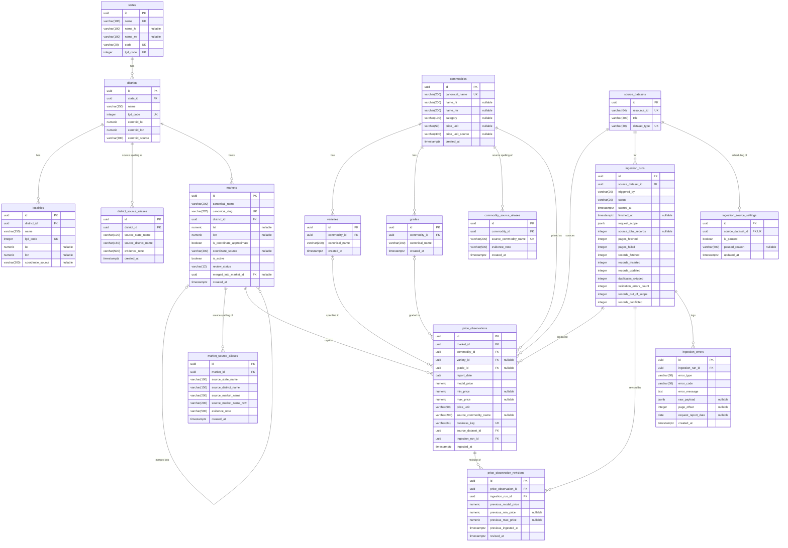
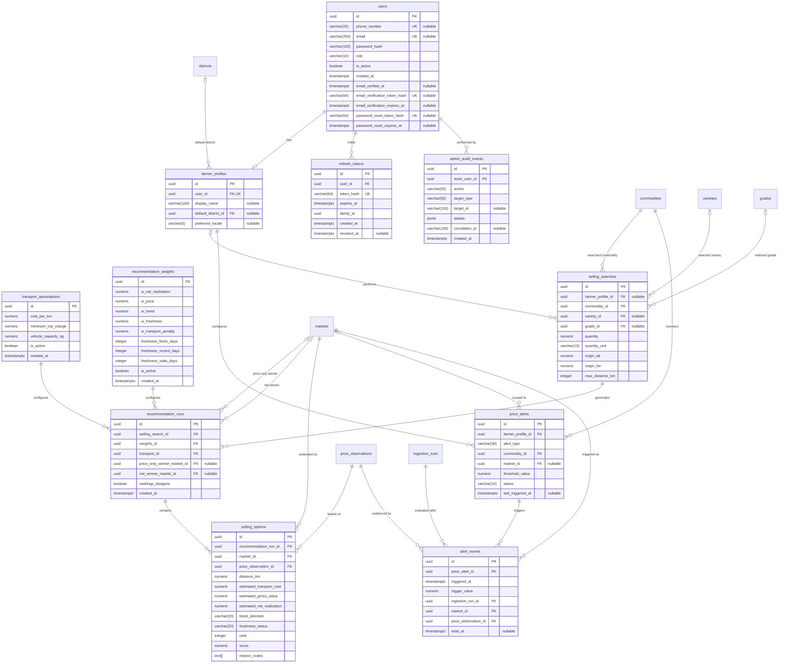
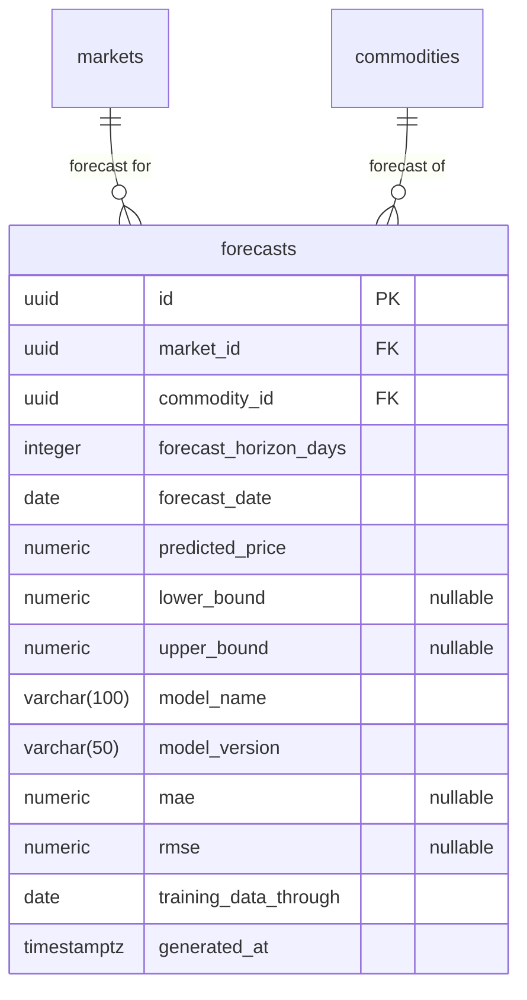
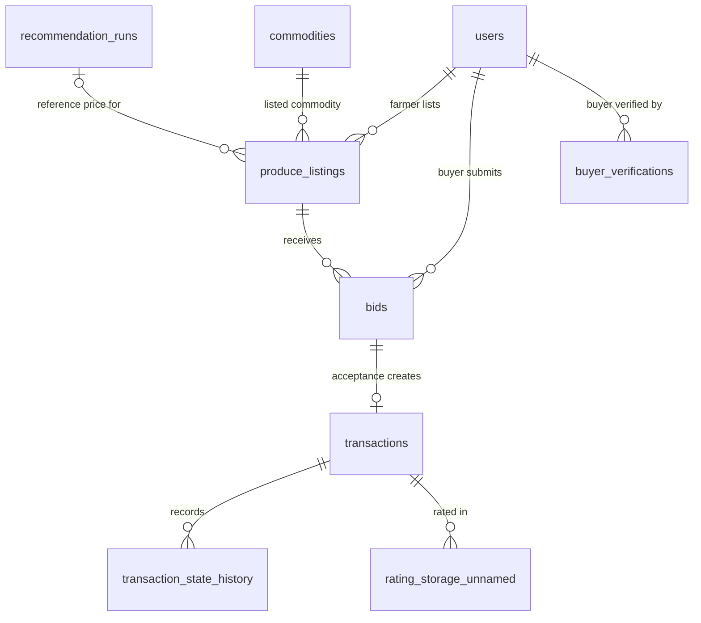

# AgriNex — Entity-Relationship Diagrams

**Status:** AUTHORITATIVE. Database architecture from Task 7 (2026-10-03), approved in the decision lock of the same day (ADR-0001, ADR-0013; [DECISION_LOG.md](../architecture/DECISION_LOG.md)). Where this document and a binding decision-log entry differ, the entry governs. Design rationale: [DATABASE_ARCHITECTURE.md](DATABASE_ARCHITECTURE.md). Nothing here is implemented; migrations follow the approved design (§42).

## Notation

- **Generated from one model.** These diagrams and [DATA_DICTIONARY.md](DATA_DICTIONARY.md) were generated in Task 7, and regenerated for the decision lock, from the same table model and checked by script, so they contain the same tables, columns, keys and nullability. The model is not part of the repository; a later change to either document must be made in both. The five `users` columns of ADR-0048 were added to both by hand on 2026-10-04, in the same change.
- **Names** are the exact table and column names. Lowercase table names replace the uppercase labels of the spec's §20 overview.
- **Types** are the dictionary's PostgreSQL types. The one difference is that NUMERIC precision and scale are omitted, because a Mermaid attribute type may contain letters, digits, hyphens, underscores, parentheses and square brackets but not commas (VERIFIED TECHNICAL FACT, Mermaid ER diagram syntax documentation via Context7, fetched 2026-10-03). `numeric` here means the `numeric(p,s)` given in the dictionary.
- **Keys:** `PK` primary key, `FK` column in a foreign key, `UK` single-column unique constraint. Columns in composite unique constraints carry no `UK`; section 8 lists those constraints.
- **Nullability:** the comment `"nullable"` marks every nullable column; all other columns are NOT NULL.
- **Relationship ends:** `||` exactly one, `|o` zero or one, `o{` zero or more, `o|` zero or one. A parent end of `|o` means the foreign key is nullable.

## 1. High-level ERD

All 28 tables (27 Phase 1 plus the optional `forecasts`) and all 45 foreign-key relationships, without attributes.

```mermaid
erDiagram
    states ||--o{ districts : "has"
    districts ||--o{ localities : "has"
    districts ||--o{ district_source_aliases : "source spelling of"
    commodities ||--o{ varieties : "has"
    commodities ||--o{ grades : "has"
    commodities ||--o{ commodity_source_aliases : "source spelling of"
    districts ||--o{ markets : "hosts"
    markets |o--o{ markets : "merged into"
    markets ||--o{ market_source_aliases : "source spelling of"
    markets ||--o{ price_observations : "reports"
    commodities ||--o{ price_observations : "priced as"
    varieties |o--o{ price_observations : "specified in"
    grades |o--o{ price_observations : "graded in"
    source_datasets ||--o{ price_observations : "sources"
    ingestion_runs ||--o{ price_observations : "produced"
    price_observations ||--o{ price_observation_revisions : "revision of"
    ingestion_runs ||--o{ price_observation_revisions : "revised by"
    source_datasets ||--o{ ingestion_runs : "for"
    ingestion_runs ||--o{ ingestion_errors : "logs"
    source_datasets ||--o| ingestion_source_settings : "scheduling of"
    users ||--o| farmer_profiles : "has"
    districts |o--o{ farmer_profiles : "default district"
    users ||--o{ refresh_tokens : "holds"
    farmer_profiles |o--o{ selling_searches : "performs"
    commodities ||--o{ selling_searches : "searched commodity"
    varieties |o--o{ selling_searches : "selected variety"
    grades |o--o{ selling_searches : "selected grade"
    selling_searches ||--o{ recommendation_runs : "generates"
    recommendation_weights ||--o{ recommendation_runs : "configures"
    transport_assumptions ||--o{ recommendation_runs : "configures"
    markets |o--o{ recommendation_runs : "price-only winner"
    markets |o--o{ recommendation_runs : "net winner"
    recommendation_runs ||--o{ selling_options : "contains"
    markets ||--o{ selling_options : "evaluated as"
    price_observations ||--o{ selling_options : "based on"
    farmer_profiles ||--o{ price_alerts : "configures"
    commodities ||--o{ price_alerts : "monitors"
    markets |o--o{ price_alerts : "scoped to"
    price_alerts ||--o{ alert_events : "triggers"
    ingestion_runs ||--o{ alert_events : "evaluated after"
    markets ||--o{ alert_events : "triggered at"
    price_observations ||--o{ alert_events : "evidenced by"
    users ||--o{ admin_audit_events : "performed by"
    markets ||--o{ forecasts : "forecast for"
    commodities ||--o{ forecasts : "forecast of"
```

## 2. Phase 1 ERD

### 2.1 Reference data, government observations and ingestion audit

Owners: geography (`states`, `districts`, `localities`, `district_source_aliases`), commodity (`commodities`, `varieties`, `grades`, `commodity_source_aliases`), price (`source_datasets`, `markets`, `market_source_aliases`, `price_observations`, `price_observation_revisions`), ingestion (`ingestion_runs`, `ingestion_errors`, `ingestion_source_settings`).

### 2.2 Identity, configuration, recommendation and alerts

Owners: auth (`users`, `farmer_profiles`, `refresh_tokens`), transport (`transport_assumptions`), recommendation (`recommendation_weights`, `selling_searches`, `recommendation_runs`, `selling_options`), alert (`price_alerts`, `alert_events`), admin (`admin_audit_events`). Tables drawn without attributes are defined in section 2.1.

### 2.3 Optional ML extension (not part of the Phase 1 migrations)

Exists only if ML proceeds (P9, HARD RULE 2, §35). Owner: price module (ADR-0013, ADR-0030).

## 3. Phase 2 / deferred extension view

**PHASE 2 / DEFERRED.** Entities only, without attributes, because their columns are not designed (HARD RULE 1). Their placement is decided in ADR-0031; the state model (RD-012) and the remaining parts of RD-025 are deferred by ADR-0032. The relationships are conceptual and come from the spec's flows: §23 (listing with `recommendationRunId` and `commodityId`, bids on a listing, a transaction created on acceptance, transaction state history, buyer verification check), §19 and §47 Q23. The spec names no table for ratings, so `rating_storage_unnamed` is a placeholder name. Every arrow points from a Phase 2 entity to its parent; no Phase 1 table references a Phase 2 table.

## 4. Relationships

| # | Parent (referenced) | Child (referencing) | FK column(s) | Cardinality (parent → child) | Label |
|---|---|---|---|---|---|
| 1 | `states` | `districts` | `state_id` | exactly one → zero or more (`\|\|--o{`) | has |
| 2 | `districts` | `localities` | `district_id` | exactly one → zero or more (`\|\|--o{`) | has |
| 3 | `districts` | `district_source_aliases` | `district_id` | exactly one → zero or more (`\|\|--o{`) | source spelling of |
| 4 | `commodities` | `varieties` | `commodity_id` | exactly one → zero or more (`\|\|--o{`) | has |
| 5 | `commodities` | `grades` | `commodity_id` | exactly one → zero or more (`\|\|--o{`) | has |
| 6 | `districts` | `markets` | `district_id` | exactly one → zero or more (`\|\|--o{`) | hosts |
| 7 | `markets` | `markets` | `merged_into_market_id` | zero or one → zero or more (`\|o--o{`) | merged into |
| 8 | `markets` | `market_source_aliases` | `market_id` | exactly one → zero or more (`\|\|--o{`) | source spelling of |
| 9 | `markets` | `price_observations` | `market_id` | exactly one → zero or more (`\|\|--o{`) | reports |
| 10 | `commodities` | `price_observations` | `commodity_id` | exactly one → zero or more (`\|\|--o{`) | priced as |
| 11 | `varieties` | `price_observations` | `variety_id`, `commodity_id` | zero or one → zero or more (`\|o--o{`) | specified in |
| 12 | `grades` | `price_observations` | `grade_id`, `commodity_id` | zero or one → zero or more (`\|o--o{`) | graded in |
| 13 | `source_datasets` | `price_observations` | `source_dataset_id` | exactly one → zero or more (`\|\|--o{`) | sources |
| 14 | `ingestion_runs` | `price_observations` | `ingestion_run_id` | exactly one → zero or more (`\|\|--o{`) | produced |
| 15 | `price_observations` | `price_observation_revisions` | `price_observation_id` | exactly one → zero or more (`\|\|--o{`) | revision of |
| 16 | `ingestion_runs` | `price_observation_revisions` | `ingestion_run_id` | exactly one → zero or more (`\|\|--o{`) | revised by |
| 17 | `source_datasets` | `ingestion_runs` | `source_dataset_id` | exactly one → zero or more (`\|\|--o{`) | for |
| 18 | `ingestion_runs` | `ingestion_errors` | `ingestion_run_id` | exactly one → zero or more (`\|\|--o{`) | logs |
| 19 | `source_datasets` | `ingestion_source_settings` | `source_dataset_id` | exactly one → zero or one (`\|\|--o\|`) | scheduling of |
| 20 | `users` | `farmer_profiles` | `user_id` | exactly one → zero or one (`\|\|--o\|`) | has |
| 21 | `districts` | `farmer_profiles` | `default_district_id` | zero or one → zero or more (`\|o--o{`) | default district |
| 22 | `users` | `refresh_tokens` | `user_id` | exactly one → zero or more (`\|\|--o{`) | holds |
| 23 | `farmer_profiles` | `selling_searches` | `farmer_profile_id` | zero or one → zero or more (`\|o--o{`) | performs |
| 24 | `commodities` | `selling_searches` | `commodity_id` | exactly one → zero or more (`\|\|--o{`) | searched commodity |
| 25 | `varieties` | `selling_searches` | `variety_id`, `commodity_id` | zero or one → zero or more (`\|o--o{`) | selected variety |
| 26 | `grades` | `selling_searches` | `grade_id`, `commodity_id` | zero or one → zero or more (`\|o--o{`) | selected grade |
| 27 | `selling_searches` | `recommendation_runs` | `selling_search_id` | exactly one → zero or more (`\|\|--o{`) | generates |
| 28 | `recommendation_weights` | `recommendation_runs` | `weights_id` | exactly one → zero or more (`\|\|--o{`) | configures |
| 29 | `transport_assumptions` | `recommendation_runs` | `transport_id` | exactly one → zero or more (`\|\|--o{`) | configures |
| 30 | `markets` | `recommendation_runs` | `price_only_winner_market_id` | zero or one → zero or more (`\|o--o{`) | price-only winner |
| 31 | `markets` | `recommendation_runs` | `net_winner_market_id` | zero or one → zero or more (`\|o--o{`) | net winner |
| 32 | `recommendation_runs` | `selling_options` | `recommendation_run_id` | exactly one → zero or more (`\|\|--o{`) | contains |
| 33 | `markets` | `selling_options` | `market_id` | exactly one → zero or more (`\|\|--o{`) | evaluated as |
| 34 | `price_observations` | `selling_options` | `price_observation_id` | exactly one → zero or more (`\|\|--o{`) | based on |
| 35 | `farmer_profiles` | `price_alerts` | `farmer_profile_id` | exactly one → zero or more (`\|\|--o{`) | configures |
| 36 | `commodities` | `price_alerts` | `commodity_id` | exactly one → zero or more (`\|\|--o{`) | monitors |
| 37 | `markets` | `price_alerts` | `market_id` | zero or one → zero or more (`\|o--o{`) | scoped to |
| 38 | `price_alerts` | `alert_events` | `price_alert_id` | exactly one → zero or more (`\|\|--o{`) | triggers |
| 39 | `ingestion_runs` | `alert_events` | `ingestion_run_id` | exactly one → zero or more (`\|\|--o{`) | evaluated after |
| 40 | `markets` | `alert_events` | `market_id` | exactly one → zero or more (`\|\|--o{`) | triggered at |
| 41 | `price_observations` | `alert_events` | `price_observation_id` | exactly one → zero or more (`\|\|--o{`) | evidenced by |
| 42 | `users` | `admin_audit_events` | `actor_user_id` | exactly one → zero or more (`\|\|--o{`) | performed by |
| 43 | `markets` | `forecasts` | `market_id` | exactly one → zero or more (`\|\|--o{`) | forecast for |
| 44 | `commodities` | `forecasts` | `commodity_id` | exactly one → zero or more (`\|\|--o{`) | forecast of |
| 45 | `commodities` | `commodity_source_aliases` | `commodity_id` | exactly one → zero or more (`\|\|--o{`) | source spelling of (ADR-0051) |

## 5. Cardinalities

- **One to many** is the default: one parent row, zero or more child rows (`||--o{`).
- **Optional parent** (`|o--o{`) where the foreign key is nullable:
  - `price_observations.variety_id` and `grade_id` (the source may omit them; never observed);
  - `selling_searches.farmer_profile_id` (anonymous comparison, F1.1), `variety_id` and `grade_id` (not selected);
  - `recommendation_runs` winners (no eligible option, ADR-0023);
  - `markets.merged_into_market_id` (self-reference, set only for MERGED markets, ADR-0014);
  - `price_alerts.market_id` (optional market, §25);
  - `farmer_profiles.default_district_id`.
- **One to one:** `users` ||--o| `farmer_profiles` (§20 USERS ||--o| FARMER_PROFILES; enforced by the unique `user_id`), and `source_datasets` ||--o| `ingestion_source_settings` (one pause setting per dataset, ADR-0020).
- **Composite foreign keys:** `price_observations` and `selling_searches` reference `varieties` and `grades` through (`variety_id`, `commodity_id`) and (`grade_id`, `commodity_id`). The diagrams draw them as one relationship per referenced table.
- **Two relationships to the same parent:** `recommendation_runs` references `markets` twice (price-only winner, net winner). `markets` references itself once (merge target).

## 6. Primary keys

Every table uses a `uuid` surrogate key named `id`, as §20 specifies for every entity it lists. The evidence file's suggestion of `bigint` keys is a non-binding implementation note and does not override the spec ([DATABASE_ARCHITECTURE.md §5](DATABASE_ARCHITECTURE.md#5-postgresql-role)). Values come from PostgreSQL's core `gen_random_uuid()` by default (VERIFIED TECHNICAL FACT, PostgreSQL 16 §9.14), and the application may also supply them.

| Table | Primary key | Type | Phase |
|---|---|---|---|
| `states` | `id` | uuid | Phase 1 |
| `districts` | `id` | uuid | Phase 1 |
| `localities` | `id` | uuid | Phase 1 |
| `district_source_aliases` | `id` | uuid | Phase 1 |
| `commodity_source_aliases` | `id` | uuid | Phase 1 |
| `commodities` | `id` | uuid | Phase 1 |
| `varieties` | `id` | uuid | Phase 1 |
| `grades` | `id` | uuid | Phase 1 |
| `source_datasets` | `id` | uuid | Phase 1 |
| `markets` | `id` | uuid | Phase 1 |
| `market_source_aliases` | `id` | uuid | Phase 1 |
| `price_observations` | `id` | uuid | Phase 1 |
| `price_observation_revisions` | `id` | uuid | Phase 1 |
| `ingestion_runs` | `id` | uuid | Phase 1 |
| `ingestion_errors` | `id` | uuid | Phase 1 |
| `ingestion_source_settings` | `id` | uuid | Phase 1 |
| `users` | `id` | uuid | Phase 1 |
| `farmer_profiles` | `id` | uuid | Phase 1 |
| `refresh_tokens` | `id` | uuid | Phase 1 |
| `transport_assumptions` | `id` | uuid | Phase 1 |
| `recommendation_weights` | `id` | uuid | Phase 1 |
| `selling_searches` | `id` | uuid | Phase 1 |
| `recommendation_runs` | `id` | uuid | Phase 1 |
| `selling_options` | `id` | uuid | Phase 1 |
| `price_alerts` | `id` | uuid | Phase 1 |
| `alert_events` | `id` | uuid | Phase 1 |
| `admin_audit_events` | `id` | uuid | Phase 1 |
| `forecasts` | `id` | uuid | Optional (ML) |

## 7. Foreign keys

| Constraint | Table (columns) | References | ON DELETE | Nullable |
|---|---|---|---|---|
| `fk_districts_state` | `districts` (`state_id`) | `states` (`id`) | RESTRICT | no |
| `fk_localities_district` | `localities` (`district_id`) | `districts` (`id`) | RESTRICT | no |
| `fk_district_source_aliases_district` | `district_source_aliases` (`district_id`) | `districts` (`id`) | RESTRICT | no |
| `fk_commodity_source_aliases_commodity` | `commodity_source_aliases` (`commodity_id`) | `commodities` (`id`) | RESTRICT | no |
| `fk_varieties_commodity` | `varieties` (`commodity_id`) | `commodities` (`id`) | RESTRICT | no |
| `fk_grades_commodity` | `grades` (`commodity_id`) | `commodities` (`id`) | RESTRICT | no |
| `fk_markets_district` | `markets` (`district_id`) | `districts` (`id`) | RESTRICT | no |
| `fk_markets_merged_into` | `markets` (`merged_into_market_id`) | `markets` (`id`) | RESTRICT | yes |
| `fk_market_source_aliases_market` | `market_source_aliases` (`market_id`) | `markets` (`id`) | RESTRICT | no |
| `fk_price_observations_market` | `price_observations` (`market_id`) | `markets` (`id`) | RESTRICT | no |
| `fk_price_observations_commodity` | `price_observations` (`commodity_id`) | `commodities` (`id`) | RESTRICT | no |
| `fk_price_observations_variety` | `price_observations` (`variety_id`, `commodity_id`) | `varieties` (`id`, `commodity_id`) | RESTRICT | yes |
| `fk_price_observations_grade` | `price_observations` (`grade_id`, `commodity_id`) | `grades` (`id`, `commodity_id`) | RESTRICT | yes |
| `fk_price_observations_source_dataset` | `price_observations` (`source_dataset_id`) | `source_datasets` (`id`) | RESTRICT | no |
| `fk_price_observations_ingestion_run` | `price_observations` (`ingestion_run_id`) | `ingestion_runs` (`id`) | RESTRICT | no |
| `fk_price_observation_revisions_observation` | `price_observation_revisions` (`price_observation_id`) | `price_observations` (`id`) | RESTRICT | no |
| `fk_price_observation_revisions_run` | `price_observation_revisions` (`ingestion_run_id`) | `ingestion_runs` (`id`) | RESTRICT | no |
| `fk_ingestion_runs_source_dataset` | `ingestion_runs` (`source_dataset_id`) | `source_datasets` (`id`) | RESTRICT | no |
| `fk_ingestion_errors_run` | `ingestion_errors` (`ingestion_run_id`) | `ingestion_runs` (`id`) | CASCADE | no |
| `fk_ingestion_source_settings_dataset` | `ingestion_source_settings` (`source_dataset_id`) | `source_datasets` (`id`) | RESTRICT | no |
| `fk_farmer_profiles_user` | `farmer_profiles` (`user_id`) | `users` (`id`) | CASCADE | no |
| `fk_farmer_profiles_default_district` | `farmer_profiles` (`default_district_id`) | `districts` (`id`) | RESTRICT | yes |
| `fk_refresh_tokens_user` | `refresh_tokens` (`user_id`) | `users` (`id`) | CASCADE | no |
| `fk_selling_searches_farmer_profile` | `selling_searches` (`farmer_profile_id`) | `farmer_profiles` (`id`) | SET NULL | yes |
| `fk_selling_searches_commodity` | `selling_searches` (`commodity_id`) | `commodities` (`id`) | RESTRICT | no |
| `fk_selling_searches_variety` | `selling_searches` (`variety_id`, `commodity_id`) | `varieties` (`id`, `commodity_id`) | RESTRICT | yes |
| `fk_selling_searches_grade` | `selling_searches` (`grade_id`, `commodity_id`) | `grades` (`id`, `commodity_id`) | RESTRICT | yes |
| `fk_recommendation_runs_search` | `recommendation_runs` (`selling_search_id`) | `selling_searches` (`id`) | CASCADE | no |
| `fk_recommendation_runs_weights` | `recommendation_runs` (`weights_id`) | `recommendation_weights` (`id`) | RESTRICT | no |
| `fk_recommendation_runs_transport` | `recommendation_runs` (`transport_id`) | `transport_assumptions` (`id`) | RESTRICT | no |
| `fk_recommendation_runs_price_winner` | `recommendation_runs` (`price_only_winner_market_id`) | `markets` (`id`) | RESTRICT | yes |
| `fk_recommendation_runs_net_winner` | `recommendation_runs` (`net_winner_market_id`) | `markets` (`id`) | RESTRICT | yes |
| `fk_selling_options_run` | `selling_options` (`recommendation_run_id`) | `recommendation_runs` (`id`) | CASCADE | no |
| `fk_selling_options_market` | `selling_options` (`market_id`) | `markets` (`id`) | RESTRICT | no |
| `fk_selling_options_observation` | `selling_options` (`price_observation_id`) | `price_observations` (`id`) | RESTRICT | no |
| `fk_price_alerts_farmer_profile` | `price_alerts` (`farmer_profile_id`) | `farmer_profiles` (`id`) | CASCADE | no |
| `fk_price_alerts_commodity` | `price_alerts` (`commodity_id`) | `commodities` (`id`) | RESTRICT | no |
| `fk_price_alerts_market` | `price_alerts` (`market_id`) | `markets` (`id`) | RESTRICT | yes |
| `fk_alert_events_alert` | `alert_events` (`price_alert_id`) | `price_alerts` (`id`) | CASCADE | no |
| `fk_alert_events_run` | `alert_events` (`ingestion_run_id`) | `ingestion_runs` (`id`) | RESTRICT | no |
| `fk_alert_events_market` | `alert_events` (`market_id`) | `markets` (`id`) | RESTRICT | no |
| `fk_alert_events_observation` | `alert_events` (`price_observation_id`) | `price_observations` (`id`) | RESTRICT | no |
| `fk_admin_audit_events_actor` | `admin_audit_events` (`actor_user_id`) | `users` (`id`) | RESTRICT | no |
| `fk_forecasts_market` | `forecasts` (`market_id`) | `markets` (`id`) | RESTRICT | no |
| `fk_forecasts_commodity` | `forecasts` (`commodity_id`) | `commodities` (`id`) | RESTRICT | no |

## 8. Important uniqueness rules

| Constraint / index | Table | Columns | Rule | Basis |
|---|---|---|---|---|
| `uq_states_code` | `states` | `code` | UNIQUE | REQUIREMENT FROM SSOT: §20 UK |
| `uq_states_name` | `states` | `name` | UNIQUE | ARCHITECTURAL DECISION: prevents duplicate state rows |
| `uq_states_lgd_code` | `states` | `lgd_code` | UNIQUE | ARCHITECTURAL DECISION: ADR-0014 (one row per LGD state) |
| `uq_districts_state_name` | `districts` | `state_id`, `name` | UNIQUE | ARCHITECTURAL DECISION: natural key; also serves districts-by-state lookups |
| `uq_districts_lgd_code` | `districts` | `lgd_code` | UNIQUE | ARCHITECTURAL DECISION: ADR-0014 (one row per LGD district) |
| `uq_localities_district_name` | `localities` | `district_id`, `name` | UNIQUE | ARCHITECTURAL DECISION: natural key; serves localities-by-district lookups |
| `uq_localities_lgd_code` | `localities` | `lgd_code` | UNIQUE | ARCHITECTURAL DECISION: ADR-0014 (one row per LGD sub-district) |
| `uq_district_source_aliases_source` | `district_source_aliases` | `source_state_name`, `source_district_name` | UNIQUE | ARCHITECTURAL DECISION: one mapping per source spelling (ADR-0014) |
| `uq_commodity_source_aliases_source` | `commodity_source_aliases` | `source_commodity_name` | UNIQUE | ARCHITECTURAL DECISION: one master commodity per source spelling (ADR-0051) |
| `uq_commodities_canonical_name` | `commodities` | `canonical_name` | UNIQUE | REQUIREMENT FROM SSOT: §20 UK; exact-match resolution |
| `uq_varieties_commodity_name` | `varieties` | `commodity_id`, `canonical_name` | UNIQUE | ARCHITECTURAL DECISION: natural key; exact-match resolution |
| `uq_varieties_id_commodity` | `varieties` | `id`, `commodity_id` | UNIQUE | ARCHITECTURAL DECISION: target of composite FKs that force a variety to belong to the referencing row's commodity |
| `uq_grades_commodity_name` | `grades` | `commodity_id`, `canonical_name` | UNIQUE | ARCHITECTURAL DECISION: natural key; exact-match resolution |
| `uq_grades_id_commodity` | `grades` | `id`, `commodity_id` | UNIQUE | ARCHITECTURAL DECISION: target of composite FKs (grade belongs to the row's commodity) |
| `uq_source_datasets_resource_id` | `source_datasets` | `resource_id` | UNIQUE | REQUIREMENT FROM SSOT: §20 UK |
| `uq_source_datasets_dataset_type` | `source_datasets` | `dataset_type` | UNIQUE | ARCHITECTURAL DECISION: one resource per dataset role (ADR-0006) |
| `uq_markets_canonical_slug` | `markets` | `canonical_slug` | UNIQUE | REQUIREMENT FROM SSOT: §20 UK |
| `uq_market_source_aliases_source` | `market_source_aliases` | `source_state_name`, `source_district_name`, `source_market_name` | UNIQUE | ARCHITECTURAL DECISION: one mapping per source spelling within its source state and district |
| `uq_price_observations_business_key` | `price_observations` | `business_key` | UNIQUE | REQUIREMENT FROM SSOT: §27, §31 RULE 6, FR-04 |
| `uq_price_observations_identity` | `price_observations` | `market_id`, `commodity_id`, `report_date`, `variety_id`, `grade_id`, `source_dataset_id` | UNIQUE NULLS NOT DISTINCT | ARCHITECTURAL DECISION: null-safe identity enforced from the resolved IDs; independent of hashing correctness; leading columns serve latest-price and trend queries |
| `uq_price_observation_revisions_observation_run` | `price_observation_revisions` | `price_observation_id`, `ingestion_run_id` | UNIQUE | ARCHITECTURAL DECISION: at most one revision per observation per run (ADR-0009) |
| `uq_ingestion_runs_one_running` | `ingestion_runs` | `source_dataset_id` | partial unique index WHERE status = 'RUNNING' | ARCHITECTURAL DECISION: at most one RUNNING run per dataset (ADR-0011) |
| `uq_ingestion_source_settings_dataset` | `ingestion_source_settings` | `source_dataset_id` | UNIQUE | ARCHITECTURAL DECISION: one setting row per dataset |
| `uq_users_phone_number` | `users` | `phone_number` | UNIQUE | REQUIREMENT FROM SSOT: §20 UK (NULLs remain distinct by default) |
| `uq_users_email` | `users` | `email` | UNIQUE | REQUIREMENT FROM SSOT: §20 UK (NULLs remain distinct by default) |
| `uq_users_email_verification_token_hash` | `users` | `email_verification_token_hash` | UNIQUE | ARCHITECTURAL DECISION: lookup of the presented verification token (ADR-0048) |
| `uq_users_password_reset_token_hash` | `users` | `password_reset_token_hash` | UNIQUE | ARCHITECTURAL DECISION: lookup of the presented reset token (ADR-0048) |
| `uq_farmer_profiles_user` | `farmer_profiles` | `user_id` | UNIQUE | REQUIREMENT FROM SSOT: §20 FK UK |
| `uq_refresh_tokens_token_hash` | `refresh_tokens` | `token_hash` | UNIQUE | ARCHITECTURAL DECISION: lookup of the presented token |
| `uq_transport_assumptions_single_active` | `transport_assumptions` | (is_active) | partial unique index WHERE is_active | ARCHITECTURAL DECISION: at most one active row, so "load active" (§16) is deterministic |
| `uq_recommendation_weights_single_active` | `recommendation_weights` | (is_active) | partial unique index WHERE is_active | ARCHITECTURAL DECISION: at most one active row (§16 deterministic engine) |
| `uq_selling_options_run_market` | `selling_options` | `recommendation_run_id`, `market_id` | UNIQUE | ARCHITECTURAL DECISION: one option per candidate market (§16 "one per candidate") |
| `uq_selling_options_run_rank` | `selling_options` | `recommendation_run_id`, `rank` | UNIQUE | ARCHITECTURAL DECISION: §16 "Assign rank 1..N" |
| `uq_alert_events_alert_run` | `alert_events` | `price_alert_id`, `ingestion_run_id` | UNIQUE | ARCHITECTURAL DECISION: at most one event per alert per run; idempotent re-evaluation (ADR-0019) |
| `uq_forecasts_point` | `forecasts` | `market_id`, `commodity_id`, `forecast_horizon_days`, `generated_at`, `forecast_date` | UNIQUE | ARCHITECTURAL DECISION: one point per forecast date per generation; serves "latest forecast" lookups |

The rules that carry most weight:

- **Observation identity** is protected twice: `uq_price_observations_business_key` (§27, §31 RULE 6) and `uq_price_observations_identity` (UNIQUE NULLS NOT DISTINCT over the six resolved identity columns). Both encode source dataset + market + commodity + variety + grade + report date ([DATABASE_ARCHITECTURE.md §10.2](DATABASE_ARCHITECTURE.md#102-null-safe-uniqueness-architectural-decision)).
- **Source spellings** map to exactly one market per (source state, source district, source market) triple: `uq_market_source_aliases_source`.
- **Commodity identity** is the exact normalized source value: `uq_commodities_canonical_name` keeps `Onion` and `Onion Green` apart.
- **Configuration** has at most one active version per table: `uq_transport_assumptions_single_active`, `uq_recommendation_weights_single_active`.
- **Decision records** have one option per market and per rank in each run: `uq_selling_options_run_market`, `uq_selling_options_run_rank`.
- **Runs and their effects** are unique per run: at most one RUNNING run per dataset (`uq_ingestion_runs_one_running`), one revision per observation per run (`uq_price_observation_revisions_observation_run`), and one alert event per alert per run (`uq_alert_events_alert_run`).
- **Reference codes** are unique: `uq_states_lgd_code`, `uq_districts_lgd_code`, `uq_localities_lgd_code`; district and commodity spellings map once (`uq_district_source_aliases_source`, `uq_commodity_source_aliases_source`).

## 9. Boundary and ownership notes

- **Ownership.** Every table has exactly one owning module ([TABLE_OWNERSHIP.md](TABLE_OWNERSHIP.md)). Mermaid ER diagrams cannot group entities, so section 2 groups the diagrams by owner instead.
- **Cross-module foreign keys** (for example `selling_options` → `price_observations`, `price_observations` → `ingestion_runs`) are integrity constraints that PostgreSQL enforces. They do not give module code access to another module's tables (§27; [DATABASE_ARCHITECTURE.md §8](DATABASE_ARCHITECTURE.md#8-entity-relationships)).
- **Phase boundary.** Phase 1 relationships never point at Phase 2 entities. The Phase 2 view only adds arrows from Phase 2 entities to Phase 1 parents.
- **Optional ML boundary.** `forecasts` references `markets` and `commodities` only. No Phase 1 table references `forecasts`.
- **Not modeled:** Redis contents (ephemeral rate-limit counters and reference-data cache, ADR-0018), Phase 2 verification documents (Phase 2, ADR-0031), and anything the spec lists as out of scope (§39).
